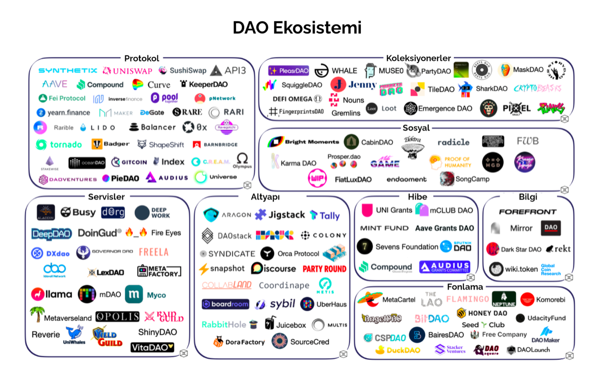

Bu kısımda Web3’ün en önemli parçalarından biri olan topluluktan bahsedeceğiz.

Geçmişin klasik startup dünyasından kripto dünyasına geçerken yaşanan değişikliklerden biri, eski dünyanın iki ana oyuncusu olan girişimci ve yatırımcıların yanına yeni aktörlerin katılması oldu. Bundan sonraki kısımlarda tek tek bahsedeceğimiz bu aktörler, bir araya geldiklerinde girişimi büyüten ve sürdüren topluluklar haline geliyorlar. Topluluklar bir yandan Web3 dünyasının en büyük gücü, öte yandan yönetmesi en zor parçalarından bir tanesi.

## Topluluk neden önemli? {#topluluk-neden-onemli}

Web3 dünyasında topluluğun öne çıkmasının en önemli nedeni, girişimlerin artık kapalı kapılar ardında ufak bir ekip ile yatırımcılar arasında kurulan şirket yapısından çıkıp daha geniş bir kesim tarafından büyütülen ve sürdürülen ekosistemler haline gelmesi.

Web 2.0 dünyasında katma değeri yaratan girişim, genelde bir şirket yapısı altında hayat buluyor. Girişimi kuran ekip ve ekibi destekleyen erken dönem yatırımcılar (genelde girişim sermayesi - İngilizcesi ‘Venture Capital’) bu yapının iki ana hissedarı oluyor. Ortaya çıkan bu yapının oluşturduğu katma değer, genel olarak halka arz ya da girişimin başka bir şirkete satılması yoluyla ortaya çıkıyor ve bu iki paydaş tarafından bölüşülüyor.

Yeni dünyada ise girişimin yarattığı bu faydanın artık daha geniş bir kesim tarafından paylaşıldığını görüyoruz. Girişim çevresinde oluşan ekosistemin içinde bu iki paydaşın yanında kullanıcıların, geliştiricilerin ve altyapı projelerinde madencilerin/onaylayıcıların da olduğunu görüyoruz.

İngilizce Decentralized Autonomous Organization kısaca DAO olarak adlandırılan yapı içinde organize olan bu topluluklar, bir yandan girişimin büyümesini sağlıyor, diğer yandan ise bu çabalarının karşılığını girişimin çıkardığı tokenler aracılığıyla alıyor. Kısacası, bildiğimiz klasik anlamdaki şirket yapısı yerini merkeziyetsiz otonom yapılara bırakmış durumda.

## DAO’lar {#daolar}

### Nedir DAO’lar? {#nedir-daolar}

DAO’ları tek bir cümle ile “Ortak bir amacı gerçekleştirmek için bir araya gelen toplulukların blokzincir üzerinde kurduğu ve yönettiği [organizasyonlar](https://ethereum.org/en/dao/)” olarak tanımlayabiliriz.

DAO’ları, dünyanın dört bir tarafına dağılmış insanların beraberce çalışabilmelerini sağlayan yapılar olarak da düşünebiliriz. Bu insanların birlikte nasıl çalışacakları ve bu eforları karşılığı nasıl ödüllendirilecekleri, akıllı kontratlar tarafından düzenlenerek blokzincir üzerine işleniyor.

### Girişime ne zaman katkı vermeye başlıyorlar? {#girisime-ne-zaman-katki-vermeye-basliyorlar}

Girişimler ilk hayata geçtiklerinde ana ekip tarafından geliştirilip büyütülüyor ancak bir noktadan sonra topluluğun yönetimi DAO’lara devrediliyor. Neden? Bunun birkaç temel nedeni var.

Birincisi, proje ilk hayata geçtiğinde hızlı ve atik davranmak gerekiyor. Küçük bir ekip, gelişen olaylara karşı daha hızlı aksiyon alabiliyor.

Zaman içinde proje gelişip serpilmeye başladıkça ona katkı verenler de artıyor. Dışarıdan geliştiriciler projeye destek olmaya başlıyor. Kullanıcılar devreye giriyor ve ürünü kullanmaya başlıyor. Tabii bu sırada proje ekibinin ‘eve ekmek götürebilmesi’ ya da ekibin yetişemediği durumlarda dışarıdan destek alınabilmesi için bir finansman ihtiyacı doğuyor. O zaman da yatırımcılar devreye giriyor.

### Topluluklar bu katkıya karşılık ne elde ediyorlar? {#topluluklar-bu-katkiya-karsilik-ne-elde-ediyorlar}

Başlangıç aşamasında projeye destek veren bütün bu aktörler zaman ve çaba gerektiren bu işleri ‘babalarının hayrına’ değil ileride bir getiri elde etmek için yapıyor. İşte ‘token yaratılması’, projeye o noktaya kadar destek vermiş olanları ödüllendirmenin en temel yolu oluyor.

### İyi de verilen token ne işe yarayacak? {#iyi-de-verilen-token-ne-ise-yarayacak}

Tokenler, sahibine projenin stratejik olarak hangi yöne gideceği konusunda söz hakkı veriyor. Yapılacak oylamalarda token sahipleri ellerindeki token kadar oy kullanıyor. (Tokenlerin diğer faydalarına ‘tokenizasyon’ bölümünde değineceğiz).

Elbette token sahiplerinin projenin yarattığı katma değerden de pay alması düşünülebilir. Projenin gelirini token sahiplerine dağıtmak, tokeni ABD’deki tanımıyla hisse senedi kategorisine sokacağı için şu aşamada ekipler tarafından tercih edilmiyor[^1].

Bunun dışında, token sahiplerine projenin sunduğu ürünleri daha uygun imkanlar ile kullanma ya da projenin diğer projelerle yaptığı işbirliklerinde öncelik verilmesi gibi ayrıcalıklar da sağlanabiliyor.

### Topluluklar merkeziyetsizliğe gitmenin belki de tek yolu {#topluluklar-merkeziyetsizlige-gitmenin-belki-de-tek-yolu}

Bir başka önemli konu ise, bir projenin Web3’ün en önemli özelliklerinden biri olan merkeziyetsizliğe doğru yol almasında en önemli mihenk taşlarından birinin DAO’lar olması.

Yönetimi ufak bir grubun elinde olan bir projeye ‘merkeziyetsiz’ demek mümkün değil. Bunu, sadece biz de söylemiyoruz. Denetleyici kurumlar için de önemli bir konu bu.

ABD’nin menkul kıymetler konusundaki otoritesi olan SEC herhangi bir tokenin menkul kıymet sayılmaması için yeterince dağıtık olması gerektiğini söyler.

“Bunun koşulu olarak o tokeni satın alanlar, herhangi bir üçüncü kişi ya da gruptan temel yönetim ya da girişimci eforu beklememelidir. Üçüncü bir partinin çabasının girişimin başarısı için temel faktör olmadığı durumda, bilgi asimetrisi ortadan kalkar ve topluma verilecek açıklamalar önemini kaybeder.[^2]”

İşte DAO’lar, bu anlamda girişimin kurucu ekibin güdümünden çıkmasının ve merkeziyetsizliğe doğru yol almasının bir göstergesi haline geliyor.

### Bir Web3 girişimi nasıl merkeziyetsiz hale geliyor? {#bir-web3-girisimi-nasil-merkeziyetsiz-hale-geliyor}

Web3’de pek çok girişim anonim. Buna rağmen, belirli bir büyüklüğe gelen projeler özellikle dış finansman aramaya başladıklarında şirket yapısı altına giriyorlar (bu, genelde isminde ‘Labs’ ibaresi geçen bir şirket oluyor). Proje büyüyüp sıra token çıkarmaya gelince işler değişiyor. Token çıkarımı off-shore bir ülkede (genelde Cayman adaları ya da Panama) bir vakıf (İngilizcesi foundation) üzerinden yapılıyor. Şirketin kendisinin ya da kurucularının bu vakıfta görev almaması gerekiyor. Vakıf bağımsız direktörler tarafından, vakfın kuruluş amacına uygun olarak yönetiliyor ve basılan tokenleri dağıtıyor[^3].

## Kaç çeşit DAO var? {#kac-cesit-dao-var}

DAO’ların kaç çeşit olduğunu söylemek oldukça güç. 2021 yılında yayınlanmış olan aşağıdaki tablo, her ne kadar üzerinden bir hayli zaman geçmiş olsa da, DAO’ların ekosistemi konusunda bize bir miktar ışık tutuyor:

<figure></figure>

*DAO ekosistemini oluşturan oyuncular. (Kaynak: ‘TheBlock, Mapping out the DAO Ecosystem’ raporu)*

Grafiğin üst kısmında gördüğünüz her kutucuk, belirli bir amaç etrafında bir araya gelmiş farklı DAO çeşitlerini gösteriyor. Gelin birer cümle ile ne olduklarını açıklayalım:

**Protokol DAO’ları:** Önceki sayfada bahsettiğimiz tipik DAO örneği bu grubun üyeleri. Bir ekip tarafından çıkarılan herhangi bir hizmet ya da ürünün belirli bir aşamadan sonra topluluğa devredildiği DAO’lar bunlar. Uniswap, Compound, Aave, MakerDAO gibi özellikle Web3’ün en gelişmiş alanı olan merkeziyetsiz finansın büyük oyuncuları bu kategoriye giriyor.

**Koleksiyon DAO’ları:** Başta sanat olmak üzere farklı alanlarda ortaya çıkmış eserleri toplayan toplulukların oluşturduğu DAO’lar. 2021-22 yıllarında NFT’nin en ‘hype’ olduğu zamanlarda oldukça popüler olan bu grup sonrasında gelen ayı piyasası ile birlikte eski albenisinden oldukça uzaklaştı.

**Sosyal DAO’lar:** Genelde topluluk bir araya geldiğinde temel misyon ‘para kazanmak’ oluyor. Sosyal DAO’lar ise bundan daha farklı olarak, ‘kulüp üyeliği’ şeklinde çalışan, üyelerine farklı ayrıcalıklar sağlayan, online ya da farklı şehirlerde değişik fiziki organizasyonlar yapan topluluklara verilen genel ad. Bu grubun içinde sosyal yardım amaçlı bir araya gelen topluluklar da mevcut.

**Servis DAO’ları:** Bu topluluklar, temel olarak diğer DAO ya da projelere insan gücü ve servis hizmeti vermek amacıyla kuruluyor. Bu hizmetler, freelance web dizaynından dijital güvenliğe, DAO’lar için ekonomik ve yönetim yapısı kurgulamaktan hukuki danışmanlık vermeye kadar geniş bir yelpaze içerebiliyor.

**Altyapı DAO’ları:** Bu alandaki girişimler daha çok diğer DAO’lara altyapı hizmeti veriyor. Bir DAO’nun operasyonel ve yönetimsel faaliyetlerini sürdürmesi için pek çok araca ihtiyacı var. Bu araçların hemen hemen hepsi için ‘outsourcing’ hizmeti almak mümkün. DAO’nun yönetim oylamalarını nasıl yapacaksınız? Yapılan toplantıların tutanaklarını nasıl ve nerede tutacaksınız? İletişim için hangi araçları kullanacaksınız? İhtiyaç duyduğunuz her alanda size yardımcı olacak araçların tümüne bu kategoriden ulaşmak mümkün.

**Hibe DAO’ları:** İlk kategoride bahsettiğimiz platform DAO’larının kurucu ekipleri, topluluğa dağıtılan tokenlerin yanında bir miktarı da ayrı bir DAO’da tutuyorlar. Burada amaç bu tokenleri kendi ekosistemlerinin gelişimine katkı sağlayacak dış girişimlere emeklerinin karşılığı olarak dağıtmak. Hibeler girişimlere, sırf bu amaçla kurulan özel DAO’lar aracılığıyla baştan belirlenmiş kriterler doğrultusunda belirli bir dönem için veriliyor. Bu DAO’lar her ne kadar iyi niyetle kuruluyor olsa da, verilen hibelerin amacına uygun kullanılıp kullanılmadığı konusunda ciddi tartışmaların yaşandığını söylemeliyiz.

**Bilgi (enformasyon) DAO’ları:** Bu grup altında toplanan DAO’lar, diğer DAO’lara dışarıdan ihtiyaç duydukları bilgileri alma ya da dışarıya bilgi aktarmaları konusunda onlara yardımcı olan araçları sağlıyor. DAO’nun sunduğu ürün ve hizmetleri gösteren wiki web siteleri, topluluk ve dış dünya ile iletişim için kullandıkları bloglar bu kategorinin örneklerinden sayılabilir.

**Fonlama DAO’ları:** Web3 alanındaki girişimlerin ilk finansman ihtiyacı, genelde girişim sermayesi aracılığıyla karşılanıyor. Bu alanda kurulan DAO’lar girişim sermayelerine rakip olarak ortaya çıktılar. Fonlama DAO’larının üyeleri dış dünya ile kurmuş oldukları güçlü bağlantıları sayesinde buldukları potansiyelli girişimleri topluluk ile paylaşıyorlar. DAO’nun diğer üyeleri de ilginç buldukları girişimlere birlikte ortak yatırım yapıyor. DAOMaker bu alanda ilk ortaya çıkmış DAO’lardan biri olarak bir dönem oldukça başarı sağlamıştı.

## Bir ağın topluluğu nasıl anlaşılır? {#bir-agin-toplulugu-nasil-anlasilir}

“İyi de bir topluluğun iyi ya da kötü, az ya da çok olduğunu nasıl anlarız? Zor değil mi bu?” Haklısınız, ancak bize bu konuda yardımcı olabilecek birkaç ipucu var.

Herhangi bir topluluğu incelemek için ilk bakmanız gereken yer ürün ya da hizmetin websitesi. Burası hem projeyi anlamak hem de topluluğa ulaşmak için gerekli kanalları sunan bir giriş kapısı.

Öncelikle hemen hemen her kripto girişimin bir Discord kanalı bulunmakta. Bu kanal, topluluğun buluşma alanı sayılıyor. Discord, daha önce kullanmamış olanlar için oldukça karışık ve ‘anarşik’ gelebilecek bir sosyal iletişim platformu. Kurumsal hayatta olanların genelde kullandıkları Slack uygulamasının topluluklar için kullanılan bir benzeri. Discord üzerinden girişimin profesyonel destek ekibiyle iletişim kurabileceğiniz gibi, ekibin topluluk üyeleri ile ilişkisini inceleyebilir ve genel olarak topluluğun eğilimleri ya da öne çıkan trendler konusunda fikir sahibi olabilirsiniz.

Benzer şekilde girişimin kendi sitesindeki forumlar ya da girişim hakkındaki reddit alt forumları (subreddit’ler) de topluluğu anlamak açısından faydalı olabilir. Girişimin Discord ya da Reddit üye sayılarını rakipleri ile karşılaştırmayı büyüklüklerini anlamak için bir yöntem olarak kullanabilirsiniz (son dönemde rakamların makyajlandığı yönünde iddialar olduğunu da unutmayın). Elbette, girişimin ve ekip üyelerinin Twitter hesapları ve topluluk ile iletişimleri de size ilginç ipuçları verebilir.

Girişimi sadece ekip ve kullanıcılar olarak düşünmemek lazım elbet. Aslında topluluk olarak bahsettiğimiz bütün bir ekosistem. Burada yazılımcı/geliştiricilere de büyük bir pay düşünüyor. Girişimin geliştiricilere sağladığı altyapı (örneğin onların kod yazmasını kolaylaştırıcı araçlar) oldukça önemli.

Token çıkarma aşamasına gelmiş daha olgun girişimler, token dağılım tablolarında ekosistemin gelişmesi için ciddi bir pay ayırıyor. Bu pay, genel olarak girişimin çıkardığı hizmetleri kullanan, bu hizmetlere ekstra özellikler katacak yan ürünler çıkaran ve kendi ürünlerini girişime entegre eden geliştiricileri fonlamak için kullanılıyor. Tabii ki bütün bu çabanın temel amacını, tüm ekosistemin büyümesi ve girişimin bu büyümeden aslan payını alması olarak özetleyebiliriz.

## Sonuç {#sonuc}

Aslına bakarsanız, topluluk bir girişimi ‘rezil de vezir de’ edebilir. Bu nedenle kripto dünyasındaki girişimlerin bağlı oldukları topluluklara gözlerinin içi gibi bakması, onlar ile iletişimde olması ve onlardan gelen geribildirimleri ciddiye alması, oturup kod yazmaları kadar önemli. Yatırımcıların da projenin başarısı için topluluk etkileşiminin kullanıcılara sunulan ürün kadar önemli olduğu gerçeğini ekibe sürekli olarak hatırlatması gerekiyor.

[^1]: ABD’nin mevcut yasalarında bir tokenin hisse senedi kategorisine sokulması, beraberinde o tokeni çıkaran ekiplerin SEC’ye düzenli raporlama yapması ve daha pek çok prosedür gerektiriyor. Web3 alanındaki projelerin token yapısının hisse senedinden farklı şekilde değerlendirilmesi ve bunun için yeni bir kanuni altyapı kurulması gerektiği savunuluyor. ABD’de 2020-24 yıllarında hükümette bulunan Demokrat Parti yönetimi ise başta SEC Başkanı Gary Gensler olmak üzere, buna gerek olmadığını ve mevcut kanuni altyapının tokenlerin yönetimine uygulanabileceğini düşünüyordu. Her ne kadar Gary Gensler bu görüşünde şimdiye kadar ısrar etse de Beyaz Saray yeni bir yasa çıkarılması konusundaki ayak diremesini yavaş yavaş bırakıyor gibi görünüyor.

[^2]: SEC’nin Kurumsal Finansman direktörü William Hinman’ın 2018 yılında yaptığı bir [konuşmadan](https://www.sec.gov/newsroom/speeches-statements/speech-hinman-061418) alıntı: “But this also points the way to when a digital asset transaction may no longer represent a security offering. If the network on which the token or coin is to function is sufficiently decentralized – where purchasers would no longer reasonably expect a person or group to carry out essential managerial or entrepreneurial efforts – the assets may not represent an investment contract. Moreover, when the efforts of the third party are no longer a key factor for determining the enterprise’s success, material information asymmetries recede. As a network becomes truly decentralized, the ability to identify an issuer or promoter to make the requisite disclosures becomes difficult, and less meaningful.”

[^3]: Bu konuda daha detaylı bilgi için şu [tweet seline](https://x.com/wassielawyer/status/1850551931393151123) bakabilirsiniz.
