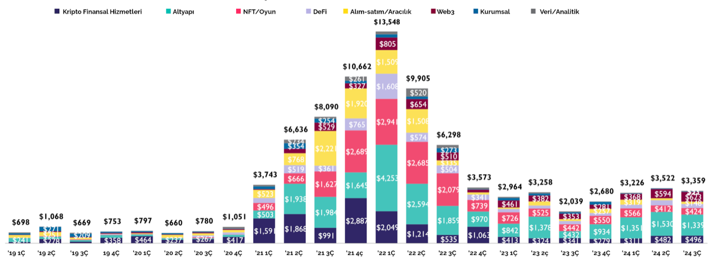

Web3 girişimcilerinin eskiye oranla ne kadar farklı olduklarına bundan önceki sayfalarda değindik. Bu girişimci kitlesi ile muhatap olan bu dünyanın yatırımcıları da benzer şekilde felsefe olarak Web 2.0 yatırımcılarından daha farklılar. Nedir bu farklılıklar?

### Yatırımcıların eli daha zayıf… {#yatirimcilarin-eli-daha-zayif}

Web 2.0 dünyasının teknoloji projelerine yatırım yapan girişim sermayelerinin, projenin başarısı için dans etmesi gereken tek aktör kurucu ekip oluyor.

Eskiden beri süreç şu şekilde işliyor: Kurucu ekip kapı kapı dolaşıp projesini girişim sermayesi şirketlerine ‘pazarlıyor’. Bunu yaparken ekipten proje ile ilgili bir iş planı hazırlaması bekleniyor. Bu plan doğrultusunda ve projenin yatırım ihtiyacına göre yeni yatırım turları yapılıyor. Yatırımcının öncelikli amacı gerek para gerekse diğer bağlantılarını kullanarak projenin başarıya ulaşmasına çalışmak oluyor. Bunun dışında, bir de eğer yatırım turlarına birden fazla yatırımcı katılmışsa diğer yatırımcılar ile muhatap olmak zorunda kalıyor. En sonunda da şirketin satılması ya da halka açılması durumunda ellerindeki hisseleri satarak yatırımcılarına güzel bir getiri elde etmeyi hedefliyorlar.

Web3 ekosistemindeki girişim sermayelerinin eli yukarıda bahsettiğimiz eski dünyadaki meslektaşlarına göre daha zayıf. Öncelikle masada artık sadece kurucu ekip yok. Bu ekibin yanında, oluşan katma değerden pay almaya çalışan diğer Web3 aktörleri de var. Bu satırlarda tek tek bahsettiğimiz dışarıdan projeye katkı veren geliştiriciler, projenin ekosistemine çekmek istediği diğer girişimler, kullanıcılar da pastadan pay kapma yarışındalar.

Masada daha fazla oyuncu olunca girişim sermayesinin aldığı pay da eski dünyaya göre daha az oluyor. Eski dünyada girişim sermayeleri bir projeye yatırım yaptıklarında ya hisse ya da henüz hisse yok ise SAFE denen ‘hisse çıktığında alım yapma’ sözleşmesi imzalarlar (ingilizce Simple Agreement for Future Equity teriminin kısaltması). Web3 dünyasında hisse senetlerinin yerini token alıyor ve token dağıtımı projenin daha olgun bir aşamasında gerçekleşiyor. Bu nedenle Web3 alanındaki yatırımcılar proje ekipleri ile genelde SAFT sözleşmesi imzalıyorlar (ingilizce Simple Agreement for Future Token teriminin kısaltması).

### … ama zamanla güçleniyorlar… {#ama-zamanla-gucleniyorlar}

Aslına bakarsanız 2020 yılı öncesinde Web3 dünyasındaki girişim sermayelerinin işi daha da zordu. Zira o zamanlar proje ekipleri yatırımcıların yüzüne bile bakmıyor ve gerekli finansmanı ICO dediğimiz token ihraçları ile karşılıyorlardı. Ne var ki, projeler konusunda detaylı araştırma yapmayan ve o zamanlar ortaya çıkan ‘hype’ ile projelere balıklama para yatıran bireysel yatırımcı, daha sonra pek çok proje ‘kof’ çıkınca ya da batınca ICO pazarından elini ayağını çekti.

2020 yılı sonrası girişimler token satma yerine token dağıtma stratejisine doğru yöneldiler. Erken aşamada ihtiyaç duydukları finansmanı ise projeleri daha derinden inceleyen girişim sermayelerinden karşıladılar.

Şimdilerde ekipler ile yatırımcılar arasındaki güç dengesinin piyasanın ayı ya da boğa, hangi dönemde olduğuna göre değiştiğini görmeye başlıyoruz. 2020-21 yıllarında projeler girişim sermayesi şirketlerine “işte bu bizim planımızı gösteren bir excel dosyası ile, “bana önümüzdeki haftaya kadar yatırım yapıp yapmayacağını söyle, çabuk davranmazsan dışarıda kalırsın” şeklinde üstü kapalı tehditler yaparak para topluyorlardı. Rüzgar tersine döndüğünde ise yatırımcıya gönderdikleri mesajlara hiçbir şekilde geri dönüş olmadığını fark ettiler.

<figure><figcaption>Çeyrek bazında blokzincir yatırımları</figcaption></figure>

*Çeyrek başına blokzincir alanında yapılan yatırımların alana göre dağılımı. Yatırımların 200 milyondan az olduğu bloklar görsel netlik amacıyla gösterilmemiş. (Kaynak: TheBlockPro Research. [Q3’24 & March Blockchain Venture Funding/M&A Recap](https://www.theblock.pro/research/q3-2024-blockchain-venture-funding-report-320940))*

Kurucu ekiplerdeki yatırımcıyı tamamen yok sayan 2020 öncesi anlayıştan, onları çok daha dikkate alan 2020 yılı sonrası değişim trendinin artarak devam edeceğini düşünüyorum. Girişim sermayeleri artık bu dünyada tecrübe sahibi oldular. Öyle her projeye balıklama atlamıyorlar. Ayrıca, büyük fonlar artık ciddi bir yatırım portföyüne sahipler ve portföy girişimleri arasında da sinerji yaratmak için çaba sarfediyorlar.

### …ve uzmanlaşıyorlar {#ve-uzmanlasiyorlar}

Öte yandan, girişim sermayesi şirketlerinin ciddi araştırma ekipleri kurarak teknik konularda çok daha deneyimli hale geldiğini söylemek mümkün. Bu teknik donanımlarını kullanarak farklı konularda uzmanlaşmaya da başladılar. Örneğin en büyük ekiplerden a16z özellikle zk (zero-knowledge) alanında araştırmalara büyük önem veriyor[^1] ve yatırımlarında bu alana odaklanıyor. Bir diğer büyük fon olan Paradigm ise tokenizasyon ve game theory alanında yaptığı deneyler ile ciddi bir bilgi birikimine ulaşmış durumda ve bunu projelerin token yaratma sürecinde aktif olarak kullanıyor (ne kadar başarılı olup olmadığı tartışma konusu olsa da).

[^1]: Bu alana ilgi duyanlara a16z’nin konuya özel [zk knowledge cannon sayfasına](https://a16zcrypto.com/posts/article/zero-knowledge-canon/) göz atmalarını hararetle tavsiye ederim.
