Bu kısımda Web3 dünyasının lokomotifi olan geliştiriciler tarafında yaşanan değişimlere göz atacağız.

Blokzincir bazlı teknolojilerin uygulama alanı olarak adlandırılan Web3 halen gelişmekte olan bir sektör. Bu sektörün gelecekte nasıl şekil alacağını gösteren en önemli göstergelerden biri de, bu dünyanın yapı taşlarını kurmak ile uğraşan geliştiriciler. Geliştirici dünyasında yaşanan hareketler bize gelecek ile ilgili önemli ipuçları verebiliyor.

Geliştirici dünyasını en yakından takip eden çalışma ise Electric Capital tarafından yıllık olarak hazırlanmakta olan Developer Report. Anlık olarak kendine has web sitesinde canlı olarak da takip edebildiğimiz bu veriler, toplu bir özet olarak her yıl biz meraklıların beğenisine [sunuluyor](https://www.developerreport.com/developer-report).

Gelin raporun 2024 yılında çıkan son baskısından seçtiğimiz verileri hep birlikte inceleyelim:

## Developer Report’tan önemli başlıklar {#rapordan-onemli-basliklar}

Raporun hemen başında yer alan yönetici özeti, dokümanı hazırlayanların önemli bulduğu çıkarımları özetlemesi bakımından ilgi çekici. Neymiş bu noktalar önce ona bakalım:

- Kripto dünyasında geliştirici sayıları Ethereum’un ortaya çıktığı 2015 yılından bu yana yılda ortalama %39 artış göstermiş.
- 2024 yılı içinde kripto dünyasındaki geliştirici sayısında %7 oranında bir azalma var.
- ‘Tecrübeli geliştirici’ olarak adlandırılan iki yıldan fazla süredir sektöre katkı yapan geliştirici sayısı ise tüm zamanların en yükseğinde. Bu geliştiriciler 2024 yılında %27 oranında artarken toplam katkının da %70’ini veriyorlar.
- Geliştiricilerin coğrafi dağılımına baktığımızda Asya’nın 2024 yılında atak yaparak Kuzey Amerika’yı geçip birinci sıraya yükseldiğini görüyoruz. ABD %19 ile ülke olarak birinciliğini korusa da, bu 2015 yılındaki %38’lik payının oldukça uzağında.
- Yazılımcıların yavaş yavaş, birden çok ağ için geliştirme yaptıkları da bir başka önemli gözlem. 2015 yılında %10’dan az olan birden fazla ağa katkı veren geliştirici sayısı aradan geçen dokuz yılda ciddi bir artış gösterdi. Artık her üç geliştiriciden biri, birden fazla ağda aktif.
- Ethereum geliştirici sayısı olarak açık ara birinciliğini korurken, Solana bu alanda en çok artış gösteren ağ. Bitcoin geliştiricilerinin %42’si Bitcoin ölçeklenme çözümleri üzerine çalışırken, Ethereum ekosistemi içindeki geliştiricilerin %42’sinin Base üzerinde olması dikkat çekici bir başka nokta.

## Developer Report’taki ilgi çekici noktalar {#ilgi-cekici-noktalar}

### Geliştirici sayılarında yıllar itibariyle yükselen trend {#gelistirici-sayilarinda-yillar-itibariyle-yukselen-trend}

Web3 dünyasında aktif geliştirici sayısı Ethereum’un ilk ortaya çıktığı 2015 yılından bu yana her yıl ortalama %39 artış göstermiş.

<figure><a href="/assets/books/sorularla-web3/304-1.png">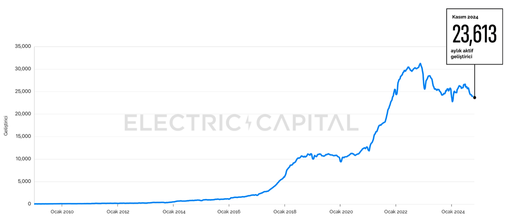</a><figcaption>Web3 alanında çalışan geliştirici gelişim trendi <em>Kripto geliştiricilerinin yıllar itibariyle gelişimi. Yıllık ortalama büyüme %39 oranında. (Kaynak: <a href="https://www.developerreport.com/developer-report">Electric Capital Developer Report 2024</a> Sayfa 9)</em></figcaption></figure>

Her ne kadar genel olarak bir artış olsa da 2023 ve 2024 yıllarında geliştirici sayısında bir azalma olduğu görülüyor. Kripto için alarm zilleri mi çalıyor?

Bu azalmanın temel nedeni, sektöre yeni katkı yapan geliştirici sayısında 2022 yılında görülen patlamanın 2023’te ‘sönmüş’ olması. Bu da çok normal aslına bakarsanız: 2020 ve 2021 yılında ciddi yatırım alan kripto girişimleri, ürünlerini pazara hazır hale getirebilmek için piyasadaki geliştiricileri adeta havada kapıyordu. Bu ortamda, Web3 dışı teknoloji tarafındaki pek çok geliştiricinin (alana çok inanmasalar da) verilen yüksek ücretlerin cazibesi ile bu alana giriş yaptığını gördük. 2022 yılının ikinci yarısı yaşanan büyük krizler (Terra Luna, 3AC ve FTX) sektöre akan girişim sermayesinin bir anda kesilmesine yol açtı. Projeler, piyasadaki kış mevsiminin de etkisiyle ayakta kalabilmek için ‘ayaklarını yorganlarına göre uzatmaya’ başladılar. Bu da 2023 yılı için geliştirici sayısında ciddi bir azalmaya yol açtı.

2024 yılındaki azalış (Kasım 2023’ten Kasım 2024’e) ise yaklaşık %7 civarında. Rapora göre %5 ile %10 arasındaki dalgalanmalar geçmişte de sık görüldüğü için istatistiksel olarak büyük bir anlam yüklemek gerekmiyor.

### Tecrübeli geliştiriciler sektörde aktif olmaya devam ediyor {#tecrubeli-gelistiriciler-sektorde-aktif-olmaya-devam-ediyor}

Burada asıl önemli nokta, sektörde uzun süredir olan geliştiricilerin katkı vermeye devam ediyor olması. Tecrübeli (2 yıldan uzun süredir sektörde olan) geliştirici sayısının 2023-24 yıllarını kapsayan dönemde yaklaşık %27 artış gösterdiğini görüyoruz.

<figure><a href="/assets/books/sorularla-web3/304-2.png">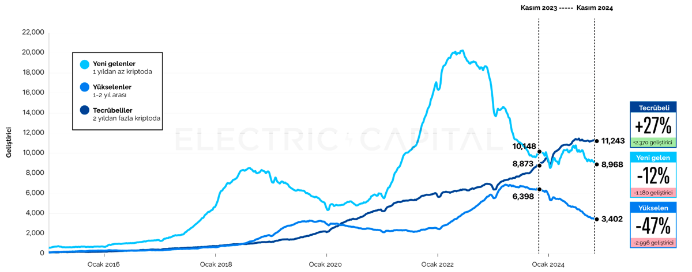</a><figcaption>Tecrübe olarak aylık aktif geliştiricilerin gelişimi <em>Tecrübe bakımından aylık aktif geliştirici sayıları gelişimi. (Kaynak: <a href="https://www.developerreport.com/developer-report">Electric Capital Developer Report 2024</a> Sayfa 12)</em></figcaption></figure>

Zira, bulundukları süre ve verdikleri katkıya bakıldığında, yazılan kodların %70’i iki yıldan uzun süredir bu alanda üretim yapan geliştiricilerden geliyor.

<figure><a href="/assets/books/sorularla-web3/304-3.png">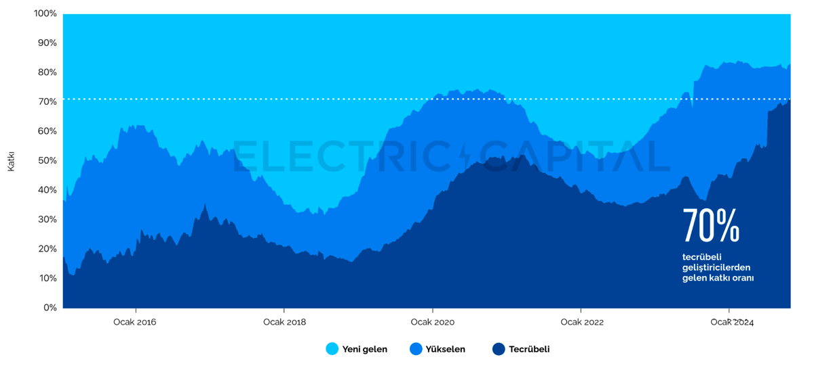</a><figcaption>Farklı tecrübedeki geliştiriciler tarafından yapılan katkı <em>Tecrübesine göre geliştiricilerin yaptığı katkılar. (Kaynak: <a href="https://www.developerreport.com/developer-report">Electric Capital Developer Report 2024</a> Sayfa 13)</em></figcaption></figure>

### Geliştirici sayısı olarak en büyük ağlar hangisi? {#gelistirici-sayisi-olarak-en-buyuk-aglar-hangisi}

Raporun her yıl en ilgi çeken kısmı, farklı ağların kaç adet geliştirici çektiği ve bu sayının bir önceki yıla göre nasıl değiştiği oluyor. 2024 yılında büyük olarak nitelendirilebilecek ağlara katkı yapan geliştirici sayıları şu şekilde gerçekleşti:

<figure><a href="/assets/books/sorularla-web3/304-4.png">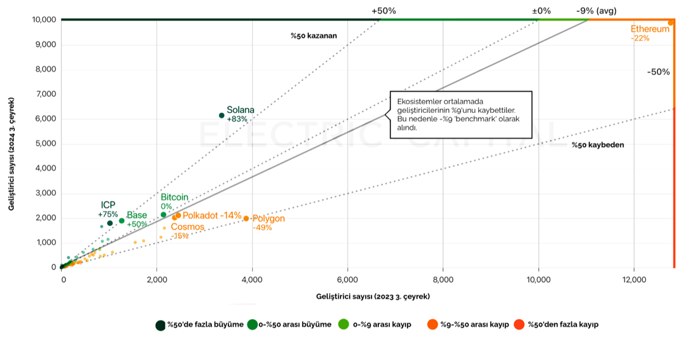</a><figcaption>Geliştirici sayısı gelişimi (2000 üzeri geliştirici) <em>Zirvedeki (2000’den fazla geliştiricinin katkı verdiği) ağların 2023-24 arası geliştirici sayısı gelişimi. (Kaynak: <a href="https://www.developerreport.com/developer-report">Electric Capital Developer Report 2024</a> Sayfa 104)</em></figcaption></figure>

Raporu ilk kez görenler için ufak bir açıklama yapalım. Öncelikle tabloda ismini gördükleriniz, ‘büyük ağlar’ olarak adlandırabileceğimiz 2000’in üzerinde geliştiriciye sahip ağlar. Yatay eksen, ağların 2023 yılı üçüncü çeyreğinde, dikey eksen ise 2024 yılı üçüncü çeyreğindeki geliştirici sayısını gösteriyor. Eğer bir ağ, yukarıda gördüğünüz 0% çizgisinin (grafiği kesen dört çizgiden soldan ikinci sırada yer alan kesik çizgi) solunda yer alırsa bu, bir yıl içinde geliştirici sayısını artırmış anlamına geliyor. Altında ise, geliştirici sayısında azalma var demek.

Tablodan genel olarak yapabileceğimiz çıkarımlar şu şekilde:

- Genel olarak baktığımızda toplam geliştirici sayısında bir azalma var. Bu nedenle, ağların performansını sektör ortalaması olan -%9’un altında ve üstünde olmalarına bağlı olarak göreceli olarak değerlendirmek daha mantıklı.
- Buna göre, büyük ağlar içinde Solana (%83), ICP (%75), Base (%50) sırasıyla en çok geliştirici çekenler. Bitcoin ise tutarlı bir geliştirici sayısına sahip.
- Polygon (-%49), Ethereum (-%22), Cosmos (-%15) ve Polkadot (-%14) ise geliştirici sayılarında bir azalış görmüşler.

Tek tek ağlara baktığımızda, Ethereum’un liderliğini koruduğunu görüyoruz. Aslına bakarsanız, Ethereum üzerinde katkı yapan geliştirici sayısı o kadar fazla ki, önümüzdeki senelerde de bu durumun devam edeceğini öngörmek kâhinlik sayılmaz.

Ethereum’un bu kadar ön planda olmasının temel nedenlerinden biri elbette ekosisteminin çok geniş olması. Bunun yanında, Ethereum üzerine geliştirme yapılan programlama aracının (Ethereum Virtual Machine kısaca EVM) yeni çıkan pek çok zincir tarafından da kullanıldığını görüyoruz. Pek çok zincir, programcıları kendisine çekebilmek için onların alışık olduğu EVM’i tercih ediyor. Bu da EVM’in sektör için bir standart haline gelmesine yol açıyor.

### Geliştiriciler artık farklı ağlara hizmet veriyor {#gelistiriciler-artik-farkli-aglara-hizmet-veriyor}

Nitekim, EVM’in sektör standardı haline gelmesiyle birlikte, birden fazla ağ üzerinde geliştirme yapan yazılımcıların sayılarının da arttığını görüyoruz. Geliştiricilerin %36’sı birden fazla ağ üzerinde aktif.

<figure><a href="/assets/books/sorularla-web3/304-5.png">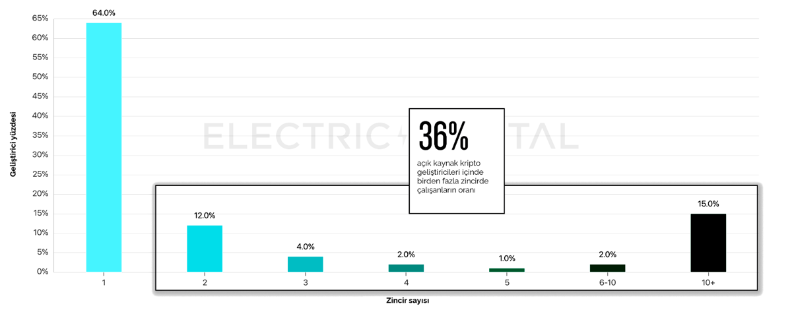</a><figcaption>Geliştiricilerin destek verdiği blokzincir adedi dağılımı <em>Geliştiricilerin geliştirme yaptığı farklı ağ sayısı. (Kaynak: <a href="https://www.developerreport.com/developer-report">Electric Capital Developer Report 2024</a> Sayfa 48)</em></figcaption></figure>

Burada da EVM’in ağırlığı olduğunu görmek mümkün. Aşağıdaki grafikte, birden fazla ağa geliştirme yapanların içinde EVM, karışık ve EVM dışı şeklinde yapılmış ayrımı yıllar bazında görebilirsiniz. Birden fazla ağ için akıllı kontrat geliştirenlerin %74’ü en az bir EVM ağ için geliştirme yapıyor.

<figure><a href="/assets/books/sorularla-web3/304-6.png">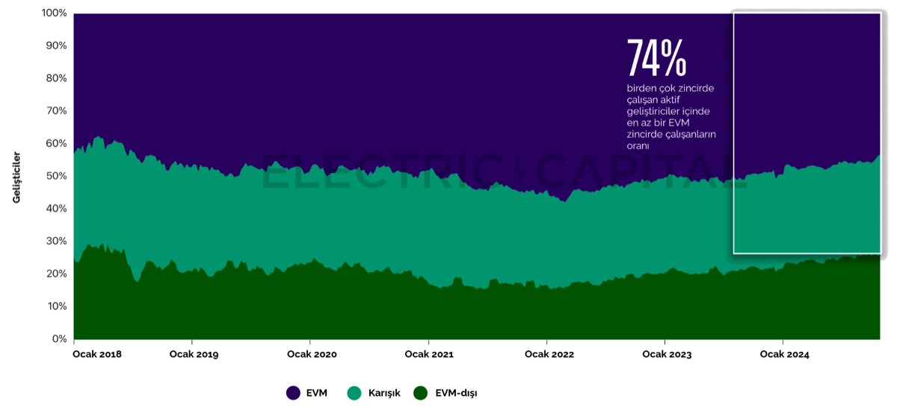</a><figcaption>Çoklu zincirde çalışan geliştiricilerin çalıştıkları ağ cinsinden dağılımı <em>Birden çok zincirde çalışan geliştiricilerin EVM ya da EVM dışı çalıştıkları ağa göre dağılımı. (Kaynak: <a href="https://www.developerreport.com/developer-report">Electric Capital Developer Report 2024</a> Sayfa 57)</em></figcaption></figure>

### Diğer ağlarda geliştiricilerin durumu nasıl? {#diger-aglarda-durum-nasil}

Büyük ağları geçip daha da küçük ağlara baktığımızda ise şimdiye kadar gördüğümüz düşüş tablosunun bir parça kırıldığını görüyoruz.

<figure><a href="/assets/books/sorularla-web3/304-7.png">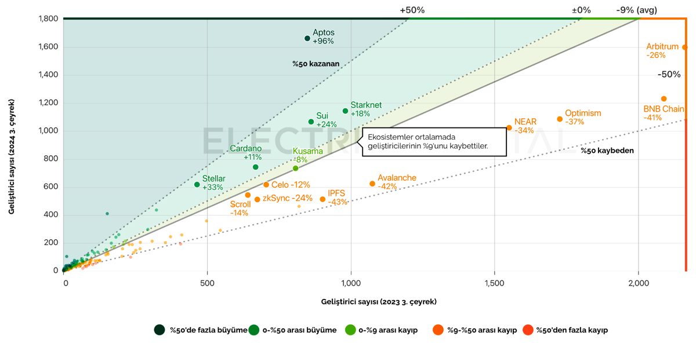</a><figcaption>Geliştirici sayısı gelişimi (500-2000 geliştirici) <em>500 ile 2000 arası geliştiriciye sahip göreceli ‘küçük’ ağların 2023-24 üçüncü çeyreğindeki geliştirici sayısı değişimi. (Kaynak: <a href="https://www.developerreport.com/developer-report">Electric Capital Developer Report 2024</a> Sayfa 106)</em></figcaption></figure>

Grafikte ilgi çekici noktalar şu şekilde:

- Move sistemine ait iki ağın parladığını görüyoruz. Aptos %95 geliştirici sayısı artışı ile tüm tabloda birinciliğe sahip. SUI de %24 artış ile üçüncü sırada.
- Bunlar dışında gelişim gösterenler ise Stellar (%33), Starknet (%18) ve Cardano (%11) olarak sıranıyor.
- Diğer bütün ağların ise ortalama geliştirici sayılarında bir azalma var.

Son olarak daha küçük sistemlerin grafiğini vererek bu konuyu kapatalım:

<figure><a href="/assets/books/sorularla-web3/304-8.png">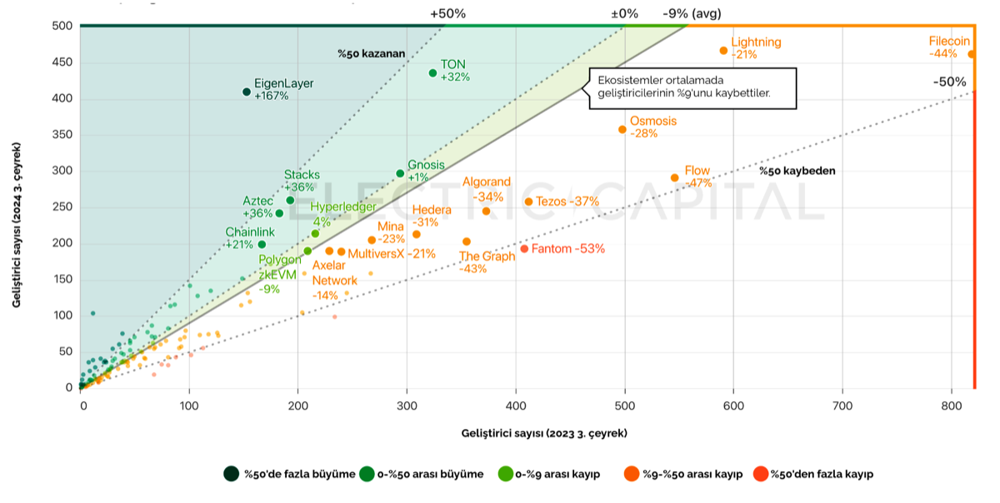</a><figcaption>Geliştirici sayısı gelişimi (200-500 geliştirici) <em>200 ile 500 arası geliştiriciye sahip göreceli ‘küçük’ ağların 2023-24 arası geliştirici sayısı gelişimi. (Kaynak: <a href="https://www.developerreport.com/developer-report">Electric Capital Developer Report 2024</a> Sayfa 107)</em></figcaption></figure>

### Merkeziyetsiz finans alanındaki geliştiriciler hangi ağlarda yoğunlaşıyorlar? {#merkeziyetsiz-finans-alanindaki-gelistiriciler-hangi-aglarda-yogunlasiyorlar}

Kullanılan ağlara baktığımızda merkeziyetsiz finans alanındaki geliştiricilerin yarısından fazlasının Ethereum ağında konumlandığını görüyoruz.

<figure><a href="/assets/books/sorularla-web3/304-9.png">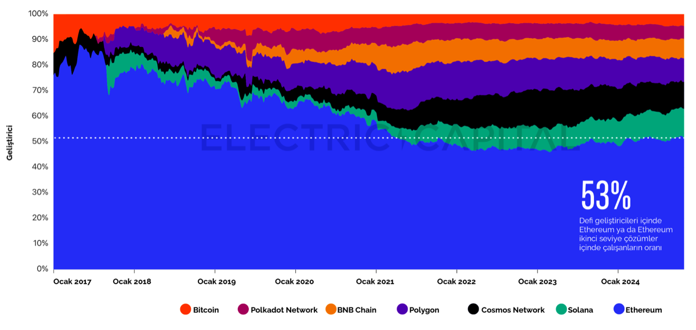</a><figcaption>Merkeziyetsiz finans alanındaki geliştiricilerin dağılımı <em>En yüksek trafiğe sahip Ethereum akıllı kontratları. (Kaynak: <a href="https://www.developerreport.com/developer-report">Electric Capital Developer Report 2024</a> Sayfa 147)</em></figcaption></figure>

### Geliştiriciler nerelerde konumlanıyor? {#gelistiriciler-nerelerde-konumlaniyor}

Son olarak, geliştiricilerin hangi bölgelerde yoğunlaştığına baktığımızda, her ne kadar ABD’nin liderliği sürse de, Web3 alanındaki geliştiricilerin %81’inin ABD dışında olması dikkat çekiyor.

<figure><a href="/assets/books/sorularla-web3/304-10.png">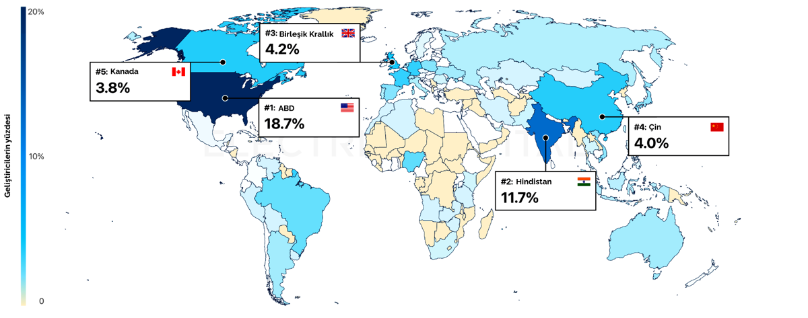</a><figcaption>Ülkelerin geliştirici sayılarının toplam içindeki payı <em>Ülkelere göre geliştiricilerin dağılımı. Ülkemiz için rakam tam olarak verilmese de, renk skalasından %1’in altında olduğu görülüyor. (Kaynak: <a href="https://www.developerreport.com/developer-report">Electric Capital Developer Report 2024</a> Sayfa 29)</em></figcaption></figure>

Geliştiricilerin ülke olarak dağılımına baktığımızda ise Asya kıtasının özellikle Hindistan ile atak yaptığını görüyoruz.

<figure><a href="/assets/books/sorularla-web3/304-11.png">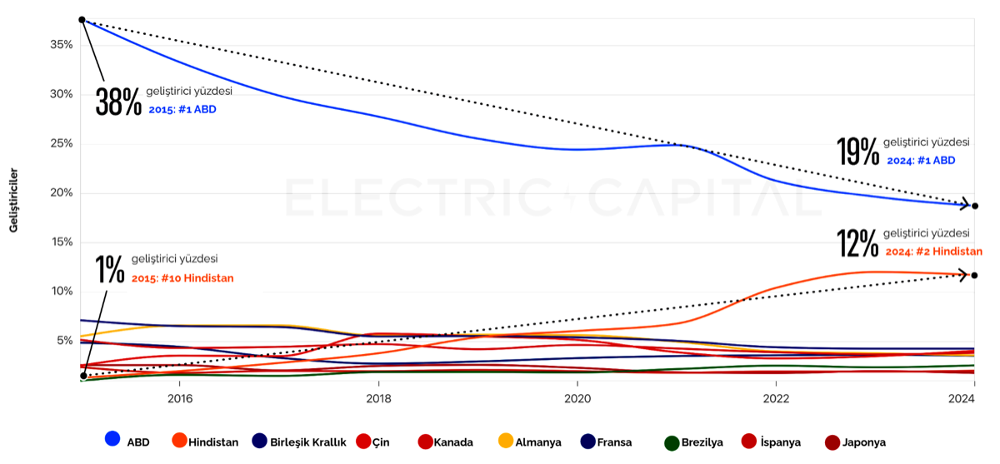</a><figcaption>En çok geliştiriciye sahip on ülkenin değişimi <em>Bölgelere göre geliştiricilerin paylarının yıllar içinde değişimi. (Kaynak: <a href="https://www.developerreport.com/developer-report">Electric Capital Developer Report 2024</a> Sayfa 30)</em></figcaption></figure>

## Sonuç {#sonuc}

Geliştiriciler kripto ekosisteminin can damarı ve geliştirici sayılarındaki değişimler Web3 için geleceğin bir öncü göstergesi. 2022 yılında yaşanan krizlerin arkasından gelen kripto kışının geliştirici sayılarında uzun süredir devam eden yükseliş trendine bir darbe vurduğu kesin. Yine de, ekosisteme daha çok katkı veren tecrübeli geliştiricilerin üretime devam etmesi, gelecek için hâlâ umutlarını sürdürdüklerini gösteriyor. Gelecekte hangi ağların biz kullanıcılara ne çeşit gelişmiş uygulamalar sunacağı konusunda ilginç ipuçları veren geliştirici raporunu yakından takip etmekte fayda var.
