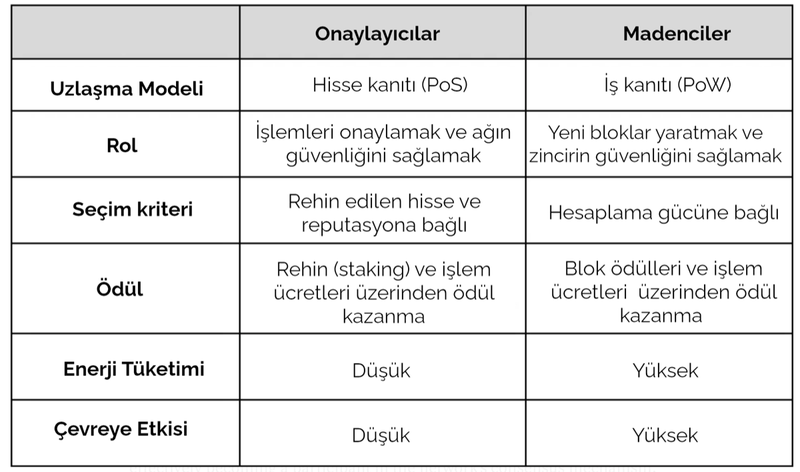

Web 2.0 dünyasında görmediğimiz, Web3 ile birlikte karşımıza çıkan bir diğer oyuncu grubu da madenciler ya da değişen rolleri ile onaylayıcılar.

## Ne işe yarar madenci ya da onaylayıcılar? {#ne-ise-yarar-madenci-ya-da-onaylayicilar}

Web3 dünyası projeleri bir şirket olmaktan öte bir ekosistem olarak var oluyorlar. Bu ekosistemin üzerinde yaşadığı altyapı ise blokzincir teknolojisine dayanıyor.

Blokzincir dijital dünyada kurulu bir yazılım ve bu dijital dünya isteyen herkesin istediği şekilde girebildiği bir ‘vahşi batı’. Bu nedenle bu dünya içinde kötü niyetli aktörlerin olduğunu da kabul etmek gerekiyor.

Normalde şirketler kendilerini dijital dünyanın tehlikelerinden ciddi güvenlik yatırımları yaparak koruyor. Web3 ekosisteminde kurulu ağlar ise böyle bir yatırım yapmak yerine, çareyi yazılımlarını binlerce makineye dağıtarak dış tehlikelerin karşısında tek bir hedef tahtası haline gelmekten kaçınmakta buluyor.

Yine de bu durum onları tüm tehlikelerden korumuyor. Bu ağlar üzerinde yapılan işlemlerin doğru bir şekilde ağa işlendiğine ve ileride değiştirilemeyeceğine emin olmak gerekiyor. Blokzincirin özünde ‘kimseye güven ihtiyacı duymamak’ var. Peki o zaman bu teknolojinin ‘doğru’ çalıştığına nasıl emin olacağız? Öncelikle, yazılım açık kaynak olduğu için isteyen herkes kimseye sormadan bu yazılımı denetleyebilir. Bu güzel ama yeterli değil.

Sistem doğru kurulmuş olsa da yapılan işlemlerin doğru bir şekilde makinelere kaydedildiğine emin olmak gerekiyor. Burada iki konu kritik: Birincisi, makinelerin sistemi sürekli olarak devam ettirmesini sağlamak gerek. İkincisi ise, makinelerin bunu yaparken dürüst ve bağımsız davrandığına yani herhangi bir yerin güdümünde olmadığına emin olmalıyız.

## Altyapı ağlarında madenci ve onaylayıcılar {#altyapi-aglarinda-madenci-ve-onaylayicilar}

Blokzincir teknolojisinin altyapısının doğru çalışmasını sağlayan makinelere Bitcoin ağında madenci[^1], diğer ağlarda ise onaylayıcı diyoruz. Bu makineler Bitcoin kurucusu Satoshi Nakamoto’nun dahiyane buluşu olan teşvik mekanizması sayesinde onbeş yıldır tıkır tıkır çalışıyorlar.

### Bitcoin madencileri {#bitcoin-madencileri}

Bitcoin üzerine madencilik başlı başına bir sektör olmuş durumda. Bir ara büyük oranda Çin’in hegemonyasında ilerleyen sektör, 2020’nin başından beri yavaş yavaş ABD’nin liderliğine geçti. Bu alanda ABD’de bulunan madencilik devleri özellikle halka açılma sayesinde elde ettikleri ciddi finansmanı ekipmana yatırarak paylarını daha da artırıyorlar.

Madencilerin temel olarak iki gelir kalemi var. Bunlardan birincisi her on dakikada bir yeni blok oluşturma karşılığında kazandıkları ödüller. İkincisi ise kullanıcıların birbirine yaptıkları Bitcoin transferleri karşılığında ödedikleri işlem ücretleri. Toplam gelirin büyük bir kısmı ödüllerden geliyor.

Toplam Bitcoin arzının %95’inin çıkarılmış olması ve verilen ödüllerin dört yılda bir azalması nedeniyle madenciliğin geleceği konusunda ciddi soru işaretleri var. Bütün bu soruları ortadan kaldırmanın yolu Bitcoin üzerindeki işlemleri artırarak madencilerin işlem ücretinden kazandıkları geliri artırmaktan geçiyor.

İşte Bitcoin üzerinde 2023 yılından beri aktif olan Ordinals protokolü, BRC-20 token standardı ile 2024 yılında ortaya çıkan Runes protokolü ve Bitcoin üzerine geliştirilmeye çalışılan ikinci seviye ağlar madenciler için kurtuluş yolu olabilir (bu konuda daha detaylı bilgiye ikinci bölümün sonundaki ‘Örnek: Bitcoin Üzerine İkinci Seviye Çözümler’ ulaşabilirsiniz).

### Ethereum’un onaylayıcıları {#ethereumun-onaylayicilari}

Ethereum sistemi de Bitcoin gibi madencilik sistemi ile başladı ancak madencilerin enerji harcaması büyük bir sorun olarak görüldüğü için bir sistem değişikliğine gidildi. Ethereum sonrası ağların kullandığı teknolojiye geçerek madencilerin yerini onaylayıcılara bıraktılar (bu değişime ikinci bölümümüzde detaylı olarak değinmiştik).

Madenci ya da onaylayıcılar, sistemi devam ettirmeleri karşılığında bir ödül kazanıyorlar. Bu ödül, ağların yeni yarattıkları tokenler oluyor. Bu da piyasadaki token adedini artırdığı için bu ağların token ekonomisinin enflasyonu olarak kabul ediliyor.

<figure><figcaption>Onaylayıcı ve madenci karşılaştırması</figcaption></figure>

## İkinci seviye çözümlerde onaylayıcılara ihtiyaç var mı? {#ikinci-seviye-cozumlerde-onaylayicilara-ihtiyac-var-mi}

Madenci ve onaylayıcılar her tür altyapı projesinin merkeziyetsizliği için oldukça kritik bir öneme sahipler. Burada 2024 yılı ile birlikte en çok konuşulan konulardan biri, özellikle Ethereum üzerine kurulu ağların bu dağıtık yapıyı nasıl sağlayacakları ve bunun için kendi ağ tokenlerini ne kadar kullanacakları oldu.

İkinci seviye ağlar merkeziyetsizleşme yolunda çıktıkları olgunlaşma serüveninde ilk aşama olarak kendi sistemlerinin tokenlerini çıkararak ekosistem oyuncularına dağıttılar. Peki ne işe yarayacak bu tokenler? Temel görev olarak, ağın hangi yönde ilerleyeceğine dair stratejik kararları token sahipleri veriyor. Peki bu bir token için yeterli bir değer önerisi mi? Başka değerler eklenebilir mi?

Normal olarak Ethereum üzerine kurulu ‘roll-up’ denilen çözümler[^2] güvenliklerini Ethereum üzerindeki onaylayıcılar üzerinden alıyorlar. Bu hizmet için ödemeyi Ethereum sisteminin parası olan ETH üzerinden yapıyorlar[^3]. Bunun için kendi tokenlerini kullanamazlar mı? Ethereum sistemi bunu kabul etmiyor. Kimi ağlar, kullanıcılardan işlem ücretlerini kendi tokenleri ile alıp Ethereum sistemine ETH olarak ödeme yapabiliyorlar. Bu durum ağ için bir açık pozisyon yaratsa da ağlar bunu kendi tokenlerinin büyümesi adına sineye çekebiliyorlar.

Tokene biçilebilecek bir başka değer önerisi, ağın kendi üzerinde yaptığı işlemleri sıralaması sırasında token kullanmak olabilir. Ne demek tam olarak bu? Ethereum’un ekonomisi kısmında ağa gelen işlemlerin bloklar haline getirilirken sıraya dizilmesi ve bu sıraya dizilme sırasında işlemlerini öne geçirmeye çalışanların ödedikleri ciddi paralardan (MEV gelirleri) bahsetmiştik. İkinci seviye çözümler şu anda kendi üzerlerinde yapılan işlemleri merkezi olarak sıralıyorlar (bu ingilizcede ‘sequencer’ olarak geçiyor). Bu onlara, MEV dediğimiz geliri ceplerine atma imkanı veriyor. Ağlar, ileride merkeziyetsizlik gereği bu sıralama işlemini farklı farklı bağımsız işlemcilere vermek zorunda kalacaklar. Bunu ne şekilde yapacakları bu satırlar yazılırken belirsizliğini koruyordu. Bir kısım ağ (örneğin Scroll) bunu bağımsız bir sıralayıcı topluluğu ile yapmayı planlıyor. Öte yandan sıralama işini farklı ağlara bir hizmet olarak sunmayı planlayan Espresso benzeri çözümler de mevcut. Önümüzdeki dönemde bu alanda ne gelişmeler olacağını hep birlikte göreceğiz.

[^1]: Bitcoin ağı benzeri madenciler ile çalışan BCH, Dogecoin, LTC gibi daha küçük ağlar da mevcut.

[^2]: Burada başka bölümlerde de bahsettiğimiz roll-up çözümler ile ikinci seviye ağların farkını bir kez daha hatırlatmakta fayda var: İkinci seviye ağlar, birinci seviye ağlar üzerine kurulu her tür çözüme verilen genel ad. Roll-up çözümler ise ikinci seviye çözümlerin bir alt kümesi. Roll-up çözümleri güvenliklerini direkt olarak Ethereum üzerinden alıyorlar. İkinci seviye olarak adlandırılan kimi çözümler ise roll-up çözümlerin aksine Ethereum’a bilgi aktarıyor ama güvenlik olarak onu kullanmıyorlar.

[^3]: Güvenlik almaktan kastedilen, kendi ağları üzerinde yaptıkları işlemleri toplu halde Ethereum üzerine gönderiyorlar. Bu işlemler Ethereum üzerinde tekrar kontrol edilerek doğru oldukları teyit ediliyor.
