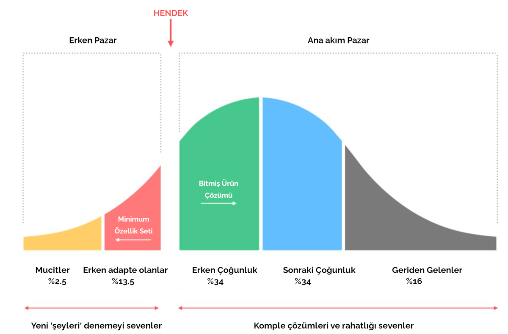
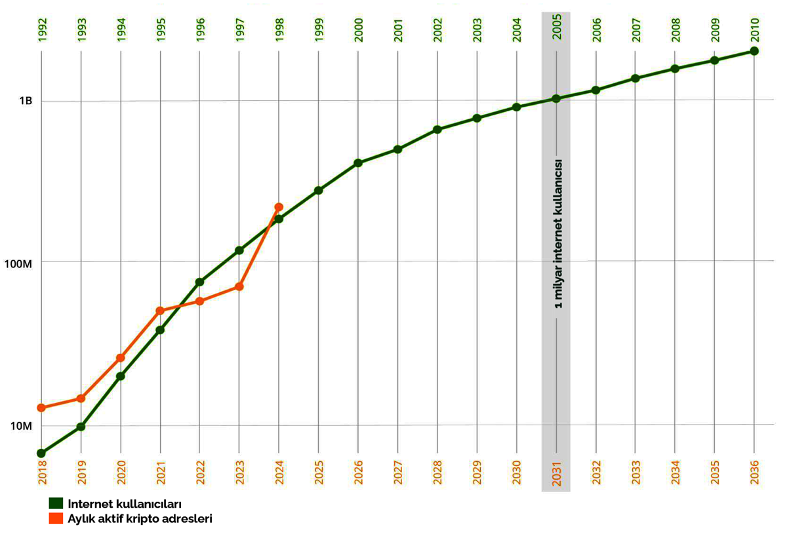
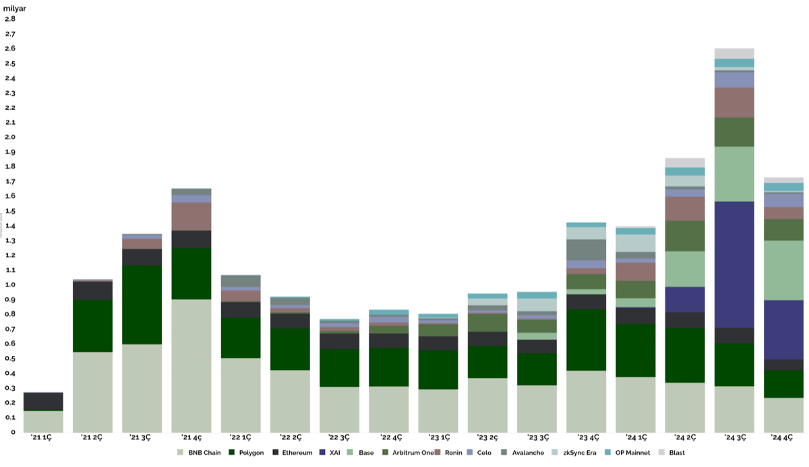

Bu kısımda Web3 ekosisteminin olmazsa olmazı olan kullanıcılardan bahsedeceğiz.

Şimdiye kadar üzerinde durduğumuz Web3 oyuncularının elbette en önemli hedefi, içinde bulundukları ağın olabildiğince çok kullanılıyor olması. Peki bunu gerçekleştirebildiler mi? Bu sorunun cevabı henüz ‘hayır’. Gelin önce Web3’ün kullanıcı kavramının Web 2.0’a göre nasıl farklılık gösterdiğine bakalım, sonra da yukarıda sorduğumuz sorunun cevabının ‘evet’ olması için gelecekte neler yapılması gerekir, ona kafa yoralım.

## Web3’de kullanıcı kavramı {#web3de-kullanici-kavrami}

Web3’ün kaç ‘kişi’ tarafından kullanıldığını bilebilmek oldukça zor. Bu dünyada kullanıcıların fiziki dünyada olduğu gibi ‘tek’ bir kişi olması gerekmiyor. Bunun yerine kullanıcılar anonim kalmayı tercih ediyor. Bunun da temel bir nedeni var aslında. Neden?

Finans dünyasından bir örnek ile bu soruya cevap verebiliriz: Bankacılık sektörünü kullanan kişiler gerçek kimlikleri ile işlem yapmak zorundalar. Bu, sistemin güvenliği için önem taşıyor. Bu her ne kadar kritik olsa da kişiler için önemli bir başka kriter daha var: O da gizlilik, bir başka deyişle mahremiyet.

İnsanlar maddi varlıklarının ya da yaptıkları finansal işlemlerin herkes tarafından görülmesini istemezler. Bu çok doğal bir hak. Finans sistemi, bu mahremiyeti kişilerin yaptıkları finansal işlemleri ya da mevcut bakiyelerini gizli tutarak sağlar. Burada müşteriler bankalara kişisel bilgilerini saklı tutacakları konusunda güvenir. Öyle ya koskoca banka onlarca yıldır bu güvenliği sağlıyor, üstelik gerek devlet gerekse bağımsız dış denetim tarafından denetleniyor. Güvenmekte bir sakınca yok.

Blokzincir tabanlı Web3 alanında ise kullanıcıların mal varlıkları apaçık meydanda. Bütün bakiyeler ve yapılan işlemler (örneğin para transferleri) herkes tarafından görülebiliyor. Sistemin bu şekilde kurulmuş olmasının temel nedeni, ağ üzerindeki varlıkların doğru ve tam olduğunu anlamak ve bunu kanıtlamak için üçüncü bir partiye (burada finans kurumuna) olan ihtiyacı ortadan kaldırmak.

Peki o zaman gizlilik yani mahremiyet nasıl sağlanacak? Kullanıcının her tür varlığı ayan beyan göz önünde olursa, fiziki dünyada kötü niyetli kişilerin uygunsuz davranışlarına maruz kalabilir. Bu nedenle, bu dünyada kullanıcıların kimlikleri gizli tutulur. Bunun yerine kullanıcı kişisel cüzdanları aracılığıyla blokzincir üzerindeki adreslere sahip olur[^1].

## Web3 kullanıcı kazanımında nerede? {#web3-kullanici-kazaniminda-nerede}

Web3 geçmişi henüz sadece son on yıla dayanan bir teknoloji. Her yeni teknolojinin büyüme sırasında geçtiği evreleri sırasıyla geçiriyor. Şu an hangi aşamada dersek, Geoffery Moore’un aşağıdaki grafiği bize ipucu verebilir.

<figure><figcaption>Hendeği atlamak</figcaption></figure>

*Geoffery Moore’un ünlü Crossing the Chasm grafiği. (Kaynak: [Wikipedia](https://en.wikipedia.org/wiki/Crossing_the_Chasm))*

Web3’ün şu an için altyapısını yavaş yavaş tamamlamak üzere olduğunu, üzerine Web 2.0 ile yarışacak ürün ve hizmetlerin sunulmaya başladığını söyleyebiliriz.

Buna paralel olarak Web3 dünyası bundan birkaç yıl öncesine kadar ‘early adopters’ denilen erken dönem kullanıcı kitlesi tarafından işgal edilmişti. Bu kitlenin içinde iki temel grup olduğunu söyleyebiliriz.

### Kimler şu anda Web3’ü kullanıyor? {#kimler-su-anda-web3u-kullaniyor}

Erken dönem kullanıcı içinde ilk grubu, bu teknolojinin ve altında yatan merkeziyetsizlik felsefesinin potansiyelini görenler olarak tanımlayabiliriz. Bu grup içinde bu alanda ürün geliştirenler ve bu ürünleri kullananlar bulunuyor. Web3 eğer bir gün geniş kitlelerce kullanılacak ise, bu grubun yeniliklere karşı olan merak ve hevesi bu yolda itici güç olacak.

İkinci grubun ise bu alandaki potansiyeli gören ve bu potansiyelden kazanç elde etmek isteyenlerden oluştuğunu söyleyebiliriz. Bu grup da kendi içinde üç alt parçaya ayrılıyor.

İkinci grup içindeki ilk parça, buraya uzun vadeli inanarak yatırım yapanlar. Bunların yatırımcı kitlesinin içinde ufak bir kısım olduğunu söylemeliyiz.

İkinci grup içindeki ikinci parça, Web3 bazlı girişimlerin projelerinin finansmanı için çıkardıkları ekosistem tokenlerini alan, kısacası ‘kriptopara oynayan kesim’. Web3 girişimlerinin ağırlıklı bir bölümü henüz token sahiplerine değer sağlayacak olgunluğa erişemediği için bu kesim daha çok spekülasyona ‘oynuyor’. Finansal ve teknolojik okuryazarlığın oldukça yetersiz olması, bu grup için en büyük sorunlardan bir tanesi.

İkinci grup içindeki üçüncü ve son parça ise, projelerin büyümelerine katkı verenlere token dağıtmasından faydalanmak isteyen ve ‘airdropçu tayfa’ olarak adlandırılan bir kesim. ‘Tokenizasyon’ bölümümüzde airdrop konusuna ağırlıklı olarak değineceğiz. Bu kesim, kimileri tarafından projelere ‘hormonlu’ katkı sağladığı için hor görülüyor. Kimileri ise henüz emekleme aşamasında projeleri kullanan bu kesimin, ekiplere açıkları bulma, yoğun talebi karşılama konusunda ‘stress testing’ yapma gibi alanlarda büyük faydası olduğuna inanıyor.

### Kullanıcıların Web3’e ilgisi nasıl gelişiyor? {#kullanicilarin-web3e-ilgisi-nasil-gelisiyor}

Yukarıda saydığımız nedenlerden dolayı, sadece rakamlara bakmak bize Web3 kullanıcılarının sayısı bakımından doğru sonuçlar vermeyebilir. Yine de ilginin ne şekilde geliştiğini anlamak için birkaç farklı metriğe bakmak faydalı olabilir. Gelin şimdi onlara bakalım birlikte:

<figure><figcaption>İnternet kullanıcıları ile aylık aktif kripto adreslerinin karşılaştırması</figcaption></figure>

*Logaritmik ölçekte internet kullanıcı sayısı ile aktif kripto cüzdan sayısının karşılaştırması. (Kaynak: Dünya Bankası, Artemis ve Dune @Daren Matsuoka)*

Yukarıdaki a16z’nin 2024 Ekim ayında yayınladığı [State of Crypto raporundan](https://a16zcrypto.com/posts/article/state-of-crypto-report-2024/) alınan grafik bize internet üzerindeki kullanıcı sayıları ile aylık aktif kripto işlemi yapan cüzdan sayılarının karşılaştırmasını veriyor. İnternet kullanıcıları için ilk yıl 1992, kripto adresleri için ise 2018 yılı alınıyor.

Grafiğe baktığımızda internet kullanıcı sayısının bir milyar kişiye ulaşması yaklaşık 13 yıl almış. Büyüme eğrilerinde geçmişten bugüne süregelen paralelliğin bundan sonra da devam etmesi durumda aylık aktif kripto cüzdan adresi sayısının 2031 yılında bir milyara ulaşması bekleniyor. Tam olarak elma-elma karşılaştırması olmasa da kullanıcı sayısının gelişimini tahmin eden ilginç bir metodoloji.

<figure><figcaption>Ethereum (EVM) uyumlu zincirlerde çeyrek bazlı işlem adetleri</figcaption></figure>

*Ethereum uyumlu zincirlerde çeyreklik kullanıcı işlem sayıları. 2024 yılı son çeyrek sadece Ekim ve Kasım aylarını içermekte, dolayısıyla son ay eklendiğinde bir önceki çeyrekten daha yüksek olacak. (Kaynak: [Token Terminal](https://tokenterminal.com/explorer/markets/blockchains?v=Y2QwMDE4ZmFhODQxYzY3MzlhZTQ0MmVi))*

İkinci grafiğimiz ise kullanıcı sayılarına değil işlem adetlerine bakıyor ve Ethereum zincirini çalıştıran makineler ile uyumlu akıllı kontrat platformlarını inceliyor. Burada özellikle 2021 yılı ile birlikte bir artış olduğunu görüyoruz. 2022 ve 2023 yıllarında piyasadaki durgunluk işlem sayılarını da ciddi bir şekilde etkiledi. Yine de 2023 yılının son çeyreğinden itibaren sayıların hızla artmakta olduğunu görüyoruz.

## Web3 nasıl daha fazla kullanıcıya ulaşır? {#web3-nasil-daha-fazla-kullaniciya-ulasir}

Şu aşamada kullanıcıların Web3 uygulamalarını gerçekten günlük hayatlarında kullanmak istediklerini söylemek oldukça zor. Kullanıcıların ufak bir kısmı yeni teknolojileri denemek daha büyük bir kısmı ise gelecekteki büyümesinden şimdiden ‘nemalanmak’ için bu dünyada.

Peki Web3 dünyasının daha geniş bir kitleye ulaşabilmesi için neler yapması gerekiyor? Bu konuya son bölümümüzde ayrıntılı olarak değiniyoruz. Burada kısa bir değerlendirme yaparsak:

### Daha iyi bir kullanıcı deneyimi {#daha-iyi-bir-kullanici-deneyimi}

Öncelikle Web3 uygulamalarının daha kullanıcı dostu olması gerekiyor. Blokzincir teknolojisinin ilk yıllarında, bu alanda çalışan geliştiriciler için en önemli konu sağlam ve güvenilir bir altyapı oluşturmaktı. Tamamen bir mühendislik çalışması olan bu konuda ciddi bir ilerleme sağlandı. Şimdi ise sıra Web3 projelerinin kullanıcı deneyimi alanında kendilerinden oldukça ileri bir seviyede olan Web 2.0’da yaptıklarından ders çıkarmasına geldi.

### Yeni nesil cüzdanlar {#yeni-nesil-cuzdanlar}

Kullanıcı deneyimi alanında belki de en önemli engel bireylerin bu dünyaya ilk adım attıklarında kullandıkları cüzdanlarda başlıyor. Bireylerin Web3 ekosisteminde bulunan varlıklarının tek sahibi olmaları onlara aynı zamanda ciddi bir sorumluluk yüklüyor. Bu sahiplik kullanıcıya özellikle cüzdanlarına erişimini kaybettiği durumda ciddi zarar verebiliyor. Neyse ki, bu alanda son yıllarda ortaya çıkan yeni teknoloji cüzdanlar bu sorunu ortadan kaldırmaya aday. Bana sorarsanız bu sayede, geniş kesimlerin Web3 uygulamalarını kullanımında çağ atlanacak.

### Ürün-pazar uyumu {#urun-pazar-uyumu}

Yine de Web3 alanındaki uygulamaların büyük kısmı, Web 2.0’da çok konuşulan pazar-ürün uyumunu yakalayabilmiş değiller. Kullanıcı için herhangi bir uygulamayı neden kullanması gerektiği hâlâ çok net değil. Burada adaptasyonun zaman içinde, kullanıcı Web 2.0 uygulamalarında sıkıntı çektikçe geleceğini söyleyebiliriz.

Bunun yakın zamanda örneğini Instagram’ın ülkemizde yasaklanması sırasında gördük. Instagram’ın kendi kafasına göre kimi içerikleri kaldırması, bunun üzerine devlet otoritesinin uygulamaya olan erişimi kesmesi hem kullanıcıları hem de uygulamayı kullanarak para kazanan insanları oldukça sıkıntıya soktu.

Web3 uygulamalarında ise böyle bir durum söz konusu değil. Kullanıcının ürettiği/paylaştığı içerikler blokzincir üzerinde tutuluyor. Eğer herhangi bir uygulama içeriğe erişimi engellerse, kullanıcılar bir başka uygulama ile aynı içeriğe ulaşma imkanına sahipler. ‘Zaman her şeyin ilacı’ derler. Belki de kullanıcı adaptasyonunu da zamana bırakmak en iyisi.

### Merkezi kurumlar ile merkeziyetsiz çözümlerin iş birliği {#merkezi-kurumlar-ile-merkeziyetsiz-cozumlerin-is-birligi}

Bunun dışında özellikle Web 2.0 dünyası oyuncularının, başta finans kurumları olmak üzere özellike kriptopara yatırımı ile ilgili hizmetleri müşterilerine sunması bu alanda kullanıcı sayısının artmasına ciddi bir katkı sağlayacak. Bunun gerçekleşebilmesi için kanuni altyapıların hazır olması gerekiyordu. Ülkemizde 2024 yılı ortasında çıkan yasa, bu anlamda belirsizliği ortadan kaldırması ve finans kurumlarının önünü açması açısından oldukça önemli bir mihenk taşı olarak kabul edilebilir.

## Sonuç {#sonuc}

Web3 dünyasının daha fazla kullanıcıya ulaşmak için daha ‘kırk fırın ekmek yemesi’ gerekiyor. Alınacak yol belki uzun ancak bu dünyanın içinde genç ve dinamik bir girişimci kitlesi gece gündüz demeden çalışıyorlar. Web 2.0 ile aradaki fark hızla kapanıyor. Önümüzdeki yıllar, ürün-pazar uyumunu yakalayan ekip ve toplulukların parladığı dönem olarak anılacak.

[^1]: Bu adresler, yarı-anonim olarak kime ait olduğu kolaylıkla bulunamayan sayı ve harflerin bir araya getirilmesi ile oluşturulurlar. Adresleri e-posta gibi düşünebilirsiniz. Gerek bu adreslerin herkese açık kısmına gerekse adrese ulaşmayı sağlayan şifreye, 12 ya da 24 kelimelik kümeler üzerinden ulaşabilirsiniz.
