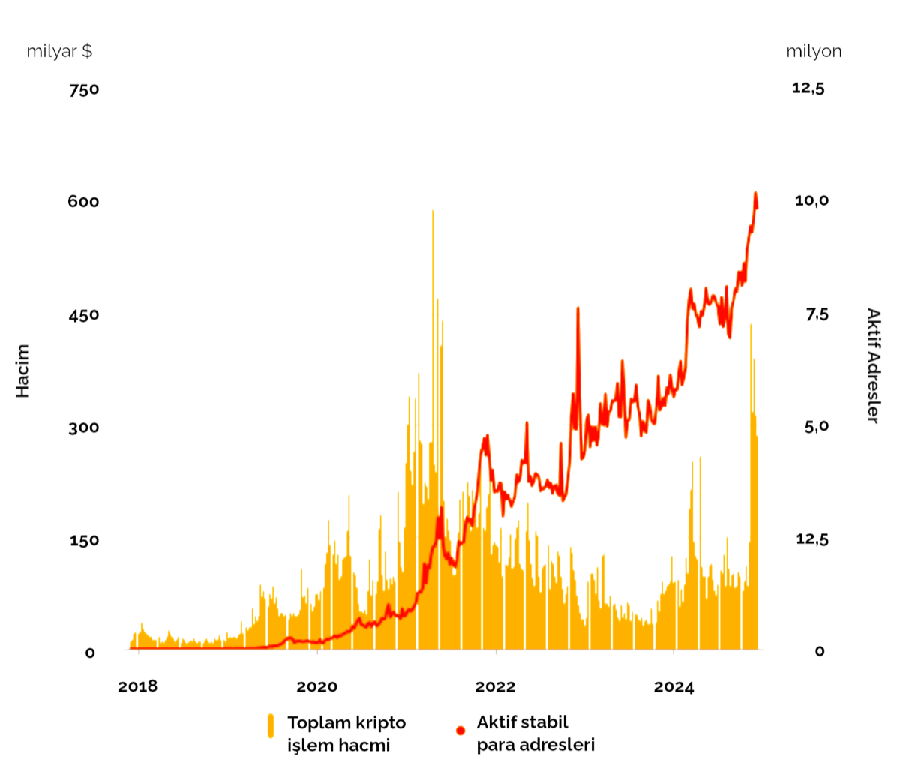
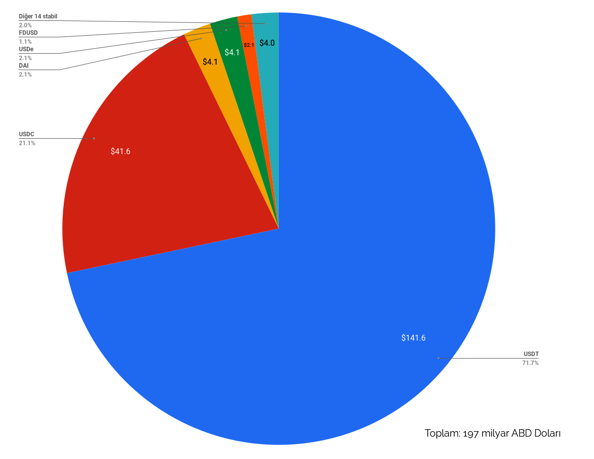
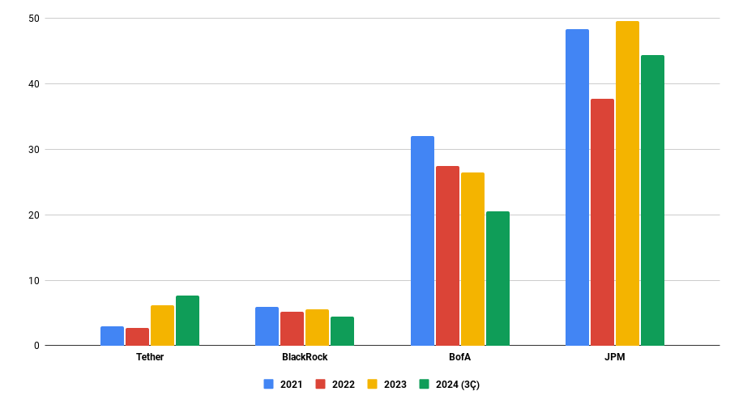

Stabil paralar, kripto dünyası içinde en çok kullanım alanı bulan ürün oldu. Teknoloji alanındaki girişimlerin hep arayıp durduğu ürün/pazar uyumunu (İngilizcesi ‘product market fit’) belki de şu ana kadar en net şekilde yakalayan ürün olan stabil paralar, her ne kadar bir ara toplam piyasa büyüklüğü olarak bir parça düşüş yaşamış olsa da, 2024 yılı içinde tekrar yükselişe geçerek 2022’de yaşadığı zirveyi tekrar yakaladılar.

## Nedir stabil para? {#nedir-stabil-para}

Stabil para deyince ne anlamamız gerektiğini artık üç aşağı beş yukarı herkes biliyor: Değeri itibari bir para birimine bağlı olan paralar bunlar. Pazarın neredeyse tamamına yakını ise ABD dolarına bağlı stabil paralardan oluşmakta. Dolayısıyla, hani bir zamanlar “kriptoparalar ABD dolarının hegemonyasına son verecek” deniyordu ya, işte onun artık gerçekleşmeyeceğinin ilanı oldu stabil paralar.

Örneğin, kriptoparaların en önde geleni olan Bitcoin’i ilk çıkaran Satoshi onun kişiden kişiye ödemelerde kullanılacak bir araç olmasını düşlemişti. Bu hedef henüz gerçekleşmedi ama özellikle kriptonun ilk zamanlarında, kripto alım-satım platformlarında yapılan işlemlerde işlem çifti olarak hep BTC kullanılırdı. Yani bir kriptopara satın alacaksanız, işlem yapmak istediğiniz tahta genelde BTC üzerinden dönerdi. BTC verip o kriptoparayı satın alabilirdiniz. Ne var ki, zamanla BTC işlem çiftlerinin giderek azaldığını ve yerini başta USDT (yani Tether) olmak üzere stabil paralara bıraktığını gördük. Dolayısıyla şu anda Bitcoin’in elinde değer önerisi olarak sadece ve sadece değer saklama aracı (İngilizcesi store-of-value) özelliği kaldı.

<figure><figcaption>Stabil para adaptasyonu <em>Kriptopara işlem hacimleri ile stabil para tutan adres sayılarındaki değişim. Hacimler büyük bir dalgalanma gösterse bile stabil para adaptasyonunda durdurulamaz bir ilerleme görülmekte. (Kaynak: <a href="https://x.com/Delphi_Digital/status/1869463499530965052">Delphi Digital</a>)</em></figcaption></figure>

### Stabil para piyasasının hakimi kim? {#piyasanin-hakimi-kim}

Neyse, stabil paralara geri dönecek olursak, bu alanda liderliği açık ara USDT (Tether) ve USDC’nin aldığını görüyoruz. Bu iki stabil paranın ortak özellikleri, merkezi yapılar tarafından çıkarılmış olmaları ve arkasında (en azından teorik olarak) basıldığı miktar kadar itibari paranın banka hesaplarında tutuluyor olması.

Bu paraların yanında merkezi olarak küçük pek çok oyuncu olsa da, bu oyunculardan biri son zamanlarda yaptığı atak ile dikkat çekiyor. Ülkemizde yasal zorunlulukları yerine getirmek istemediği için faaliyette bulunmayan ama dünyanın ödeme sistemi olarak en büyüklerinden olan PayPal da stabil para sektörüne el atmış durumda. Hem Ethereum hem de Solana zincirleri üzerinde piyasaya sürülen bu stabil para ile ilgili detaylı bilgiye bu bölümün sonunda bulunan “Örnek: PayPal’ın Stabil Parası PYUSD” kısmından erişebilirsiniz.

<figure><figcaption>Stabil para pazar payları</figcaption></figure>

*Dolara çıpalanmış stabil paraların pazar payları. (Kaynak: [TheBlock](https://www.theblock.co/data/stablecoins/usd-pegged))*

### Merkezi stabil paraların riskleri {#merkezi-stabil-paralarin-riskleri}

Bu özellik, kullanıcıya bir gün parasını geri almak istediğinde bire bir değerden geri alabileceği konusunda güvence veriyor olsa da bu alanda hâlâ bazı sıkıntılar olduğunu söylememiz gerek. Örneğin, bu stabil paraların arkasında gerçekten o kadar itibari para var mı? Çıkardıkları raporların doğru olduğuna güvenmek zorundasınız. Sonra, USDC’nin 2023 yılı Mart ayında yaşadığı gibi, paraların tutulduğu bankanın batma riski var. Dolayısıyla bu alanda şeffaflık konusunda sorunlar ve potansiyel riskler halen mevcut.

Öte yandan kullanıcılar için bu stabil paraların, kriptonun vaat ettiği ‘dijital dünyada varlıklar üzerinde tam olarak hak sahibi olma’ özelliğini taşımadığını net olarak söyleyebiliriz. Siz, kendi cüzdanınızda USDT tuttuğunuzu düşünebilirsiniz ama bir gün Tether uzaktan kumanda ile cüzdanındaki USDT’yi dondurup kullanılmaz hale getirebilir. Bu durumda yapabileceğiniz hiçbir şey yok açıkçası. Bu paraları basan Tether ya da Circle’ın da merkezi şirketler olmaları nedeniyle bu tip baskılara karşı koymaları oldukça zor.

### Ya merkeziyetsiz stabil para alternatifleri? {#ya-merkeziyetsiz-alternatifler}

Bu iki büyük stabil paranın dışında, kendini merkeziyetsiz dolayısıyla sansüre karşı daha dayanıklı olarak konumlandıran küçük bir üçüncü oyuncu var, o da MakerDAO tarafından çıkarılan DAI.

DAI’nin temel özelliği herhangi bir kurum tarafından değil kullanıcılar tarafından basılıyor olması. Arkasındaki teminat ise başta ETH olmak üzere kriptoparalar ve gerçek dünya varlıklarından oluşuyor (USDC de var).

DAI gerçekten merkeziyetsiz olması nedeniyle belli avantajlara sahip olsa da kripto dünyasında bir türlü istediği büyüklüğe ulaşamıyor. Bunun da temel nedeni, arkasında duran teminatların değerinin sürekli değişkenlik gösteriyor olması. Sistem, teminatların olası değer düşüşlerine karşı DAI’nin arkasının sağlam durabilmesi için yüksek teminat istiyor. Örneğin şu anda piyasada olan DAI’nin yaklaşık 2.5 katı bir miktar, teminat olarak sisteme kilitlenmiş durumda. Böyle olunca, DAI’nin sermaye verimliliği çok düşük kalıyor. Yani kullanım alanlarına baktığınızda elde edeceğiniz potansiyel gelir, bağladığınız paranın yanında yetersiz kalıyor.

Öte yandan 2024 yılının yaz aylarında DAI’yi çıkaran merkeziyetsiz yapı MakerDAO ismini Sky olarak değiştirdi ve DAI’nin yeni versiyonu olan USDS’i piyasaya süreceğini açıkladı. Bu açıklama kripto dünyasında ciddi bir tepki çekti. Tepkinin temel nedeni, USDS’in aynı USDT ya da USDC gibi uzaktan kontrolle dondurulabiliyor olması. Sky bunu ileride otoriteler ile başının derde girmemesi için yapıyor. Her ne kadar DAI mevcut hali ile devam edecek olsa da[^1], işin tadının kaçtığını belirtmek gerekiyor.

DAI dışında 2021 yılında popüler olan bir başka merkeziyetsiz para ise UST idi. Terra blokzinciri içinden çıkan ve ağın kendi para birimi olan Luna ile desteklenen UST, kullanıcılara verdiği yıllık %20 faiz ile pek çok Web3 kullanıcısını kendine çekmişti. Ne var ki, bu tip inanılmaz getiri vaat eden ürünlerde ilk sorulması gereken soru “değirmenin suyu nereden geliyor?” olmalı. Belirli bir büyüklüğe kadar ‘pazarlama masrafı’ olarak Terra sistemini kuranlar tarafından ödenen bu faiz, sisteme konan paranın 18 milyar ABD Doları’na kadar yükselmesi sonrası sürdürülemez hale geldi. Sonrasında büyük bir patırtı ile çöken UST’nin hikayesini, bölümümüzün sonundaki “Örnek: UST” kısmında daha detaylı olarak okuyabilirsiniz.

### Merkez Bankası Dijital Paraları {#merkez-bankasi-dijital-paralari}

Stabil paraların bu kadar popüler olması, itibari paraları çıkaran merkez bankalarının gözünden kaçmadı elbette. İtibari paralara alternatif olarak çıkan bu merkeziyetsiz ürünlere çok da sıcak bakmayan merkez bankaları, kendi dijital paralarını çıkarmak için uzun süredir çalışmalar yapıyorlar.

Merkez bankalarının kendi perspektiflerinden bir Merkez Bankası Dijital Parası (İngilizce Central Bank Digital Currency kısaca CBDC) çıkarması kadar doğal bir gelişme olamaz. Zira, teknoloji size artık bastığınız parayı programlanabilir yapma olanağı veriyor. Bu sayede çok daha efektif bir para politikası güdebilirsiniz.

Örneğin, herhangi bir bölgede afet mi oldu, o bölgede bundan zarar gören vatandaşlara direkt para yardımı yapabilirsiniz. Bunu şu anda itibari paralar ile de yapabilirsiniz ama CBDC’nin güzelliği bundan sonra başlıyor. Gönderdiğiniz paranın nasıl ve nerede kullanılacağına önceden karar verebilirsiniz. Yani yaptığınız yardımı hane halkı için temel ihtiyaç maddeleri ya da çiftçi için dizel yakıt alımı ile sınırlı tutabilirsiniz. Öte yandan süreli olarak da yapabilirsiniz bu yardımı. Belirli bir süre içinde kullanılmayan paraları otomatik olarak geri çekebilirsiniz.

Merkez bankaları açısından oldukça verimli bir araç olan CBDC’lerin, kullanıcılar için etkileri ise pek çok soru işareti ile dolu. Öncelikle, parayı harcamanın bu kadar şeffaf bir şekilde takip ediliyor olması, özellikle mahremiyet konusunda ciddi endişeler barındırıyor. Hele bir de CBDC’ler konusunda en ileri ülke olan Çin’in ‘sosyal repütasyon’ adı altında yaptığı uygulamalar, Web3 yanlıları arasında tam bir distopya olarak değerlendiriliyor.

Finans dünyasının lideri olan ABD’de ise CBDC’ler konusunda şu an için hakim görüş bu konudan uzak durmak yönünde. Özellikle kişisel özgürlüklerin çok hassas bir konu olduğu ülkede, halkı CBDC’ye ikna etmek oldukça zor iş. Zaten Cumhuriyetçiler açık açık karşı olduklarını ilan ettiler bile. Öte yandan, Web3 dünyasının stabil para piyasası zaten ABD Doları üzerinden dönüyor. Bu pazarın oyuncuları arasında olan USDC, baştan itibaren hükümet ile iyi ilişkiler içinde. USDT de yavaş yavaş hükümetin suyuna girmiş durumda. Her iki kurum da kendilerine gelen ‘şu hesaptaki şu parayı dondur’ taleplerini çok hızlı bir şekilde yerine getiriyorlar. Dolayısıyla ABD’nin şu aşamada kamu eliyle bir dijital merkez bankası parası basmasına gerek yok gibi görünüyor.

Ülkemizde ise CBDC konusunun geliştirilmesi TCMB’ye bırakılmış durumda. Merkez Bankası bu konuda TÜBİTAK ile yakın çalışarak bir prototip geliştirdiğini açıkladı. 2023 yılı sonunda tamamlanan ilk faz çalışmalar sonrası 2025 yılında ikinci faz çalışmalar ile birlikte geniş çaplı testler yapılması [öngörülüyor](https://anlatilaninotesi.com.tr/20241119/2025e-dogru-yeni-nesil-para-biriminin-tum-detaylari-dijital-turk-lirasi-turkiye-icin-neden-oldukca-1090381254.html). Genelde bankalar aracılığıyla yürütülecek bir sistem olacak gibi görünüyor. İlerleyen aşamaları hep birlikte takip edeceğiz.

### Kullanıcı stabil para kullandığı için ne kazanıyor? {#kullanici-stabil-para-kullandigi-icin-ne-kazaniyor}

Stabil paralar ile ilgili bir başka önemli nokta da kullanıcının elde ettiği kazanç. Ne Tether ne de USDC’yi çıkaran Circle, paralarını elinde tutan kullanıcılara herhangi bir getiri vaat etmiyor[^2]. Elinizde USDT tuttuğunuzda efektif olarak Tether şirketine faizsiz borç vermiş oluyorsunuz. Zaten, Tether’in en büyük gelir kalemi kendisine verilen bu paralar üzerinden kazandığı faiz geliri. Baksanıza, içinde yaklaşık [110 kişinin çalıştığı](https://www.apollo.io/companies/Tether-to/5569974e736964255dc85c00) Tether’in 2023 yılı gelirleri, o şanlı Wall Street’in en büyük para yöneticisi olan BlackRock’tan bile daha fazla:

<figure><figcaption>Tether, BlackRock, Bank of America ve JP Morgan net kârları <em>JPMorgan, Bank of America, BlackRock ve Tether’in son üç yıl net kazançları. (Kaynak: Delphi Digital, Tether, Yahoo Finance)</em></figcaption></figure>

Bir diğer para olan DAI ise, kullanıcılara ellerindeki DAI’yi sisteme kilitlemeleri durumunda protokol tarafından belirlenen oranda bir faiz veriyor[^3].

2024 yılında ortaya çıkan yeni bir stabil para olan Ethena, hem USDT ve USDC’nin merkezi olma, hem de DAI’nin sermaye verimliliği problemlerini çözdüğünü iddia ediyor. Bölümümüzün sonunda yer alan “Örnek: Ethena” kısmında hem bu parayı tanıtıyor, hem de potansiyeli ve risklerine göz atıyoruz.

## Sonuç {#sonuc}

Stabil paralar kriptoparaların inişli çıkışlı dünyası içinde yatırımcılara sığınabilecekleri güvenli bir liman sunuyor. Her ne kadar bankada tutulan paraya göre farklı riskler taşıyor olsalar da, stabil paralar Web3 dünyasının gelişmesi ve özellikle yeni kullanıcıların bu alana girmesi için oldukça etkili bir araç.

Merkezi stabil paraların Web3 dünyasının merkeziyetsiz ruhu ile ciddi şekilde çelişiyor olduğunu da unutmamak gerekiyor. Önümüzdeki dönemde gelmesi beklenen merkez bankaları tarafından çıkarılacak paralar da benzer şekilde merkeziliği körüklüyor olacaklar. Uzun vadede Web3’ün ilk baştaki hedeflerine ulaşabilmesi için merkeziyetsiz alternatiflerin piyasada daha etkin olması gerekiyor.

Şu ana kadar özellikle gelişmekte olan ülkelerde, kullanıcıları ülkenin çalkantılı ekonomik politikalarından koruma gibi bir değer önerisi ile popüler olan stabil paraların, bundan sonra da gelişen Web3 alanları ile birlikte daha da yaygınlaşması beklenebilir. Büyümesi beklenen alanlar için en önde gelen merkeziyetsiz finans ise bir sonraki kısmın konusu.

[^1]: DAI stabil parası, bir akıllı kontrat olarak revize edilemiyor (İngilizcesi non-upgradable contract). Bir kez bu akıllı kontratı Ethereum sistemine yüklediğinizde artık sizin kontrolünüzden çıkıyor. İsteyen istediği gibi kullanabilir. Blokzincirin en önemli özelliklerinden biri bu.

[^2]: Circle’in eski ortağı olan Coinbase USDC’yi kendisine kilitleyenlere [belirli bir oranda getiri veriyor](https://help.coinbase.com/en/coinbase/coinbase-staking/rewards/usd-coin-rewards-faq).

[^3]: Yazının hazırlandığı sırada bu oran [%6,5 seviyesinde idi](https://app.spark.fi/dashboard).
