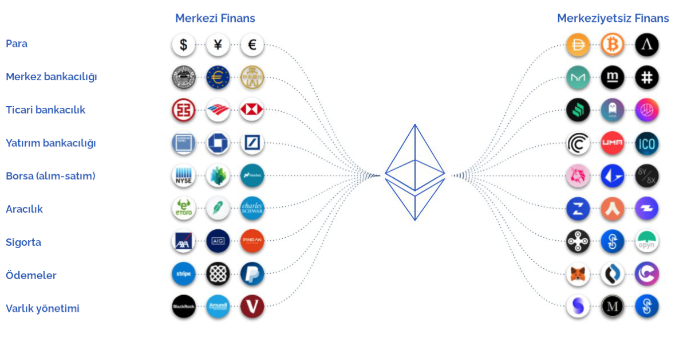
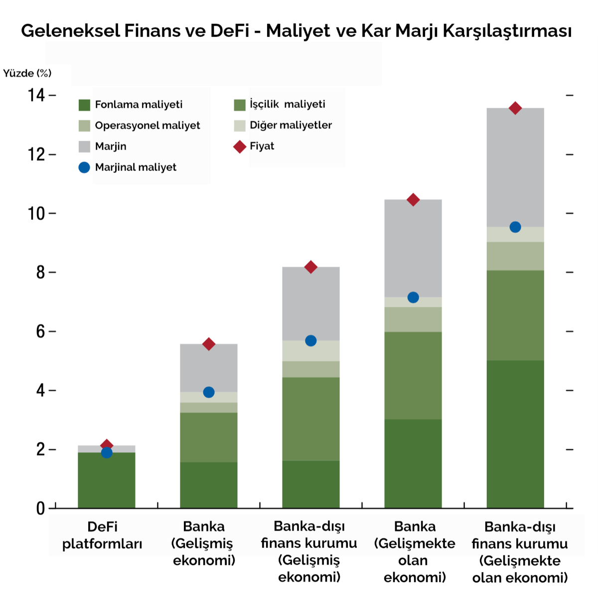
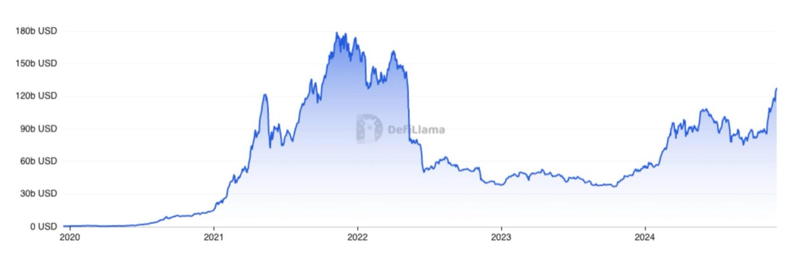

Bu kısımda Web3’ün en geliştiği alan olan finans sektörüne ve bu alandaki uygulamalara verilen genel isim olan merkeziyetsiz finans (ingilizce Decentralized Finance ya da kısaca DeFi) alanına bakacağız.

## Önce kısa bir tarihçe ile başlayalım: {#once-kisa-bir-tarihce-ile-baslayalim}

Yazımızın başında da bahsettiğimiz gibi merkeziyetsiz finans ya da DeFi, Web3’ün finans alanındaki uygulamalarına verilen genel isim.

2009 yılında hayata geçen ilk merkeziyetsiz uygulama olan Bitcoin, kendisini ‘kişiden kişiye para transferlerinde kullanılacak, sansüre dayanıklı bir para’ olarak konumlandırmıştı. Sonrasında bu ürünün altında yatan teknoloji olan blokzincirin aslında başka uygulamalarda da kullanılabileceğini savunan bir grup, Bitcoin topluluğundan koparak 2015 yılında Ethereum’u hayata geçirdiler.

Bir altyapı olarak dileyen herkesin istediği her programı yükleyebileceği bir ağ olan Ethereum üzerinde, bu tarihten itibaren değişik uygulamalar geliştirilmeye başlandı. Bunlar içinde en çabuk hayata geçen uygulamalar finans alanında gerçekleşti.

## Nedir DeFi? {#nedir-defi}

Merkeziyetsiz finans, geleneksel anlamda finans sektörü tarafından sunulan hemen her hizmetin merkeziyetsiz olarak kurulmuş uygulamalar aracılığıyla blokzincir üzerinde verilmesi olarak adlandırılabilir.

<figure><figcaption>Geleneksel finans ile merkeziyetsiz finans</figcaption></figure>

*Merkeziyetsiz finans klasik finans tarafından verilen her tür hizmeti bizlere sunmaya aday. (Kaynak: [Consensys](https://consensys.net/knowledge-base/defi/))*

Merkeziyetsiz finans yukarıda sıralanan hizmetleri sunan bir altyapı aslında. Temel özelliği ise herkesin erişimine açık olması ve içindeki uygulamaların beraberce şeffaf bir şekilde çalışabilmesi.

Bu saydığımız hizmetler kullanıcılara bir deste halinde sunuluyor. Ne demek tam olarak bu? Hizmeti oluşturan her parçayı sunan birden fazla hizmet sağlayıcı var. Kullanıcı adeta bir lego yapar gibi, istediği parçayı istediği sağlayıcıdan alıp birleştirebiliyor. İstediği anda da parçalardan birini çıkarıp yerine bir başkasını takabiliyor. Bu, kullanıcıya hizmet sağlayıcı karşısında müthiş bir güç kazandırıyor.

## Web3’te neden finans alanı öne çıktı? {#neden-finans-alani-one-cikti}

Web3 uygulamalarının finans alanında büyümesinin iki temel nedeni var. Birincisi, potansiyelin büyük olması. İkincisi ise bu potansiyelin değerlendirilebileceği uygun koşulların var olması. Gelin biraz daha açalım bu iki maddeyi:

### Potansiyelin büyüklüğü {#potansiyelin-buyuklugu}

Blokzincirin temel felsefesi dijital dünyada kişilerin birbirleri ile güvenli bir şekilde ilişkiye girmesini sağlamak. Dijital dünyanın anonim yapısı gereği kullanıcıların diğer kişilere direkt olarak güven duyması imkansız. O nedenle, yaptıkları her işte onlara birilerinin yardımcı olması gerekiyor. Yani kişilerin güven ihtiyacını bu aracı kurumlar karşılıyor. Blokzincir işte bu güveni kullanıcılara şeffaf bir şekilde verebiliyor, dolayısıyla kişilerin bu aracılara olan ihtiyacı ortadan kalkıyor. Böyle bir ihtiyacın en çok hissedildiği alan ise aslına bakarsanız finans.

Finans kurumlarının müşterilere sunduğu en önemli değer önerisi ‘güven ihtiyacını karşılamak’. Bunu layıkıyla yapabilmek için ciddi bir operasyonel yük altına giriyorlar. Üstelik bağlı bulundukları yasalara uyum sağlamak için gösterdikleri çaba ve masraf da işin cabası. Bu nedenle müşterilerine bu maliyeti bir şekilde yansıtmak zorundalar. Öte yandan mevcut yasalar müşteri kabul ederken belirli kriterlere uyma zorunluluğu getiriyor; bu nedenle her bireyi müşteri olarak kabul edemiyorlar. Dolayısıyla günümüz dünyasında hâlâ finans kurumlarına erişimi olmayan ciddi bir kesim bulunuyor.

İşte merkeziyetsiz finans ‘herkesin erişimine açık olması’ ve operasyonel yükünün azlığı sayesinde kullanıcılara ‘ucuz’ ürünler sunarak geleneksel finans ile rekabet edebilir hale geliyor. Kullanıcının merkeziyetsiz finansı kullanabilmesi için tek ihtiyacı olan cep telefonu ya da bilgisayar üzerinden ulaşabileceği bir elektronik cüzdan. Evrak, izin gibi herhangi bir kısıtlama yok.

### Potansiyelin değerlendirilebilmesi {#potansiyelin-degerlendirilebilmesi}

Yukarıda gördüğünüz gibi ortada ciddi bir potansiyel var ama bu illa bu fırsatı değerlendirebileceğiniz anlamına gelmiyor. Bunun için belli ön koşullar var. Bunlar içinde en önemlisi blokzincirin yeşerebileceği alanın tamamen dijital olması. İşin içine fiziki dünyanın gereklikleri girdiğinde blokzincir tökezlemeye başlıyor.

Finans dünyası da, özellikle 1990’lı yıllardan başlayarak kendini dijitalleşmeye en çabuk adapte eden sektörlerin başında geliyor. Farkında mısınız bilmiyorum ama artık finans kurumları ile fiziki ilişkimiz gitgide azalıyor. Nakit yerine kart kullanıyoruz, işlerimizi cep telefonundaki uygulamalardan hallediyoruz. Finans kurumları da bizi buna teşvik ediyorlar. Hatta yavaş yavaş şubelerin bile ortadan kalktığını görüyoruz. Sektör, dijitalleşmenin maliyet avantajlarını tüm benliğiyle kucaklamış durumda.

İşte bu dijitalleşme dönüşümü, blokzincirin kendini gösterebilmesi için en kritik konu. Bitcoin ve sonrasında gelen kriptoparalar ile bir önceki bölümde bahsettiğimiz stabil paralar, kişilerin dijital dünyada ekonominin temeli olan ‘değeri’ kurumlara ihtiyaç duymadan tutmasını sağlıyor. Merkeziyetsiz finans da, benzer şekilde elinde fazla kapitali bulunan kişilerin bunu kapital ihtiyacı olanlara direkt olarak aktarabilmesinin yolunu açıyor.

## DeFi’nin avantajları neler? {#definin-avantajlari-neler}

Gelin şimdi de hızlıca DeFi’nin biz kullanıcılar için avantajlarını sıralayalım:

### Verimlilik {#verimlilik}

DeFi ürünü dediğimiz aslına bakarsanız blokzincir üzerinde çalışan uygulamalar (blokzincir jargonuyla ‘akıllı kontratlar’). DeFi’nin klasik finansa göre en büyük avantajlarından biri, nihayetinde birer yazılım olmalarından ötürü, kurulma ve operasyon maliyetlerinin çok düşük olması. Bu temel bir özellik.

DeFi’nin belirli standartlar üzerine kurulmuş olması, bu alandaki uygulamaların birbirleri ile uyumlu bir şekilde çalışabilmesini sağlıyor. Bu sayede, uygulamalar son kullanıcıya sunulacak ürünün her bir parçasını bir araya getirmeye çalışmak yerine sadece kendi uzman oldukları alan içinde çalışıyorlar. Aynı alan üzerinde çalışan onlarca uygulamanın olması inovasyonu, bu da verimliliği ciddi şekilde artırıyor.

Nisan 2022 yılında IMF tarafından yayınlanan Global Stability Report bu avantajı açık bir şekilde ortaya koyuyor:

<figure><figcaption>Geleneksel finans ve DeFi - maliyet ve kâr marjı karşılaştırması</figcaption></figure>

*Gelişmiş, gelişmekte olan ülkelerdeki finans kurumları ile DeFi platformlarının maliyet ve fiyat karşılaştırması. (Kaynak: [IMF Global Study Report, April 2022, Sayfa 80](https://www.imf.org/en/Publications/GFSR/Issues/2022/04/19/global-financial-stability-report-april-2022))*

DeFi platformlarının gerek banka gerekse banka dışı finans kurumlarına göre ciddi bir işçillik ve operasyonel maliyet avantajı bulunmakta (yukarıdaki grafikte en alttaki fonlama maliyeti ve en üstteki kâr marjı dışında ortadaki diğer maliyetler). Bu avantaj gelişmiş ülkelerden gelişmekte olan ülkelere geçerken daha da belirgin hale geliyor. Yoğun rekabet nedeniyle de DeFi’deki kâr marjlarının da düşük olması, tüketici için en uygun fiyatın DeFi’de olmasına yol açıyor.

### Şeffaflık {#seffaflik}

DeFi üzerindeki uygulamaları geliştiren ekiplerin kimi zaman anonim olduğunu görüyoruz. Bu durum gerçek hayattaki bir hizmet için anormal olsa da Web3 dünyasında çok da garip karşılanmıyor. Zira, burada uygulamayı kimin yaptığının bir önemi yok. Önemli olan programın düzgün çalışması. Bu da, ‘açık kaynak’ felsefesi gereği, uygulamayı oluşturan akıllı kontratın kodlarının herkesin görebileceği ve denetleyebileceği şekilde paylaşılması sayesinde oluyor. Uygulamanın ‘içini’ bildikten sonra kimin yazdığının bir önemi kalmıyor.

Sadece bununla da sınırlı değil şeffaflık. Blokzincir sayesinde, uygulamaların ne yaptığını, kullanıcıların bu uygulamaları nasıl kullandığını çok net olarak görebiliyorsunuz. Hatırlayanlarınız olacaktır, 2008 yılında ABD’de yaşanan ‘ipotek krizi’, finans dünyasında büyüyerek bir balon haline gelen türev enstrümanlarının büyüklüğünü kimsenin ölçemiyor olmasından kaynaklanmıştı. DeFi için böyle bir durum söz konusu değil, zira bütün yapılan işlemler ve alınan riskler apaçık blokzincir üzerine yazılıyor.

### Herkesin erişimine açık {#herkesin-erisimine-acik}

Bundan önceki sayfada da yazdığımız gibi, kamuya açık blokzincirlerin en temel özelliği herkesin erişimine açık olmaları. Cep telefonuna yüklenen bir elektronik cüzdan uygulaması ya da bilgisayarın tarayıcısına kurulan bir eklenti ile isteyen herkes hesap sahibi olabilir; hesabında kriptopara olduğu sürece DeFi ürünlerinin web sitelerine girip cüzdanını bağlayarak uygulamaları kullanabilir.

Bu arada biraz teknik kalacak ama kimilerinin aklına takılabilecek bir soruya da buradan açıklık getirelim. Kimi zaman kimi web sitelerinin belirli ülkelerden gelen kişilerin kullanımına kapalı olduğunu görüyoruz. Bu web site sahiplerinin kurulu oldukları ülke yasalarına uymak amacıyla koydukları bir engel. DeFi ürünleri birer uygulama (akıllı kontrat) olarak blokzincir üzerinde yaşıyorlar. Büyük ve olgunlaşmış DeFi uygulamalarının hemen hepsi blokzincire konduktan sonra artık değiştirilemez hale geliyorlar, yani kurucu ekibin kontrolünden çıkıyorlar. Bir web sitesi uygulamaya erişime kısıt getirse bile, kullanıcılar başka web siteleri aracılığıyla bu akıllı kontratlara istedikleri yerden bağlanabilirler. Bunu kimse engelleyemez.

### Tam sahiplik sağlama {#tam-sahiplik-saglama}

Web3 dünyasının kullanıcılara sunduğu en önemli değer önerilerinden biri dijital varlığa tam olarak sahip olma olanağı. Ne demek tam olarak bu? Klasik anlamda, bir müşteri parasını bankada tuttuğunda aslında parasını bankaya emanet etmiş olur. Genelde müşteriler parayı istedikleri zaman ATM’ler üzerinden ya da şubeden çekebildikleri için bu durumu çok düşünmezler. Peki ya bir gün banka parayı vermezse? “Yok canım olmaz öyle şey” demeyin, Lübnan’da karısının kanser tedavisi için bankada bulunan mevduatını çekmek isteyen ama nakit sıkıntısı nedeniyle bu isteği reddedildiği için banka şubesini basan [adamın hikayesini](https://pulitzercenter.org/stories/my-money-or-your-life-bank-robbers-beirut) duyanlar vardır elbet.

Kullanıcı blokzincir üzerindeki parasına sadece kendisi erişebilir. Bunu da kendisine ait elektronik cüzdan ile yapar. Parasını istediği şekilde değerlendirir ya da istediği hesaba istediği zaman gönderebilir.

Tabii bu özellik büyük bir lüks olduğu gibi kullanıcıya büyük bir sorumluluk da getiriyor. Cüzdanı oluştururken kendisine verilen kelimeleri kaybederse blokzincir üzerindeki para ulaşılamaz hale gelir. Neyse ki bu alanda çıkan yenilikler kullanıcıları bu dertten kurtaracak gibi görünüyor. Bu konuda daha detaylı bilgiye ikinci bölümümüzün içindeki ‘Cüzdanlar’ kısmından ulaşabilirsiniz.

Öte yandan tam sahiplik özelliği sayesinde finansal piyasalarda en büyük risklerden biri olarak kabul edilen karşı taraf riski (İngilizcesi counterparty risk) de elimine edilmiş oluyor.

## DeFi nasıl büyüdü? {#defi-nasil-buyudu}

DeFi’nin gerçek bir patlama yaşadığı ‘yaz dönemi’, 2021 yılında protokollerin kendilerine ait yönetim tokenlerini teşvik olarak kullanıcılara dağıtmaları ile başladı. DeFi protokolleri, çıkardıkları yönetim tokenleri sayesinde kurdukları havuzlara likidite sağlayan yatırımcıları ve bu havuzların kullanıcılarını kendilerine çekmeyi başardılar. Bu sayede büyümek için ihtiyaç duydukları likidite ve işlem hacmine ulaşmış oldular. Bir yandan da, bu tokenler aracılığıyla protokollerinin yönetimini daha geniş bir kesime yayarak merkeziyetsizlik yolunda önemli bir yol katettiler.

Burada ufak bir parantez açalım: Kimi merkezi yapıların, yüksek miktarda ve hesap kitap yapmadan kullandıkları kaldıraçlı işlemler ile bu büyümeye hormonlu bir şekilde katkı sağladığını da gördük. 2022 yılında yaşanan ‘krizlerin’ temel nedeni, merkeziyetsiz sistemler değil, aslında bu fütursuz merkezi yapılar olduğunu belirtmek gerek. Piyasalarda 2022 yılı sonrası yaşanan kış dönemi, merkeziyetsiz finans protokollerinin kullanımını ciddi şekilde etkiledi. 2023 yılında yaşanan dip sonrası kriptopara değerlerinin de artması ile birlikte bu alanda faaliyet gösteren protokollere ilginin tekrar tırmanışa geçtiğini gördük.

<figure><figcaption>Merkeziyetsiz finans sistemine kilitli toplam para</figcaption></figure>

*Merkeziyetsiz Finans protokollerine kilitlenen para (bir nevi mevduat gibi düşünebilirsiniz) miktarının yıllar içinde değişimi (milyar ABD Doları). (Kaynak: [DefiLlama](https://defillama.com/))*

Yönetim tokenlerini dağıtmak, likidite ve işlem hacmini DeFi’ye doğru çekse de, bunun sürdürülebilir bir strateji olmadığı açıktı. Zira, verilecek tokenlerin bir sınırı var. Önemli olan, insanların bu sistemleri sürekli olarak kullanmaları. Milyon dolarlık soru işte bu.

## DeFi’nin daha da büyümesi için önünde hangi engeller var? {#daha-da-buyumesi-icin-onunde-hangi-engeller-var}

DeFi’nin sürdürülebilir bir şekilde büyümesi için çok daha geniş kesimlerce kullanılması yani benimsenmesi gerekiyor. Peki bu nasıl olacak? Orada da iki temel sorunun çözülmesi gerektiğini düşünüyorum. Bunlar kullanım zorluğu ve kullanıcıların aldığı risklerin minimize edilmesi.

### Kullanıcı deneyimini artırma {#kullanici-deneyimini-artirma}

DeFi’nin önündeki birinci sorun kullanım kolaylığı. DeFi, yapı itibari ile klasik finanstan temelden ayrışıyor: Klasik finans, finans kurumlarının müşterilerin sahip olduğu paraları emanet alarak işletmesi üzerine dönen bir sistem. DeFi ise kullanıcıların sahip olduğu kriptoparaları, DeFi protokollerini kullanarak ama kendileri tarafından yönetmeleri esasına dayanıyor.

DeFi dünyası göreceli yeni bir alan. Bu alandaki en kıdemli oyuncuların bile geçmişi en fazla beş sene. Bu beş sene içinde protokollerin uğraştıkları temel konu, yukarıda bahsedilen temeli baz alıp klasik finansı taklit etmeye çalışmak oldu.

Bunu başardıktan sonra ise, yine aynı avantajları kullanarak bu sefer klasik finansın çıkaramayacağı yeni ürünleri kullanıcılarına sunmakla uğraştılar.

Burada temel bir konuyu unutmamak gerek; altyapı alanındaki bu gelişmeleri yürüten programcılar, daha çok mühendis kökenli ve işin tekniğine yoğunlaşan bir kitle. Onlar için ‘sağlam ürün’ çıkarmak daha öncelikli bir hedef. Bunda da oldukça başarılılar.

Halbuki bu, son kullanıcı için yeterli değil. Ortaya çıkarılan başarılı ürünlerin geniş kesimlerce kullanımı için artık bir sonraki aşamaya geçmek gerekiyor. Bu da, bu ürünlerin kullanıcı için ‘cilalanması’ ve rahat kullanılır hale getirilmesi.

Son kullanıcı, onlarca blokzincir, ikinci seviye çözüm, cüzdan, anahtar benzeri konular ile uğraşmak istemiyor, bunları bilmek zorunda da değil. Onun için önemli olan elindeki telefondan her tür ürüne zahmetsizce ulaşabilmek. DeFi bu anlamda kullanıcıya istediğini henüz veremese de, son zamanlarda bu alanda çalışmaların arttığını söylemek gerek. Özellikle Solana zincirinin kullanıcı rahatlığını ön plana çıkaran ürünler konusunda rakiplerinden daha önde olduğunu belirtmeliyiz.

Daha net örnek için son dönemde ortaya çıkan kripto debit kartlarına bakabiliriz. Bu kartlar, kullanıcılara kendi cüzdanlarında tuttukları kriptoparaları harcama, DeFi uygulamaları ile entegrasyon ve fiat (yani itibari) paradan kriptoparaya geçiş (on-ramp) ya da kriptoparadan fiat paraya geçiş (off-ramp) konularında büyük ilerleme sağladılar. Sıra, harcama dışında bu kartlar ile fatura ödeyebilmeye gelmiş görünüyor[^1].

### Kullanıcının aldığı riskleri azaltma {#kullanicinin-aldigi-riskleri-azaltma}

Merkeziyetsiz finansın temel özelliklerinden biri, kişiye dijital dünyadaki varlıkları üzerinde tam sahiplik vermesi. Ne demek ‘tam sahiplik’? Sahip olunan varlığa ulaşmanın sadece kişinin elinde olması, dolayısıyla varlık üzerindeki her tür aksiyona (örneğin varlığı değerlendirme ya da bir başkasına devretme) haiz olması. Bu büyük bir güç.

Öte yandan bu özellik, belki de DeFi’nin geniş kitlelerce kullanımının önündeki en büyük engellerden biri. Zira kullanıcının elindeki bu güç aynı zamanda büyük bir sorumluluk da getiriyor. Kullanıcının, farklı blokzincirlerin ve üzerindeki protokollerin risklerini öğrenmesi, riskini buna göre değerlendirmesi ve dağıtması gerekiyor. Halbuki geniş kitlelerin bu sorumluluğu alabilecek ne finansal ve teknolojik okuryazarlığı ne de bunları öğrenmek için hevesi var. Bunu 2022 yılındaki UST olayında da net olarak gördük. Stabil para olduğu için ‘risksiz’ olarak değerlendirilen UST’nin temel riskleri pek çok yatırımcı tarafından göz ardı edildi ve sonunda olan maalesef yatırımcıya oldu. UST krizinin tüm detaylarını bu bölümün sonuna doğru yer alan ‘Örnek: UST’ kısmında görebilirsiniz.

DeFi’nin bu riskleri geniş kitlelere anlatabilmek için daha basit, daha kolay anlaşılır ürünler sunması ve (belki de ‘merkeziyetsizlik’ ruhuna aykırı olacak şekilde) kullanıcılara bu riskleri anlatıp onlara yol gösterecek aracılar kullanması gerekiyor.

## DeFi için çare ne? {#care-ne}

Yukarıdaki sorunların çözümü ve DeFi’nin geniş kitlelerce adaptasyonunu sağlamak için uzun vadede iki temel yol görünüyor.

### Kendi kendine başarabilecekleri {#kendi-kendine-basarabilecekleri}

Öncelikle, DeFi ürünlerinin yolun başında olduğunu unutmamak gerekiyor. Dolayısıyla, temel sorunları çözdükten sonraki aşamada odaklanacağı konu kullanıcı deneyimini artırmak olacak. Aslına bakarsanız burada, özellikle son kullanıcıya yönelik ön yüzlerin hızla gelişmeye başladığını görüyoruz ([Zerion](https://zerion.io/), [Zapper](https://zapper.xyz/tr) tarzı hizmet veren sunucular, [Clave](https://getclave.io/) benzeri kullanım kolaylığı sağlayan cüzdanlar, farklı DeFi ürünlerine ulaşım sağlayan toplayıcılar gibi). Kullanıcı deneyimini parça parça iyileştiren bu girişimlerin daha sonrasında farklı alanlara doğru genişleyerek kullanıcıya geniş bir kapsamda hizmet vermeye başladıkları da görülüyor. Bunlar, kullanıcı deneyimi açısından önemli gelişmeler ve önümüzdeki dönemde hızlanarak devam edecekler.

Kullanıcının maruz kaldığı riskler konusu ise daha çetrefilli. Protokollerin hacklenmesi, kurucu ekiplerin projeleri suistimal etmesi, piyasalardaki ani dalgalanmaların yarattığı likidasyonlar son kullanıcının gözünü korkutan konular. Bu alanda sunulan hedge mekanizmaları son kullanıcıya hitap edemeyecek kadar karmaşık. Merkeziyetsiz sigortacılık ise şu an [Nexus Mutual](https://nexusmutual.io/)’in sunduğu çok kısıtlı bir ürün yelpazesini aşamamış durumda. Önümüzdeki dönemde bu alanda geliştirilecek (örneğin merkeziyetsiz sigorta protokolü ArmorFi’nin adını [ease](https://armor.ease.org/) olarak değiştirip farklı denenmemiş bir ürün gamı sunması gibi) yeni ürünlerin büyük potansiyeli olabilir. Zaten, girişim finansmanı şirketleri DeFi’nin ve Web3’ün potansiyeline canı gönülden inanmış olacaklar ki, 2022 yılında yaşanan kriz sonrası azalmış olsa da bu alana oluk oluk para akıtmaya devam ediyorlar.

### Rakipler ile ortak yapabilecekleri {#rakipler-ile-ortak-yapabilecekleri}

Öte yandan, ‘dışarıdan’ yardım almak, DeFi’ye önündeki problemleri çözmek konusunda oldukça fayda sağlayabilir. Gelin DeFi’ye yardımcı olabilecek iki adaya hızlıca bakalım:

Adaylardan biri fintech şirketleri. Bu şirketler klasik dünyanın finans kurumlarına dijital dünyaya adaptasyon konusunda hizmet verirken, çok ciddi bir kullanıcı deneyimi tecrübesi kazandılar. Edindikleri bu deneyimleri DeFi’ye sunabilirler. Böylece ‘önde Fintech arkada DeFi’ diye tanımlayabileceğimiz, müşterinin aşina olduğu fiat para bazlı hizmetleri kriptoparaya dayalı ürünler için de sunabilirler.

Diğer büyük aday ise merkezi kurumlar. Merkezi kurumlardan kastımız, gerek klasik anlamda bankalar da dahil finans kurumları, gerekse merkezi kripto hizmet sağlayıcıları. Bu kurumlar, hem kullanıcı deneyimi tecrübeleri hem de sigorta benzeri müşterilerine sağladıkları güvenceler ile DeFi ürünlerinin geniş kesimlerce kullanımında çok ciddi bir pay sahibi olabilirler. Her ne kadar kimileri tarafından ‘merkeziyetsizlik ruhuna’ aykırı olduğu düşünülse de, bu süreç, kullanıcının önüne farklı alternatifler konabilmesi açısından oldukça önemli olabilir.

## Sonuç {#sonuc}

DeFi, kullanıcılara klasik finans ile karşılaştırıldığında oldukça farklı bir dünya sunuyor. Yaşadığı hızlı büyüme ardından gelen soluklanma dönemi sonrası 2024 yılıyla birlikte tekrar ivme kazanmış gibi görünüyor. Umarım bu alandaki girişimlerden gelecek yenilikler ve merkezi kurumlar ile yapılacak işbirlikleri, DeFi’nin geniş kesimlerce adaptasyonu konusunda önemli bir katalizör olacak. Gelecek heyecanlı, hep birlikte göreceğiz.

[^1]: Delphi Digital’in “[The Year Ahead for DeFi 2025](https://members.delphidigital.io/media/delphis-defi-year-ahead-2025)” raporunda bu konuyla ilgili daha detaylı bilgiye ulaşabilirsiniz.
