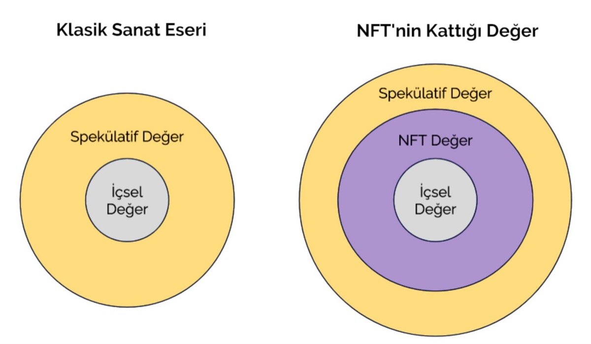
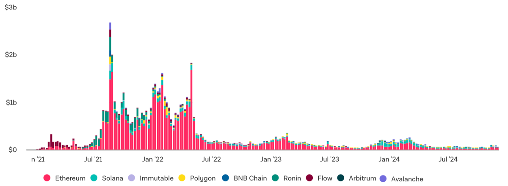

Bu kısımda 2020’li yılların başında herkesin dilindeyken yaşanan krizlerin etkisiyle heyecanını kaybeden ama uzun vadede önemli Web3 alanlarından biri olmaya devam edecek olan NFT dünyasının kapılarını aralayacağız.

## Nedir bu NFT? {#nedir-bu-nft}

Duymayan kaldı mı NFT’leri gerçekten? “Herkes konuşuyor ama ne demek tam anlamadık!” şeklinde bir sitem almamak için ne olduğunu yine de dilimizin döndüğünce basit bir şekilde anlatmaya çalışalım.

NFT terim olarak Non-Fungible-Token’ın kısaltması. Bu ne demek peki? Tekil (eşsiz) dijital varlık[^1]. Çok teşekkürler açıklama için ama biraz daha açsanız iyi olmaz mı? Gelin açalım o zaman.

Non-Fungible-Token kelimesini tek tek açıklayalım önce. Token, Türkçe jeton demek; daha teknik açıklamasıyla dijital dünyadaki herhangi bir varlığı tanımlamak için kullanılan küçük bir yazılım parçası demek. Peki ya bu ne demek tam olarak?

Dijital dünya, esasında fiziki (yani elle tutulur) olmayan, 1 ve 0’lardan oluşan sanal bir dünya. Fiziki ürünler emek ve zaman harcanarak ve dünyamızda bulunan materyaller kullanılarak üretilir. Dolayısıyla sayı ve miktar olarak kısıtlıdırlar. Bir ürün ancak kısıtlı ise değerli olur. Ne kadar fazla ise değeri o kadar azalır. Antalya’da Lara plajında kum satmaya çalışın bakalım, alacak birini bulabilecek misiniz?

Dijital dünyada ise bu ‘kısıtlılık’ özelliği bulunmamakta. 1 ve 0’ları rahatça kopyalayabilirsiniz ve çoğaltabilirsiniz. Online dolaşırken gördüğünüz güzel bir resmi, elinizdeki farenin sağ tuşuna basıp ‘kopyala-yapıştır’ yapabilirsiniz.

Peki dijital dünyada bir varlık sonsuz bir şekilde üretilebiliyorsa o varlık nasıl değerli olabilir? Biz değerli bir varlığa nasıl sahip olabiliriz? İşte burada, dijital dünyada değişen ‘sahiplik’ tanımına geliyoruz.

## Dijital dünyada sahiplik {#dijital-dunyada-sahiplik}

Dijital ürünlerin rahatça kopyalanabilmesi nedeniyle, ürünleri kilitlemeye ya da şifrelemeye çalışmak işe yaramıyor. Keza, görsellerin arka tarafına ‘watermark’ yani damga koymak da faydasız.

Bu nedenle, dijital dünyada ‘sahiplik’ nediri anlamak için bize öğretilen tüm kavramları yeniden oluşturmak gerekiyor. Zira sahiplik, bir ürünün tek kopyasına sahip olmak değil artık. Sahiplik, o ürünün sahibi olduğunuzu tüm dünyaya ilan etmekten geçiyor.

İşte blokzinciri burada devreye giriyor. Blokzincirinin özelliği, herkese açık ve geriye doğru değiştirilemez bir kayıt defteri olması. Herkese açık derken, her isteyenin yazabildiği, her isteyenin de bunu görebildiği bir defter. Üstelik bu kayıt silinemiyor ya da değiştirilmek istenirse orijinali her zaman orada kalıyor.

Blokzinciri sayesinde artık herhangi bir dijital eseri yaratan, eserin kendisini değil ama sahipliğini blokzincire yazabiliyor ve bunu başkasına devredebiliyor.

Sanat eserleri de bu bağlamda kamuya açık ürünler haline geliyorlar. Önemli olan bu eserleri bilgisayarınızda tutmak değil. Bu eserin sahibi olduğunuzu tüm dünyaya kanıtlamak. İşte bunu da blokzinciri sağlıyor.

## NFT bir varlığa (örneğin sanat eserine) nasıl değer katar? {#nft-bir-varliga-ornegin-sanat-eserine-nasil-deger-katar}

Bir sanat eserinin değerini kabaca ikiye ayırmak mümkün (burada tamamen subjektif bir değerlendirme yaptığımı belirtmeliyim). Birincisi içsel değer, ikincisi ise spekülatif değer. İçsel değer dediğimiz, sanat eserinin kaba anlamıyla inşaat maliyeti. Bir resim ise kullanılan boya ve kanvas ücreti, üreten sanatçının eser üzerinde çalıştığı süre gibi.

Spekülatif değer ise, eserin pazar değerini belirleyen ekstra tüm değerlerin toplamı olarak adlandırılabilir. Bunların bir kısmı sanatçının ünü, diğer ürünlerinin satış fiyatı, sanatçının daha ne kadar eser üretebileceği (sınırlılık), eserin daha önce hangi koleksiyonlara ait olduğu gibi esere özgü özellikler. Bir diğeri ise pazarın durumu. Örneğin son bir kaç yıldır yaşadığımız gibi piyasada para bolluğu olması, mevcut yatırım araçlarından istenen getirilerin alınamaması nedeniyle sanat eserlerinin alternatif yatırım aracı olarak görülmesinin getirdiği fiyat şişkinliği bunlardan birkaçı.

<figure><figcaption>NFT bir sanat eserine nasıl değer katar?</figcaption></figure>

*NFT bir sanat eserine nasıl değer katar? Tamamen subjektif bir değerlendirme.*

NFT’lerin yukarıda bahsettiğimiz spekülatif değerin her bir parçasına artı etki yaptığını söylemek mümkün. Neler bunlar, hızlıca gözden geçirelim:

### Eserin orijinal olduğunun teyidi {#eserin-orijinal-oldugunun-teyidi}

Öncelikle, maliyet konusunda ciddi bir avantaj getiriyor NFT’ler. Örneğin bir sanat eserinin orijinal olduğunu anlamak hayli zahmetli ve pahalı bir iş. Özellikle fiziki eserlerde müzeler ya da koleksiyonerler konunun uzmanı eksperlere başvurmak zorunda kalıyorlar. Halbuki NFT’de bilmeniz gereken tek konu sanatçının adresi. Sonrasında blokzincir size eserin gerçekten sanatçı tarafından mı çıkarıldığını saniyeler içinde söyleyebilir.

### Transfer maliyetini azaltma {#transfer-maliyetini-azaltma}

Bir başka artı, transfer maliyetleri konusunda. Fiziki eserlerin bulunduğu ortamdan başka bir ortama taşınmaları, hele ülke ve okyanus ötesine götürülmeleri ciddi bir maliyet. NFT’lerin de içinde olduğu dijital eserlerin ise böyle bir sorunu yok. Bu işin maliyet kısmı. Bu kolay erişim ve transfer, aynı zamanda eserlerin global bir alıcı kitlesine ulaşmasını da sağlıyor.

### Daha likit ürünler, daha hızlı alım-satım {#daha-likit-urunler-daha-hizli-alim-satim}

NFT’lerin hızlı ve güvenli bir şekilde global bazda el değiştirebiliyor olmasının, bu ürünlerin ticaret hacmini ciddi şekilde artırdığını da söyleyebiliriz. İşlem hacmi artan ürünlerin daha likit olmasının getirdiği pek çok artılar da var. Şimdiden yavaş yavaş örneklerini görmeye başladığımız, NFT’lerin bir varlık olarak kabul edilip kredi alırken teminat olarak kullanılmasının büyük bir potansiyel arz ettiğini söyleyebiliriz.

### Eserin geçmiş sahiplerinin takibi {#eserin-gecmis-sahiplerinin-takibi}

Öte yandan, eserin orijinalliği dışında ona değer katan bir başka unsur ise, hangi koleksiyonlarda bulunduğu. Eğer ürün, geçmişte ünlü bir koleksiyoner tarafından satın alınmış ise bu onun değerine olumlu bir etki yapıyor. NFT’lerin daha önce kimler tarafından ne zaman hangi fiyata satın alındığını ve satıldığını saniyeler içinde görmek mümkün.

### Sonraki satışlardan sanatçıya otomatik telif ödemesi {#sonraki-satislardan-sanatciya-otomatik-telif-odemesi}

Üreticiler yani sanatçılar için asıl önemli konulardan biri de NFT’lerin programlanabilir kod parçaları olması. Neye yarıyor bu? Sanatçının, eserin sadece ilk satışından değil, daha sonraki satışlarından da pay alabilmesine. Bunun için, sanatçının ortaya çıkardığı eseri NFT’ye dönüştürürken, sonraki satış haklarından %x payın kendisine gönderileceğini belirtmesi yeterli. Sonrasında takibe bile gerek yok. Eser el değiştirdiği anda satılan rakamın önceden belirlenen oranı sanatçının adresine otomatik olarak yatabilir.

### Küçük parçalara bölünme: Daha geniş kitlenin erişimi {#kucuk-parcalara-bolunme-daha-genis-kitlenin-erisimi}

Fiziki bir sanat eseri, tam ve bütün olarak kalmalı ve sahipleri arasında bu şekilde el değiştirmeli. NFT’lerin ise altı üstü bir kod parçası olması dolayısıyla parçalara bölünebilme ve o şekilde el değiştirebilme imkanı var. Bir sanat eserinin bütününe para vermek istemeyecek ama bir parçasına sahip olmaktan mutluluk duyabilecek bir kitle mümkün olabilir. Hele bu parçalar, rahatça kişiler arasında alınıp satılıyor ise, yani bir tabloya göre daha likit olarak işlem görebiliyorsa, bu eserleri yatırım ya da spekülasyon amacıyla almak isteyecek oldukça büyük bir kitle karşımıza çıkabilir.

### Sanatçı ile hayranlar arasında daha derin etkileşim {#sanatci-ile-hayranlar-arasinda-daha-derin-etkilesim}

NFT’lerin sanatçı ile hayran kitlesi arasındaki iletişimi artırması, bunun da hem sanatçıya hem hayran kitlesine ekonomik artılar getirmesi mümkün. Örneğin müzisyenler NFT’ler sayesinde hayran kitlesini farklı farklı alt gruplara bölerek en sıkı hayran kitlesine özel gösteriler düzenleyebilir. NFT’lerin satılabilir olması bunları elinde tutanların daha sonrasında başkalarına kârlı bir şekilde devretmesine da olanak tanıyor.

## NFT dünyasında son durum ne? {#nft-dunyasinda-son-durum-ne}

NFT dünyası 2021 yılı içinde büyük bir patlama yaşadı. Çıkan onlarca dijital eser, binlerce koleksiyon, ödenen çılgınca rakamlar… Sonrasında ise 2022 yılı içinde ciddi bir yavaşlama görüldü. Zincir üzerindeki NFT hacimlerine baktığımızda hacimlerin değişimi çok ciddi:

<figure><figcaption>Zincir bazında NFT hacimleri</figcaption></figure>

*Farklı zincirlerde aylık NFT hacim oranları (milyar ABD Doları). (Kaynak: [TheBlock](https://www.theblock.co/data/nft-non-fungible-tokens/nft-overview))*

2021-22 yıllarında pazarın belki de tek hakimi olan Ethereum, sonrasında liderliğini sürdürüyor olsa da diğer zincirlerin de pazardan ciddi pay kaptığını görüyoruz. Özellikle 2023 yılında ortaya çıkan Ordinals NFT’leri sayesinde Bitcoin dünyasında daha önce eşi görülmemiş bir hareketlilik yaşandı. Benzer şekilde, 2022 yılında yakalandığı krizi başarıyla atlatan Solana ekosistemi, özellikle NFT ve memecoin üzerinden ciddi bir yeni kitle kazanmayı başardı.

NFT’lerin alım-satımının yapıldığı pazaryerlerinde de yıllar içinde ciddi değişimler yaşandığını gördük. Ethereum ağında en baştan beri piyasada lider olan OpenSea, 2023’ün başlangıcı ile birlikte işin ticaret tarafına odaklanan Blur’un yaptığı atağa karşı koyamadı ve ikinci sıraya düştü. Solana ağında piyasada lider pazaryeri olan Tensor’un da OpenSea’nin akıbetine uğrayarak Magic Eden tarafından ikinciliğe itildiğini gördük. Magic Eden aynı zamanda Ordinals furyasını erken keşfetmesi sayesinde Bitcoin ağında da liderliği ele almış durumda.

## Sonuç {#sonuc}

Henüz emekleme aşamasında olan, bu nedenle spekülatif iniş ve çıkışlara maruz kalan, zamanla standartların daha da oturacağı NFT piyasası, önümüzdeki yıllarda kendisini ciddi bir varlık sınıfı olarak kabul ettirecek özelliklere sahip. Bu yol şu an oldukça taşlı, bakalım asfalt yola ne zaman çıkacağız?

[^1]: ‘’Sorularla Blockchain’ kitabının editörlüğünü de yapan sevgili Ahmet Usta’nın yorumuyla belirteç’.
