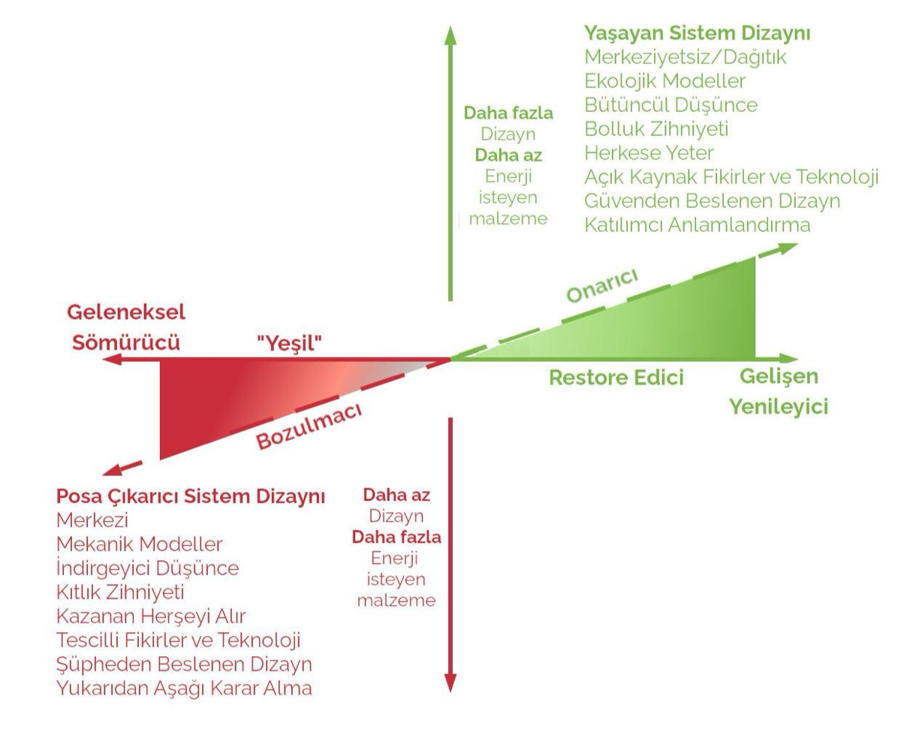

Bu kısımda, Web3’ün kendini farklı bir misyona adamış bir kolu olan onarıcı (yenileyici) finans (ReFi)’den bahsedeceğiz.

Web3’ün ne olduğunu anlatırken genelde ilk tanımlamalardan biri, gücü bireylere vermek oluyor. Buna bir de Web3’ün altyapısı olan blokzincir teknolojisinin içinden çıktığı ilk ürün olan Bitcoin’i kuranların felsefesini ekleyin. ‘Ne pahasına olursa olsun bireyselliği ön plana çıkaran[^1]’ bu felsefeye de bakınca, Web3’ün toplumu çok da önemsemeyen ve bencil bir oluşum olduğu izlenimi doğabiliyor.

Halbuki gerçek bundan daha farklı. Web3’ün temel değer önerilerinden bir tanesi, ‘toplumsal bir koordinasyon mekanizması’ olarak kullanılabilmesi. Ne demek tam olarak bu? Birbirinden uzak insanların önceden belirlenmiş kurallar içinde, bir misyon etrafında uyumlu bir şekilde hareket edebilmelerini sağlamak.

İşte şimdi henüz yeni yeni filizlenmeye başlayan onarıcı finans hareketi, blokzincirin bize verdiği bu gücü kullanarak Web3 üzerinde gerçek bir kullanım alanı yaratmak için çabalıyor. Gelin önce nedir bu hareket onu anlayalım:

## Ne demek onarıcı finans? {#ne-demek-onarici-finans}

Onarıcı finansı (İngilizcesi Regenerative Finance - ReFi) kısaca finansa yeni bir bakış açısı getirmeyi hedefleyen bir hareket. Amaç genel olarak ‘içine ettiğimiz’ doğayı ve çevreyi onarmak yoluyla toplumun genel olarak refahını artırmak[^2].

İçinde yaşadığımız sistem, kapital sahiplerinin kârını maksimize etmeye çalışan, büyümeyi yakalamak adına çevresel etkileri hiçe sayan bir sistem.

ReFi bu anlamda kâr anlayışını değiştirmeye, oluşan değerin sadece kapital sahiplerine değil topluluklara ve çevrenin korunmasına/iyileştirilmesine aktığı bir dünya kurmayı amaçlıyor.

Bu hedeflerin çok ‘havada’ kaldığını, ulaşılması mümkün olmayan hayaller olduğunu düşünebilirsiniz. Haklı olabilirsiniz ama belki de merkeziyetsiz sistemler sayesinde bu amaçların hepsine olmasa da bir kısmına ulaşmanın yolu vardır. İşte bu hareket için blokzincir teknolojisi nasıl yardımcı olabilir gelin ona bakalım şimdi de.

## Blokzincir onarıcı finansa nasıl yardımcı olabilir? {#blokzincir-nasil-yardimci-olabilir}

Merkeziyetsiz finans olarak adlandırdığımız Web3’ün finansal uygulamaları, bize kişilerin varlıklarına tam olarak egemen oldukları ve değerin coğrafi sınır taşımadan kişiler arasında hızlı bir şekilde el değiştirebildiği bir dünya sunuyor. ReFi ise DeFi’nin bu temel değer önerisini kendisine adapte ediyor. Nasıl yapıyor bunu tam olarak? Bunu anlamak için önce belki mevcut sistemlerin sorunlarına bakmak gerekiyor.

Mevcut ekonomik sistemlerin doğru teşvik mekanizmalarına sahip olduğunu söylemek oldukça güç. Bu modeller ile global çapta herhangi bir şekilde insanları mobilize edebilmek mümkün değil. İnsanlara ya da çevresel sorunların çözümüne yönelik yapılan yardımların ya yanlış ellerde heba olduğunu ya da türlü engeller nedeniyle verimsiz bir şekilde kullanıldığını görüyoruz. Üstelik, maalesef bu sorunları yaratanlardan kimse hesap sormuyor.

ReFi, blokzincir teknolojisini kullanarak kişilerin toplum yararına olan hizmetleri dünyanın neresinde olursa olsun hızlı, şeffaf ve engel tanımadan fonlamasına olanak sağlıyor. Bu hizmetleri fonlamada özellikle bir sonraki bölümümüzde daha detaylı bakacağımız gerçek dünya varlıklarının tokenleştirilmesinde kullanıyor.

<figure><figcaption>Evrimleşen ekolojik ekonomiler <em>Ekonomilerin gelenekselden yenileyiciye evrimi. Bill Reed (Regenesis)'in 'Ekolojik dizaynın önündeki yol' makalesinden adapte edilmiştir. (</em><strong><em>Kaynak</em></strong><em>: <a href="https://www.refiturkiye.com/">ReFi Türkiye</a></em>)</figcaption></figure>

ReFi, bizlere açık kaynak ve defter teknolojisi ile blokzincirin uzlaşma ağlarını kullanarak klasik sistemlere göre çok daha demokratik ve kapsayıcı bir altyapı sunuyor. Bu altyapı ile doğru kişileri ödüllendirmek ve kaynakları en çok ihtiyacı olanlara aktarmak mümkün. Tabii bunu yaparken unutulmaması gereken bir başka nokta da katılımcıların üzerine düşen sorumluluğu aldıklarına emin olmak yani onları hesap verir kılmak.

ReFi’nin dijital altyapısını kullanarak, sınır ötesini aşan kaynak havuzları oluşturmak, küçük toplulukların ihtiyaçlarına hizmet edecek ürünler dizayn etmek ya da çevresel hareketlere hız kazandıracak hizmetler kurmak mümkün olacak[^3].

## ReFi hangi alanlarda daha faydalı olabilir? {#refi-hangi-alanlarda-daha-faydali-olabilir}

Peki ReFi bize nerelerde fayda sağlayabilir? Dünyamızda yaşanan ekonomik eşitsizliğin ve çevresel felaketlerin ucu bucağı olmasa da, ReFi’nin fayda sağlayabileceği alanlardan öne çıkan birkaç tanesine hep birlikte göz gezdirelim şimdi de:

### Gerçek dünya varlıklarının tokenleştirilmesi yoluyla çevreye katkı {#gercek-dunya-varliklarinin-tokenlestirilmesi-yoluyla-cevreye-katki}

ReFi’nin şu ana kadar belki de en ilerlemiş alanı, özellikle karbon emisyonlarının azaltılması konusundaki projelerde kendini gösteriyor. Karbon kredileri ile ilgili alım-satım dahil pek çok projeye aracılık eden [Toucan Protocol](https://blog.toucan.earth/) ile arazilerin yeniden ağaçlandırılması için yatırımcılar ile toprak sahiplerini bir araya getiren [Credit Nature](https://creditnature.com/) bu alandaki en bilinen iki örnek olarak göze çarpıyor.

### Sürdürülebilir tarım politikalarını destekleme {#surdurulebilir-tarim-politikalarini-destekleme}

ReFi projeleri, tarım işiyle uğraşanlara toprağın kendini onarmasına yardımcı olacak ekim metotları ya da gıda güvenliği konularında fayda sağlayacak inisiyatiflere yatırım yapıyorlar. Bu alanda pek çok proje çalışması söz konusu. Bunlardan biri olan [EthicHub](https://www.ethichub.com/en), yatırımcıları Güney Amerika’daki çiftçiler ile bir araya getiriyor. Bankacılığa erişimi olmayan çiftçiler verecek teminatları da olmadığı için sadece kendi aralarında, o da %100’lere varan oranlarda faiz ödeyerek borçlanabiliyorlar. EthicHub çiftçileri bu alandaki yatırımcılar ile bir araya getirerek onlara ucuz kredi sağlıyor ama faydası bununla sınırlı değil. Onların aynı zamanda biyoçeşitlilik ödül programlarından faydalanmalarına da [yardımcı oluyor](https://www.engage.hoganlovells.com/knowledgeservices/news/where-finance-digital-sustainability-and-impact-meet-what-is-regenerative-finance-refi). (Bunlardan bir başka örnek olan ‘Crypto Climate Coalition’ ile ilgili detaylı Örnek incelemesine bu bölümün sonunda ulaşabilirsiniz.)

### Toplulukları destekleme {#topluluklari-destekleme}

ReFi, toplulukların sosyal refahını sağlama ve sürdürülebilirlik konularında destekler veriyor. Bunlar, ekonomik zorluk içindeki mikro-girişimcileri [desteklemekten](https://rsfsocialfinance.org/get-funding/meet-the-entrepreneurs-2/), bankacılığa erişimi olmayan kesimlere finansal hizmetler [götürmeye](https://www.ethichub.com/en), hava ve çevre kirliliğinin üst boyutta olduğu yerlerde yenilenebilir enerji projeleri finanse etmeye kadar farklı bir dizi inisiyatifi içeriyor.

## ReFi’de her ‘şey’ güllük gülistanlık mı? {#her-sey-gulluk-gulistanlik-mi}

Peki bu kadar güzel konular var, neden ReFi hareketini ve projelerini daha sık duymuyoruz?

Öncelikle ReFi hareketinin faydalarını uzun vadede göreceğimizi belirtelim. Kullanım alanları henüz daha konsept aşamasında. Bunların başarısı uzun zaman alacak (bir kısmı muhtemelen hiç başarıya ulaşmayacak). Şu an yaşadıklarımız, 2017-20 yılları arasında merkeziyetsiz finansın içinden geçtiği sürece oldukça benziyor.

Bu alanın diğer ‘gönüllü’ projelere göre temel farkı, tokenleşme sayesinde paydaşların çıkarlarını ekonomik olarak da aynı hizaya getirebilme şansı. Tokenleşme sayesinde oluşacak ekonomik dünyanın başarılı olup olmayacağı da bir soru işareti. Bunun için farklı modellerin denenmesi, içlerinden göreceli başarılı olanların farklı senaryolarda ince ayar yapılarak daha da fayda sağlar hale gelmesi gerekiyor. Bu da zaman alacak.

## Sonuç {#sonuc}

Onarıcı finans (ReFi), Web3 dünyasının birey odaklı değer önerisini genişleterek tüm topluma faydalı hale getirmeye çalışan alanı. Henüz Web3’ün kendisi bile toplum tarafından anlaşılamamış iken, açıkçası ReFi konusunda konuşmak ve bu alana yatırım yapmak oldukça cesaret istiyor. Web3 dünyası şu an için kısa vadeli kazançlar, pump-dump olayları, bir anda ‘hype’ yaşayıp sonra hayal kırıklığı yaşatan projeler içine sıkışmış durumda. Gerçekten hayatımızın içinde kullanabileceğimiz potansiyel alanlardan biri olan ReFi belki de uzun vadede Web3’ün geniş kesimlerce benimsenmesi açısından kritik bir öneme sahip olacak. Dileriz öyle olur.

[^1]: Bitcoin topluluğu içinde en etkili gruplardan birini bireyselliği ön plana çıkaran ve felsefi olarak ABD’de oldukça kuvvetli bir akım olan liberter (özgürlükçü) düşünceye yakın olanların oluşturduğunu belirtelim.

[^2]: Tanım Hogan Lovells’in Where finance, digital, sustainability and impact meet: what is Regenerative Finance (ReFi)? adlı [yazısından](https://www.engage.hoganlovells.com/knowledgeservices/news/where-finance-digital-sustainability-and-impact-meet-what-is-regenerative-finance-refi) yazarınız tarafından ‘kabalaştırılarak’ Türkçe’ye çevrilmiştir.

[^3]: Bu tanımlamalar, Toucan’ın ‘What is ReFi’ [yazısından](https://blog.toucan.earth/what-is-refi-regenerative-finance/) alındı.
