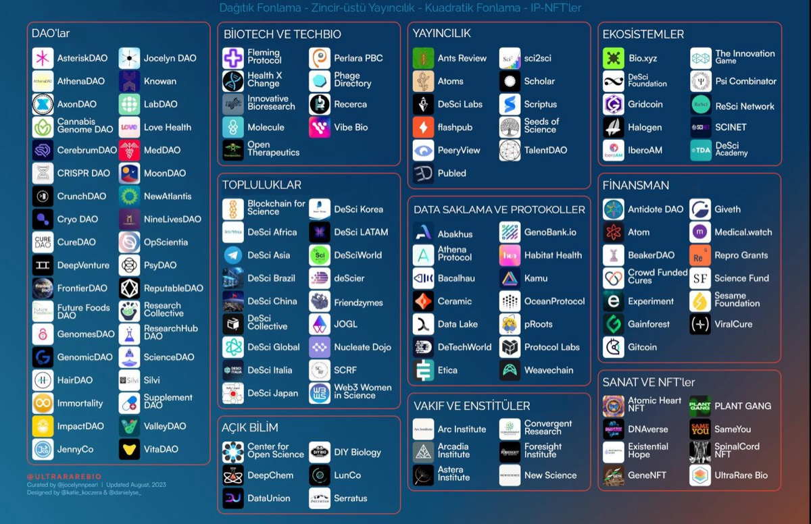

Web3 olarak da adlandırılan merkeziyetsiz sistemler, şimdiye kadar daha çok finansal alandaki uygulamalarda ön plana çıktı. Bu alandaki en kalıcı girişimler ise merkeziyetsiz otonom organizasyonlar (decentralized autonomous organization kısaca DAO) şeklinde yapılandılar (MakerDAO, CurveDAO gibi). DAO’ların en büyük özelliği ise, dijital dünyada belirli bir amacı gerçekleştirmek isteyen kişiler arasında teknik ve sosyal koordinasyonu verimli bir şekilde sağlayabilmesi.

Öte yandan, Web3 tipi sistemlerin daha geniş kitlelerce benimsenmesi için artık finans dışı farklı kullanım alanlarının da ortaya çıkması gerekiyor. Burada 2015-2019 yılları arasında ‘blockchain’ tabanlı pek çok girişim ortaya çıkmıştı. Bunlardan günümüze çok azı kaldı. Bunun temel nedeni, ortaya konulan projelerin vizyonunu pratiğe dökme ve özellikle topluluk organizasyonu konusunda zayıf kalmaları oldu.

Son zamanlarda ortaya çıkan girişimler ise, finans alanında başarılı olmuş DAO modelini kendilerine örnek almaya başladılar.

## Huzurlarınızda merkeziyetsiz bilim (DeSci) {#huzurlarinizda-merkeziyetsiz-bilim-desci}

Klasik anlamda bilim, bilgiyi teori, deneme ve gözlem yoluyla metodik bir şekilde aramak olarak tanımlanıyor. Ne yazık ki merkezi bir yapılanma altında büyüyen geleneksel bilim, özellikle son yıllarda belirli sayıda büyük kurum ve yayıncıların tekeli altına girmiş durumda.

Web3 dünyası içindeki merkeziyetsiz bilim ise dört temel karakteristiğe dayanarak bu oturmuş denklemi değiştirmeye çalışıyor[^1].

Bunlardan birincisi, bilimi şu anki sahibi olan merkezi yapılardan alıp merkeziyetsiz sistemlere dağıtmak. Bu sayede ticari kaygılarla ve bürokrasi nedeniyle gelişmenin önünü tıkayan merkezi kurumların gücünü azaltıp kaynak kullanımı ve karar verme aşamasını daha demokratik hale getirmek.

Şeffaflığı ön plana koyan merkeziyetsiz bilim, açıklığı ve hesap sorulabilirliği teşvik ederek, bilimsel araştırmanın daha güvenilir ve kullanılabilir olmasını amaçlıyor.

Dağıtık ağlar, sınır ötesi ve sansüre dayanıklı bir şekilde çalışabilmeyi sağlıyor. Bu ağları kullanan merkeziyetsiz bilim, kurumsal ve coğrafi sınırları ortadan kaldırarak farklı görüşleri, birlikte problem çözmeyi ve tecrübeleri paylaşmayı teşvik ediyor.

Son olarak merkeziyetsiz bilim, araştırmacıların bu yöndeki çabalarının karşılığını onlara DAO’lar ve tokenleri içeren bir teşvik sistemiyle sunuyor.

## Merkeziyetsiz bilimde hangi oyuncular var? {#merkeziyetsiz-bilimde-hangi-oyuncular-var}

Özellikle bilim ve sanat alanında toplulukları bir araya getirmeye çalışan Merkeziyetsiz Bilim (İngilizcede Decentralized Science, kısaca DeSci) çatısı altında Ağustos 2023’e kadar 100’den fazla oluşum toplanmış durumda.

<figure><figcaption>Merkeziyetsiz bilim dünyası <em>Decentralized Science ekosistemi - Ağustos 2023. (Kaynak: <a href="https://x.com/UltraRareBio/status/1694830533120040961">UltraRareBio</a>)</em></figcaption></figure>

Yukarıdaki tüm girişimlerin detaylı listesine dipnotta yer alan [link](https://docs.google.com/document/d/1aQC6zn-eXflSmpts0XGE7CawbUEHwnL6o-OFXO52PTc)[^2] üzerinden ulaşabilirsiniz. Burada gördüğünüz gibi merkeziyetsiz bilim alanındaki oyuncuları dokuz grupta toplayabiliyoruz[^3].

### DAO’lar {#daolar}

Merkeziyetsiz bilimin her alanında adeta topraktan fışkıran onlarca merkeziyetsiz otonom yapı (DAO) görüyoruz. Bu DAO’lar, bilimi fonlamaktan, bilimsel yayın endüstrisini bozmaya, açık bilimi desteklemekten ve uzun yaşama gibi spesifik araştırmalar yapmaya pek çok farklı hedefin peşinden koşuyorlar.

### Merkeziyetsiz bilim ekosistemleri {#merkeziyetsiz-bilim-ekosistemleri}

Bu alandaki projeler yukarıdaki gruptan farklı olarak birden fazla problemi çözmek için uğraşıyorlar. Bu projeler farklı sektörleri içeriyorlar ancak DAO olarak çalışmıyor olabilirler.

### Yayıncılık {#yayincilik}

Bilimin nerede ve nasıl yayınlanması ile ilgili iyileştirmeler yapmaya çalışan takımlar, projeler ve şirketler. İyileştirmeler arasında akran değerlendirmesi, mikro yayınlar ve bilim insanlarının yaptıkları katkılar karşılığı bağış alabilecekleri platformlar bulunmakta.

### Merkeziyetsiz biyoteknoloji {#merkeziyetsiz-biyoteknoloji}

Biyoteknoloji alanında çalışan merkeziyetsiz oluşumlar. Nadir görülen hastalıkların üzerinde çalışmalar yapan ve çalışanları destekleyen oluşumlar, örneklerden sadece biri.

### Sanat ve NFT’ler {#sanat-ve-nftler}

Bilim ve sanat kesişiminde farklı konuları araştıran ekipler bu grup altında toplanıyor. Örnekler arasında NFT’ler aracılığıyla projelere fon toplayan ya da farklı projelere yatırım yapan DAO’ları görüyoruz.

### Merkeziyetsiz fonlama {#merkeziyetsiz-fonlama}

Farklı alanlarda yapılan araştırmaları fonlama amacıyla kurulmuş yapıları barındıran bir grup burası.

### Data saklama protokolleri {#data-saklama-protokolleri}

Araştırmacılar tarafından üretilen bilimsel verilerin şeffaf ve değiştirilemez bir şekilde blokzincir altyapısı üzerinde saklandığı protokoller bu gruba giriyor. Keza bu ve benzeri protokollerde kullanıcılara ait hassas bilgilerin mahremiyet göz önünde tutularak gizli bir şekilde saklanması da söz konusu.

### Vakıf ve enstitüler {#vakif-ve-enstituler}

Her biri farklı bir bilim kolunda uzmanlaşmış, bir DAO değil de genelde hayırseverler tarafından kurulan vakıf ve enstitülerin oluşturduğu grup.

### Açık Bilim {#acik-bilim}

Bilimin herkese açık olması ve paylaşılmasını misyon edinen bir avuç girişimi barındıran bir grup. Bilim topluluklarının ortak çalışabilmesi için onlara veri yönetiminde yardımcı olan araçların üretilmesinden, uzay araştırmalarının dizaynının koordine edilmesine kadar farklı konularda çalışan farklı oluşumlar mevcut.

## Sonuç {#sonuc}

Merkeziyetsiz bilim (DeSci) oluşumları, Web3 için çok önemli bir kullanım alanı üzerinde çalışıyorlar. Web3’ün içinde bulunduğu dijital dünyasının, fiziki dünyamıza dokunan projeleri şimdiye kadar hep çetrefilli problemler ile karşılaştılar (örneğin tapuların dijitalleştirilmesi gibi). Yine de geniş kesimlerin Web3’ü benimsemesi için bu tip girişimler oldukça kritik. Başarılı olmaları (zor da olsa) hepimizin dileği. Yolculuklarını yakından izleyeceğiz.

[^1]: Merkeziyetsiz bilim ile ilgili bu tanımlamalar, Jagjit Singh’in CoinTelegraph’ta yayınlanan [makalesinden](https://cointelegraph.com/explained/decentralized-science-desci) alındı.

[^2]: [https://docs.google.com/document/d/1aQC6zn-eXflSmpts0XGE7CawbUEHwnL6o-OFXO52PTc](https://docs.google.com/document/d/1aQC6zn-eXflSmpts0XGE7CawbUEHwnL6o-OFXO52PTc)

[^3]: Aşağıdaki grupların tanımları bu alandaki en kapsamlı liste olan [DeSci Wiki’](https://docs.google.com/document/d/1aQC6zn-eXflSmpts0XGE7CawbUEHwnL6o-OFXO52PTc/edit#heading=h.arcrgw3lu7wt)den alındı.
