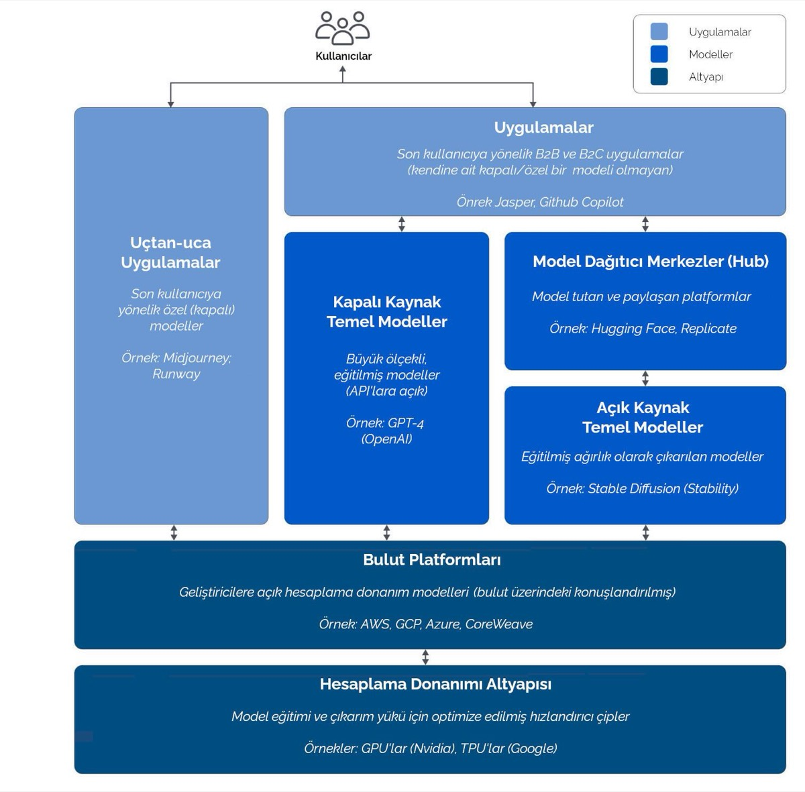
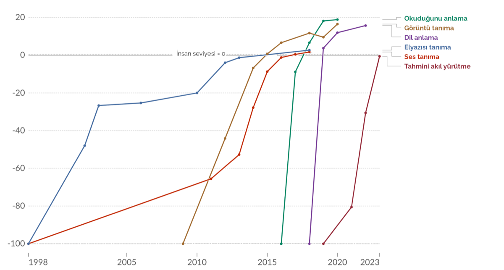
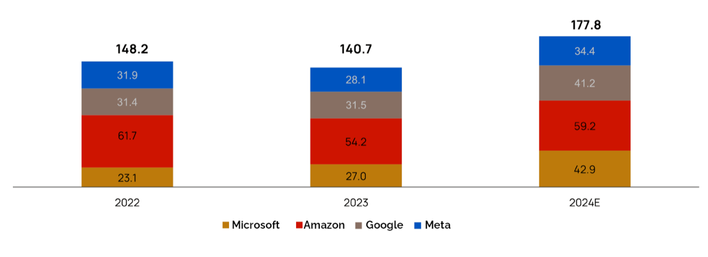
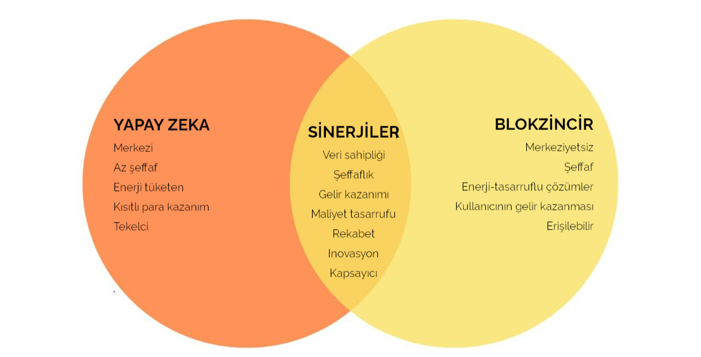
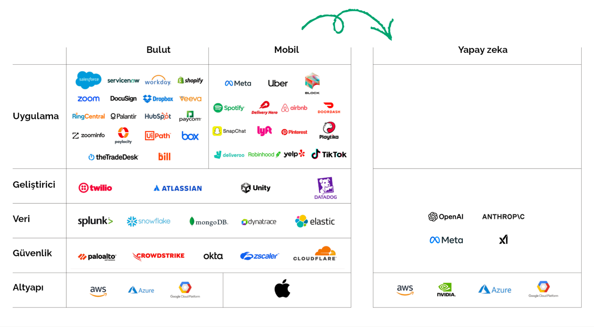

Evet, işte geldik belki de kitabımızın en ilgi çekmeye aday kısımlarından birine: Yapay zeka ve Web3. Bu kısımda yapay zeka ile Web3’ün arasındaki ilişkiyi ve birbirlerini nasıl etkileyeceğini anlamaya çalışacağız.

Yapay zeka uzun süredir üzerinde çalışılan, yatırım yapılan ve geliştirilen bir alan. Kimi kaynaklar başlangıcını 1950’lere kadar [götürüyor](https://coderspace.io/blog/yapay-zekanin-tarihi-dunden-bugune-yapay-zeka/). Son zamanlarda çok konuşulan ‘genel yapay zeka’ üzerine çalışmalar[^1] ise yirmi yıldan fazla bir süredir devam ediyor. Başlangıçta yavaş seyreden bu gelişmeler, özellikle son yıllarda donanım alanındaki yaşanan gelişmeler sayesinde inanılmaz bir seviyeye geldi.

En basit haliyle yapay zekanın nasıl çalıştığına bir bakalım:

## Yapay zeka nedir, nasıl çalışır? {#yapay-zeka-nedir-nasil-calisir}

Yapay zeka çok farklı alanlarda çok çeşitli işlevler için kullanılıyor. O nedenle tek bir tanım getirmek çok zor. Konumuz olan genel yapay zeka en basit haliyle “bizim ürettiğimiz çeşitli bilgi kaynaklarını bir araya getirip bize satan ‘hafızası güçlü’ bir papağan” olarak tanımlanabilir. Bu papağanın en önemli özelliği bizim düşünce yapımızı, hareketlerimizi, ses tonumuzu taklit edebilmesi[^2] hatta kimi zaman bizim daha gelişmiş halimize dönüşebilmesi.

Yapay zekanın en büyük kaynağı veri, verinin de en geniş bulunduğu yer internet. İnternet üzerindeki tüm bilgiler yapay zekaya yükleniyor. Bu bilgiler yazı, görsel, ses her tür veriyi içeriyor. Kamuya açık bu bilgiler daha sonra özel veritabanlarında bulunan daha ‘özel’ bilgiler ile destekleniyor. Toplanan tüm bilgiler önce temizleniyor ve makinelerin okuyabileceği bir hale getiriliyor.

Makineler bu bilgileri alarak analiz ediyorlar. Makinelerin yaptığı, kelimeler arasındaki ilişkileri ve beraber ne şekilde, hangi sırayla kullanıldıklarını çıkarmak. ‘Tokenleştirme’ denen bu süreçte her bir kelime (ve alt kırılımları) bir birim olarak alınıyor. Buradaki kritik nokta, bu birimlerin kullanım sıklığı ve başka birimlerle ilişkilerine göre ağırlıklandırılması. Bu ağırlıklandırma sonucu trilyonlarca parametre ortaya çıkıyor. Örneğin ChatGPT’nin 1.8 trilyon parametresi olduğu tahmin ediliyor.

Son olarak, kullanıcının ona sorduğu soruların yanıtlarını ‘tahmin ve analiz ederek[^3]’ onunla konuşur gibi kullanıcıya sunuyorlar[^4].

Burada ilginç birkaç nokta var. Öncelikle makineler nasıl analiz yapılacağını ‘öğrendikten’ sonra artık kendi kendilerine çalışabiliyorlar. Kullanıcıdan gelen geri bildirimler ile kendi kendilerini eğitiyorlar. Hatırlarsınız, ChatGPT ilk çıktığında kullananlar “çok saçma cevaplar veriyor, ben itiraz edince de hemen kendini düzeltiyor” şeklinde yorumlarda bulunurlardı. Bu, yapay zekanın ‘bizi kullanarak’ kendini geliştirdiğinin bir örneği aslında. Olay artık öyle bir noktaya geldi ki, verdiği cevaplara nasıl ulaştığı kimi zaman yapay zeka uzmanlarını bile hayrete düşürüyor.

İyi de nasıl bir ‘şey’ bu yapay zeka? Elle tutulur mu, gözle görülür mü? Gelin şimdi de yapay zeka dünyasının üzerindeki perdeyi hafifçe aralayıp içeriye göz atalım.

## Yapay zekanın katmanları {#yapay-zekanin-katmanlari}

Yapay zeka dediğimiz aslına bakarsanız altyapılardan uygulamalara kadar üst üste konarak bize hizmet veren bir ürün destesi. Bu haliyle daha önceki yazılarımızda bahsettiğimiz DeFi’nin destelerine benziyor.

<figure><figcaption>Taslak üretken yapay zeka teknoloji destesi <em>Üretken yapay zeka teknoloji destesi (Taslak). (Kaynak: <a href="https://a16z.com/who-owns-the-generative-ai-platform/">a16z</a>)</em></figcaption></figure>

Destenin en altında koyu lacivert renkli ‘altyapı katmanı’ var. Yapay zekanın yukarıda saydığımız tüm işlemleri yaparak istediğimiz sonucu bize anında verebilmesi için çok ciddi bir donanım ihtiyacı bulunuyor. Gerek işlemciler (çipler) gerekse bulut platformları bu ihtiyacı karşılıyor. İşte bu nedenle Nvidia gibi çip devlerinin hisse değerleri uçuyor. Amazon ve Microsoft’un sahip olduğu AWS ve Azure bulut sistemleri, kendi şirketlerinin en büyük kâr kaynakları haline geliyor.

Bizim çok konuştuğumuz ChatGPT gibi üretken yapay zeka modelleri ise bu altyapının üzerine konuşlandırılıyorlar. Yukarıdaki grafikte koyu mavi olarak gördüğünüz bu ‘orta katman’ işte bu yapay zeka modellerinin bulunduğu yer. Burada pek çok farklı model mevcut. ChatGPT gibi kapalı olanların yanında Meta’nın Llama’sı gibi yarı-açık ya da Stable Diffusion gibi tam açık kaynak modeller de bulunmakta.

Facebook’un Llama’sının veri seti kapalı ama bu veri seti içindeki ağırlıklandırmalar açık. Bu ne demek? İsteyen istediği gibi ağırlıkları değiştirerek modeli revize edebilir. Örneğin ChatGPT’deki kimi sansür mekanizmalarını kaldırabilir.

‘Kapalı/özel’ modeller klasik anlamda lisanslı yazılım ürünleri gibiler. Bu modeller gerek veri seti gerekse bu setlerin ağırlıklandırılmasını bizlerden saklıyor. Llama gibi yarı-açık modeller ise veri setlerini saklarken bu setlerin ağırlıklandırılmasını bize gösteriyor ve değiştirmeye izin veriyorlar. Tamamen ‘açık kaynak’ ise hem veri setlerini hem de ağırlıklandırmayı herkesin görebileceği ve değiştirebileceği şekilde sunan modellere deniyor.

En üst tarafta açık mavi ile gösterilen yerde ise son kullanıcı için yaratılmış ‘uygulama katmanı’ bulunuyor. Bu uygulamalar ChatGPT gibi modellerin üzerine inşa ediliyor[^5].

## Yapay zekanın göz kamaştıran gelişimi {#yapay-zekanin-goz-kamastiran-gelisimi}

Yapay zeka gözlerimizin önünde inanılmaz bir şekilde büyüyor. Biz kullanıcılar olarak özellikle ChatGPT’nin de etkisiyle yapay zekayı sadece kişisel asistan olarak kullanıyor olsak da, bu teknolojinin daha geniş anlamda iş dünyasına etkileri saymakla bitmez.

Karşınızda yemeyen içmeyen, sadece ‘enerji harcayan’, gece gündüz çalışan ve şu an için bir üniversite öğrencisi, yakın zamanda ise bir doktoralı niteliğine sahip olacak bir ‘iş gücü’ var[^6].

<figure><figcaption>Yapay zeka sistemlerinin insan performansı ile karşılaştırılması</figcaption></figure>

*Her bir alan içinde yapay zekanın ilk performansı -100’e konulmuş. İnsan performansı ise baz alınarak sıfıra ayarlanmış. Yapay zeka 0 çizgisine geldiğinde insan performansına ulaşmış oluyor. Gördüğünüz gibi yapay zeka okuduğunu anlama, görüntü tanıma, dil anlama konularında insanları geçti. El yazısı ya da ses tanıma ile tahmini akıl yürütme konularında ise bizleri yakalamış durumda. (Kaynak: [Our World in Data](https://ourworldindata.org/artificial-intelligence))*

World Economic Forum, önümüzdeki on yılda yapay zekanın Gayrisafi Milli Hasılaya etkisinin yıllık ortalama %0,5 ile %1,5 arasında olacağını [tahmin ediyor](https://www.weforum.org/agenda/2024/05/these-5-countries-are-leading-the-global-ai-race-heres-how-theyre-doing-it/)[^7]. Bu toplamda 1,2 trilyon ile 3,8 trilyon ABD doları bir ekonomik büyüklük demek!

Bunu bir de hızla gelişmekte olan robotlar ile birleştirin. Sunduğunuz hizmetin maliyetinden, kazandığınız gelire kadar her yönden sizi ciddi şekilde etkileyeceğini tahmin edebilirsiniz[^8].

## Teknoloji devlerinin yapay zeka yarışı {#teknoloji-devlerinin-yapay-zeka-yarisi}

Teknoloji dünyasının devleri uzun zamandır yapay zekanın kendilerini nasıl etkileyeceğine kafa yoruyor ve ellerinde ne var ne yoksa bu alana yatırıyorlar. Aşağıda teknoloji dünyasında ‘mahşerin dört atlısı’ olan Microsoft, Amazon, Google ve Meta’nın son üç yılda yapay zeka alanında yaptığı yatırımlar var. Sizi hesaplama yapma zahmetinden kurtarıp üç yıllık toplam harcamanın 465 milyar ABD Doları olduğunu belirtelim. Peki bu tabloda yer almayan Apple ile birlikte bu beş devin kenarda ‘nakit’ olarak bekleyen bir 400 milyar ABD Doları parası daha olduğunu söylesek? Sanırım bu alandaki devasa yatırım iştahının bir süre daha devam edeceğini az çok kestirebilirsiniz.

<figure><figcaption>Teknoloji devlerinin yapay zeka harcamaları</figcaption></figure>

*Dört teknoloji devinin 2022-24 arası üç yıllık dönemde toplam harcaması tam 465 milyar ABD doları! (milyar ABD Doları) (Kaynak: [Delphi Digital](https://members.delphidigital.io/reports/the-tower-the-square#the-tower---the-square-b517))*

Zira yapay zeka alanında yapılan yatırımlar nedeniyle çip üreticisi Nvidia dünyanın en değerli şirketleri listesinin en üstlerinde yer alıyor.

Yaptıkları bunca yatırımın üzerine bir de yapay zekanın en önemli girdisi olan verinin de en büyük sahibi teknoloji devleri olunca akıllara şu soru geliyor: Acaba kullanıcıların Web 2.0 dünyasında teknoloji devlerinin tekelleşmesinden dolayı yaşadığı sıkıntılar yapay zekada da tekrarlanacak mı? Acaba Web3’te olduğu gibi merkeziyetsiz çözümler bu tekelleşmeye karşı alternatif bir yol sunabilir mi?

## Web3 ile yapay zekanın kesişimi {#web3-ile-yapay-zekanin-kesisimi}

Peki Web3 dünyasının merkeziyetsiz girişimlerine bu alanda yer var mı? Hadi büyük teknoloji devlerine kafa tutmayı geçtik ama en azından ufak da olsa var olmaları mümkün mü? Bunu anlamak için önce “Blokzincir ile yapay zeka teknolojileri birlikte çalışabilir mi?” sorusuna yanıt arayalım:

### Blokzincir ile yapay zeka ne kadar uyumlu? {#blokzincir-ile-yapay-zeka-ne-kadar-uyumlu}

Teknoloji olarak baktığımızda blokzincir ile yapay zekanın birbirine uyumlu teknolojiler olmadığını görüyoruz.

Neden derseniz; blokzincir kesinlik gerektirirken yapay zeka büyük oranda olasılık hesaplarına dayanıyor[^9]. Bunun yanında blokzincir, merkeziyetsiz olmak adına binlerce makine üzerinde çalışıyor. Bundan dolayı kapasitesini ve performansını oldukça kısıtlı tutmak zorunda. Yapay zeka ise bir işlemci ve enerji oburu; ne kadar çok kaynak yerse o kadar başarılı oluyor.

Bu teknolojiler her ne kadar uyumsuz görünse de, bazı alanlarda birbirlerini tamamlayabilirler.

### Blokzincir ile yapay zeka hangi noktalarda kesişiyor? {#blokzincir-ile-yapay-zeka-hangi-noktalarda-kesisiyor}

Blokzincir teknolojisinin kendine has özellikleri yapay zeka ile tam olarak örtüşmese de, iki teknolojinin kesiştiği alanlarda sinerjiler doğması mümkün:

<figure><figcaption>Yapay zeka ve blokzincir kesişiminden doğan sinerjiler <em>“Zıtlık sinerji yaratır.” (Kaynak: <a href="https://blog.ueth.org/p/when-giants-collide-exploring-the">De University of Ethereum</a>)</em></figcaption></figure>

### Web3 yapay zekanın katmanlarına nereye kadar etki edebilir? {#web3-yapay-zekanin-katmanlarina-nereye-kadar-etki-edebilir}

Yapay zekanın gerektirdiği yüksek yatırımlar nedeniyle, tamamen merkeziyetsiz, uçtan uca bir yapay zeka modelinin mevcut teknoloji devlerine ait modellerle yarışması maalesef mümkün görünmüyor. Aslında buna çok da gerek yok. Web3 ruhunu taşıyan modellerin bu dünyada var olabilmesi hâlâ mümkün. Nasıl?

Yukarıda bahsettiğimiz desteler içinde belirli köşeleri tutarak ve Web3’ün Web 2.0’a göre farklılık yaratan güçlü taraflarını ön plana çıkararak. Ne gibi mesela?

### Nedir Web3’ü Web 2.0 dünyasına göre farklı kılan özellikler? {#nedir-web3u-web-2-0-dunyasina-gore-farkli-kilan-ozellikler}

Web3’ün eski nesillerden üstün olduğu özellikler şunlar:

- açıklık (şeffaflık),
- herkesin kullanımına açık olma (platformsuzlaştırma riskinden uzaklık),
- farklı parçaların birbirleriyle uyumlu biçimde çalışabilmesi,
- sansüre dayanıklılık,
- verilerin değiştirilemez biçimde saklanması ve
- kullanıcının oluşan katma değerden pay alması.

## Web3 girişimleri yapay zekanın hangi alanlarında aktif? {#web3-girisimleri-yapay-zekanin-hangi-alanlarinda-aktif}

Blokzincirin yukarıda saydığımız özellikleri, hem insanların hem de makinelerin dijital dünya ve onun yarattığı ekonomi içindeki faaliyetlerini kökten değiştirebilir. [a16z’nin son raporundan](https://a16zcrypto.com/posts/article/state-of-crypto-report-2024/) birkaç örnek ile konuyu somutlaştıralım:

**Orijinalliğin teyidi:** Yapay zeka ile bir yılda toplam 15 milyardan fazla fotoğraf [yaratıldı](https://journal.everypixel.com/ai-image-statistics). Bu, fotoğrafçılığın 150 yıllık tarihinde üretilenden daha fazla! Blokzincir, içeriklerin otantik olduğunu anlamamıza yardımcı olur.

**Demokratikleşme:** Yapay zeka modellerinin eğitim ihtiyacı için kullanılan hesaplama gücü son on yıl içinde [her yıl dört kat artış gösterdi](https://epochai.org/blog/training-compute-of-frontier-ai-models-grows-by-4-5x-per-year). Blokzincirler, bu hesaplama gücüne daha geniş kesimlerin erişimini sağlamaya yardımcı olur.

**Şeffaflık:** ABD’de yapay zeka şirketlerine olan güven 2019’dan bu yana [beş yılda %50’den %35’e düştü](https://www.edelman.com/trust/2024/trust-barometer). Blokzincir açık, kullanıcının sahip olduğu servislerin yaratılmasına yardımcı olur.

**Sahiplik:** Öncü yapay zeka modelleri trilyonlarca token (data birimi) ile [eğitildi](https://ai.meta.com/blog/meta-llama-3/). Bütün bu bilgi, sahipleri tarafından çoğunlukla ücretsiz olarak bu modellere verildi. Blokzincir veri sağlayıcılara telif hakları konusunda yardımcı olabilir.

Şimdi de gelin yapay zekanın farklı alanlarında var olmaya çalışan blokzincir tabanlı merkeziyetsiz girişim örneklerine bakalım:

**Verinin toplanması ve işlenmesi:** Yapay zekanın temel veri kaynağının internet üzerinde bulunan kamuya açık veriler olduğunu söylemiştik. İyi de bu kaynağın bir sınırı var. Ayrıca bu kaynak, içinde bir sürü ‘çöp’ de barındırıyor. Şöyle özel kaynaklardan toplanmış doğrulanmış bilgiye hiçbir yapay zeka ‘hayır’ demez.

Bu alandaki merkeziyetsiz çözümler verecekleri teşvikler ile kullanıcıların özel bilgilerini onların kimliklerini açık etmeden toplayabilirler. Aynı şekilde verilerin doğruluğunu tespit etmekte ya da modellerin eğitiminde bireyleri kullanabilirler. Bu alanda ortaya çıkan çözümler şunlar:

- **Veri pazar yerleri:** Kullanıcıları ve veri sağlayıcıları bir araya getiren merkeziyetsiz protokoller. (Örnek: [Ocean Protocol](https://oceanprotocol.com/)[^10], [Masa](https://www.masa.ai/), [Sahara AI](https://saharalabs.ai/))
- **Kullanıcılara ait özel veri setleri (DataDAO’ları):** Kullanıcılara ait özel bilgilerin toplanmasını teşvik eden ağlar. (Örnek: [Vana](https://www.vana.org/), [NVG8](https://nvg8.io/))
- **Kamusal ve sentetik veri setleri:** Kamuya açık verileri ‘süpüren’ ya da kullanıcı talebiyle yeni veri setleri yaratan platformlar. (Örnek: [Dria](https://dria.co/), [Mizu](https://mizu.global/), [Grass](https://www.getgrass.io/), [Synesis One](https://www.synesis.one/), [First Batch](https://www.firstbatch.xyz/)[^11])
- **Veri depolanması:** Verinin ve veri setlerinin uzun süreli değiştirilmeden saklanmasını ve ulaşılabilir olmasını sağlayan depolama çözümleri. (Örnek: [Filecoin](https://filecoin.io/), [Arweave](https://www.arweave.org/), [Ceramic](https://ceramic.network/), [Tableland](https://tableland.xyz/))
- **Veri yönetimi ve doğrulaması:** Verinin yapay zekanın ‘hazmedebileceği’ şekilde hazırlanmasını ve kaynağının doğrulanmasını sağlayan platformlar. (Örnek: [Space and Time](https://spaceandtime.io/), [The Graph](https://thegraph.com/), [Subsquid](https://www.sqd.dev/), [Sahara](https://saharalabs.ai/), [Covalent](https://www.covalenthq.com/), [Hyperline](https://www.hyperline.xyz/))
- **Veri etiketleme:** Yapay zeka modellerinin kendi kendini eğitebilmesi için gerekli ince ayarlamaları insan eliyle yapan, böylece ‘daha kaliteli’ veri setleri oluşturmayı sağlayan protokoller. (Örnek: [Sapien](https://www.sapien.io/), [Kiva AI](https://www.kivaai.com/), [Fraction.AI](http://fraction.ai))

**İşlemci gücü altyapısının sağlanması:** Yapay zekanın bir insanı taklit edebilmesi yani ‘sahip olduğu büyük veri seti içinden gerekli parçaları bulması ve kullanıcıya sunması’ için çok ciddi bir işlemci (GPU) gücüne ihtiyacı var. Ciddi yatırım gerektiren bu alanda teknoloji devleri şimdiden köşeleri kapmış gibi görünse de, son zamanlarda ortaya çıkan gelişmeler sayesinde merkeziyetsiz girişimler arayı kapatabilirler. Yine de bu çözümlerden kısa vadede başarı beklemeyin çünkü henüz çok küçükler. Örnekleri sıralayalım:

- **Genel amaçlı işlemci gücü sağlayanlar:** Geniş bir yelpazede her tür uygulamanın donanım ihtiyacını karşılamaya yönelik merkeziyetsiz çözümler sunan platformlar. (Örnek: [Akash Network](https://akash.network/), [Aethir](http://aethir.com/))
- **Dar alanda işlemci gücü sağlayanlar:** Yapay zekanın geneline değil içindeki belirli alanlara işlemci gücü sağlayan merkeziyetsiz platformlar. Merkeziyetsiz veri eğitimi, GPU tokenleştirmesi bu servis alanlarından birkaçı. (Örnek: [io.net](http://io.net), [Gensyn](https://www.gensyn.ai/), [Prime Intellect](https://www.primeintellect.ai/), [Hyperbolic](https://hyperbolic.xyz/), [Hyperspace](https://hyper.space/))
- **Son kullanıcı için işlem gücü sağlayanlar:** Yapay zekanın bize hizmet vermesi için mega modeller kullanılıyor. Bu modellerin çalışabilmesi için geri planda binlerce sunucudan oluşan devasa veri merkezleri kurulmuş durumda. İşte bu mega modellere karşı yeni geliştirilen modeller cep telefonu ya da bilgisayarda bile çalışmayı vaat ediyor. Ne işe yarayacak bu? Kullanıcının kişisel bilgileri bilgisayarından dışarı çıkmayacak. Bu sayede kullanıcı, verileri başkasının eline geçer korkusu yaşamayacak. Bu çözümler kullanıcının kişisel bilgilerini paylaşmadan kullanabileceği modelleri ve bu modellerin kişiselleştirmesi için gerekli olan işlemci ve saklama kapasitesini sağlıyor. (Örnek: [PIN AI](https://www.pinai.io/), [Exo](https://x.com/exolabs_), [Crynux.ai](http://crynux.ai), [Edge Matrix](https://emc.network/))

**Temsilciler için uygun altyapı modelleri kurulması:** Son kullanıcının kullanabileceği açık kaynak ve/veya merkeziyetsiz yapay zeka uygulamaları henüz emekleme aşamasında. Bu uygulamalara ‘temsilci’ (İngilizce ‘agent’) deniyor.

Son kullanıcıların temsilcilerden verim alması için öncelikle bu uygulamalara temiz ve yeterli miktarda veri sağlanması gerekiyor. Bu da ancak altyapının gelişmesi ile mümkün. Bu nedenle, önce altyapıdaki veri setleri ve onları kullanan modeller gelişecek, sonra sıra temsilcilere gelecek.

Bu arada şunu hemen belirtelim: Burada hem merkeziyetsiz platformlar hem de merkezi kurumlar tarafından geliştirilen açık kaynak çözümler bulunmakta. Örneklere birlikte bakalım:

- **Değiştirilebilir geniş dil modelleri:** Yapay zeka modelleri kullanıcılardan aldıkları geri bildirimleri kullanarak kendilerini eğitiyorlar. Bunu yaparken, kullandıkları verilerin ağırlıklarını değiştiriyorlar. İşte bu ağırlıkları açık kaynak olarak paylaşan modeller de var. Böylece isteyen istediği gibi bu ağırlıkları değiştirebiliyor. Ne işe yarıyor bu? Bu modelleri kullanan yukarıda bahsettiğimiz temsilciler ihtiyaçlarına göre modelleri şekillendirme imkanına kavuşuyorlar. Örneğin modellerin koyduğu ‘sansür mekanizmalarını’ kaldırabiliyorlar. (Örnek: [Llama3,](https://ai.meta.com/blog/meta-llama-3/) [Mistral](https://mistral.ai/), [Stability AI](https://stability.ai/))
- **Mahremiyet:** Yapay zeka modellerinin geliştirilmesi, eğitilmesi ve çıkarım yapması sırasında kullanıcı ve kamuya ait gizli bilgilerin mahremiyetini sağlamaya yönelik mekanizmalar sağlayan platformlar. (Örnek: [Bagel Network](https://www.bagel.net/), [Arcium](https://www.arcium.com/), [ZAMA](https://www.zama.ai/))
- **Yapay zeka çıktılarının doğrulanması:** Yapay zeka çıkarımlarının doğrulanması için kullanılan kriptografik kanıtları üreten platformlar. (Örnek: [Modulus Labs](https://www.modulus.xyz/), [Giza](https://www.gizatech.xyz/), [Ritual](https://ritual.net/), [OpenGradient](https://opengradient.ai/))
- **Altyapı kaynak kullanımını koordine eden ağlar:** Yapay zeka modelleri oluşturmak için gerekli olan kaynakları merkeziyetsiz bir ortamda bir araya getiren ağlar. Nedir bu kaynaklar? İşlemci gücü, veri setleri, modeller, kısaca yukarıda saydığımız her tür altyapı uygulamaları. Bu ağların yavaş yavaş entegre modeller haline geldiğini de görüyoruz. (Örnek: [Bittensor](https://bittensor.com/), [Near](https://near.org/), [Allora](https://www.allora.network/), [Sentient](https://sentient.foundation/))

**Açık kaynak ve merkeziyetsiz son kullanıcıya yönelik uygulamalar:** Hemen yukarıda da belirttiğimiz gibi son kullanıcıya yönelik açık kaynak ya da merkeziyetsiz yapay zeka uygulamaları bir elin parmakları kadar az. Bu alanda bırakın merkeziyetsiz uygulamaları merkezi çözümlerin bile yeterli büyüklüğe ulaşmadığını görüyoruz. Henüz bu katmanda ortaya çıkmış büyük bir girişim (bir milyar ABD Doları üzerinde ciro yapan) bile yok:

<figure><figcaption>Milyar ABD Doları üzeri satış yapan bulut, mobil ve yapay zeka şirketleri <em>Bir milyar ABD Doları ciroyu geçmiş bulut, mobil ve yapay zeka girişimleri. Gördüğünüz altyapı tarafı teknoloji devlerinin hegemonyasına girmiş olsa da uygulama tarafı hâlâ bakir bir alan. (Kaynak: Sequoia Capital - <a href="https://www.sequoiacap.com/article/generative-ais-act-o1/">Generative AI’ Act o1</a>)</em></figcaption></figure>

Biz kullanıcılar altyapıya ciddi yatırım yapmış merkezi ve kapalı çözümlerin bize sunduğu ChatGPT gibi uygulamaları kullanıyoruz. Bunlar dışında bir de bu uygulamalar için üretilmiş eklentiler var. Bu eklentilerin uzun vadede ne kadar var olacağını bilmek zor.

Bu eklentilerin kullanıcılar üzerinden para kazanabilecekleri gelir modelleri de henüz gelişmiş değil. Gelişse bile yüksek ihtimal OpenAI gibi platformlar bu eklentilerden App Store gibi yüksek oranda kesinti alacaklar.

Bir yandan da, geçmişte bu tip kapalı platformlar üzerine kurulu uygulamaların platformdaki değişikliklerden dolayı canları çok yandı. Örneğin, bir zamanlar Facebook üzerine kurulu oyunlar ya da içerik üreten haber siteleri, Facebook’un algoritmasını değiştirmesi nedeniyle bir anda ulaştıkları kitleyi yitirdiler. Yaptıkları tüm yatırım boşa gitti.

Bu alanda Web3 dünyasının kendine has özelliklerini kullanan açık kaynak ya da merkeziyetsiz uygulamalar yavaş yavaş ortaya çıkıyor. Bu uygulamalar kullanıcının ihtiyaçlarına ucuz bir şekilde cevap verirken onların mahremiyet ile ilgili kaygılarını da gideriyorlar. Örneğin: Doğrulanabilir yapay zeka çıkarımları kullanan ve kullanıcı bilgilerini kesinlikle tutmayan [venice.ai](http://venice.ai) gibi son kullanıcı uygulamaları; kullanıcıların cüzdanlarını kullanarak yapay zeka aracıları ile birlikte kendi yollarını çizdikleri [Parallel Colony](https://parallel.life/colony/signup) gibi online oyunlar.

Yukarıda saydığımız örnekler Web3 dünyasının kendine has özelliklerinin yapay zeka dünyasına nasıl uyarlanabileceğiyle ilgiliydi. Bir de madalyonun öbür yüzünde yapay zeka araçlarının Web3 dünyasındaki uygulamaları nasıl iyileştirebileceği konusu var. Gelin şimdi de ona bakalım:

## Peki yapay zeka Web3’te nasıl kullanılabilir? {#peki-yapay-zeka-web3te-nasil-kullanilabilir}

Yapay zeka yazılım ile ilgili her alanı derinden etkiliyor. Buna Web3 dünyası da dahil.

Bu alanda en büyük etki son kullanıcıya dokunan yapay zeka uygulamaları (bunlara temsilci - İngilizcesi “agent” deniyor) sayesinde insanlar Web3’ü çok daha kolay ve rahat şekilde kullanabilecekler. Web3 her ne kadar kendine has özellikleri ile Web 2.0 dünyasına göre avantajlar taşısa da, kullanımı hâlâ oldukça zor. Web 2.0 dünyasının aracılarına o kadar laf ediyor olsak da, kullanıcı dostu uygulamalar yaratmada Web3’ten fersah fersah öndeler. Yapay zeka temsilcileri Web3’ün bu alanda arayı kapamasına yardımcı olabilir.

Bunun dışında yapay zeka altyapısında faaliyet gösteren pek çok girişim, bu temsilcilerin zincir üzerindeki faaliyetlerini kolaylaştıracak ürünler geliştiriyorlar[^12].

Şimdi sırayla bu iki alandaki örneklere göz atalım:

### Yapay zeka temsilci (agent) uygulamaları {#yapay-zeka-temsilci-agent-uygulamalari}

İşte belki de yapay zekanın Web3’e en çok yarayacağı alana geldik: Yapay zeka ile yaratılmış/güçlendirilmiş uygulamaların (temsilcilerin) kullanıcıların zincir üzerindeki işlemlerine yardımcı olması.

Şunu kabul etmek gerekiyor: Web3 dünyasının gücü ve sorumluluğu kullanıcıya vermesi çok güzel ancak kullanıcılar bu dünyadaki uygulamaları kullanacak teknik bilgi ve beceriye sahip değiller. Olmaları da gerekmiyor, gerekmemeli! Örneğin merkeziyetsiz finansta kullanılabilecek pek çok farklı ve ilginç uygulama var. Ne var ki bu uygulamalar farklı ağlar üzerindeler. Kullanıcının bu uygulamaları kullanabilmesi için cüzdanındaki kriptoparayı bir ağdan öbürüne geçirmesi gerekiyor. Halbuki, kullanıcının hangi ağı kullandığını bilmesine gerek yok. Cüzdanından işlemi direkt olarak yapabilmeli.

İşte yapay zeka temsilcileri, kullanıcının aynı gündelik hayatta biriyle konuşur gibi vereceği emirleri alıp uygulamaya koyacaklar. Örneğin, kullanıcı “bana bir ay boyunca her gün en uygun fiyattan şu kadar şu tokendan al” dediğinde bunu anlayacak. Bununla da kalmayıp ona bu işlemi 7/24 çalışıp yerine getirecek bir dünya sunacak.

Bu, bugün mümkün mü? Henüz değil. Peki ne zaman? Temsilciler kullanım açısından henüz emekleme aşamasında; yazılımların daha kullanıcı dostu olması için olgunlaşması gerekiyor. Aynı zamanda, yapay zekanın altyapısının merkeziyetsiz sistemleri destekleyecek seviyeye gelmesi için zamana ihtiyaç var.

Web3’ün yapay zeka temsilcilerini kullanabilecek alanları aşağıdaki gibi sıralanıyor:

**Son kullanıcılar için yapay zeka arayüzleri:** Blokzincir ile iletişime geçmek ve işlem yapmak için ChatGPT benzeri doğal dil işleme uygulamaları kullanımı. (Örnek: [Venice.ai](http://venice.ai), [Veldt](https://theveldt.ai/))

**Merkeziyetsiz finans alım-satım işlemleri:** Alım-satım altyapıları kullanarak zincir üzerindeki işlem emirlerini otomatize bir şekilde gerçekleştirme. (Örnek: [Taoshi](https://www.taoshi.io/), [Intent.Trade](https://intent.trade/), [Robonet](https://robonet.finance/))

**Merkeziyetsiz finansta kredi kullanımı:** Web proof olarak adlandırılan sıfır bilgi kanıtını kullanarak kullanıcının gerçek dünya bilgisini afişe etmeden dijital kimliği ve sosyal medya repütasyonunu kullanarak daha az bir teminat ile borçlanması.

**Zincir-üstü topluluk yönetimi:** Özellikle DAO[^13]’larda üyeler oy vererek belli yönetim kararları alır. Bu kararlar sonucu yapılması gereken belirli zincir üstü işlemler çıkar. İşte bu işlemlerin yapımında yapay zeka temsilcilerinden yardım alan araçların kullanımı. (Örnek: [Botto](https://www.botto.com/))

**Geliştiriciler için geliştirme ve güvenlik araçları:** Yapay zeka modellerini/araçlarını kullanarak zincir üzerindeki geliştirici deneyimini ve güvenlik mekanizmalarını iyileştirme. (Örnek: [ChainGPT](https://www.chaingpt.org/), [Guardrail](https://www.getguardrail.xyz/))

**Risk yönetimi:** Makine öğrenmesi ve yapay zeka temsilcileri yardımıyla zincir üstü uygulamaların risk parametrelerini anlık olarak değiştirmeye olanak sağlayan servisler. (Örnek: [Chaos Labs,](https://chaoslabs.xyz/) [Gauntlet](https://www.gauntlet.xyz/), [Minerva](https://www.gominerva.com/))

**Kimlik (Birey olma ispatı):** Kriptografik kanıtlar ve makine öğrenmesi modelleri yardımıyla kullanıcının birey olduğunu doğrulayan uygulamalar. (Örnek: [Worldcoin](https://worldcoin.org/))

**Oyun:** Oyun üreticileri temel oyun mekaniklerini geliştirmek için yapay zekaya başvuruyorlar. Örneğin, kullanıcı dışındaki karakterleri yapay zeka kullanarak ‘akıllandırıyorlar’[^14]. (Örnek: [Parallel Colony](https://parallel.life/colony/signup), [PlayAI](https://playai.network/))

**Sosyal medya:** Kullanıcıların zincir üstü sosyal deneyimini artırmak için yapay zeka temsilcilerini kullanan uygulamalar. (Örnek: [KaiKai](https://kaikai.ai/), [NFPrompt](https://nfprompt.io/))

### Yapay zeka temsilcilerine yardımcı olacak merkeziyetsiz altyapı araçları {#yapay-zeka-temsilcilerine-yardimci-olacak-merkeziyetsiz-altyapi-araclari}

Kullanıcının blokzincir üzerinde işlem yapmasına yardımcı olacak temsilcileri kullanabilmesi için altyapıda oluşturulan veri setlerinin temsilciler için hazır hale getirilmesi gerekiyor. Bunun için pek çok araç var:

**Veri analiz/takip araçları:** Blokzincir üzerindeki verilerin sorgulanması, analiz edilmesi, görsel hale getirilmesi ve aksiyon alınabilecek görüşler sağlaması için çalışan uygulamalar. (Örnek: [Nansen](https://www.nansen.ai/), [Dune](https://dune.com/home), [Arkham](https://www.arkhamintelligence.com/), [Messari](https://messari.io/))

**Veri doğrulama ve blokzincir kapasitesini artırıcı araçlar:** Blokzincirin bir yandan işlem kapasitesini artıracak bir yandan da yapay zekadan gelen ‘muhtemel’ bilgilerin doğruluğunu teyit edecek aracılara ihtiyacı var. Co-processor denen bu merkeziyetsiz çözümler[^15] blokzincir ağlarına bu konuda yardımcı oluyor. ([Super](https://superprotocol.com/), [Phala](https://phala.network/ai), [Marlin](https://www.marlin.org/))

**Bilgi sağlayıcılar:** Yapay zeka kullanarak zincir üzerindeki akıllı kontratlara zincir dışı bilgi getiren ‘bilgi sağlayıcılar’. (oracles) (Örnek: [Chainlink](https://chain.link/), [Ora](https://www.ora.io/), [OpenLayer](https://www.openlayer.tech/))

**Zincir üstü için model yaratıcılar:** Zincir üzerinde kullanım için temel geniş dil modelleri yaratmayı sağlayan platformlar. (Örnek: [Pond](https://cryptopond.xyz/), [RPS](https://www.rpslabs.io/), [Nous](https://nousresearch.com/))

**Veri eğitim ve ‘ince ayar’ mekanizmaları:** Zincir üzerinde kurulu veri eğitim ve düzeltme mekanizmaları. Bu platformlar tokenler ile teşvik edilmiş ve doğrulanabilir mekanizmalar kurulmasını sağlıyorlar. (Örnek: [Gensyn](https://www.gensyn.ai/), [Prime Intellect](https://www.primeintellect.ai/), [Pluralis](https://pluralis.ai/), [Macrocosmos](https://www.macrocosmos.ai/), [Neuromesh](https://www.nmesh.io/), [Flock.io](http://flock.io))

**Temsilci ağları:** Bir sonraki kısımda sınıflandırdığımız üst yapı uygulamalarını bir araya getiren ağlar. Temel işlevleri aracı uygulamaların yaratılması, kullanıcıya sunulması ve gelir kazanımı konusunda geliştiricilere yardımcı olmak. (Örnek: [Morpheus](https://morpheusdata.com/), [Theoriq](https://www.theoriq.ai/), [Grass](https://www.getgrass.io), [Olas](https://olas.network/), [Wayfinder](https://cache.wayfinder.ai/), [Mira](https://mira.network/), [Payman](https://www.paymanai.com/), [Skyfire](https://skyfire.xyz/))

## Sonuç {#sonuc}

Yapay zeka önümüzdeki dönemde hayatımızda ciddi değişiklikler yapmaya aday. Yapay zekanın getireceği zeka bolluğu bu alandaki arz-talep dengesini değiştirecek. Bu da özellikle hayatını zeka ve düşünce gücünü kullanarak kazanan ‘beyaz yakalıları’ etkileyecek. Sonrasında oyunun içine robotların da girmesi özellikle büyük ölçekli üretimde çalışan ‘mavi yakalıları’ da etkilemeye başlayacak.

Bizi henüz direkt olarak etkilemese de teknoloji devleri şimdiden bu alana ciddi yatırımlar yaptılar. Bu da bizlerde “acaba Web 2.0 gelişimi sonrası ortaya çıkan tekelleşme ve beraberinde gelişen sıkıntılar yapay zekada da tekrarlanır mı?” endişesine yol açıyor.

Neyse ki Web3 dünyası geçmişte yaşananlardan aldığı derslerle bu kez daha hazırlıklı. Uçtan uca entegre çözümler yerine birbiri ile uyumlu bir şekilde çalışan küçük girişimler ‘birlikten kuvvet doğar’ sözünü hayata geçirmeye çalışacaklar.

Yapay zeka dünyasının altyapısı yüksek miktarda enerji, çip ve veri gerektirdiği için teknoloji devlerinin ağırlığı bir süre daha devam edecek gibi görünüyor. Web3 girişimleri bu büyük pastadan ufak parçalar ‘kemirmeye’ çalışacaklar.

Merkeziyetsiz çözümlerin daha başarılı olabileceği alan, kullanıcı ile yapay zeka altyapısı arasında bir köprü olmak. Kullanıcının ihtiyaçlarını en uygun şekilde (en hızlı, en ucuz, en ‘nokta atışı ihtiyacı karşılama’ gibi) gerçekleştirmesini sağlayacak uygulamalar başarılı olacak.

Yapay zeka yarışı tüm hızıyla devam ediyor. Son beş yılda yaşanan gelişmeler akıl alır gibi değil. Yapılan büyük yatırımlar sayesinde önümüzdeki dönemde bir bu kadar daha kapasite ve performans artışı yaşanması söz konusu.

Gelecekte yapay zeka alanında teknoloji devlerinin yanında merkeziyetsiz girişimler etkili olabilecek mi? Bunu kestirmek oldukça zor. Daha kesin olanı, yapay zeka araçlarının Web3 dünyasının geniş kesimlerce benimsenmesine oldukça fayda sağlayacağı. Heyecanla izleyip göreceğiz.

Dipnot: Konuyu daha fazla araştırmak isteyenler için yazı içinde en çok yararlanılan kaynakları bir kez de buraya eklemek istiyorum:

- Delphi Digital Decentralized AI (I- [Tower and Square](https://members.delphidigital.io/reports/the-tower-the-square#the-tower---the-square-b517)), II ([The means of production](https://members.delphidigital.io/reports/seizing-the-means-of-production-deai-part-ii#the-means-of-production-ca3c)), III ([The composable compute](https://members.delphidigital.io/reports/deai-iii-composable-compute)), IV (The Agentic Economy) by [PonderingDurian](https://members.delphidigital.io/profiles/@PonderingDurian)
- [Situational Awareness](https://situational-awareness.ai/) by [Leopold Aschenbrenner](https://x.com/leopoldasch)
- Coinbase Ventures - [Demystifying the Crypto x AI Stack](https://paragraph.xyz/@cbventures/demystifying-the-crypto-x-ai-stack) 
- [topology.vc](https://www.topology.vc/deai-map): Yapay zeka alanındaki tüm girişimleri bir araya toplayan kapsamlı bir harita

[^1]: Yapay zeka ilk olarak belli konularda uzmanlaşmış olarak çıktı. IBM’in satranç alanında uzmanlaşmış Deep Blue uygulaması gibi. Genel her konuda taleplere cevap veren yapay zeka uygulamaları (Artificial General Intelligence) ise uzman akranlarına göre daha yavaş ilerledi ama son yıllarda hız kazandı.

[^2]: Yapay zeka biz insanların kişi ve olayları ilişkilendirme (yani anlamlandırma) yeteneğini taklit ediyor.

[^3]: Yapay zeka, hazırlamış olduğu kelime ilişkilerinden çıkardığı haritaları kullanarak kullanıcının isteklerini cevaplıyor.

[^4]: Yapay zekanın çıktıları olarak metin oluşturmak, görsel tanımak, bilgiyi bir araya getirmek gibi geniş bir yelpaze sayabilmek mümkün. Burada basitleştirmek adına ChatGPT’nin soru-cevap yöntemini anlattık.

[^5]: Bunun yanında üzerine uygulama konulmasına izin vermeden direkt olarak son kullanıcıya ulaşan Midjourney gibi yapay zeka modelleri de mevcut.

[^6]: Yazıda genel olarak yapay zekanın magazinsel örneklerine yer vermemeye çalıştım ama yeri geldiği için dipnot olarak bile olsa şu anekdotu sizinle paylaşmadan geçemeyeceğim: George Mason Üniversitesi’nde ekonomi profesörü olan [Bryan Caplan](https://x.com/bryan_caplan) 2023 yılının Ocak ayında ChatGPT’nin öğrencilerine verdiği sınavdan D notu alması üzerine [Matthew Barnett](https://x.com/MatthewJBar) ile “ChatGPT’nin 2029 yılına kadar hiçbir sınavından A alamayacağı” üzerine bir iddiaya girer. Bundan sadece üç ay sonra ortaya çıkan GPT-4’ün sınavdan A almasıyla birlikte iddiayı [kaybeder](https://x.com/finmoorhouse/status/1638221410328797186).

[^7]: Tarih boyunca yıllık %2 civarında bir büyüme gösteren kişi başı GSMH’nin YZ’nın getireceği ‘patlayıcı büyüme’ ile %30’lara çıkacağını iddia eden [araştırmalar bile var](https://www.openphilanthropy.org/research/could-advanced-ai-drive-explosive-economic-growth/).

[^8]: Hadi dayanamayıp gelecekten bir örnek daha verelim. YZ’nın gelecekteki en büyük darboğazlarından olması beklenen ‘hesaplama kapasitesini’ aşmak için kendi çiplerini nasıl dizayn edeceğini anlatan, bir OpenAI mühendisi tarafından yazılmış [şu öyküyü](https://press.asimov.com/articles/tinker) hararetle tavsiye ederim.

[^9]: Blokzincir kesinlik içeren (hatta değiştirilemeyen) sonuçlar üretirken, yapay zeka aynı bir insan gibi olasılıklar üzerinden çıkarımlar yaparak sonuca varıyor. Bu nedenle yapay zekaya ‘yanlış yaptın’ dediğimizde ‘özür dilerim’ diyerek kendini düzeltiyor. Aynı insanlar gibi :). Öte yandan, yapay zeka da ‘sinir ağlarıyla’ mantıksal çıkarımlar yapıp doğruluk sağlayabiliyor ama bu kısmı konu dışında bırakıyoruz.

[^10]: [Ocean Protocol,](https://oceanprotocol.com/) [Fetch.ai](http://fetch.ai) ve [SingularityNET](https://singularitynet.io/) Temmuz 2024’te birleşerek [Artificial Superintelligence Alliance](https://www.superintelligence.io/) (ASI) ismini aldılar.

[^11]: [First Batch](https://www.firstbatch.xyz/)’in Türkiye orijinli bir ekip tarafından geliştirildiğini belirtelim.

[^12]: Hemen belirtelim bu girişimlerin merkeziyetsiz ya da açık kaynak olmak gibi bir zorunlulukları yok. Zaten baktığınızda pek çoğunun böyle olmadığını görüyorsunuz.

[^13]: DAO, Türkçesi ‘Merkeziyetsiz Otonom Yapılar’ olan ‘Decentralized Autonomous Organization’ teriminin kısaltması

[^14]: Bu karakterlere İngilizce’de ‘intelligent NPC non-player-character’ deniyor.

[^15]: Super, Phala ve Marlin gibi TEE çözümleri bu alanda ağların daha yüksek kapasiteli uygulamalara ev sahipliği yapmasına yardımcı oluyorlar. Doğrulama anlamında ise zkML, opML alanında pek çok proje bulunmakta.
