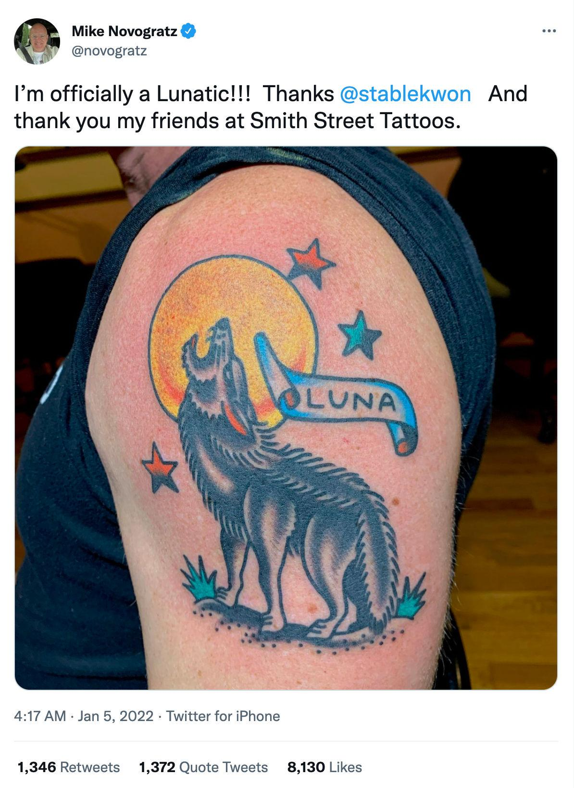

Bu kısımda 2022 yılı Mayıs ayında yaşanan Terra ağı çıkışlı stabil para birimi UST’nin hikayesine bakacağız.

Ödeme sistemleri üzerine uzmanlaşmaya çalışan Terra blokzinciri tarafından çıkarılan stabil para UST, 2022 yılının başlarında yaşanan ataklardan dolayı ABD dolarına olan çıpasını kaybetti. Gelin önce hızlıca stabil para nedir kavramına bakalım, arkasından UST’deki temel sorun neydi ona yanıt arayalım.

## Nedir UST, nasıl çalışır? {#nedir-ust-nasil-calisir}

UST algoritmik bir stabil para. Ne demek bu? Arkasında bir itibari para ya da DAI’de olduğu gibi basılandan fazla miktarda bir kriptopara yok. Bunun yerine bire bir Terra ekosisteminin temel parası (coini) olan LUNA var.

Sistem kısaca şu şekilde çalışıyor: UST almak isteyen, LUNA’sını gönderiyor. 100 dolar tutarında LUNA mı gönderildi? Karşılığında 100 UST basılıyor ve alınan LUNA da yakılıyor. Yarın öbür gün, UST’nizi bozdurmak mı istiyorsunuz? 100 dolar tutarında LUNA basılıyor ve gönderdiğiniz UST yakılıyor.

### Niye UST’ye ihtiyaç duyuluyor? {#niye-ustye-ihtiyac-duyuluyor}

Piyasada o kadar stabil para var. Bir de UST gerekli mi? Terra’nın ödemeler üzerine uzmanlaşmış bir blokzincir olması nedeniyle likit ve kendi sisteminin ihtiyaçlarına göre esneklik gösterebilecek bir para birimine ihtiyacı var. Eğer USDC, USDT gibi bir para kullanmak isteseydi bunun karşılığında bir ödeme yapması gerekecekti. UST için ise öyle bir ödeme yapmasına gerek yok. Talep oldukça LUNA karşılığı UST basabilir. Eğer insanlar bu sistemi kabul edip UST kullanırlar ise ne ala. İyi de insanlar niye kullansın?

Teoride, Terra sisteminin ileride büyüyeceği ve yaygınlaşacağına inanıyorsanız, üzerine kurulu uygulamaları kullanmak için UST’yi alabilir ya da elinizde tutabilirsiniz. Ancak başlangıçta kurulu çok fazla uygulama yok zira piyasada elinde UST tutan yok. Yumurta tavuk sarmalına girdik.

Peki o zaman ne yapmalı? DeFi’nin zamanında uyguladığı teşvik sistemi ile UST’nin kullanımını yaygınlaştırmalı. Terra sistemi, UST’nin kullanımını yaygınlaştırmak için ağız sulandıracak bir teşvik kullandı. Anchor Protokolü adı verilen bir kredi uygulaması ile sisteme yatırılan UST’lere tam %20 faiz vermeye başladı. ABD’de dolar faizlerinin 0’lara yakın olduğu bir zaman diliminden bahsediyoruz (2021 yılları). %20 faiz inanılmaz!

Nitekim istenen gerçekleşti ve ilk kurulduğundan Mayıs 2022’ye kadar yaklaşık 18 ayda piyasadaki toplam UST miktarı 18 milyar ABD Dolarına kadar geldi.

UST aslında 2022 yılı Mayıs ayına gelmeden önce bir büyük badire atlatmıştı. Bundan bir yıl önce 2021 yılının Mayıs ayında değeri bir ara 0,96 ABD Dolarına düşse de sonrasında toparlanmış, yatırımcıları da rahat bir nefes almıştı.

### En son neler yaşandı? {#en-son-neler-yasandi}

UST’nin bu kadar genişlemesi aslında en çok LUNA’ya yaradı. İnsanların %20 faiz beklentisi ile UST almak için, LUNA vermeleri gerekiyordu. Bu, LUNA’ya ciddi bir talep doğurdu. Bir taraftan da insanların UST almak için yatırdığı LUNA’lar yakıldığı için LUNA’nın arzı azalıyordu. Bütün bunlar sonucu LUNA’nın değeri 1 ABD Dolarından 2022’nin Nisan ayı başında 112 ABD Dolarına kadar yükseldi.

İyi ama bu bir sarmal. Yukarı doğru iyi gidiyor da; ya terse dönerse? İnsanlar bir gün UST’ye olan güvenlerini kaybedip paralarını geri verirlerse, karşılığında onlara LUNA verilecek, onlar da aldıkları LUNA’ları piyasada satacaklar ve LUNA fiyatı düşecek.

İşte Terra kurucuları, bu döngüyü kırmak için yüzyıllardır merkez bankalarının kullandığı bir yöntemi uyguladılar. Merkez bankaları paralarının değerini savunmak için depolarında cephane bulundururlar. Bunlar genelde başka ülke paraları ve en çok da altın olur. Kripto dünyasının altını ne? BTC tabii ki. Terra da, UST hazinesinde tutmak üzere 10 milyar ABD Doları tutarında BTC alacağını açıkladı. Aradan geçen zamanda ise yaklaşık 3 milyar ABD Doları tutarında BTC’yi satın alıp kasaya koydu.

Ne yazık ki bu hamle yeterli olmadı. Mayıs ayının başlarında FED’in açıklamaları sonrasında bir düşüş yaşayan kripto pazarında, açıklamanın yapıldığı hafta sonuna doğru ciddi bir şekilde UST satışları yaşandı. Bu durum sonrasında UST, ABD Dolarına olan çıpasını kaybetti.

## İşin özü güven {#isin-ozu-guven}

Stabil paraların merkeziyetsiz finansın temel taşı olduğunu söylemek gerek. Bu nedenle, kullanıcılara vereceği güven çok ama çok önemli. Yatırımcı zaten kullandığı uygulamalarda belli bir getiri beklentisi ile yeterince risk alıyor. Bunu yaparken sahibi olduğu stabil paranın yarın öbür gün kendisine aynı miktarda değer olarak döneceğini düşünüyor.

USDC gibi paralarda bu güven ‘bakın, basılan tokenin arkasında bankada para var’ söylemi ile geliyor. USDT’nin bu anlamda eksikleri var, ama o da ilk olmanın avantajı ile özellikle merkezi borsaların defacto para birimi haline geldi. DAI deseniz arkasında fazla fazla teminat var (ki teminatın kriptopara olması onu bir parça riskli yapıyor elbette, özellikle ani düşüşlerde).

UST ise bir algoritmik para olarak farklı bir noktada.

Öncelikle algoritmik stabil paraların henüz deneysel olduğunu belirtmekte fayda var. Pek çok eski uygulama (Basis gibi) başarılı olamadı. Hâlâ sürenlerden Ampleforth 1 ABD doları civarında gezinse de yaklaşık 100 milyon ABD Doları piyasa değeriyle geniş kesimlere ulaşamadı.

Bu paraların uzun vadede başarılı olmaları geniş kesimlerce kabul görmelerine bağlı. Ödemelerde kullanılması, uygulamaların bu parayı kabul etmesi lazım. Bu nedenle öncelikle Terra sisteminin kullanımının artması ya da UST’nin başka blokzincirlere açılması gerekirdi (bu konuda Terra’nın Avalanche ve Evmos ile kullanım üzerine anlaşmalar yaptığını biliyoruz). Yüksek faiz vererek UST basımını artırabilirsiniz ama insanlar bu parayı alıp faize yatırıyorlar ise bu kullanım anlamına gelmez.

Kısa vadede ise yukarıda bahsettiğimiz başarının gelebilmesi için LUNA’ya olan güvenin tam olması lazım. Yüksek faiz vererek para basmak sürdürülebilir bir yöntem değil. Anchor protokoldeki 18 milyar ABD Doları için yıllık 3,6 milyar ABD Doları faiz ödemesi yapacaksınız. Bunu da efektif olarak LUNA basarak karşılayacaksınız.

Kısa vadede yüksek faiz ile hormonlu büyümeye çalışmak oldukça riskli bir hareket. Bir de bunun üzerine UST’ye yapılan ataklara karşı Terra’nın aldığı önlemlerin şeffaf olmaması güveni daha da zedeledi. Piyasadan yüksek miktarda UST çekilmesine karşı Terra’nın cevabı, yaklaşık 1.5 milyar ABD Doları karşılığı bir parayı OTC masası dediğimiz büyük işlemli gruplara vermek ve onlara “UST’yi koruyun” demek oldu. Bu para nasıl kullanıldı o da tam olarak belli değil (OTC masaları blokzincir üzerinde değil, merkezi borsalar üzerinden harcama yapıyorlar; o nedenle takip edilemiyor). Şeffaflığın olmadığı yerde söylenti ve korku başlar. UST’nin yaşadığı krizi çıkartan temel neden bu oldu.

## Olanlardan nasıl sonuçlar çıkarabiliriz? {#olanlardan-nasil-sonuclar-cikarabiliriz}

Kayıpları yerine getirmeyecek olsa da, yaşananlardan bazı dersler çıkarılması halinde kripto dünyasının bu krizden daha güçlü çıkabileceğine inanıyorum. Gelin bu dersler neler olabilir hızlıca bir göz atalım:

### DeFi henüz yeni doğmakta olan bir alan, teori ile pratik birbirine uymayabiliyor {#defi-henuz-yeni-dogmakta-olan-bir-alan-teori-ile-pratik-birbirine-uymayabiliyor}

DeFi’nin riskli bir alan olduğu hep konuşulur, bizim yazılarımızda da sıkça yer alır. Bu uyarıları, yazarın ‘kendini sağlama almak’ için eklediğini düşünmeyin lütfen. DeFi gibi yeni filizlenmeye başlayan bir alanda, deneysel olarak ortaya çıkan projeler ile ilgili ne kadar senaryo çalışması yaparsanız yapın, pratik hayat önünüze aklınıza hiç gelmeyecek bambaşka engeller çıkarabiliyor.

DeFi alanının en saygın isimlerinden olan [Delphi Digital](https://turansert.com/genel/2022/05/20/delphidigital.io), sonradan yayınladığı [öz eleştiride](https://members.delphidigital.io/reports/learnings-from-last-week/) teoride güzel bir proje olan Terra konusunda nerede hata yapıldığını çok net olarak anlatmış:

Delphi Digital, 2021 yılı başlarında tanıştıkları Terra ekosisteminin, ‘algoritmik stabil paralara entegre olmuş, gerçek dünya adaptasyonuna odaklanmış ve göreceli ölçeklenebilir bir blokzincir olma’ tezini çok ilgi çekici bulmuş. Sonrasında Terra üzerinde Mart ayında faaliyete başlayan kredi protokolü Anchor’un sunduğu yüksek faizin UST’nin geniş kesimlerce adaptasyonu tezine müthiş uyumlu olduğunu düşünmüş. O zamanlarda DeFi’de getiriler genelde %100’ler seviyesinde olduğu için Anchor’un verdiği %20’lik faiz onlara gayet makul görünmüş.

Teoride oldukça mantıklı. Gelelim sonrasında neler olduğuna: 2022 yılı başlarında DeFi’de getiriler hızla düşerken, Anchor’un bu oranı sürdürmesi Terra üzerinde ciddi bir fon toplanmasına neden oldu. Verilen yüksek faiz sonucu oluşan açık başlangıçta Anchor rezervlerinden karşılanırken, sonrasında bu mümkün olmadı.

Hızlı büyüme nedeniyle oluşan kırılganlık, özellikle piyasanın kötü olduğu dönemlerde ölümcül hale gelebiliyor. Bunu önlemek için Terra tarafından alınan önlem ‘rezervlere BTC atalım’ oldu. Kağıt üzerinde oldukça makul görünen bu önlemin, piyasanın kötü dönemlerinde kullanıldığında BTC’nin fiyatını daha da düşürerek aslında hiç de düşünüldüğü kadar yeterli olmadığı görüldü.

### DeFi’de tek yol merkeziyetsizlik olmalı {#defide-tek-yol-merkeziyetsizlik-olmali}

Merkeziyetsiz sistemlerin oyuncularının izlemesi gereken temel yol merkeziyetsizleşmek olmalı. Başlangıçta büyüme aşamasında kurucu ekibin merkezi olması hoş görülebilir ancak bu uzun vadede değişmeli. Merkeziyetsizlik, karar mekanizmalarının şeffaf olmasını ve sistemin bütün işlemlerinin blokzincirden takip edilebilmesini gerektirir. UST’nin kurucu ekibi bu anlamda hem merkezi bir ekip, hem de aldıkları önlemler şeffaf değildi. Paranızın bir kısmını BTC yapmanız sizi merkeziyetsiz yapmaz.

### Riskin dereceleri önemli {#riskin-dereceleri-onemli}

Bir diğer sık görülen durum ise ‘göreceli risk algısında’. Ne kastediyoruz bundan? DeFi dünyası ürünlerinin riskli olduğunu bilen bir kesim var ve bu kesim buna göre portföy çeşitlendirmesi yapıyor. Bunu yaparken, parasının bir kısmını yüksek getiri-yüksek risk ürünlere koyarken, kalan kısmını daha az riskli ürünlerde değerlendiriyor.

Klasik finansta bu daha az riskli ya da risksiz olarak adlandırılan ürünler, devlet bonoları ya da bildiğimiz nakit tutma şeklinde görülüyor. DeFi dünyasının kimi aktörleri de, UST’yi adı üzerinde ABD Dolarına çıpalandığı için, ‘risksiz’ bir para olarak değerlendirdi. Kazın ayağının öyle olmadığı, son olaylarda acı bir şekilde tecrübe edilmiş oldu.

### Fanatizmin yeri ve zamanı var {#fanatizmin-yeri-ve-zamani-var}

Her fikir ya da proje, özellikle başlangıç aşamasında fanatik bir topluluğa ihtiyaç duyar. Fanatikler, projenin eksik ve gediklerine rağmen onu diri tutar ve olgunlaşma öncesinde projenin düştüğü zamanlarda ayağa kalkmasına yardımcı olurlar.

Öte yandan, aynı fanatiklik proje olgunlaştıkça toksik bir hale de gelebiliyor. Terra sistemi topluluğunda da son zamanlarda buna benzer hareketler görülmeye başlanmıştı. Topluluk üyeleri (başta kurucu Do Kwon olmak üzere) sisteme yapılan eleştirileri, [aptallıkla suçlayacak](https://twitter.com/stablekwon/status/1464897977793728514?s=20&t=jbrCdOsCTMywLNKXSYk-vA) kadar saldırgan bir hale gelmişlerdi.

Yapılan eleştirilerin dikkate alınmaması, projelerin içerdiği risklerin tam olarak anlaşılmasına engel oluyor. Eğer gerekli tartışmalar yapılsa ve bu riskler tartışılsaydı belki de kamuoyunda farkındalık artacak ve gerekli geliştirmeleri yapmaları için proje sahipler üzerinde baskı yaratılabilecekti.

Bu fanatiklik ya da ‘üstten görme’ durumu sadece projeyi kuranlarda değil yatırımcılarda da görülebiliyor. ABD’nin en ünlü dijital finansal servis ve yatırım yönetim şirketi olan [Galaxy Digital](https://www.galaxydigital.io/)‘in kurucusu [Mike Novogratz](https://twitter.com/novogratz) bunun en ibret verici örneklerinden. Luna’ya olan desteğini göstermek için Ocak 2022’de koluna bu temada bir dövme yaptıran Novogratz, son yaşananlar sonrası verdiği [demeçte](https://www.marketwatch.com/story/my-tattoo-will-be-a-constant-reminder-that-venture-investing-requires-humility-says-michael-novogratz-with-a-luna-tattoo-after-the-cryptos-collapse-11652896185) ‘yaptırdığım dövme, yatırımcılığın alçakgönüllülük gerektirdiğini bana sürekli hatırlatacak’ yorumunda bulundu. Hepimizin kulağına küpe olmasında fayda var.

<figure></figure>

*“Artık resmi olarak bir Lunatic oldum!” \[Lunatic, Luna fanatiklerinin kendilerine taktıkları ad\]. Mike Novogratz. (Kaynak: [X](https://twitter.com/novogratz/status/1478535972560195585?ref_src=twsrc%5Etfw) - Not: Novogratz bu postu sonrada kaldırdı.)*

### Şeffaflık, DeFi’nin olmazsa olmazı {#seffaflik-definin-olmazsa-olmazi}

Yukarıda bahsettiğimiz bir konuyu tekrar hatırlatmakta fayda var: DeFi’nin kuruluşundaki temel prensiplerden bir tanesi şeffaflık.

Neden bu kadar önemli şeffaflık? Merkeziyetsiz sistemlerde, herhangi bir denetim mekanizması yok. Piyasadaki pek çok ürünün kurucu ekipleri bile belli değil. O zaman nasıl güveneceğiz bu ürünlere? Şeffaflık sayesinde.

Nasıl bir şeffaflık bu? Ürünlerin hepsinin yazılım kodlarının açık olması. Yapılan tüm işlemlerin blokzincir üzerine kaydedilmesi. Büyüdükçe yavaş yavaş merkeziyetsizleşen girişimlerin kamuoyuna açıkladıkları bir yol haritalarının bulunması. Girişimi yönlendirecek stratejik kararların, herkese açık oylamalar ile topluluk tarafından alınması. İşte ancak bu maddeler sayesinde DeFi’ye güven sağlanabiliyor.

Son yaşanan UST/Terra kazasında ise DeFi’nin bu temel prensibinden uzaklaşıldığını gördük. Özellikle sistemin kendini korumak için kenara koyduğu milyarlarca dolarlık BTC’nin akıbeti uzun bir süre bilinemedi. Eğer bu para, blokzincir üzerinde işlem görseydi hepimiz nasıl kullanıldığını rahatça takip edebilirdik. Terra ekibi ise böyle bir hareket yerine parayı merkezi borsalara aktardı. Olayların başladığı 7 Mayıs’tan tam 10 gün sonra 16 Mayıs’ta açıklama yaparak kasada bulunan 80,000 BTC’yi sattığını [açıkladı](https://twitter.com/LFG_org/status/1526126703046582272). DeFi açısından affedilemez bir hata bu. Güveni kaybetmenin daha hızlı bir yolu olamazdı herhalde.

### Bu bir yol kazası {#bu-bir-yol-kazasi}

Yaşananlar sonrası pek çok kişi ‘bu olay DeFi’yi çok yaraladı’ şeklinde yorumladı. Şahsen bu konuda genel oluşan havanın aksine bir görüşteyim.

Elbette yaşananlar DeFi’nin büyümesi sırasında şimdiye kadar tecrübe edilen en büyük kriz idi. Bu olayın bir domino etkisi ile ekosistemdeki pek çok oyuncuyu benzer şekilde etkilediğini gördük. Önce 3AC oluşan açığa dayanamayarak battı. Sadece kendi batmakla kalmadı aynı zamanda arkasından ona kredi vermiş olan merkezi kredi platformlarını da batırdı. En sonunda yaşanan FTX krizi ise adeta olayların üzerine tüy dikti. Dolayısıyla yaşanan bu üç büyük kriz, DeFi’nin geniş kesimlerce adaptasyonunu net bir şekilde geciktirdi.

Yine de yaşananlar, bize Web3’ün temel prensiplerinden sapıldığı noktada neler olabileceğini göstermesi açısından güzel bir örnek oldu. UST’deki hızlı yükseliş, piyasaya Justin Sun gibi tartışmalı karakterlerin getirdiği USDD gibi başka stabil paraların da girmesine neden olmuştu. Eğer bu olay birkaç ay sonra gerçekleşse, yüksek ihtimalle, UST ile birlikte USDD ya da klonu başka stabil paralara yatırılmış milyarlarca doların da yok olduğunu görecektik. Bu açıdan ‘zararın neresinden dönülse kardır’ gibi de düşünülebilir (ve kabul, bu oldukça iyimser bir bakış açısı).

## Sonuç {#sonuc}

Kripto dünyasının o ana kadar yaşadığı bu en büyük kriz olan UST’nin ABD Doları çıpasını kaybetmesi ve Luna’nın sıfıra inmesi, şiddetini kaybetmiş olsa da artçı sarsıntılar sonrasında da devam etti. Web3 dünyası, bu olanlardan gerekli dersleri çıkardı diye düşünüyorum. Kapalı, merkezi ve yüksek kaldıraç kullanan kurumların nasıl bir risk barındırdığı ortaya çıktı. Bu olay sonrası kripto dünyası daha şeffaf, eleştiriye daha açık, belki daha ihtiyatlı bir büyüme içine girdi. Yine de, bundan sonra da böyle krizler olmaya mutlaka devam edecek. Umudumuz, küçük yatırımcıların bu tip krizleri olabildiğince hasarsız bir şekilde atlatabilmesi. Hep birlikte yaşayarak göreceğiz.
