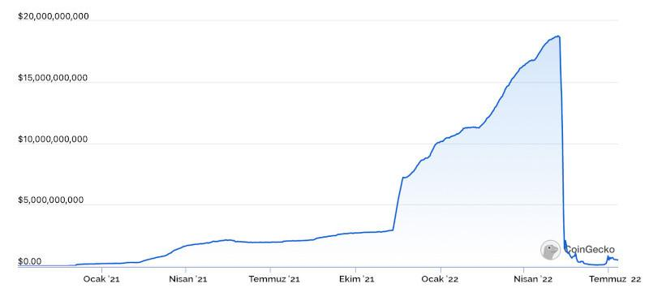

Bu kısımda, UST ile başlayan 2022 krizinin ikinci perdesi olan 3AC iflasına bakıyoruz.

## Nasıl başladı? {#nasil-basladi}

Kitabımıza bu kısımdan başlayanlar için bir önceki kısımda bahsettiğimiz 8 Mayıs tarihinde UST’de yaşanan sıkıntı ile başlayan ve sonrasında domino taşları gibi teker teker birbirini etkileyen olaylar zincirinin başrol oyuncularını inceleyelim öncelikle:

### UST {#ust}

Yaşanan sarsıntının temelinde Terra sisteminin stabil parası olan UST’nin 1 ABD dolarına sabitlenmiş çıpasını kaybetmesi var.

Bir önceki kısımda ayrıntılarını incelediğimiz gibi dolara sabit olmakla birlikte Anchor Protokolü tarafından yıllık %20 gibi ağız sulandırıcı bir faiz oranı ile yatırımcılara sunulan UST, bir yıldan kısa bir zaman içinde yaklaşık 18 milyar ABD Doları gibi bir büyüklüğe ulaştı.

<figure><figcaption>UST piyasa değeri <em>UST Piyasa Değeri (ABD Doları). (Kaynak: <a href="https://www.coingecko.com/en/coins/terraclassicusd">CoinGecko</a>)</em></figcaption></figure>

Büyük ölçüde hormonlu olarak gerçekleşen bu büyümenin sürdürülebilir olmadığı aslında apaçık ortadaydı ancak müzik çalarken bütün oyuncular dans etmeye devam etti.

Sonrasında müzik susunca, dans pistinde en hareketli oyuncu olan Three Arrows Capital’in (3AC) oturacak sandalye bulamadığını gördük. Önce bu arkadaşları bir tanıyalım:

## Three Arrows Capital - 3AC {#three-arrows-capital-3ac}

2012 yılında [Zhu Su](https://twitter.com/zhusu) ve [Kyle Davies](https://twitter.com/kyleldavies) adında iki trader [tarafından Singapur’da](https://en.wikipedia.org/wiki/Three_Arrows_Capital) kurulan [Three Arrows Capital](https://www.threearrowscap.com/about-us/) (kısa adıyla 3AC) esas olarak bir arbitraj fonu. Ne demek arbitraj fonu? Benzer ürünlerin farklı piyasalar arasında farklı fiyatlardan işlem görmesinden doğan fırsatları değerlendiren bir fon. İşlem yaptıkları benzer karaktere sahip enstrümanları bir piyasada alıp (ya da borç alıp) diğer tarafta satan (ya da borç veren) böylece riski minimuma indirerek kazanç sağlayan yapılar.

### 3AC’nin kullandığı üç temel arbitraj ürünü {#b-3acnin-kullandigi-uc-temel-arbitraj-urunu}

3AC’nin bu tip piyasa farklılıklarından yararlanarak işlem yaptığı üç temel ürün var (başka pek çok yatırımı dışında). Bunlar BTC/GBTC, ETH/stETH ve USD/UST idi.

**1. BTC/GBTC:** Piyasadan BTC borçlanıp, bu BTC ile GBTC almak.

GBTC, elinde BTC tutan özel bir fon (İngilizce’de trust fund). ETF dediğimiz, sahip olduğu ürünlerin fiyatını takip eden fonlar ABD’de çok yaygın ancak ABD’nin SPK’sı olan SEC kripto için bu fonlara ancak 2024 yılının Ocak ayında izin verdi. Bunun öncesinde, kriptoparalara yatırım yapmak isteyen büyük emeklilik fonları gidip GBTC alıyorlar idi. Bu aşırı talep nedeniyle GBTC, elinde tuttuğu BTC’den daha yüksek bir değere sahip idi.

GBTC’nin birkaç özelliği var; herkes alamıyor (sadece belirli bir ‘nitelikli’ grup işlem yapabiliyor), aldıktan sonra altı ay boyunca satamıyorsunuz. Ayrıca öyle geri verip karşılığında BTC almak da yok, satışı sadece piyasaya yapabiliyorsunuz. GBTC primli olduğunda aslında bu bir sorun değil. Eğer GBTC %10 primli işlem görüyorsa, BTC’ni yatır, altı ay bekle altı ay sonunda %10 primli olarak piyasada sat. İşte 3AC’nin yaptığı işlemlerden biri bu idi.

Peki ya GBTC’ye olan talep azalır ve GBTC iskontoya düşerse? O zaman zarar etmemek için GBTC’yi satmaz, elinizde tutmaya devam edersiniz. Ne zamana kadar? GBTC’ye talebin ve buna bağlı fiyatın artmasını bekleyeceksiniz. Bu nasıl olur? Eğer GBTC’yi geri verip BTC alabilirseniz. Bu da GBTC’nin hukuki yapısı nedeniyle mümkün değil. Bu durumdan çıkışın tek bir yolu var, o da eğer GBTC kanuni yapısını değiştirip bir ETF’e dönüşürse. Zira böyle bir durumda isteyen piyasa fiyatından GBTC’sini satıp BTC’ye dönebilir. İşte GBTC’yi çıkaran Grayscale bu fonu ETF’e çevirmek için SEC’ye başvurdu ancak SEC izin vermedi. Ta ki, Grayscale SEC’yi mahkemeye verip, mahkeme SEC’yi Bitcoin ETF’leri konusunda ‘zorla’ ikna edinceye kadar. O da 2024 Ocak ayını buldu.

**2. ETH/stETH:** Ethereum 2022 yılının Eylül ayında faaliyete geçen yeni versiyonunda PoW denen iş kanıtı yönteminden, daha az enerji harcayan PoS sahiplik kanıtı yöntemine geçti. Sistemin güvenliğini ve işleyişini artık madenciler değil sisteme ETH rehin etmiş onaylayıcılar sağlıyor. Bu nedenle onaylayıcı olmak isteyenler 2020 yılının Aralık ayından bu yana ellerindeki ETH’yi (en az 32 ETH olacak şekilde) sisteme kilitliyorlar ve bunun karşılığı bir faiz alıyorlar. Sisteme kilitlenen bu ETH’leri geri çekmek 2023 yılının Mart ayına kadar mümkün değildi. Bunun için önce PoS sistemine geçilmesi sonra da yaklaşık altı ay kadar beklenmesi gerekiyordu.

İşte 2020 Aralık ayı ile 2023 Mart ayı arasındaki yaklaşık 27 ay boyunca sisteme kilitlenen bu ETH’leri likit hale getirmek için çeşitli tokenler türetildi. Bunlardan en büyüğü ise [Lido Finance](https://lido.fi/) tarafından çıkarılan staked ETH ([stETH](https://www.coingecko.com/en/coins/lido-staked-ether)) oldu. ETH’nizi Lido Finance’e kilitlediğinizde karşılığında stETH alıyorsunuz. stETH ile hem varlığınızı PoS sistemine kilitlemiş gibi faiz alıyor hem de bu tokeni DeFi sisteminde kullanarak (örneğin varlığınızı başka sistemlere likidite sağlayarak) ekstra gelir elde ediyorsunuz. Eğer günün birinde ETH ihtiyacınız olursa stETH’yi satabiliyorsunuz ama bunu piyasada yapmak zorundasınız. (Lido Finance ETH’nizi stake ettiği için 27 ay boyunca bu parayı size ETH olarak geri vermiyordu. Siz gidip piyasada satıyordunuz, dolayısıyla stETH’nin değerini piyasa belirliyordu.)

Teorik olarak stETH ile ETH’nin değerinin eşit olması gerek. Zira konan her bir ETH için bir stETH yaratılıyor. Zaten bir gün ETH’ler PoS sisteminden çekilebilir olduğunda stETH’ler de benzer şekilde ETH’ye çevirebildiniz. O güne kadar ya bekleyecektiniz ya da piyasa size ne dikte ediyorsa (ki bu genelde iskontolu bir fiyat oluyor) oradan satacaktınız.

**3. USD/UST:** UST’nin büyümesinin temel nedenlerinden biri yatırımcıların (ya da al-sat yapan piyasa oyuncularının), bulabildikleri her yerden ABD dolarına çıpalı paraları (USDT, USDC) borçlanıp bu paraları UST’ye yatırmaları oldu. Öyle ya, bankaların USD mevduata %1’in altında bir faiz verdiği ortamda, USDC için %4 vaat etmek yatırımcılar için müthiş cazip. USDC’yi bu orandan borç alıp %20 ile UST’ye yatırdığınızda bu da sizin için müthiş. Alan memnun satan memnun. Nereye kadar? Önceki bölümde bahsettiğimiz gibi müzik sona erinceye kadar.

### 3AC bu üç ürünü nasıl kullandı? {#b-3ac-bu-uc-urunu-nasil-kullandi}

İşte 3AC piyasadan olabildiğince para borçlanıp yukarıdaki üç ‘arbitraj’ fırsatını kullanarak ciddi bir şekilde büyüdü. Hesaba katmadıkları ne oldu? Yukarıdaki sistemlerin piyasalar yükselişte iken yani müzik devam ederken kazanç sağladığı, piyasaların düşüşe geçtiği noktada ise göz ardı edilen bütün risklerinin bir anda başa geldiği. Neydi bu riskler?

Birincisi USDT(C) gibi paraları borç alıp UST’ye yatırma stratejisinin, her iki paranın da ABD dolarına çıpalanması nedeniyle ‘sıfır risk’ gibi algılanırken, aslında UST’nin gerçek risklerini gizlemesi. Nedir bunlar? UST’nin temel fonksiyonu olan geniş kitlelerce kullanım hedefine ulaşamaması. Bunun yerine, Terra sistemi kurucularının UST’yi büyütmek için sürdürülemez bir şekilde yüksek faiz vererek adeta ince bir buz üzerinde yürümesi. Bu buz kırıldığında en hızlı batanlar en çok yük taşıyanlar oldu ki bunların başında 3AC geliyordu.

İkincisi ise likidite sıkıntısı. 3AC, USD/UST stratejisini olabildiğince sömürmek adına USDT (ve USDC) borçlanabilmek için fazla miktarda teminat verdi. Neydi verilen bu teminatlar? Yukarıda bahsettiğimiz arbitraj işlemleri sırasında aldığı GBTC hisseleri ve stETH tokenleri ile başta BTC ve ETH olmak üzere likit kriptoparalar. UST’nin çıpasını kaybettiği noktada 3AC’ye borç verenler kredileri geri çağırmaya başladılar. Krediler geri ödenmediği noktada da ellerinde tuttukları bu teminatları piyasada satma yoluna gittiler. İşte bu bozdumalar sonrası GBTC’nin piyasa değeri BTC’ye göre %34’e yakın [geriledi](https://ycharts.com/companies/GBTC/discount_or_premium_to_nav), aynı şekilde stETH’nin değeri 0,93 ETH’ye [düştü](https://coinmarketcap.com/currencies/steth/steth/eth/) BTC, 2022 Haziran ayında şimdiye kadar en kötü performans gösterdiği ayı yaşayıp %39.7 oranında değer kaybetti. Bütün bu yaşananlar, teminatların değerini daha da düşürüp, daha fazla teminatın bozulmasına yol açtı.

Yukarıda yaşananların dışında 3AC’nin elindeki GBTC’leri farklı kurumlara teminat göstererek kredi aldığı şeklinde iddialar var ki, doğru ise dolandırıcılık olarak adlandırılabilecek bu olayı 3AC’nin kurulu olduğu Singapur otoritelerinin incelemeye aldığını da belirtelim. Sonrasında 2023 yılı Eylül ayında 3AC’nin iki kurucusuna 9 yıl boyunca sermaye piyasalarında işlem yasağı getirdiğini de [ekleyelim](https://coingeek.com/3ac-founders-hit-with-9-year-capital-markets-ban-in-singapore/).
