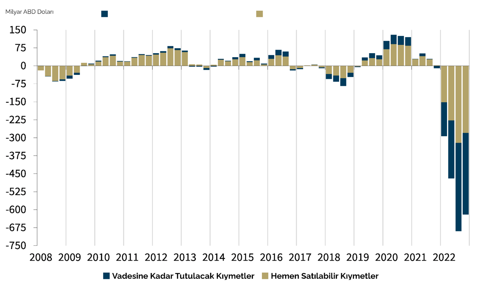

Bu kısımda, 2023 yılı başında ABD’de batan üç bankanın hikayesinden yola çıkarak finansal piyasalarda bizi nelerin beklediğini anlamaya çalışacağız.

ABD’de finans piyasaları 2023 yılı Mart ayında karıştı. İki bankanın kapanması ile başlayan süreçte ABD yetkililerinin o hafta sonu açıkladığı kurtarma paketi ile sular durulmuş gibi görünse de gelecek ‘her zaman olduğu gibi’ belirsizliğini koruyor. Gelin kısaca olanları ve nedenlerini hatırlayalım, sonra da geleceğe bakalım.

## 2023 ABD bankacılık krizinde neler oldu, neden oldu? {#neler-oldu-neden-oldu}

Olaylar dizisi basında sıkça yer aldığı için burayı kısa tutalım dilerseniz:

### Makro ekonomik nedenler: Faiz indirimi ve sonrasında hızlı artırım {#makro-ekonomik-nedenler-faiz-indirimi-ve-sonrasinda-hizli-artirim}

ABD Merkez Bankası olan FED, pandemi ile birlikte ortaya çıkan ekonomik krizi aşabilmek için 2020-21 yıllarında piyasayı paraya boğmuştu. 2022 yılında ise bu rüzgarı tersine çevirerek enflasyonu indirmek adına 40 yıldır görülmemiş bir şekilde faizleri hızla artırma yoluna gitti. Sorunun temeli buradan başlıyor.

Yaşanan para bolluğu ABD’li bankaların mevduatlarının şişmesine yol açtı. Bankalar, şişen mevduatı kredi olarak verecek yer bulamadılar (ülkemizden ne kadar da farklı değil mi?). Kredi veremedikleri durumda ellerinde ‘patlayan’ bu parayı koyabilecekleri tek enstrüman ABD hazine bonosuydu. Bunu yaparken de oldukça düşük kalan faizler nedeniyle nispeten daha yüksek getiriye sahip uzun vadeli (5-10 yıl arası) bonolara yüklendiler.

Bu stratejiyi izleyen bankalar için en kritik konu, borçları (mevduat) ile alacakları (kredi ya da bono) arasındaki vade farkını yönetmek. Müşteri, mevduatını istediği zaman çekebilir; yani borçlar kısa vadelidir, krediler ve bonolar ise uzun vadeli. Kredilerde bu bir sorun olabiliyor; çünkü müşteriden krediyi geri isteyemiyorsunuz ama iş bonoya geldiğinde ihtiyaç duyduğunuzda ikinci pazarı olduğu için gidip orada bozabilirsiniz. Tabii bunun bir maliyeti var. İşte sorun da burada başlıyor.

### Makro ekonominin genel bankacılık sektörüne etkisi {#makro-ekonominin-genel-bankacilik-sektorune-etkisi}

Peki bu stratejideki en büyük risk nerede? Vadeyi yönetmek birinci konu. Bankalar, aldıkları mevduatı ikincil piyasası olan bonolara yatırarak bu sorunu ‘çözmüş gibi’ yapıyorlar. Sorun, bu mevduat çözülmeye yani müşteriler paralarını çekmeye başlayınca ortaya çıkıyor. Neden?

Müşteriler paralarını neden çeksin? Üç temel nedeni olabilir. Birincisi, bankanın verdiği mevduat faizini beğenmezler ve parayı başka bankaya taşırlar. İkincisi paraya ihtiyaçları vardır, harcamak için çekerler. Üçüncüsü ise bankadaki paralarının tehlikede olduğunu düşünürler.

İşte burada, başta bahsettiğimiz FED’in faizleri artırmasının sonuçlarını 2022 yılının sonundan itibaren görmeye başladık. Ne gördük? Birincisi, artan bono faizleri nedeniyle bankaların ellerinde tuttuğu bonoların değeri düşmeye başladı. Normalde büyük bir sorun bu; çünkü zarar ediyorsunuz. Burada bir muhasebe kuralı bankaların imdadına yetişti. Bankalar, ‘ben bu tahvili vadesi gelene kadar elimde tutacağım’ diyerek bu bonoları piyasa değerinden değil, satın aldıkları değerden ellerinde tuttular. Bu şekilde oluşan toplam 620 milyar dolar tutarındaki zarar bankaların bilançolarında gösterilmedi.

<figure><figcaption>Bankaların yatırım enstrümanlarından doğan gerçekleşmemiş kazanç/zararları <em>Bankaların ellerinde tuttukları hazine bonolarından doğan zararları. (Kaynak:</em> <em>FDIC)</em></figcaption></figure>

FED’in faiz artırmasının ikinci etkisi ise müşteri tarafında oldu. Müşteriler artan faizler nedeniyle paralarını bankalardan çekip alternatif yatırım araçlarına yani bonolara ve para piyasası enstrümanlarına kaydırmaya başladılar. Öyle ya, alternatif para piyasası araçları %5’lerde getiri sağlarken hangi aklı başında kişi gidip parasını %0,1’den banka mevduatında tutar? Banka, elindeki likidite hızla azalmaya başlayınca müşteriye parasını vermek için ne yapacak? Elinde duran değeri düşmüş (ama muhasebede satın aldığı değerden duran) bonoları satmaya başlayacak. Bunun sonucu ne? Ciddi bir zarar yazması.

### Kapanan üç bankaya has riskler {#kapanan-uc-bankaya-has-riskler}

İşte tam bu noktada kapatılan üç bankaya özel bir başka risk ortaya çıkıyor. O da ‘sektörel konsantrasyon’ riski.

Burada ilk olarak zora düşen Silvergate ‘kripto dostu’ bir banka iken arkasından gelen Silicon Valley Bank (SVB) ise teknoloji dünyasına yakın bir banka[^1] (üçüncü kapatılan Signature Bank ise büyüklük olarak bu iki banka arasında ve kripto dostu olarak bilinen bir başka banka). Hizmet verdikleri sektörler (yani kripto ve teknoloji dünyasının kurumları), 2020-21’deki para bolluğunda yatırımcılardan topladıkları paraları getirip bu bankalara yatırdılar. Sonrasında para musluklarının kısılması, teknoloji ve kriptoya yapılan yatırımları bir anda azalttı. Bunun üzerine gelişimlerini sürdürmek isteyen girişimler kaynak ihtiyaçları nedeniyle yavaş yavaş mevduatlarını çekmeye başladılar.

Bir başka deyişle, yukarıda bahsettiğimiz makroekonomik politikaların etkisi bu üç bankanın müşterilerinde çok daha fazla şekilde hissedildi. Buna bir de geleneksel müşterilerin aksine çok daha bilgili, iletişim halinde ve atak bir sektör olan kripto ve teknoloji alanında faaliyet gösteren müşterileri ekleyin[^2]. Alın size FED’in en korktuğu ‘stabilitenin zıttı volatilite’.

Bu durumdan en çok etkilenen banka olan Silvergate bir de üzerine FTX ile olan sıkı ilişkileri ortaya çıkınca Aralık ayı içinde elinde bulunan mevduatın üçte ikisini kaybetti. Üzerine bir de kriptoya şüpheyle yaklaşan üç senatörün bankaya yazdığı [mektup](https://www.warren.senate.gov/oversight/letters/senators-warren-marshall-kennedy-release-new-information-renew-push-for-answers-from-silvergate-bank-over-role-in-ftx-collapse#:~:text=On%20December%206%2C%202022%2C%20Senators,of%20dollars%20in%20customer%20funds.) ve bunu kamuoyu ile paylaşmaları olayların üzerine tuz biber ekti.

Yine de neresinden bakarsanız bakın, Silvergate aylara yayılan ve yavaş yavaş gelişen bir süreç yaşadı ve sonunda ‘gönüllü kapanmaya gitti’. Kapanma sonucu bankanın varlıkları müşteri mevduatlarının tamamını karşıladığı için ABD’li vatandaşın o gözü gibi baktığı vergi gelirlerine herhangi bir halel gelmedi.

SVB’de ise durum biraz daha farklı. Silvergate’in kapanması ve bunun temel nedeninin bankanın elinde tuttuğu bonolar olması, piyasada “sırada kim var?” sorusunu akıllara getirdi. Bu anlamda en yüksek bono oranına (ve sigorta koruması kapsamındaki en az mevduata) sahip olan SVB bir anda dikkatleri üzerine çekti. Özellikle girişim sermayesi firmalarının yatırım yaptıkları şirketlere “paranızı SVB’den çekin” uyarısı yapması neredeyse iki gün içinde ‘bankadan kaçış’ı getirdi[^3] ve 10 Mart 2023 Cuma günü bankaya el konup kapatıldı.

Sonrasında, hafta sonu boyunca artan piyasa oyuncularının ateşi, 12 Mart Pazar akşamı ABD’li otoritelerin mevduatlara sınırsız garanti getirmesi, üstüne üstlük bankaların ellerinde zararına tuttukları bonolara ilk satın aldıkları değer üzerinden kredi sağlayacağını [açıklaması](https://www.federalreserve.gov/newsevents/pressreleases/monetary20230312b.htm) ile bir parça söndü. Burada satır arasında dikkat çeken nokta, açıklamanın içine kripto dostu bir diğer banka olan Signature Bank’ın da kapatılmasının da ‘sokuşturulması’ oldu. Konunun ilginç olmasının nedeni Signature Bank’ın Silvergate gibi kripto konsantrasyonu olmaması ve SVB kadar bono satın almış olmamasına rağmen kapatılması[^4]. Bu, özellikle kripto çevrelerinde ABD’li otoritelerin kriptoya olan düşmanlığının bir göstergesi olarak nitelendirildi.

## ABD bankacılık krizinden çıkarılacak dersler ve gelecek bize neler getirecek? {#cikarilacak-dersler-ve-gelecek-bize-neler-getirecek}

Öncelikle konunun geçmişte olduğu gibi bir ‘batık kredi’ problemi olmadığı konusunda hemen hemen herkes hemfikir[^5]. Sorunun temel nedeni FED’in faizleri hızlı bir şekilde yükseltmesi sonrası, bankaların elinde biriken bonoların oluşturduğu zarar ve bu bankaların risk yönetiminde çuvallaması.

### Banka yönetimleri, hissedarlar ve mudiler için {#banka-yonetimleri-hissedarlar-ve-mudiler-icin}

Burada bankaların, özellikle kripto ve teknoloji sektörüne hizmet verenlerin vade ve faiz riskini doğru bir şekilde yönetememiş olmalarının işlerin buraya gelmesinde en önemli paya sahip olduğunu unutmamak gerek. Zaten Biden yönetimi, yaptıkları açıklamalarda banka yöneticilerinin işlerini kaybedeceklerini, onları seçen hissedarların ya da kredi veren kuruluşların yaptıkları yatırımın ise sıfırlanacağını belirterek bu kesimlere cezayı kesti.

Mevduat sahipleri, en azından paralarını kurtardılar ama özellikle SVB’nin müşterisi olan teknoloji dünyasının pek çok girişiminin kurucuları 11 Mart hafta sonu muhtemelen birkaç yıl yaşlandılar[^6]. Bütün bu olaylardan sonra küçük bankalardan büyük bankalara geçiş olur mu? Küçük banka hisselerinin pazartesi günü yaşadığı ciddi kayıplar[^7] burada kaygıların devam ettiğini gösteriyor.

### FED için {#fed-icin}

Peki FED cephesinde ne gibi dersler çıkarılabilir, ya da neler beklenebilir? FED’in faiz artırarak enflasyonu indirme politikasını ‘sistem bir yerde patlayana kadar’ sürdüreceği düşünülüyordu. Bu patlamanın ekonomik bozulmadan dolayı olması beklenirken, ‘gol’ bankalar tarafından geldi. Özellikle ekonomik göstergelerde görülecek olası kötüleşme ya da enflasyondaki olası düşüş FED’in faiz artışlarından vazgeçmesi sonucunu getirebilir.

Burada uzun vade için de birkaç söz söylemekte fayda var. ABD’li otoritelerin aldığı önlemler, uzun vadeden çok kısa vadeyi düşündüklerini gösteriyor. Zira, bu tip genel bir mevduat garantisi uzun vadede bankaların haddinden fazla risk almalarını getirebilir. Ancak FED’in temel iki önceliği var: Finansal stabilite ve enflasyonu düşük tutmak. Şu an için kriz yaratabilecek bir kıvılcım çıktığı için ilkini önlemek adına ikincisinden feragat etmiş olabilir[^8].

Özellikle SVB olayı bize ABD’li banka ve otoritelerin değişen çağa ayak uydurma konusunda kendilerini geliştirmeleri gerektiğini gösteren acı bir örnek oldu. Teknolojinin gelişmesi, toplulukların birbirleri ile bağının ve iletişimin artması, mobil cihazlar aracılığıyla bile işlem yapılabilmesi, paranın çok hızlı bir şekilde yer değiştirmesine neden oluyor.

Dolayısıyla, bankaların likidite konusunu değerlendirirken artık ‘sosyal medya’ riskini de iyi değerlendirmesinde fayda var. Ayağınızın altındaki halı her an kayabilir.

Otoritelerin bu olaylara hızlı tepki verdiğini düşünenler olsa da Signature Bank’ın kapatılması gerçekten büyük bir hayal kırıklığı yarattı. Bu kapatmayı kripto düşmanlığı gibi görmek çok ağır bir itham olur. Ben şahsen bunu daha çok, ABD’li otoritelerin ‘sistemin stabil kalmasını sağlamak’ adına yaptıkları ve ‘suyun akışını tersine çevirmeye’ çalışan talihsiz bir hamle olarak görüyorum. Sistemi 9’dan 5’e, pazartesiden cumaya yönetip, yeni teknolojilere ayak uydurmaya çalışan bankaları ‘piyasanın stabilitesini bozuyorlar’ gerekçesiyle kapatamazsınız. Bu yeni kaygan ortamda ortaya çıkacak riskleri daha hızlı algılayıp buna göre önlem almaya odaklanmakta fayda var.

ABD’nin dünyada ileri güç olmasının temel kaldıraçlarından biri inovasyon oldu. Her ne kadar regülatörler ‘stabilite’ deseler de, önümüzdeki dönemde özellikle inovasyon konusunda kanun koyucular ile yaşadıkları sürtüşme artarak sürecek. Güçler dengesini iyi oturtmuş olan ABD sisteminin, teknolojiye ayak uydurmakta yavaş ve hantal kalsa da önümüzdeki dönemde çıkaracağı yasalar ile bu alanda öncü olmayı sürdürmesini bekliyorum.

[^1]: ‘Kripto dostu’ derken kastettiğimiz şu: Kriptonun yeni bir sektör olması nedeniyle pek çok büyük banka kripto alanında faaliyet gösteren girişimlere uzak duruyor. Bir yandan da bu sektörün ihtiyaçları da geleneksel finansa göre farklı. Örneğin, 7/24 çalışan bir sektörde para transferlerini pazartesi-cuma 9’dan ‘5’e şeklinde sınırlayamıyorsunuz. O nedenle, Silvergate SEN adını verdiği bir ağ ile kendi müşterilerine aralarında günün her saatinde para transferi yapmaya olanak veren bir ağ kurmuştu. Bu da güzel bir ağ etkisi yarattı. Eğer çalıştığınız sektördeki tüm firmalar SEN ağında ise sizin de orada olmanız klasik dünyanın engellerinden birinden kurtulmanız anlamına geliyor. Benzer bir durum SVB için de geçerli. ABD’de bir şirket iseniz yetkili imzaya sahip çalışanlarınızın (ya da kurucularınızın) ABD kimlik numarasına (İngilizcede Social Security Number kısaca SSN) sahip olmadığı durumda pek çok banka size hesap açmaz. Halbuki, ABD’de özellikle Delaware eyaletinde kurulu pek çok girişimin kurucuları yurt dışında yaşıyorlar. SVB, işte bu tip girişimcilere SSN olmadan da hesap açabilme imkanı verdiği için teknoloji şirketlerinin tercih ettiği bir banka olmuştu.

[^2]: ‘Çiftçilere hizmet veren bir banka olsaydı olaylar bu kadar hızlı gelişip kontrolden çıkmazdı’ gayet geçerli bir argüman haline geliyor.

[^3]: Sadece 9 Mart 2023 Perşembe günü SVB’den bir günde 42 milyar ABD Doları transfer yapıldı. Bankanın toplam 175 milyar ABD Doları mevduatı olduğu düşünüldüğünde bu toplam mevduatın %25’i demek! Kaynak: DFPI. Bu arada bankanın geçen haftaya kadar Moody’s derecesinin A olduğunu da ekleyelim.

[^4]: Banka yetkilileri Cuma günü başlayan mevduat çıkışının Pazar günü durduğunu belirtiyorlar. Banka 7/24 çalışan bir para sistemi kurduğu için para çıkışları hafta sonu da devam ediyordu.

[^5]: Her ne kadar New York Times gibi ana akım medya, konuyu kripto eksenine çekmeye çalışsa da, Janet Yellen’in hafta sonu konuk olduğu programda söylediği gibi konu temelde bankaların elindeki değeri düşmüş bonolar.

[^6]: Amerika’daki start-up’ların yaklaşık yarısının SVB’de hesabı olduğu tahmin ediliyor. Kaynak: [Delphi Digital](https://twitter.com/delphi_digital/status/1634956829058019331)

[^7]: Bankanın herhangi bir sıkıntı yaşaması halinde mevduatlar korunuyor ama bankanın hisse değeri kalmıyor - bu riski almak istemeyen yatırımcılar bir an önce banka hisselerini elden çıkarmaya bakıyorlar.

[^8]: Parasal genişlemenin enflasyon getireceğini düşünen bir kesim olduğu gibi, bunun olmayacağını ve parasal genişlemenin daha çok varlık fiyatlarının artmasına ve paranın riskli olarak da nitelenen alternatif varlıklara kaymayı getireceğini söyleyen bir kesim de var.
