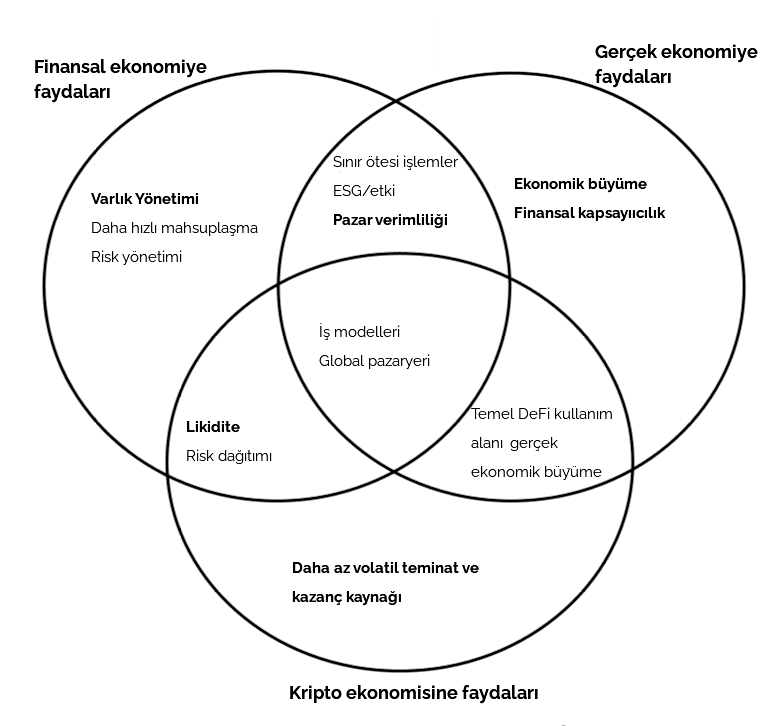
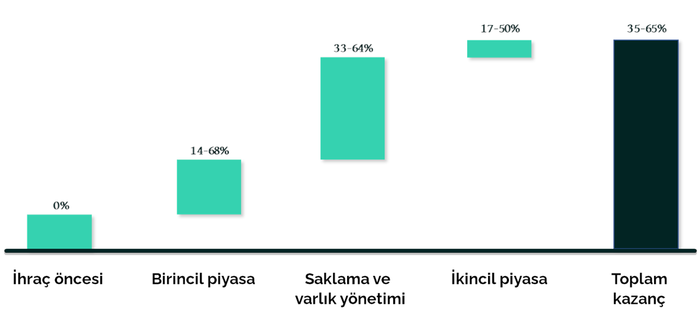
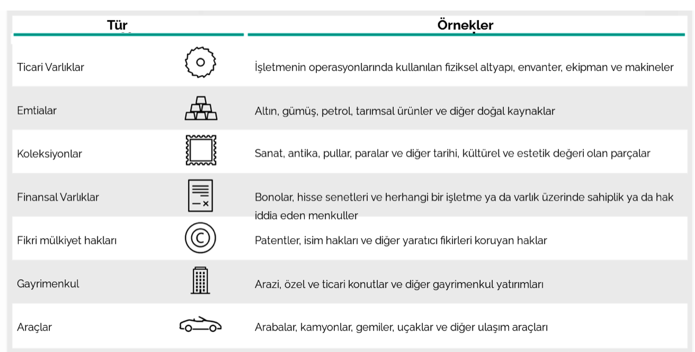
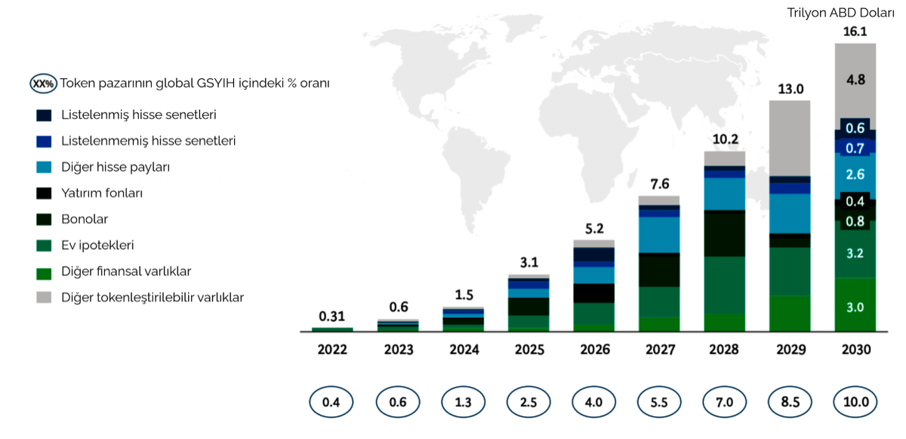

Bu kısımda sık duyduğumuz ve Web3 dünyasının ekonomisini oluşturan token kavramını anlamaya çalışacağız.

## Nedir bu tokenler? {#nedir-bu-tokenler}

Öncelikle neden ‘token’ diye İngilizce bir terim kullanıyoruz? Yok mudur bu meredin Türkçesi. Çok haklısınız - elbette var ama tam anlamını veriyor mu emin değilim. Tokenin Türkçe karşılığı olarak ‘jeton’, ‘gösterge’ gibi pek çok farklı terim mevcut ama bunlar içinde benim ilk kitabım ‘Sorularla Blockchain’ editörü sevgili Ahmet Usta’nın kullandığı ‘belirteç’ terimi belki de en uygunu. Yine de gördüğünüz gibi bu bile kulağa oldukça tuhaf gelen iki kelime. Kim bilir, belki bir gün kulağımız alışır. (Örneğin ilk başta Blockchain terimini kullanırken zamanla blokzinciri terimine alıştığımız gibi). O güne kadar token demeye (yazarken token olarak yazıp okurken ‘tokın’ olarak okumaya) devam.

Anlamına gelirsek aslında oldukça basit: Dijital dünyada, başka herhangi bir dijital ya da fiziki varlığın sahipliğini gösteren varlıklara token diyoruz.

Burada hemen bir es verip, konuyu daha iyi kavrayabilmek için dijital varlık ile fiziki varlık arasındaki farkı iyi anlamak gerekiyor. Fiziki varlıklar, adından da anlaşılabileceği gibi fiziki olarak var olan varlıklara deniyor. Dijital varlıklar ise 1 ve 0’lardan oluşan sanal dünyanın varlıkları. Dijital varlıkların en büyük avantajı zaman ve mekana bağlı kalmadan fiziki varlıklara göre çok daha hızlı hareket edebilmeleri. En büyük dezavantajları ise bu varlıkların çok rahat kopyalanabilir olmaları. Gelin bu sorunu biraz daha açalım.

### Dijital varlıklarda ‘kopyalanma’ sorunsalı {#dijital-varliklarda-kopyalanma-sorunsali}

Dijital varlıkları kopyalamak ya da çoğaltabilmek inanılmaz derecede kolay. Herhangi bir dijital dosyayı, örneğin jpeg formatındaki bir resmi farenizin sağ tarafına basıp ‘kopya’ opsiyonunu seçerek istediğiniz yere kopyalayabilirsiniz. Orjinalinden hiçbir farkı olmaz. Herhangi bir varlığı sınırsız şekilde çoğalttığınız durumda ise, maalesef o varlığa bir değer atfedebilmek adeta imkansız hale gelir.

### Nasıl çözüldü bu sorun? {#nasil-cozuldu-bu-sorun}

İşte tüm avantajlarına rağmen dijital varlıkların biz insanlar tarafından bir değere sahip varlık olarak kullanılabilmesi mümkün değil. Peki o zaman, dijital dünyanın gelişmesi ile birlikte bu dünyanın içindeki dijital varlıkları nasıl kullanmaya başladık? Birileri bize kullandığımız dijital varlığın sınırlı sayıda olduğunu taahhüt etti. Şu an hepimizin internette kullandığı kredi kartları ya da banka hesaplarını ele alalım. Kredi kartı ile internetten sipariş verirken ya da arkadaşımıza para gönderirken, bir banka bize kullandığımız dijital varlığın kısıtlı olduğunu söyledi. Biz de toplum olarak bankalara güvendiğimiz için bu paraların dijital olarak kısıtlı olduğunu kabul ettik.

Zaman içinde dijital dünyadaki bütün aktivitelerin finansal bacağında dijital paraları kullanmaya başladık. Dikkat ederseniz bugün artık fiziki olarak paraya dokunuşumuz giderek azaldı. Hatta kimi İskandinav ülkelerinde artık paranın kalmadığını [okumaya başladık](https://festipay.com/top-six-cashless-societies-finland-sweden-and-china-lead-way/).

### Peki ya merkezsiz olarak çözüm var mı? {#peki-ya-merkezsiz-olarak-cozum-var-mi}

Blokzincir teknolojisinin biz insanlara getirdiği en büyük fayda dijital dünyadaki herhangi bir varlığı kısıtlı hale getirirken, bankalar gibi büyük finans kuruluşlarına olan ihtiyacı ortadan kaldırması oldu. Blokzincir özünde herkese açık bir kayıt defteri. Bu defter üzerine kaydedilen dijital varlıklar kısıtlı sayıda üretilebiliyor ve bu herkes tarafından görülüyor, onaylanıyor. Bankaların yüzyıllar boyunca çalışarak oluşturduğu güven konusundaki sosyal konsensusu, bilgisayarlar matematik sayesinde benzer şekilde oluşturmayı başardılar.

### Biraz da tekniğine bakalım {#biraz-da-teknigine-bakalim}

Yukarıda yazdığımızı özetlersek; tokenler toplum olarak güvendiğimiz kurumlar ve bu kurumların yarattığı platformlar ya da herkese açık blokzincir altyapısına sahip ağlar üzerinde işlem gören dijital varlıklara deniyor.

Teknik olarak token, dijital sahipliği gösteren ufak kod parçacıklarına deniyor. Akıllı kontrat olarak da adlandırılan bu ufak kodların en önemli yanı programlanabilir olmaları. Programlanabilme bu varlıklara süper güçler sağlıyor. Neler bunlar az sonra bakacağız ama önce gelin farklı token çeşitlerine bir göz atalım.

## Token standartları {#token-standartlari}

Tokenlerin herkes tarafından anlaşılabilmesi ve kullanılabilmesi için belli standartlar geliştirilmiş. Bunlardan en önemli olan üç tanesine değinmekte ve farklarını anlamakta fayda var.

### Değiştirilebilir (fungible) tokenler {#degistirilebilir-fungible-tokenler}

Hayatımıza ilk giren token Bitcoin ile ortaya çıkan BTC oldu. Bu token, paranın temel özelliklerinden biri olan birbiriyle değiştirilebilir (fungible) olma özelliği taşıyordu. Neden önemli bu?

Değiştirilebilirlik, paranın alışverişlerde değişim aracı olarak kullanılabilmesi için oldukça kritik. Bu, ticaretin güvene dayalı esaslarından bir tanesi. Sattığınız bir ürün için aldığınız parayı başka bir ürün için kullanabilmelisiniz ve bu paranın değeri diğer aynı cins paralar ile aynı olmalı. Bir paranın diğeri ile aynı olmaması durumu ticareti sekteye uğratabilir. Eski zamanlarda, krallar dolaşımdaki paraları altın ya da gümüşten yaparken, zamanla masrafların artması nedeniyle piyasaya içine başka madenler karıştırılmış paralar sürmeye başladılar, ki bu pek çok krallığı krize ve hatta yıkılmaya doğru götüren nedenler arasında sayılır.

Günümüzde kullandığımız itibari paralar birbiri ile değiştirilebilir olma özelliğine sahipler. Kağıt paralar, seri numaralı olması nedeniyle birbirinin aynı olmasalar da, değer olarak (sahte olmadıkları sürece) birini ya da öbürünü almanız sizin için çok da büyük bir fark yaratmaz.

İşte kripto dünyasındaki ilk çıkan tokenler de birbirleri ile değiştirilebilir şekilde ortaya çıktılar. Bitcoin sonrası çıkan Ethereum’un parası ETH de benzer özellikler ile oluşturuldu. Ethereum dünyası, üzerine kurulan pek çok farklı platforma ev sahipliği yapıyor. İşte bu platformlar kendi sistemlerinin paralarını çıkarmak istedikleri durumda, bu paraların tüm Ethereum dünyası içinde dolaşımda olabilmesi için belli standartlara uygun olmaları gerekiyor. Geliştiriciler çıkaracakları tokenin para özellikleri taşımasını istiyorlarsa, [ERC-20](https://ethereum.org/en/developers/docs/standards/tokens/erc-20/) denilen standardı uygulamak zorundalar.

### Tekil - değiştirilemez (non-fungible) tokenler {#tekil-degistirilemez-non-fungible-tokenler}

Blokzincir dünyasında temellerin atılması sonrası ortaya çıkan uygulamalar zamanla değişmeye ve gelişmeye başladı. Bu değişim yeni ihtiyaçlar doğurdu. Örneğin, sanat eserleri ya da koleksiyonlar, sahiplik belgeleri, sigorta poliçeleri gibi dijital dünyaya özgü varlıklar için ‘değiştirilebilir token’ elbisesi dar gelmeye başladı. Bu varlıklar doğaları gereği aynı fiziksel dünyada olduğu gibi ‘tek ve eşsiz’ niteliklere sahip olma ihtiyacı duydular.

Bunun üzerine Ethereum dünyası 2018 yılında [ERC-721](https://eips.ethereum.org/EIPS/eip-721) standardını uygulamaya koydu. İngilizcesi non-fungible token ya da kısaca NFT olan bu standart ile çıkarılan token cinsinin Türkçesi Cumhurbaşkanlığı Dijital Ofisi tarafından ‘Nitelikli Fikri Tapu’ [olarak belirlendi](https://www.aa.com.tr/tr/bilim-teknoloji/nftnin-turkce-karsiligi-nitelikli-fikri-tapu-olarak-belirlendi/2570316).

NFT aslına bakarsanız kendi içinde bir akıllı kontrat. ERC-721 standardı ile oluşturulan bir token, herhangi bir dijital varlığa işaret ederken, o varlığa ait bir ‘eşsiz tanımlayıcı’ (ingilizcesi ‘unique ID’) belirleniyor. Örneğin herhangi bir koleksiyona ait 10,000 parça var ise, bu parçaların her biri 1’den 10,000’e kadar rakam ile tanımlanıyor. Bu sayede, parçalar aynı koleksiyonun içinde oldukları için ortak bir isme sahip olsalar da her bir parça bu rakam sayesinde diğerinden farklı olarak işlem görüyor yani eşsiz oluyor.

### Hibrit tokenler {#hibrit-tokenler}

Yazılım dünyasının en güzel yanlarından biri ihtiyaçlara göre yazılımların hızlı bir şekilde geliştirilebilmesi. Yukarıda bahsettiğimiz değiştirilebilir (fungible) tokenler ve eşsiz (non-fungible) tokenler sonrası, kimi projeler çıkardıkları tokenlerin bazı durumlarda değiştirilebilir bazı durumlarda eşsiz olmasını istediler. ‘İyi de niye ihtiyaç duyuldu buna?’ diye merak edenlere biraz teknik yanıtı da hemen verelim:

Yukarıda bahsettiğimiz ERC-20 ve ERC-721 esasında birer akıllı kontrat. ERC-20 ile token çıkarmak için bir akıllı kontrat geliştirmeli ve bunu Ethereum zincirine yazmalısınız. ERC-721 ile örneğin 10,000 parçadan oluşan bir koleksiyon yarattığınızda bir temel kontrat ve 10,000 eşsiz tanımlayıcı yaratıp blokzincire yazıyorsunuz.

Ethereum blokzinciri kısıtlı bir kapasiteye sahip. Her bir kontratı zincire yazmak oldukça maliyetli. Hele bir de zincire talep yüksek olduğu zamanlarda bu maliyet iyice yukarı çıkabiliyor.

Kimi oyunlarda ise oyunun doğası gereği arada bir çoklu sayıda değiştirilebilir para çıkarmanız gerekiyor Böyle olunca, her seferinde ERC-20 token kontratını yazmak maliyetleri artırabiliyor. Bunun yerine her yeni çıkaracağınız parayı, ERC-721 standardındaki bir non-fungible token tanımlayıcısı ile çıkarmak ve sonra bunları çoklu hale getirmek bir çözüm olabilir - ancak ERC-721 ile bunu yapmak mümkün değil. İşte bu nedenle çıkarılan ERC-1155 standardı, hem ERC-721 tokeni ile çıkan bir NFT koleksiyonu gibi eşsiz tanımlayıcı hem de bu eşsiz tanımlanan tokenlerin her birinin sonrasında ERC-20 token gibi değiştirilebilir şekilde kullanılmasını sağlayan hibrit bir yapı olarak kurgulanmış.

### Peki ya ‘token’ ile ‘coin’ farkı? {#peki-ya-token-ile-coin-farki}

Sıkça karıştırılan ama aslına bakarsanız çok da önemli olmayan bir konuya da meraklısı için değinelim. Token ve coin farkı nedir?

Token genel bir kavram ve yukarıda da bahsettiğimiz gibi herhangi bir fiziki ya da dijital varlığın sahipliğini gösteren dijital temsile verilen genel bir ad.

Kripto dünyasında, ‘coin’ herhangi bir birinci seviye blokzincir ağının kendine özgü parasına verilen isim. Örneğin, Bitcoin sisteminin parası olan bitcoin (yani BTC), Ethereum sisteminin parası olan ether (yani ETH) ya da Avalanche sisteminin parası olan AVAX gibi.

Dolayısıyla coin kavramını esasen token kavramının bir alt kümesi olarak düşünebiliriz.

## Tokenin ne gibi avantajları olabilir? {#tokenin-ne-gibi-avantajlari-olabilir}

Peki, herhangi bir varlığın token haline getirilmesi ne gibi avantajlar doğurabilir? Tokenleştirme konusunda danışmanlık verenlere sorduğunuzda size sayfalar dolusu fayda sayabilirler ancak “Bunların içinde en önemlisi ne?” diye soracak olursanız, buna programlanabilme özelliği diyebiliriz. Gelin biraz daha açalım bunu.

### Programlanabilir olmak {#programlanabilir-olmak}

Herhangi bir fiziksel varlığı dijital hale getirdiğinizde aslında o varlığın bir taklidini yaratmış oluyorsunuz. Bunun çok da bir anlamı yok. Örneğin şu an giderek daha az kullandığımız kağıt paraların, banka hesaplarımızda duran online olarak kullandığımız dijital paralar ile fonksiyon olarak hiçbir farkı yok. Halbuki bu dijital paraları şu aralar çok konuşulan merkez bankası dijital parası haline getirdiğimizde ise ortaya tamamen farklı bir ürün çıkıyor. Nasıl?

### Örnek: Merkez Bankası Dijital Parası (CBDC) {#ornek-merkez-bankasi-dijital-parasi-cbdc}

Merkez Bankası Dijital Paraları (İngilizcesi ‘Central Bank Digital Currency’ ya da kısaca CBDC) bildiğimiz dijital paraların tokenleştirilmiş haline verilen genel ad. Bu paraları tokenleştirmek, esasında bunları birer ufak program haline getirmek demek (blokzincir deyimiyle ‘akıllı kontrat’ olması). Bu sayede pek çok farklı özellik getirebilirsiniz bu paralara. Örneğin, paranın hangi alanlarda kullanılabileceğini belirleyebilirsiniz. Bir örnek vermek gerekirse, Antalya bölgesinde bir sel felaketi olduğunda, sadece bu bölgedeki çiftçilerin hesaplarına yardım olarak CBDC gönderebilir ancak bu paranın kullanımını sadece temel ihtiyaç maddeleri ya da mazot alımı ile sınırlayabilirsiniz. Bu, size verdiğiniz teşvikleri çok daha verimli ve nokta atışı kullanma olanağı sağlar.

### Geri dönelim Web3 dünyasına… {#geri-donelim-web3-dunyasina}

Kripto dünyasında bu programlanabilir olma özelliğinin özellikle stabil paralarda sıkça kullanıldığını görüyoruz. En büyük stabil para olan Tether’in, özellikle ABD’li otoritelerden gelen istekleri hızlı bir şekilde yerine getirerek blokzincir üzerindeki hesaplarda duran USDT’leri ‘uzaktan kumanda’ dondurduğunu biliyoruz. “E, nerede kaldı o zaman finansal varlıklara tam sahip olma?” dediğinizi duyar gibiyim. Size kim USDT’nin merkeziyetsiz bir para olduğunu söyledi ki?

Bu alanda benim en sık takip ettiğim araştırma kurumlarından TheBlock’un pro versiyonunda çıkan şu grafik, gerçek ve finansal ekonomi ile kripto dünyasında tokenleştirmenin potansiyel faydalarını çok güzel özetlemiş:

<figure><figcaption>Tokenleştirmenin faydaları <em>Tokenleştirmenin finansal, gerçek ve kripto ekonomisine faydaları. (Kaynak: TheBlock - <a href="https://www.theblock.co/post/241500/tokenization-of-off-chain-assets-presented-by-avalanche-and-ava-labs">Tokenization of Off-Chain Assets- Presented by Avalanche and Ava Labs</a>)</em></figcaption></figure>

### Programlanabilme sayesinde gelen diğer avantajlar {#programlanabilme-sayesinde-gelen-diger-avantajlar}

Tokenlerin programlanabilir olması beraberinde pek çok avantajı getiriyor. Birkaçını sayarsak.

Finansal piyasalarda tokenleştirme sayesinde global ölçekte 7/24 çalışan ve programlanabilen varlıklar yaratıyorsunuz. Bu sayede; daha hızlı mahsuplaşma, operasyonel maliyetleri azaltma, ürünleri daha geniş kesimlerin erişimine açma ve daha şeffaf hizmet sunma [mümkün hale geliyor](https://www.mckinsey.com/featured-insights/mckinsey-explainers/what-is-tokenization).

<figure><figcaption>Tokenleştirmenin maliyet avantajları <em>Finansal ürünlerde tokenleştirmenin avantajları örneği. (Kaynak: <a href="https://www.finoa.io/blog/cost-savings-tokenization/">Finoa</a>)</em></figcaption></figure>

Programlanabilir olmanın bir varlığa kattığı önemli değerlerden bir tanesi de likidite. Zira küçük parçalara bölebildiğiniz bir varlık, çok daha geniş bir kesim tarafından ulaşılabilir hale geliyor. Aynı zamanda gayrimenkul gibi likit olmayan varlıklar da bir anda daha likit bir pazara açılmış oluyorlar.

Öte yandan, bu programların belirli standartlar dahilinde farklı uygulamalar içinde çalışabilmesi ya da başka varlıklar ile birlikte kullanılabilmesi, token sahibinin bu varlıklara koyduğu sermayesinin çok daha verimli bir şekilde kullanabilmesini sağlıyor.

## Hangi varlıklar tokenleştirilebilir? {#hangi-varliklar-tokenlestirilebilir}

Tokenleştirmeyi aslında fiziki dünyada bulunan hemen her varlık için yapmak teorik olarak mümkün.

Burada sıkıntı daha çok varlıkların fiziki dünyadan dijital tarafa geçişinde oluyor (bu konuya az sonra geri döneceğiz). Bu nedenle, bir varlık ne kadar dijitalleşmiş ise onu tokenleştirmek de o kadar hızlı olabiliyor.

İşte bunun için tokenleştirmeye aday ilk varlıkların finansal varlıklar olduğunu söyleyebiliriz. Bonolar, hisse senetleri, şirket borçları yani kısaca herhangi bir varlık üzerinde hak iddia eden her tür finansal ürün bu kategorinin içine giriyor. Bu alanda BlackRock gibi devlerin örneklerini görmeye başladık bile (BlackRock’un çıkardığı menkul kıymete dayalı token projesi BUIDL ile ilgili detay yazıyı bu bölümün sonundaki örneklerde okuyabilirsiniz).

Bu tip finansal varlıkların sonrasında yine dijitalleşmiş olan fikri mülkiyet haklarının tokenleştirilmesi örneklerini görebiliriz.

Bir sonraki adımda ise sıra henüz dijitalleşmemiş ama bir şekilde standartlaşmış emtiaların (altın, gümüş, petrol gibi) tokenleşmesine gelecek.

Ticari varlık (makineler, envanter, taşıt araçları), sanat eseri koleksiyonları, gayrimenkuller için tokenleştirmenin yukarıda saydığımız ürünlerin sonrasında olmasını bekliyorum. Bunun temel nedeni, bu varlıkların tek ve eşsiz olmaları nedeniyle daha az likit olmaları. Likiditenin az olması bu varlıklara olan talebi ciddi şekilde düşürebiliyor.

<figure><figcaption>Tokenleştirme örnekleri <em>Tokenleştirilebilecek varlık türleri ve örnekleri. (Kaynak: TheBlock - <a href="https://www.theblock.co/post/241500/tokenization-of-off-chain-assets-presented-by-avalanche-and-ava-labs">Tokenization of Off-Chain Assets- Presented by Avalanche and Ava Labs</a>)</em></figcaption></figure>

## Nasıl bir pazardan bahsediyoruz? {#nasil-bir-pazardan-bahsediyoruz}

Token pazarının ne kadar büyük bir pazar olduğu konusunda çeşitli tahminler var. Bu konuda en büyük danışmanlık şirketlerinden BCG’nin tahmini pazarın 2030 yılına kadar yaklaşık 16 trilyon ABD Doları bir büyüklüğe ulaşacağı şeklinde[^1].

<figure><figcaption>Tahmini token pazarı (2030) <em>Ünlü danışmanlık firması BCG’ye göre 2030 yılına kadar token piyasasının gelişimi. (Kaynak: World Economic Forum - Global Agenda Council, BCG)</em></figcaption></figure>

Grafikte BCG’nin, pazarın yaklaşık dörtte üçlük bir payının öncelikli olarak finansal varlıklardan geleceğini tahmin ettiğini görüyoruz. Kalan çeyrek payın ise altyapı projeleri, araba filoları ve patentlerden oluşacağı tahmin ediliyor.

## Bir varlığın tokenleştirilme adımları neler? {#bir-varligin-tokenlestirilme-adimlari-neler}

Peki, fiziksel bir varlık token haline gelirken hangi adımların atılması gerekiyor? Süreci beş temel adıma ayırmak mümkün.

İlk olarak tokenleştirilecek varlığı belirlemeniz gerekiyor. Bu varlık yukarıda bahsettiğimiz hisse senedi benzeri finansal bir ürün olabileceği gibi, gayrimenkul gibi finans dışı bir varlık da olabilir. Bu aşamada varlığın özellikle ABD’deki yatırımcılara yönelik ise, bir menkul kıymet mi yoksa bir emtia mı olarak kategorize edileceği de önem taşıyor.

İkinci konu, hukuki olarak varlığının sahipliğini kanıtlamak ve değerini saptamaktan geçiyor. Bu, saydığımız tüm adımlar içinde en çetrefilli konu sayılabilir. Zira, burada işin içine üçüncü partiler giriyor. Hukuki konularda avukatlar, değerleme konusunda denetçilerin olması şu anda kaçınılmaz gibi.

Üçüncü adım varlığı dijital olarak temsil edecek tokeni yaratmak, yani tokenleştirmek. Belki de en az fiziksel efor gerektiren ama kurgulanması için ciddi bir tecrübe isteyen bir adım burası. Varlığın özelliklerini ve fonksiyonlarını belirlemeniz ve koyduğunuz kural ve kısıtlamalar ile birlikte tokeni yönetecek olan akıllı kontrat üzerine işlemeniz gerekiyor.

Daha önce doğrulamasını yaptığınız varlığın bilgisini ve ne kadar token yaratılacağını akıllı kontratlar aracılığıyla belirledikten sonra bu kontratları blokzincir üzerine kaydetmek bir sonraki adımı oluşturuyor. Blokzincirde kısaca TGE (‘Token Generation Event’ teriminin kısaltması, Türkçeye ‘token oluşturma etkinliği’ olarak çevrilebilir) olarak adlandırılan basım olayı tokenin doğuşu anlamına geliyor.

Son olarak, fiziki varlıkların saklanması ve tokenler aracılığıyla blokzincir üzerinde sürekli olarak takip edilmesi süreci var. Bu süreçte genelde bu iş için uzmanlaşmış fiziksel varlıklar için yedieminler, dijital varlıklar için ise emanet (ingilizcesi custody) hizmeti veren sağlayıcılar kullanılıyor.

## Tokenleştirmenin neresindeyiz? Sorunlar, engeller neler? {#tokenlestirmenin-neresindeyiz-sorunlar-engeller-neler}

Kripto dünyasının içine doğmuş kriptoparaların yıllar içinde ciddi bir büyüme kaydetmesine rağmen, özellikle gerçek dünya varlıklarının tokenleştirilmesinin bir hayli geride kaldığını gördük.

### En büyük gelişme stabil paralarda {#en-buyuk-gelisme-stabil-paralarda}

Bu alanda belki de en büyük kullanım alanı bu kitapta başka bölümlerde de bahsettiğimiz stabil paralar alanında oldu. Stabil paralar, klasik finans ile kripto dünyası arasında bir köprü vazifesi gördüler adeta. (Bu konuda ilginç bir örnek olan Ethena ile ilgili dördüncü bölümün sonundaki örnek çalışmaya göz atabilirsiniz.)

### Regülasyon eksikliği {#regulasyon-eksikligi}

Fiziksel varlıkların geride kalmasının temel nedenleri arasında başta gelen konu, kanuni belirsizlikler. Bu alanda düzenlemelerin gelmesi bir hayli gecikti. Dünyanın hemen her yerinde hükümetler konuya daha yeni yeni eğilebiliyorlar.

Global bir yapı olan blokzincirin temel değer önerilerinden biri, hemen herkesin erişimine açık olması. Hükümetler ise kendi lokal düzenlemelerini yapıyor, yatırımcılarını korumak amaçlı müşterini tanı gibi pek çok prosedürü yürürlüğe koyuyorlar. ‘Müşterini tanı’ (ingilizcesi ‘know-your-customer’ kısaca ‘KYC’) prosedürleri zincir üzerinde de mevcut ancak burada herhangi bir standardizasyon yok. Dijital kimlik ve repütasyon konusunda blokzincir dünyasının geneline yaygınlaşacak bir uygulama henüz ortaya çıkmadı.

Öte yandan blokzincir, varlıkların zincir üzerinde transferi ve mahsuplaşma konularında klasik enstrümanlara göre kesin bir üstünlüğe sahip olsa da zincir dışı konulara herhangi bir şekilde etki edemiyor. Zincir dışı oluşan anlaşmazlıkların çözülmesi için gereken kanuni altyapılar henüz yetersiz. Bu da gerçek dünya varlıklarının tokenleştirilmesinin önündeki en büyük engel.

### Zincir dışı varlığı zincir üstüne geçirme zorlukları {#zincir-disi-varligi-zincir-ustune-gecirme-zorluklari}

Bunun dışında ufak ama uzun vadede çözümü mümkün kimi engeller de mevcut. Örneğin tokenlerin üzerinde hak iddia ettikleri fiziksel varlıkların gerçek değerini belirleme ve bunun zincir üzerine aktarımı konusunda kimi sıkıntılar var. Likit varlıkların (örneğin petrol ya da altın) değerini saptama konusunda Oracle dediğimiz bilgi sağlayıcılar her geçen gün kendilerini geliştiriyorlar ancak likit olmayan varlıklarda bu sorun devam ediyor. Kullanıcılar çoğunlukla varlıklarını emanet tutanların onlara verdiği bilgilere güvenmek zorundalar.

### ‘Kripto’ teriminin yarattığı imaj problemi {#kripto-teriminin-yarattigi-imaj-problemi}

Bunların yanında bir de tokenleştirme konusunda bir imaj problemi yaşandığını söylememiz gerekiyor. Öncelikle, tokenlerin kripto dünyasında işlem görmesi, bu alana eleştirel bakan geniş bir kesimi itiyor. Burada demografik değişimleri ve kriptonun daha fazla kabul görmesinin etkilerini uzun vadede göreceğiz. JPMorgan’ın denemekte olduğu, sadece KYC yapan nitelikli yatırımcıların erişimine açık olan yani toplumun büyük bir kısmını dışlayan çözümlerin ise uzun vadede ne kadar başarılı olacağını kestirmek oldukça zor. Bir yandan da bu alanda ilk olarak ortaya çıkan projeler, genelde geleneksel piyasalardan finansman sağlayamayan, nispeten daha riskli projelerden oluşuyor. Bu da genel olarak token projelerine bakışı olumsuz etkiliyor.

## Sonuç {#sonuc}

Tokenleşme (ya da tokenizasyon) önümüzdeki dönemde sık konuşacağımız konular arasında yer alacak. Bu alandaki projelerin arada kaldıkları ikilem, regülasyona uyabilmek için ‘müşterini tanı’ prosedürleri gereği ‘özel/kapalı’ ağları kullanma zorunluluğu.

Kapalı blokzincirler 2010’lu yılların ikinci yarısında denenen ve çok başarılı olmayan projelere ev sahipliği yaptılar. Üstelik bu ağlar, blokzincirin ‘herkesin erişimine açık olma’ ruhuna da aykırı kalıyorlar. Bu durum, token projelerini global ve herkesin erişimine açık (dolayısıyla daha likit) bir pazara ulaşım konusunda sıkıntıya sokabiliyor.

Yine de ortada ciddi bir potansiyel var ve yavaş da olsa yürürlüğe girmeye başlayan regülasyonlar bu alandaki gelişmelere hız verecek. Dileyelim ki, önümüzdeki dönemde açık/kamusal blokzincirler üzerinde hükümetleri de tatmin edecek token projeleri ön plana çıksın.

[^1]: Rapora [https://web-assets.bcg.com/1e/a2/5b5f2b7e42dfad2cb3113a291222/on-chain-asset-tokenization.pdf](https://web-assets.bcg.com/1e/a2/5b5f2b7e42dfad2cb3113a291222/on-chain-asset-tokenization.pdf)

    adresinden ulaşılabilir.
