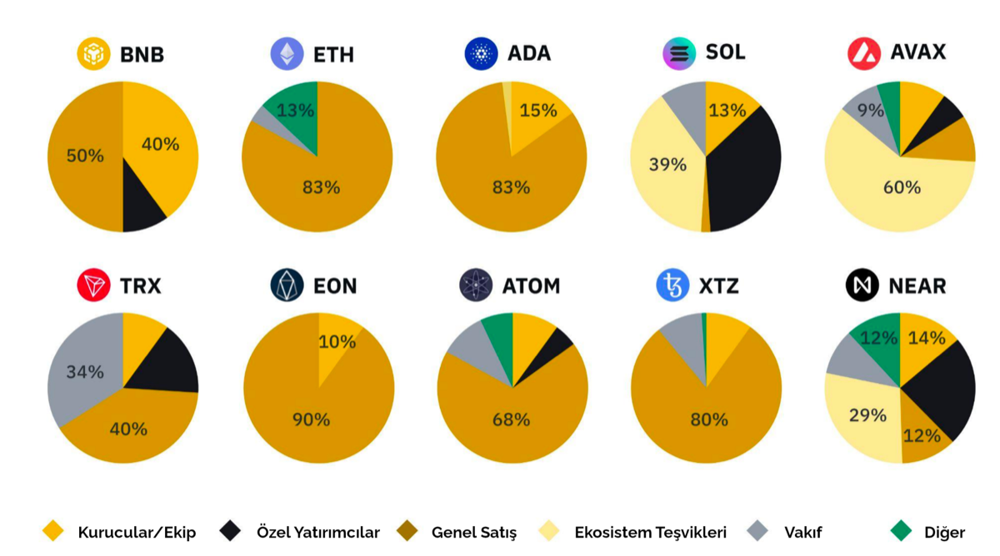

Bu kısımda kripto ekosisteminin en çok tartışılan alanlarından biri olan tokenomics konusuna değineceğiz.

## Ne demek tokenomics? {#ne-demek-tokenomics}

Tokenomics, iki kelimenin ‘token’ ve ‘economics’ kelimelerinin birleştirilmesinden türetilmiş bir ‘uydurma’ terim. Kısaca, tokenlere bağlı olarak bir ekonomi yaratılması diyebiliriz.

Biraz daha açmamız gerekirse, herhangi bir ekosistem içinde kişiler arasında değer değişim aracı olarak kullanılan varlıklara token diyoruz.

Bu varlıkların basılması, üretilmesi, dağıtılması, teşvik olarak verilmesi ve yakılması gibi pek çok aktivitenin bir araya gelmesi ise ortaya kendine has bir ekonomi çıkarıyor.

Tokenomics, işte bu ekonominin dizayn edilmesi işine verilen ad ve ekosistemin sağlıklı ve sürdürülebilir bir şekilde ilerlemeye devam etmesi açısından oldukça kritik bir öneme sahip.

## Önce bir klasik dünya ile karşılaştırma yapalım {#once-bir-klasik-dunya-ile-karsilastirma-yapalim}

Klasik dünyada bir şirketin yarattığı katma değeri bölüştürmesi nispeten basit bir matematiğe dayanır:

Öncelikle şirket bu katma değeri üretmesine yardımcı olan diğer paydaşlarına kâr-zarar tablosunda göreceğimiz kalemler üzerinden paylaşım yapar. Çalışanlarına maaş ve prim ödemeleri, tedarikçilerine ürettiği ürün için kullandığı hammadde ve diğer giderler, kredi kullandığı bankalara ödediği faizler ve devlete ödediği vergi gibi. Bütün bu paydaşlara yaptığı ödemeler sonrası kalan kârı ise ya daha sonraki büyümesinde kullanmak için elinde tutar ya da sermayedarlarına dağıtır. Bunu yaparken de dağıtacağı rakamı (temettüyü) hisselere böler. Hisse, şirketin kendine kalan kârı bölüşmesinde kullanılan temel birimdir.

Bir hisse senedi çıkarırken belirli bir toplam sayı belirler ve bunu hissedarlar arasında bölersiniz[^1]. İlk başta hissedar olarak da kurucu ekip ve onları finanse eden yatırımcılar bulunur. Burada en büyük patırtı, özellikle ilk yatırım turları sırasında farklı hisse senedi gruplarına verilen farklı hakları kurgulama sırasında çıkar.

Web3 dünyasına baktığımızda ise hisse senedinin yerini tokenlerin aldığını görüyoruz. Aslında klasik dünya ile benzerlikler de burada sona eriyor gibi görünüyor. Klasik dünyadan farklı olarak ortada bir şirket yerine bir ekosistem var. Bu sistemde hem değer üzerinde hak iddia edenler daha fazla hem de bu değerin kime nasıl paylaştırılacağı eskisine göre çok daha farklı. Gelin şimdi bu dediğimizi biraz daha açalım:

## Tokenleri kimlere vereceğiz? {#tokenleri-kimlere-verecegiz}

Tokenlerin dağıtım süreci hisse senetlerine göre çok daha karmaşık. Zira ortada sadece kurucu ekip ve ona finansman veren yatırımcılar yok. Koca bir ekosistemden bahsediyoruz. Bu iki oyuncunun yanında, sistemin işleyişini sağlayan (özellikle altyapı projelerinde) madenci (ya da onaylayıcılar), sistem yazılımının ortaya çıkmasına ya da test edilmesine yardımcı olan dış geliştirici kitlesi ve en önemlisi sistemin büyümesini sağlayacak olan kullanıcılar var.

Web3 dünyasının temel değer önerilerinden biri, yaratılan katma değerin tüm sistem oyuncuları arasında adilce dağıtılması. İşte bu nedenle, bir token sistemi dizayn ederken, yukarıda saydığımız bütün aktörlerin bu katma değerden pay aldığı bir kurgulama yapmanız gerekiyor.

## Token ekonomisi için nasıl bir planlama yapmalı? Nelere dikkat etmeli? {#nasil-bir-planlama-yapmali-nelere-dikkat-etmeli}

Bir token ekonomisinin planlamasını yaparken dört temel konuya dikkat etmek gerekiyor: Token basımı, dağıtımı, dağıtım sonrası verilecek teşvikler ve token yakımı. Bu kurguda dikkat edilmesi gereken bir diğer önemli konu ise zamanlama. Yani hangi tokenin kime ne zaman verileceğine karar vermek.

Bu dört konuya daha derinden bakacağız ama önce gelin token basımına gelene kadar yaşanan süreci bir anlamaya çalışalım.

### Token basımı öncesi süreç {#token-basimi-oncesi-surec}

Token basımına geçmeden önce, projenin ilk kuruluş aşamasından bu noktaya gelene kadar geçen sürede neler olduğunu kısaca hatırlayalım: Proje genelde küçük bir ekip tarafından kurulur. Ekip ilk başta gecesini gündüzüne katarak, değer yaratacak bir ürün ya da hizmet ortaya çıkarmak için çalışır. Ekipler projelerini web sitelerinden duyurmaya, proje detaylarını sitede yer alan ‘docs’ sekmesi üzerinden paylaşmaya başlarlar.

Sonrasında sürece bu ekibe yardımcı olan dış paydaşlar eklenir. Örneğin projenin kodları herkese açık olan ‘github’ üzerinde paylaşılıyor ise, gönüllü geliştiriciler yazılımı inceleyip açıkları kapatacak önerilerde bulunabilirler. Projenin başarılı olacağına inanan bir başka geliştirici grubu ise direkt projeye katkı vermeye ya da proje ile entegre çalışacak farklı yazılımlar üzerinde çalışmaya başlarlar.

Tabii bu arada, başlangıçta her ne kadar gönüllü çalışıyor olsalar da gerek kurucu ekip ve gerekse dış geliştiriciler bir noktada yaşamlarını sürdürmek için finansmana ihtiyaç duyar. Web3 dünyasının ilk zamanları daha doğrusu 2020 yılı öncesine kadar bu finansman için halktan para toplama yolu kullanılıyordu.

Klasik hisse senedi arzlarında gördüğümüz IPO (İngilizce ‘Initial Public Offering’ Türkçesi ‘ilk halka arz’) olarak adlandırılan ‘halktan para toplama’ terimi Web3 dünyasında ICO (İngilizce ‘Initial Coin Offering’) terimi şeklinde ‘türetildi’. Özellikle 2017-18 yıllarında oldukça popüler olan bu yol sonrasında etkisini kaybetti. Bunun birkaç nedeni var.

Birincisi, ICO sırasında token dağıttığınız bireysel yatırımcı oldukça sabırsız, hemen sonuç görmek istiyor. Oysa, o zamanlar projeler ICO sırasında daha henüz kağıt üzerinde birer vizyon olarak vardılar; başarıya ulaşmaları için ciddi bir çaba ve zamana ihtiyaçları vardı. İkincisi ise, kağıt üzerine vizyon çizmek herkesin yapabileceği kolay bir iş. Asıl sorun bunu başarabilmek. Ama işte ilk başta bu yöntemle ciddi para toplandığını gören binlerce proje büyük vizyonlu ama içi boş bir şekilde ICO yapmaya kalkınca tabir-i caiz ise ‘işin suyu çıktı’. Projeler ICO yoluyla para toplayamaz hale geldiler.

2020 yılı sonrası projelerde ise bu ‘halka açılma’ sürecine çok daha sonra geçilmeye başlandı. Üstelik eskiye göre önemli bir farkla; projeler genellikle token basımı sırasında belirli bir kısmı halka bedava vermeye başladılar (İngilizcesi ‘Airdrop’ yani bir nevi ‘havadan gelen bedava para’). Bunun yerine projeler finansman ihtiyaçlarını, kripto alanında uzmanlaşmış girişim sermayelerinden karşıladılar. Bunu da projenin daha ilk aşamalarında yapıyorlar.

### Token basımı {#token-basimi}

Token basımı ve sonrasında dağıtımı Web3 alanındaki bir proje için en önemli mihenk taşlarından biri. Neden? Token basımı projenin merkeziyetsizlik rotasına doğru pupa yelken yola çıkması anlamına geliyor. (Dikkat ederseniz, ‘yola çıkmak’ terimini kullandım, zira hedef limana varmak için karanlık sulardan geçmek, fırtınaları atlatmak gerekiyor. Nice yiğit proje, token basımı sonrası bu badireleri atlatamadığı için battı ya da karaya oturdu.)

Projelerin token basımına kısaca TGE (İngilizcesi ‘Token Generation Event’ Türkçesi ‘Token oluşturma etkinliği’) adı veriliyor. Her projenin ‘yoğurt yiyişi’ farklı ve bu fark kendini TGE sırasında da gösteriyor ancak yine de genel hatlarıyla belli ortak noktalar da bulunmakta:

### Ne kadar token olacak toplamda? {#ne-kadar-token-olacak-toplamda}

Projeler genelde sabit sayıda bir toplam token miktarı belirliyorlar. Bu belki de klasik anlamdaki halka arzlara göre en büyük farklardan biri. Hisse senedi piyasasında şirket halka arz sonrası ileride bir gün genel kurulunu toplayıp toplam hisse sayısını iki katına çıkarabilir. Sınırlı sayıda toplam token olması, bir Web3 projesinin prestiji için önemli göstergelerden biri sayılıyor.

Peki toplam token sayısı daha sonra değiştirilemez mi? Projenin sonraki aşamalarında stratejik kararlara yön verenler (ki bunlar token sahipleri oluyorlar) eğer dilerlerse toplam token sayısını artırabilirler ama bunun token değerine negatif etkisi olacağını da bilmek gerekiyor. Bu arada hemen belirtelim: Ethereum gibi altyapı projeleri toplam token miktarlarını baştan belirlemiyorlar.

### Token dağıtımı nasıl olacak? {#token-dagitimi-nasil-olacak}

Toplam arz belirlendikten sonra sıra bu tokenlerin kimlere verileceğine geliyor.

Genelde kurucu ekip %20 ile %30 civarı bir payı alıyor (ufak bir kısım da danışmanlara ayrılabiliyor).

Sonrasında yatırımcılar (geçmişte yapılmış yatırıma bağlı olarak) yine bu rakamlara yakın bir orana sahip oluyorlar.

Kalan miktar ise genelde ekosistemin diğer oyuncuları için ayrılıyor. Bunun içinde ekosistemin gelişmesi için ileride kullanılmak üzere kenara konan bir miktar da bulunuyor. Zaman içinde projenin büyümesine katkı sağlayacak diğer küçük projelere verilen ödüller ya da hibeler için ayrılan bir pay da var. Bu pay ya projenin merkeziyetsiz otonom yapısına (İngilizcesi Decentralized Autonomous Organization kısaca DAO) ya da proje ekibinin bir sivil toplum oluşumuna (foundation) veriliyor.

<figure><figcaption>Birinci seviye ağların token dağılımları <em>Birinci seviye ağların token dağıtımları birbirlerinden çok farklılık gösterebiliyor. (Kaynak: Binance Research)</em></figcaption></figure>

Son olarak da projenin halka ücretsiz dağıttığı airdrop’lar geliyor. Bu rakam projenin token dağıtımında genelde %5 ile %10 arasında değişmekle birlikte dağıtım süreci geçtiğimiz yıllar içinde ciddi bir değişime uğradı. Airdrop konusu toplumun geniş bir kısmını daha fazla ilgilendirdiği için gelin bu konuya biraz daha ayrıntılı bakalım.

## Herkesin sevgilisi airdroplar {#herkesin-sevgilisi-airdroplar}

Airdrop, adı üzerinde havadan gönderilen para anlamına geliyor. Küçük yatırımcıların ilgisini üzerlerine çekebilmek için topluluğa airdrop yapmak artık neredeyse her proje için farz oldu. Özellikle 2020 yılında merkeziyetsiz finansın ilk çıkışıyla hayatımıza giren airdroplar o günden bu yana sürekli olarak gelişen ve değişen bir süreç izliyor. Gelin kısaca airdropların tarihçesine değinelim.

### İlk dönem airdropları… {#ilk-donem-airdroplari}

Halka teşvik amacıyla token dağıtılmasının örnekleri uzun süredir hayatımızda olsa da, bu olayın bir furya haline gelmesi 2020 yılı ile birlikte gerçekleşti. Bu alanda bilinen en büyük örnek, bir kredi verme platformu olan [Compound](https://compound.finance/)’un ‘kullanıcılarına platformu kullanma şartıyla’ verdiği COMP tokenler oldu. Sonrasında, merkeziyetsiz dünyanın en büyük alım-satım platformu olan [Uniswap](https://app.uniswap.org/)’ın airdrop dağıtımı bütün matematiği değiştirdi. Merkeziyetsiz borsaların en büyüğü olarak ciddi bir likiditeye sahip olan Uniswap, rakip Sushiswap’ın ‘likidite karşılığı token teşviği’ hamlesi sonrası üzerindeki likiditenin ciddi bir kısmını kaybetti. Daha fazla kan kaybetmek istemeyen Uniswap’ın karşı hamlesi kendi teşvik programını başlatmak oldu ama bir farkla: Uniswap, o ana kadar kendi platformunda işlem yapmış (bir kez bile olsa!) her bir kullanıcıya 400 UNI token dağıttı. Tokenı alıp ilk hafta içinde satanlar ortalama[^2] 4 dolardan toplam 1,600 ABD Doları kazanç elde ettiler. (Satmayıp bekleyenlerin beş-altı ay sonra UNI tokenin 40 dolara kadar yükseldiğini gördüğünü de belirtelim).

Geçmişte platformu kullananlara bu kadar token verilmesi, tüm topluluk için bir sürpriz oldu. Bu olay, aslına bakarsanız Uniswap’tan çok diğer platformların işine yaradı, çünkü kullanıcılar özellikle tokeni henüz çıkmamış uygulamalara ‘airdrop dağıtılır’ umuduyla girip işlem yapmaya başladı.

### Yaygınlaşma ve evrilme… {#yayginlasma-ve-evrilme}

Uniswap sonrası pek çok uygulama, benzer şekilde ücretsiz token dağıtırken bir noktadan sonra işin suyu çıkmaya başladı. Platformlar üzerinden bir kez işlem yapmış yüzbinlerce hesap ortaya çıktı. Üstelik hesap yaratmak son derece basit bir işlem olduğu için insanların onlarca, yüzlerce hesap açtığını gördük. Bunun üzerine platformların airdrop verme kriterleri yavaş yavaş değişmeye başladı.

Uniswap sonrası en büyük airdroplardan biri Arbitrum’dan geldi. Arbitrum ekibi, token dağıtımı sırasında farklı bir uygulama yaparak eski ve aktif kullanıcıları ödüllendirme yoluna gitti. Örneğin erken kullanıcıları ödüllendirmek için uygulamayı en başta kullananlar, aktifliği özendirmek için farklı aylarda platformu kullanmış olanlar, platform üzerindeki farklı akıllı kontratlarda belirli sayının üzerinde işlem yapanlar, belirli bir değerin üzerinde işlem hacmi yakalayanlar, Ethereum’dan platforma yüksek miktarda varlık geçirenlerin her biri yüksek derecede ödüle hak kazandılar.

### Ne işe yarıyor airdroplar? {#ne-ise-yariyor-airdroplar}

Buraya kadar airdropların amacına hizmet ettiği söylenebilir. Gerçekten platformu ya da uygulamayı kullananlara verilen ödüller topluluk içinde uygulamaların imajını olumlu yönde etkiledi.

Uygulamalar açısından airdropların faydaları bununla sınırlı değil. Özellikle ABD’de kurulu olanların SEC’nin ‘çıkardığınız tokenler birer menkul kıymettir’ argümanına karşı koyması için de güzel bir kalkan bu uygulama. Neden?

Normalde kurucu ekip yatırımcılardan erken aşamada yatırım alırken, bu yatırımın karşılığı olarak token vermeyi taahhüt ediyorlar. Ediyorlar etmesine ama bu tokenlerin ne kadar olacağı ya da nasıl bir değer ifade ettiği bilinmiyor. TGE (token yaratımı) sürecinde yatırımcılar adet olarak ne kadar token alacaklarını biliyorlar ancak bu tokenlerin değeri hâlâ belli değil. Normalde halka arz sırasında hisseler satılırken belirli ilan edilen değer üzerinden satılır. Burada ise token değeri piyasa tarafından belirleniyor. Tokenler gerek Uniswap benzeri merkeziyetsiz gerekse büyük merkezi borsalarda işlem görmeye başlıyor. Yaptıkları yatırım karşılığı aldıkları tokenler bir süre daha kilitli kalacağı için yatırımcıların da (en azından teorik olarak) fiyata etki etmesi beklenmiyor. İşte bütün bu saydıklarımızdan dolayı, projeler yatırımcılarına herhangi bir getiri vaad etmediklerini iddia ederek SEC’nin gazabından arınmaya çalışıyorlar.

### ‘Puanlama’ sistemi geldi, mertlik bozuldu… {#puanlama-sistemi-geldi-mertlik-bozuldu}

Yukarıdaki iki örnek ile güzel bir şekilde başlayan airdrop furyasının zamanla hem topluluk hem de uygulamalar açısından dejenere olmaya başladığını gördük. Topluluk içinde airdrop farmer (airdrop çiftçisi) olarak adlandırılan bir grup oluşmaya başladı. Yeni çıkan ya da piyasada olan her projeye yarattıkları binlerce hesap ile saldıran bu grup, çıkan airdroplardan maksimum miktarı kapmaya başladılar. Bu durum projeler üzerinde sahte işlem hacimleri oluşmasına neden oldu.

### Projeler puanlama sistemini neden sevdi? {#projeler-puanlama-sistemini-neden-sevdi}

Projelerin bir çoğu da sahte bile olsa bu hacimleri benimsediler, hatta artması için hormonlu teşvikler sunmaya başladılar. Airdrop öncesi kullanıcılara yaptıkları işlem, uygulamada tuttukları para, uygulamayı sosyal medyada tanıtma gibi görevler karşılığı ‘puan’ vermeye başladılar.

‘Puan sistemi’ aslına bakarsanız şeffaflıktan uzak, proje açısından herhangi bir taahhüt içermeyen ve toplulukları sömürmek için kullanılan bir metod. Projeyi kullanarak ‘binlerce puan’ kazanan kullanıcılar, sonrasında projenin aslında toplamda milyarlarca puan dağıttığını görünce ciddi hayal kırıklığına uğruyorlar. Sonuçta baktığınızda topluluğa dağıtılacak belirli sayıda bir token havuzu var. Bunu dağıtırken insanlara on puan ya da on bin puan vermenin proje açısından bir farkı yok.

Peki projeler bunu neden yapıyorlar? Akla gelen ilk neden, tabii ki uygulamanın daha çok kullanılmasının getireceği komisyonlar. Bunun dışında birkaç neden daha var.

Proje, ne kadar çok kullanılırsa, ekibin finansman aldığı yatırımcılara verdiği hedefleri tutturması o kadar kolay oluyor. Token çıkarımı öncesi yeni finansman ihtiyacı doğması durumunda, ekibin ekstra yatırım alabilmek için elini güçlendiriyor.

Benzer şekilde aktif kullanıcısı fazla olan protokol, başka protokoller ile ortak bir iş yapmak istediğinde (örneğin iki platformda da kullanılabilecek bir ürün çıkarmak gibi) oluşacak katma değerin bölüşümü çok daha avantajlı hale gelebiliyor.

Öte yandan puanlama sistemi projelere token teşviğine kıyasla çok daha büyük bir rahatlık ve esneklik getiriyor. Sabit sayıdaki tokeni kullanıcılara istedikleri şekilde istedikleri sürede verip, yolda teşvikleri değiştirme şansına sahip oluyor projeler.

### Airdrop süreci dejenere olmaya doğru ilerler… {#surec-dejenere-olmaya-dogru-ilerler}

Sonrasında işin daha da suyunun çıktığını gördük. Projeler puanlama sisteminden bıkan kullanıcıları, uygulamalarını kullanmaya itmek için ‘sezon bir’, ‘sezon iki’ gibi farklı dönemler oluşturmaya başladılar. Üstelik her yeni periyotta verilen puanları artırarak yeni kullanıcı çekmeye çalıştılar. Eskiden beri projede olanlar başlangıçta aldıkları puanlar yeni sezonda verilenlerin yanında ufacık kalsa bile, onları kaybetmemek uğruna seslerini çıkarmadan proje içinde kalmaya devam ettiler.

Airdrop’un toplam arzın ne kadarı olduğu ve kime dağıtıldığı da önemli olabiliyor. Çok küçük bir oranın airdrop için ayrılmış olması topluluk tarafından alınan ödülleri azalttığı için tepki çekebiliyor. Bir başka tepki çeken konu ise, airdropun kullanıcılar ve geliştiriciler arasında paylaşımı. Burada en kötü tecrübelerden birini [Starknet](https://www.starknet.io/) projesi yaşadı.

Ethereum üzerinde en parlak ikinci seviye çözümlerden biri olarak gösterilen Starknet, airdrop dağıtımında geliştiricileri ‘kayırdığı’ iddiasıyla topluluğun ciddi tepkisini çekti. Kullanıcıların büyük bir çoğunluğu aldıkları az miktarda airdrop ödülü satıp, platformu topluca terkettiler. Aradan geçen altı ay süre boyunca Starknet üzerindeki projelerin kullanıcı çekmekte ciddi zorluk yaşadığını gözlemledik.

### Airdroplar geçici heves, kalıcı olan kullanıcıya değer yaratabilmek {#airdroplar-gecici-heves-kalici-olan-kullaniciya-deger-yaratabilmek}

Sonuç olarak uzun vadede bu tip kullanıcıların uygulamaları kullanacağını düşünmek oldukça hayalci bir yaklaşım. Bir projenin token teşviği olmadan kullanıcılara değer yaratıyor olması gerek. Herhangi bir projeye yatırım yaparken dikkat edilmesi gereken konu, aslında klasik dünyadaki yatırımcıların baktığından farklı değil: “Proje hangi soruna çare oluyor?”

## Kim, ne zaman aldığı tokenleri satabilecek? {#kim-ne-zaman-aldigi-tokenleri-satabilecek}

Token dağıtımlarının en önemli konularından biri de token almaya hak kazananların bunu ne zaman satabilecekleri.

Bu konuda şimdiye kadar piyasada oluşan genel uygulama, airdrop olarak verilen tokenlerin hemen satılabilir olması. Bunun dışında kalan diğer tokenler genelde belirli bir süre kilitli kalıyor. Bu süre projeden projeye değişse de yıllar geçtikçe kilit sürelerinin uzamaya başladığını görüyoruz. Bunun temel nedeni, erken kilit açılımı olan projelerin token değerlerinin genelde düşük olması. Piyasa, bu açılımları projelerin ensesinin üstünde duran ‘Demokles’in kılıcı’ gibi görmekte.

Burada bir başka konu da açılımların nasıl bir süre içinde gerçekleşeceği. Bir anda gerçekleşecek kilit açılımlarının fiyata negatif etki yaptığını görüyoruz. Bu konuda belki de en ciddi darbeyi yukarıda olumlu örnek olarak verdiğimiz Arbitrum yaşadı. İlk açıldığında airdrop olarak 1.1 milyar token dağıtan Arbitrum, sonrasında Mart 2024’te aynı miktarda yatırımcı ve ekip için ayrılan tokenin kilidini açtı. Ethereum üzerinde en çok varlık barındıran ve en çok kullanılan proje olan Arbitrum’un tokeni ARB’nin değeri bu kilit açılımı öncesi ve sonrası bir türlü diğer benzer projelerin (örneğin Optimism) tokenlerinin gösterdiği performansa ulaşamadı.

## Peki tokenler kanuni olarak nasıl değerlendiriliyorlar? {#peki-kanuni-olarak-nasil-degerlendiriliyorlar}

Yukarıda saydıklarımız tokenlerin standart bakımından türleri. Bu tokenlerin kanuni mevzuatta nasıl ele alındıkları ise ülkeden ülkeye değişen hayli karmaşık bir konu.

### İsviçre {#isvicre}

Bu konuda ilk ve belki de en yaygın olarak kullanılan terminoloji İsviçre hukukunda bulunuyor. İsviçre, tokenleri kullanım alanını dikkate alarak üç temel türe ayırıyor. Ödeme tokenleri, fayda tokenleri ve varlık tokenleri.

Ödeme tokenleri, herhangi bir mal ya da hizmet alma karşılığı kullanılıyorlar. Bize tanıdık gelen pek çok kriptopara, örneğin BTC, ETH ya da SOL bu türün altına giriyor. Bu tokenlerin temel özelliği tokeni basanın token sahiplerine herhangi bir getiri vaat etmiyor oluşu.

Fayda tokenleri herhangi bir uygulamaya girmek, o uygulamayı kullanabilmek için varlar. Bu anlamda, yukarıda saydığımız tokenler aslında ait oldukları blokzincirlerde yapılan işlemlerin gerçekleştirilmesinde kullanıldıkları için bir anlamda fayda tokeni de sayılıyorlar.

Son kategori olan varlık tokenleri ise herhangi bir varlığı temsil eden tokenlere verilen genel ad. Bu varlıklar yukarıda bahsettiğimiz gibi fiziki bir varlığı temsil edebildikleri gibi, sermaye piyasası ürünlerinin blokzincir üzerine taşınması durumunda da bu kategori altına giriyorlar.

### ABD {#abd}

Bu alanda en büyük tartışmaların ise Amerika Birleşik Devletleri’nde yaşandığını görüyoruz. Tartışmaların ne şekilde geliştiğini anlamak için işin tarihçesine kısaca değinmekte fayda var.

2009 yılında Bitcoin ile ortaya çıkan kriptoparalar önceleri görmezden gelinerek ciddi bir şekilde ele alınmıyor. Bu da çok normal. Sonuçta ülkelerin işleri başlarından aşkın ve kripto gibi altının onda biri büyüklüğe sahip bir varlık sınıfını kategorize etmek öncelikler arasında yer almıyor.

2020’li yıllara geldiğimizde ABD’nin başkenti Washington DC’deki genel hava, kriptonun artık yeni bir varlık sınıfı olarak ortaya çıktığı ve kanuni bir düzenlemeye ihtiyaç duyulduğu şeklinde. Ne var ki, tam bu noktada 2022 yılında kripto dünyasında yaşanan kriz bütün taşları yerinden oynatıyor.

Krizin baş aktörlerinden olan FTX borsasının sahibi Sam Bankman Fried, 2020 seçimlerinde başkan seçilen Biden’a en çok para veren ikinci bağışçı. Sonrasında 2022 yılında yapılan ara seçimler için de demokrat adaylara 40 milyon ABD Doları [bağışta bulunuyor](https://en.wikipedia.org/wiki/Sam_Bankman-Fried). Bununla da yetinmiyor ve belki koyduğu paranın karşılığını almak için [DCCPA](https://en.wikipedia.org/wiki/Digital_Commodities_Consumer_Protection_Act) ismi verilen dijital varlıklar ile ilgili tamamen kendisi gibi merkezi kurumları koruyan ve merkeziyetsiz girişimlerin köküne kibrit suyu dökecek bir yasa tasarısı için lobi faaliyetinde bulunuyor.

Sam Bankman Fried’in sahibi olduğu FTX borsasının Kasım 2022’de batması sonrası Demokrat Parti’de dijital varlıklar ile ilgili olarak ciddi bir rota değişikliği yaşanıyor. ABD’nin SPK’sı olan SEC’nin o dönemki başkanı Gary Gensler’in de etkisiyle Beyaz Saray ve parti içinde “kriptovarlıklar için ayrı bir yasaya gerek yok, SEC bu işi götürebilir” görüşü ağırlık kazanmaya başlıyor. Gensler, hemen hemen tüm kripto varlıkların birer menkul kıymet sayılması gerektiğini hararetle savunanlardan. Bunun tek istisnası olarak gördüğü varlık Bitcoin. Ethereum’un ne olduğu sorusunu [doğru dürüst şekilde yanıtlamaktan](https://www.youtube.com/watch?v=VhA1dZXeao0) kaçınan Gensler, diğer tüm varlıkları ihraç edenlere “gelin bizimle konuşun, izin alın” diyor.

Peki kripto varlığın menkul kıymet ya da emtia olmasının ne farkı var? En temel fark, bu tokenleri alacak olanlar için yapılacak olan bilgilendirmeden geliyor. Menkul kıymet olması durumunda bu alanı denetleyen SEC’nin ciddi denetim ve açıklama zorunlulukları var. Tokeni çıkaran (bir hisse senedinde olduğu gibi) eğer bir şirket ise, o zaman bu durum çok da önemli değil - benzer açıklamaları ve başvuruları SEC’ye yaparsınız. Sorun, merkezi olmayan yapılar fotoğrafın içine girdiği zaman çıkıyor. Zira, merkeziyetsiz bir yapı SEC’ye nasıl başvuruda bulunacak?

Gary Gensler dönemi öncesi SEC yönetimi bu konuda ‘merkeziyetsizlik’ kriterini turnusol kağıdı gibi kullanarak, Ethereum dahil merkeziyetsiz tokenlerin menkul kıymet sayılmayacağını söylemişti. Gary Gensler ise bu konuda çok daha ‘muğlak’ bir çizgide. Merkeziyetsiz denen yapıların pek çoğunun aslında bu kılıf arkasına saklanan merkezi yapılar olduğunu savunuyor. Bu konuda net olarak yanıt verdiği tek kriptopara bitcoin; BTC’nin menkul kıymet olarak sayılamayacağını kabul ediyor ama kalanların çoğunun menkul kıymet sayılması gerektiğini söylüyor.

İyi de koskoca ABD bu konuda hiçbir düzenleme yapmamış mı? Yapmış tabii ama sıkı durun, 1946 yılında! ABD’nin güneydoğusunda bulunan en büyük eyaletlerinden Florida’da büyük narenciye bahçelerine sahip olan William John Howey adında bir şirket ile SEC arasındaki bir davanın sonucunda bu düzenleme yapılmış aslında. Olay, şirketin kendisine ait büyük bir arazinin yarısını, bir kira sözleşmesi ile genel halka pazarlamasıyla çıkıyor. Howey’den arazi kiralayanlar bu toprağın ekip biçme hakkını bir servis sözleşmesi ile Howey’e ait şirkete kiralıyorlar. Howey’in şirketi arazi kiralayanlara (ki bunların çoğunluğu eyalet dışından tarımla ilgisi olmayan kişiler) yetişen ürünlerin satışından dolayı yüksek gelir elde edeceklerini vaat ediyor. Bunu gören SEC, bu kiralama sözleşmesinin aslında bir menkul kıymet satışı olduğunu belirterek Howey’e dava açıyor. En son Anayasa Mahkemesi’ne kadar giden dava sonucu yargıç Frank Murphy, bu tip bir satışın bir yatırım sözleşmesi sayılması için dört temel koşulun yerine gelmiş olması gerektiğine hükmeden o tarihi kararı veriyor.

Literatüre Howey Test olarak geçen bu kararın içinde bir menkul kıymetin yatırım kontratı olarak sayılması için gerekli dört şart şu şekilde sıralanmış:

1. Parasal bir yatırım olması
2. Kâr beklentisi olması
3. Varlığı satanın bir kurum olması ve alanlar ile bir finansal işleme girmesi
4. Başarının başkalarının çabasına bağlı olması

Bir varlık, eğer yukarıdaki dört koşulu da sağlıyorsa o zaman bir yatırım kontratı sayılıyor ve çıkarılmadan önce SEC’ye kayıt edilmesi gerekiyor. Yok eğer birinden bile testi geçemiyor ise o zaman SEC’ye başvuru yapılmasına gerek yok.

1946 yılının ortamında yapılan bu düzenlemenin bugünün şartlarına uymadığı çok açık. Özellikle de merkeziyetsiz dünyada ortaya çıkan dijital varlıklara. İşte bu nedenle, bu alanda ABD’de yeni bir yasanın çıkması sadece bu ülkede değil, liderlik ettiği finansal piyasalar aracılığıyla tüm dünyada dijital varlıklara olan ilgiyi başka bir seviyeye taşıyacak boyutta.

### Avrupa {#avrupa}

Genelde teknolojik gelişmelerde hep geri kalan ‘yaşlı’ Avrupa, belki de ilk kez, o da dijital varlıklar konusunda ABD’nin önüne geçti. 2023 yılında kabul edilen MiCA (İngilizce Markets in Crypto-Assets Regulation’ın kısaltması - Türkçesi Kripto Varlık Piyasalarının Regülasyonu), kripto varlık yatırımcı ve tüketicilerini korumayı amaçlayan bir yasa.

Temel olarak kripto varlıkların basımı ve ticaretini [düzenleyen](https://www.esma.europa.eu/esmas-activities/digital-finance-and-innovation/markets-crypto-assets-regulation-mica) MiCA, bu alanda gerekli lisans, tüketici koruması, piyasa manipülasyonunu önleyici hükümler içerirken, stabil paralara özel maddeleri ile dikkat çekiyor.

MiCA’nın ilginç özelliklerinden biri hangi dijital varlıkların kapsama alanına girdiği konusunda ‘merkeziyetsizliği’ kriter olarak kullanması. Tamamen merkeziyetsiz protokoller örneğin merkeziyetsiz finans (DeFi) MiCA’nın dışında tutuluyor. NFT’ler ise ‘duruma göre’ MiCA kapsamından muaf tutuluyor. Burada da kriter ‘tekil olmak’. Tekil dijital sanat eserleri, koleksiyon parçaları gibi dijital varlıklar MiCA içine girmezken, örneğin bu sanat eserini birbiri ile değiştirilebilir (İngilizcesi fungible) daha küçük parçalara bölerseniz o zaman MiCA kapsamına [giriyorsunuz](https://crystalintelligence.com/crypto-regulations/nfts-and-mica-what-you-need-to-know/).

MiCA’nın genel bir çerçeve mevzuat olduğunu ve tüm AB ülkelerinde uygulamaya gireceğini belirtelim. Bu arada pek çok AB ülkesinde kurulu olan ve şu anda bu ülke yasaları altında hizmet veren kurumlar için 2026 yılına uzanan bir [geçiş süreci söz konusu](https://technologyquotient.freshfields.com/post/102jake/grandfathering-under-mica-how-member-states-approach-the-transitional-regime) olacak.

### Türkiye’de tokenlerin durumu ne? {#turkiyede-durum-ne}

Ülkemizde Temmuz 2024’te [yürürlüğe giren](https://www.aa.com.tr/tr/ekonomi/kripto-varliklara-iliskin-yasa-resmi-gazetede-yayimlandi-/3263941) kripto varlık yasa tasarısı ise adından da anlaşılabileceği gibi tüm varlık sınıflarını kripto varlık olarak değerlendiriyor ve SPK’nin denetimi altına koyuyor. Token çıkarılması konusunu teknik olarak TÜBİTAK’ın onayına tabi kılan yasa, nihai onay sahibi olarak SPK’yı gösteriyor.

Yasa görebildiğimiz kadarıyla oldukça yenilikçi. Kripto dünyasını tek endişelendiren konu, genel çerçeve olarak olumlu görünen yasanın açık bıraktığı boşlukların ikincil düzenlemeler ile nasıl doldurulacağı. Bu alanda SPK tarafından şu ana kadar oluşturulan düzenlemeler, ağırlıklı olarak kripto varlık hizmet sağlayıcılar üzerine hükümler içeriyor. Kitabımızın yayına hazırlandığı sırada SPK’nın bu konudaki düzenlemeleri yavaş yavaş ortaya çıkmaya başladı ancak kamuoyunda bu düzenlemeleri yorumlama konusunda farklılıklar var. Siz kitabı okurken eminim SPK akıllarda oluşan sorulara açıklık getirecektir.

[^1]: Daha sonrasında ihtiyaç olması durumda sermaye artırımı yoluyla toplam hisse sayısına ekleme yapabilirsiniz.

[^2]: Token’in ilk hafta boyunca ortalama değeri
