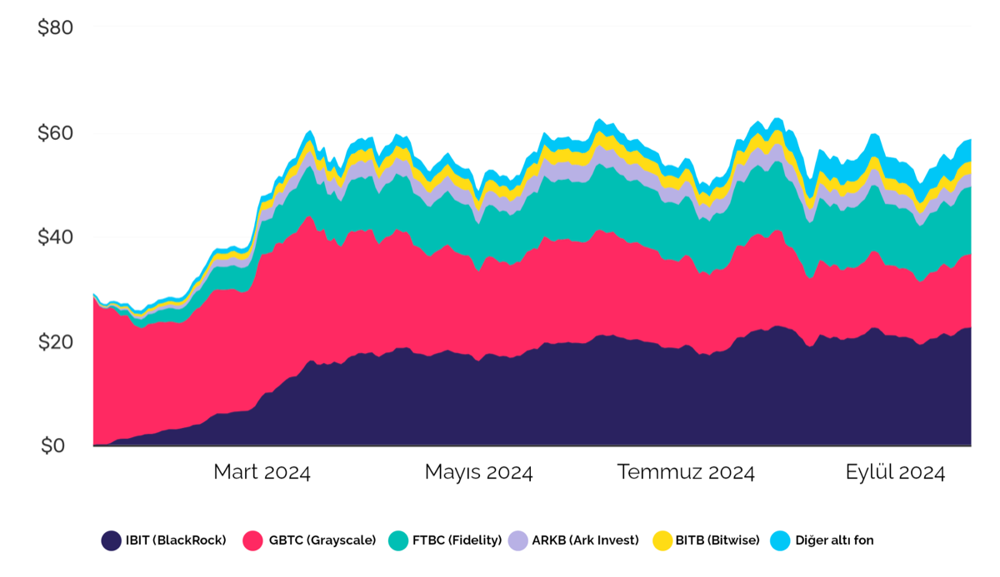

Bu kısımda, ABD’nin en büyük varlık yöneticilerinden BlackRock’ın Ethereum blokzinciri üzerine kurduğu tokenleştirilmiş menkul kıymet hizmetinden bahsedeceğiz.

Kripto dünyasının Wall Street ile olan ilişkisinde artık son safhaya geçmeye başladık. Bu durum yanlış bir şekilde Gandhi’ye ithaf edilen ‘Önce seni görmezden gelirler, sonra sana gülerler, arkasından seninle savaşırlar ve sonrasında sen kazanırsın’ sözünü hatırlatıyor[^1]. Bunun son örneği ise, ünlü fon yöneticisi BlackRock’ın Mart 2024’te Ethereum ağı üzerinde çıkardığı 100 milyon ABD Doları değerindeki tokenleştirilmiş menkul kıymet oldu. Şimdi gelin önce olayı daha net anlayalım, sonrasında da neden bu kadar önemli olduğuna göz atalım:

## BlackRock’ın kripto ile ilişkisi nereden nereye evrildi? {#blackrockin-kripto-ile-iliskisi-nereden-nereye-evrildi}

BlackRock, toplam 10 trilyon ABD Doları (evet, yanlış yazım yok, tam tamına 10 trilyon!) bir portföye sahip olan dünyanın en büyük varlık yöneticisi. O kadar büyük ve önemli bir fon ki, “BlackRock bir yana diğer bütün fonlar bir yana” desek çok da yanılmış olmayız.

BlackRock’ın kripto ile ilişkisi, başlangıçta hemen her Wall Street fonu gibi oldukça mesafeliydi. Öyle ki bir Wall Street efsanesi olan BlackRock CEO’su Larry Fink, 2017 yılında yaptığı bir söyleşide Bitcoin için ‘para aklamanın en büyük göstergesi’ tabirini [kullanmıştı](https://www.cnbc.com/2017/10/13/blackrock-ceo-larry-fink-calls-bitcoin-an-index-of-money-laundering.html).

Zaman içinde özellikle 2020 yılındaki pandemi sırasında kurumsal dünyanın kriptoparalara karşı duruşunun yavaş yavaş değişmeye başlaması BlackRock’ı da etkiledi. Fon, 2022 yılının Ağustos ayında artan ilgi karşısında kurumsal yatırımcılara kriptoya erişim hizmeti verebilmek için Coinbase ile ortaklık yaptığını [açıkladı](https://www.coindesk.com/business/2022/08/04/blackrock-to-offer-crypto-for-institutional-investors-through-coinbase-prime/). Asıl bomba ise 2023 Haziran’ında BlackRock’ın spot Bitcoin ETF başvurusunda bulunduğu [haberi ile geldi](https://www.investopedia.com/blackrock-files-for-a-spot-bitcoin-etf-7547609). ABD’de hemen hemen her ürün için çıkarılan ETF’ler temel olarak, temsil ettikleri ürünün (örneğin altın, bakır gibi) değerine bağlı olarak değişen ve klasik borsalarda işlem gören hisse senetlerine deniyor. Bitcoin ETF’i hem Bitcoin’in artık kendini bir yatırım aracı olarak kabul ettirmesi hem de kriptoya uzak ama Bitcoin’in getirisinden faydalanmak isteyen geniş bir kitleyi kendine çekmesi olasılığı nedeniyle oldukça önemli bir eşik noktası olarak görülüyordu.

Kripto için dalganın tersine döndüğü an belki de bu olay oldu. Zira, daha önce yapılan Bitcoin ETF başvuruları tam on yıldır ABD’nin sermaye piyasası komisyonu SEC’nin duvarından geri dönüyordu. Larry Fink, ABD finans piyasalarında SEC Başkanı Gary Gensler’e bir telefon açabilecek kadar güçlü bir kişilik; BlackRock’ın şimdiye kadar yaptığı ETF başvurularının onaylanma oranı da %99.8 idi. Bu başvuru, kriptonun Wall Street tarafından kesin olarak kabul edildiğinin işaret fişeği oldu adeta[^2].

Larry Fink’in kriptoya olan ilgisi ETF başvurusu ile sınırlı kalmadı. Önce 2023 Ekim ayında katıldığı bir programda Bitcoin’de yaşanan yükselişin ‘kaliteye doğru bir gidiş’ olduğu nitelemesini [yaptı](https://www.coindesk.com/business/2023/10/17/blackrock-ceo-larry-fink-seeing-client-demand-for-crypto-around-the-world/). Hemen arkasından Ocak ayında verdiği bir mülakatta Bitcoin’in ‘yatırımcıları jeopolitik risklerden koruyan bir varlık sınıfı olduğunu ve bu anlamda binlerce yıllık altından bir farkı olmadığını’ [belirtti](https://www.nasdaq.com/articles/blackrock-ceo-larry-fink-says-bitcoin-is-an-asset-class-that-protects-you).

Bitcoin ETF’lerinin Ocak ayında kabul olması BlackRock’ın genel piyasa havasını koklama konusundaki maharetini (ya da bu konudaki ağırlığını) gösteren önemli bir gösterge oldu. BlackRock ETF’leri işleme başladığı günden bu yana 17 milyar ABD Dolarının üzerinde bir varlığa ulaşarak [bu alanda birinci sırada olan Grayscale’in ardından ikinciliğe](https://blockworks.co/bitcoin-etf) yerleşti.

<figure><figcaption>Bitcoin ETF’lerine girişler <em>ABD’de spot bitcoin ETF’lerine kuruluşundan itibaren giren para miktarı (milyar ABD Doları). (Kaynak: TheBlock)</em></figcaption></figure>

## Gelelim BlackRock’ın son hamlesine. Ne oldu? {#gelelim-son-olaya-ne-oldu}

Bu alanda BlackRock’ın yaptığı son hamle ise 100 milyon ABD Doları büyüklüğünde bir fon kurmak [oldu](https://securitize.io/learn/press/blackrock-launches-first-tokenized-fund-buidl-on-the-ethereum-network). Fon, ABD’deki nakit, tahvil, bono ve repo’lara yatırım yapacak. En büyük özelliği ise fonun hisselerinin birer dolarlık tokenler halinde blokzincir üzerinde işlenmesi olacak[^3]. Fonun yaptığı işlemlerden kazandığı gelir, her ay sonunda hesaplanıp token sahiplerinin blokzincirdeki hesaplarına ekstra token olarak gönderilecek. Bu arada BlackRock, kripto dünyasına şık bir selam çakarak fonun ismini BUIDL koymuş[^4].

Fon temel olarak, kripto ile ilgilenen büyük kurumların kripto alım satımı için kenarda tuttukları paraya getiri sağlamayı hedefliyor. Normalde, müşteriler bu paraları USDC gibi enstrümanlarda faizsiz tutmak ya da klasik dünyaya çekerek fonlara yatırmak zorundalar. Bu fon sayesinde, zincir dışına çıkmadan, istedikleri zaman 7/24 diğer nitelikli müşterilere gün kaybına uğramadan anında transfer edebilecekler (böylece varlıklarını çok daha verimli kullanabilecekler). Bunun yanında USDC tutmanın aksine varlıklarına getiri sağlayacaklar. İleride bu varlığın üzerine kurulu türev ürünler ortaya çıkacak ya da müşterilerin varlıklarını teminat olarak gösterip borç alma gibi farklı finansal hizmetlere de erişimleri olacak.

BlackRock fonun para kısmının yönetimini yaparken, diğer kısımlar için farklı kurumlar ile ortak çalışacak. Örneğin gerçek dünya varlıkları Bank of New York Mellon’da saklanırken, fonun tokenleştirilmesi, müşterilerin içeri alınması ve raporlama ile ilgili bütün işlemleri [Securitize](https://securitize.io/)[^5] yönetecek. [Anchorage](https://www.anchorage.com/), [BitGo](https://www.bitgo.com/) ve [Coinbase](https://www.coinbase.com/prime/custody) müşterilerin kripto varlıkları saklama konusunda fon ile iş birliği içindeyken, fonun blokzincir üzerindeki varlıklarının anahtarlarını saklama hizmetini [Fireblocks](https://www.fireblocks.com/) verecek.

100 milyon ABD Doları olarak çıkan fon daha sonra gelen talepler ile birlikte ilk altı ay içinde toplam 521 milyon ABD Doları büyüklüğe [ulaştı](https://etherscan.io/token/0x7712c34205737192402172409a8f7ccef8aa2aec).

## ETF’lere benziyor mu BUIDL? Neden önemli? {#etflere-benziyor-mu-bu-urun-neden-onemli}

Peki nedir bu fonu özel yapan? Bitcoin ETF’ine benzer mi, yoksa farklı mı? Aslına bakarsanız, bu fonu kripto ile geleneksel dünyayı bir araya getirmesi açısından Bitcoin ETF’lerine benzetebiliriz ama bir farkla:

### Bitcoin ETF’lerinin fonksiyonu ne? {#bitcoin-etflerinin-fonksiyonu-ne}

Bitcoin ETF’leri kripto dünyasını klasik dünyaya getiriyorlardı. Ne demek bu? Bitcoin ETF’leri sayesinde, klasik dünyadaki bir yatırımcı hiç kripto dünyası ile muhatap olmadan (bir kripto borsasında hesap açmadan ya da kendine cüzdan kurmadan) aynı hisse senedi alıp satar gibi kriptoya erişim şansı yakaladı.

### BUIDL, Bitcoin ETF’inden farklı mı? {#buidl-bitcoin-etfinden-farkli-mi}

BUIDL fonu ise bunun tam tersi, klasik dünyayı kriptoya yaklaştıran bir hamle. Zira, büyük nitelikli kurumlara hizmet vermek için kurulan bu fon müşterilerine blokzincir üzerinde kullanabilecekleri bir araç sunuyor. Bitcoin ETF’leri için en önemli eleştirilerden biri “hani Bitcoin mevcut sisteme alternatif olacaktı, ETF’ler yoluyla asi çocuk ehlileştiriliyor” idi. BUIDL fonu bu anlamda blokzincir üzerine kurulu ve ona daha fazla yatırım gelmesini sağlayacak bir yapı olarak ETF’den farklılaşıyor.

### BlackRock, BUIDL ile esen kripto rüzgarından mı faydalanmak istiyor? {#blackrock-buidl-ile-esen-kripto-ruzgarindan-mi-faydalanmak-istiyor}

Pek öyle sayılmaz. BUIDL’i, BlackRock’ın uzun vadeli stratejisinin ilk adımlarından biri olarak görmek gerek. Larry Fink, yukarıda sansasyonel parçalarını paylaştığımız söyleşilerinin hemen hemen hepsinde, gerçek dünya varlıklarını token haline getirmenin öneminden bahsediyor. Gerçek dünya varlıkları denince aklımıza hemen gayrimenkul benzeri ürünler gelse de, zaten dijitalleşmiş olan klasik dünya fonları bu anlamda tokenleştirmek için ilk adaylar. İşte BlackRock, BUIDL ile bu kapıdan içeriye ilk adımını atmış oluyor. Ve bu pazar, ünlü danışmanlık firması BCG tarafından 2030 yılında 16 trilyon dolara ulaşması [beklenen](https://www.ledgerinsights.com/bcg-addx-estimate-asset-tokenization-to-reach-16-trillion-by-2030/) dev bir dünya.

### BUIDL hangi ağda kurulmuş? {#buidl-hangi-agda-kurulmus}

Bir başka önemli nokta ise, BlackRock’ın fonu kamuya açık bir blokzincir olan Ethereum üzerinde kurması. Bu noktayla, bir zamanlar kurumsal tarafta çokça denemesi yapılan özel (kapalı) blokzincir üzerine kurulu yapılardan ayrışıyor.

BlackRock’ın bu işlemi birlikte yürüttüğü Securitize’in kurucusu Carlos Domingo, yaptığı bir söyleşide JPMorgan gibi bankaların kanuni zorunluluktan dolayı kapalı blokzincirler kullandıklarını ama bunun ideal bir yapı olmadığını belirtiyor. Zira, bir dolara eşitlenmiş bir token çıkardığınızda, diğer girişimlerin bu tokeni kullanarak farklı ürünler geliştirebilmesinin tek yolunun herkese açık bir blokzincir kullanmaktan geçtiğini vurguluyor. İzinle girilen blokzincirler bu anlamda imtiyazlı birkaç kurumun oyun oynadığı kum havuzu olmanın ötesine geçemiyorlar. Domingo, BlackRock’ın vizyon sahibi bir kurum olarak token varlıkların geleceğinin açık blokzincirlerde olacağını öngördüğünü söylüyor. Bu nedenle onları açık zincir kullanmak konusunda ikna etmek zorunda kalmamış. Bu arada, Ethereum kullanılmasının temel nedenini hem en olgun hem de en büyük akıllı kontrat platformu olmasına bağlıyor. Bunu söylerken, geleceğin farklı zincirlerin bir arada yaşayacağı (İngilizcede multi-chain denen) bir dünyadan geçtiğini belirterek, diğer blokzincirlere de göz kırpmayı ihmal etmiyor.

## Sonuç {#sonuc}

Wall Street’in ETF’ler ile başlayan kripto dünyası ile flörtü, BlackRock’ın açıkladığı BUIDL fonu ile bir sonraki aşamaya geçti gibi. Bu fon açık blokzincir üzerine geliştirilmiş bir ürün; JPMorgan’ın liderliğini yaptığı ‘mış’ gibi yaparak ilerleyen özel blokzincir üzerine kurulu ‘steril’ girişimlerinden değil. Devamını merakla bekliyoruz.

[^1]: İngilizcesi “First they ignore you, then they laugh at you, then they fight you, then you win” sözünün Gandhi’ye ait olmadığını bu konuda araştırmalar yapan Gandhi Enstitüsü direktörü Kit Miller da teyit ediyor. Sözün orijinalinin, 1918 yılında ABD’li bir sendika lideri olan Nicholas Klein’ın bir gösteri sırasında [söylediği](https://apnews.com/article/archive-fact-checking-2315880316) ‘Önce seni görmezden gelirler, sonra seninle dalga geçerler, arkasından sana saldırıp yakmak isterler, en sonunda da senin adına anıtlar dikerler’ olduğu belirtiliyor. (İngilizcesi ise şu şekilde: “First they ignore you. Then they ridicule you. And then they attack you and want to burn you. And then they build monuments to you”)

[^2]: Şirket 16 Kasım 2023’te Ethereum ETF başvurusunda bulunduğunu da [açıkladı](https://www.coindesk.com/policy/2023/11/16/blackrock-files-application-for-spot-ether-etf/). Nitekim 23 Temmuz 2024 tarihinde [işlem görmeye başlayan](https://www.theglobaltreasurer.com/2024/07/23/ethereum-etfs-get-the-green-light-a-new-era-for-crypto-investment/#:~:text=Starting%20July%2023%2C%202024%2C%20these,investors%20easier%20access%20to%20Ethereum.) ilk Ethereum ETF’leri arasında BlackRock’ın [iShares Ethereum ETF](https://www.blackrock.com/us/individual/products/337614/ishares-ethereum-trust-etf)’i de yer aldı.

[^3]: Fonun kuruluşu sonrası çıkartılan ilk 100 milyon ABD Doları işlemi ve sonrasında yazı tarihi itibariyle 521 milyon ABD Dolarına çıkan fonun blokzincir kaydını [şu adreste](https://etherscan.io/token/0x7712c34205737192402172409a8f7ccef8aa2aec) görebilirsiniz.

[^4]: Kripto dünyasının içindekiler biliyor olsa da BUIDL’in hikayesine kısaca değinelim. Bitcoin’in oldukça dalgalı seyrettiği ilk dönemlerinde, 2013 yılında fiyatı 15 dolardan 1000 dolarlara kadar yükseldikten sonra bir gecede 716 dolardan 38 dolara düşmüştü. O sırada Bitcoin Forum’da bir forum üyesi (muhtemelen ayık kafada değil) “I AM HODLING” şeklinde bir mesaj [göndermişti](https://bitcointalk.org/index.php?topic=375643.0). İngilizcesi ‘I am holding’ Türkçesi ‘ne olursa olsun Bitcoin’imi elimde tutuyorum’ cümlesinin yanlış yazılması olan bu terim başta çokça dalga geçilse de, sonrasında uzun vadeli yatırımcılar için vazgeçilmez bir ‘özlü söz’ haline [geldi](https://corporatefinanceinstitute.com/resources/cryptocurrency/hodl/). BUIDL da aynı şekilde Build (‘uzun dönem için bir şeyler inşa etmek’) kelimesinin yanlış yazımı olarak kullanılıyor.

[^5]: Kripto alanında kendini riske atmak istemeyen BlackRock, Securitize’a aynı zamanda yatırım yaparak stratejik ortaklık yapmış ve şirketin yönetim kuruluna bir elemanını [atamış](https://www.businesswire.com/news/home/20240320771318/en/BlackRock-Launches-Its-First-Tokenized-Fund-BUIDL-on-the-Ethereum-Network?ref=bankless.ghost.io).
