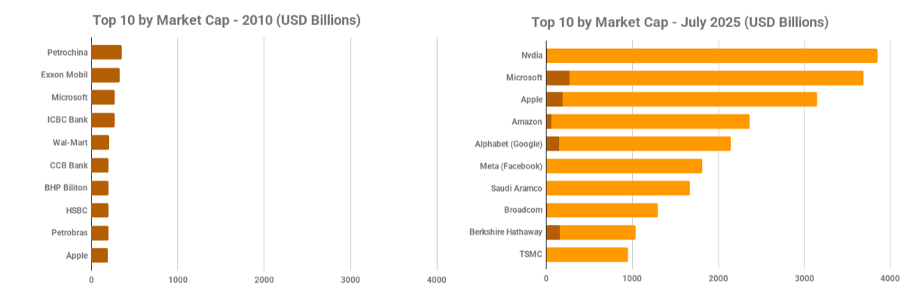

## From Protocols to People {#from-protocols-to-people}

Web 1.0 built the foundation. Its academic and military architects gave us the gift of open, free protocols—the fundamental rules that allowed a global network to exist. But they weren't building it for the masses. They were building it to solve technical problems.

The move to Web 2.0 was not a single event, but a huge shift in how people thought about the internet. The process began in the early 90s when the closed network of universities and military bases was opened up to commerce. The [arrival of the first Internet Service Providers](https://en.wikipedia.org/wiki/The_World_%28Internet_service_provider%29) (ISPs) was the turning point. For the first time, the internet wasn't just a research project; it was a product.

Web 2.0 refers to the era when the internet shifted from static pages to interactive platforms built around user-generated content.

In short, Web 2.0 was the commercialization of the internet.

## The Problem of Potential {#the-problem-of-potential}

So why was this shift necessary? Because Web 1.0, for all its technical brilliance, was practically unusable for the average person.

The researchers who built the early internet weren't incentivized to think about user experience. When they applied for research grants, they promised technical breakthroughs, not beautiful design. Polishing an interface didn't have much "scientific value." As a result, the user was an afterthought.

As the internet's foundations solidified, a few people started to see its mind-boggling potential. This network could connect billions of people for communication, collaboration, and commerce on a scale never before imagined. But there was a catch: getting online was a nightmare. You needed a computer, an expensive and unreliable connection from an ISP, and the patience to navigate a clunky, unforgiving interface. To see the benefits of the internet, you first had to conquer it.

This friction created one of the biggest business opportunities of the late 20th century.

## The Web 2.0 Gold Rush {#the-gold-rush}

Entrepreneurs and investors saw the massive gap between the internet's raw potential and its frustrating reality—and they rushed in to fill it. This marked a fundamental handover. The center of gravity for web development shifted from university campuses to the private sector.

A natural division of labor appeared. The research arms of large corporations focused on the hard, expensive problems of hardware and infrastructure. The job of building user-friendly applications fell to a new wave of nimble, fast-moving startups.

Thousands of them sprang to life, armed with flashy pitch decks showing the internet's promise. They knocked on the doors of venture capitalists and raised millions. This kicked off the dot-com frenzy. Then, in 2000, [the bubble burst](https://stockstotrade.com/dot-com-bubble-chart/). Dozens of startups that had failed to turn hype into a sustainable business were wiped out.

But from the wreckage, titans emerged. Companies like Amazon and Google, which [survived the crash](https://www.eweek.com/cloud/eweek-at-30-how-amazon-survived-the-dot-com-crash-to-rule-the-cloud/), had finally cracked the code. They proved that unimaginable commercial value could be built on the open protocols of Web 1.0, and in doing so, they wrote the playbook for the next twenty years.

## The Defining Features of Web 2.0 {#the-defining-features-of-web-2-0}

So what did this new era look like? In almost every way, Web 2.0 became the polar [opposite](https://www.identity.com/web1-and-web2/) of Web 1.0. Its defining features weren't just technical, but philosophical.

### Web 2.0: Fast, User-Focused Applications {#fast-user-focused-applications}

While Web 1.0 was about building the slow-moving, foundational infrastructure, Web 2.0 was about the fast-moving applications built on top of it. [The focus shifted entirely to the end-user](https://crowleymediagroup.com/resources/understanding-web-2-0s-the-evolution-of-the-net/). The primary goal was to get as many users as possible, as quickly as possible.

Figuring out what millions of people want is hard. Some features catch fire, while others fizzle out. So, the Web 2.0 playbook was to ship products quickly, measure user reactions, and iterate constantly. The slow, deliberate planning of the protocol era was replaced by a new mantra: "move fast and break things." This relentless focus on creating user-friendly experiences is what finally made the internet accessible to everyone.

### Web 2.0: Proprietary, Walled Gardens {#proprietary-walled-gardens}

This speed and growth was fueled by venture capital. [VCs invest in](https://www.investopedia.com/terms/v/venturecapitalist.asp) risky projects expecting massive returns from the few that succeed. To meet these expectations, Web 2.0 startups had to find ways to win—and win big.

This meant the open, collaborative spirit of Web 1.0 was a thing of the past. Startups fiercely protected their code with copyrights and trade secrets to prevent rivals from copying them. Their goal wasn't just to acquire users, but to *capture* them. To do this, they built "walled gardens"—closed ecosystems offering everything a user might need, making it difficult for them to leave.

### Web 2.0: Radical Centralization {#radical-centralization}

This combination of venture capital and explosive growth created an inevitable endgame: centralization. A successful startup eventually faced a choice: go public or get acquired by a larger company.

If they went public, their new boss was Wall Street, which demanded one thing above all else: relentless, predictable quarterly growth. This pressure, felt constantly by executives, left them with two paths. They could find new ways to grow their own business, or they could acquire other startups to create a story of growth for investors.

This spiral of acquisitions consolidated the market, creating a handful of giants that dominated the entire digital landscape.

The change in the most valuable companies list in 15 years reveals the stunning results of this consolidation.

<figure><figcaption>The world's 10 most valuable companies (2010 and 2025 - in billions of USD) In 2010, the world's largest companies were in oil and finance, with only Microsoft and Apple representing tech. By mid-2025, the list is dominated by technology companies, which hold the top spots. The Web 2.0 model didn't just create products; it concentrated wealth and power at an unprecedented scale.</figcaption></figure>

This concentration of power in the hands of a few platforms came with its own set of problems.

## The Price of "Free" in Web 2.0 {#the-price-of-free}

The Web 2.0 model, funded by venture capital, was built on a simple premise: grow your user base as fast as possible, at any cost. For years, profitability wasn't just ignored; it was a banned word. The only metric that mattered for startups was answering the question, "How many users have you reached?"

This strategy created tech giants and made their early products free to use. But there was a hidden cost. If users weren’t paying for the product, then what was the business model? What were companies monetizing?

The answer was simple and unsettling: users themselves. Their attention. Their data. Their behavior. And eventually, their beliefs.

That is where the real problem started. How do you deliver infinite profit growth when you’ve already captured billions of users? You can't grow your user base by 50% year-over-year when almost everyone is already on your platform.

The tech giants needed a new story to tell investors in their quarterly earnings calls. The story they came up with was simple: if you can't get more users, you have to extract more value *from* your existing users. The business model pivoted from user acquisition to user monetization.

This is how we got the ad-supported internet. Companies like Facebook and Google realized the most valuable asset they had was user attention and data. They became the [two biggest advertising agencies](https://www.marketingdive.com/news/facebook-global-ad-revenue-surpass-100-billion-2024-warc/735278/) in the world. To sell more ads, they needed to make them more effective.

The key was personalization. A billboard is seen by thousands but is relevant to almost no one. But showing a baby food ad to a mother who just shared photos of her newborn? That’s incredibly effective. So they started analyzing the data we willingly gave them.

Soon, even that wasn't enough to feed Wall Street's voracious appetite for more profit. To meet this demand, the platforms needed to learn more about us than we were consciously sharing.

Their data collection became so pervasive and their predictive models so powerful that it often felt like [they were listening to our private conversations](https://www.wired.com/story/facebooks-listening-smartphone-microphone/). A discussion with a spouse about a broken washing machine might be followed by a flood of washing machine ads.

This led many users to believe their phone's microphone was being used for ad targeting—a claim the companies have always denied. The reality is that their other data, from search history to social connections, allows them to make startlingly accurate predictions about our needs and intentions.

Advertising was one thing, but it wasn't the final step. These platforms soon realized the data itself was a valuable commodity. While they claim they don't sell your personal data directly, they use it to offer targeted ads. The consequences of this became terrifyingly clear in the 2010s. The same machinery built to sell products was used to sell political ideologies, famously culminating in the [Cambridge Analytica scandal](https://en.wikipedia.org/wiki/Facebook%25E2%2580%2593Cambridge_Analytica_data_scandal), where user data was weaponized to influence elections. The tools of commerce had become tools of manipulation.
