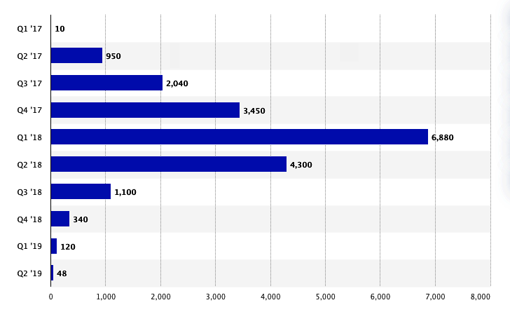

## The Web3 Movement Begins {#the-movement-begins}

As the flaws of Web 2.0 became undeniable, a movement was already brewing. Its roots [trace back](https://cypherlab.org/blog/articles/history-of-cypherpunks) to a forward-thinking group known as the **[cypherpunks](https://en.wikipedia.org/wiki/Cypherpunk)**.

Long before the rest of the world caught on, this digitally-native community of activists and computer scientists saw the danger ahead. They saw a threat to privacy and rights in handing the internet to just a few corporations.

Their thinking was a reaction to the great centralization of power in Web 2.0. They diagnosed a fundamental problem at the core of the digital world: the problem of trust.

In our physical world, we have systems for establishing trust and ownership. But online, in a global village of strangers, how do you verify anything?

- **The Trust Problem:** How can you trust that the person you're dealing with is who they say they are? Web 2.0 solved this with a central intermediary—Facebook, Google, or your bank—vouching for everyone.
- **The Ownership Problem:** How can anything digital be scarce or valuable? In a world of 1s and 0s, any file, like an mp3, can be copied a million times, instantly and perfectly. An infinitely available asset is effectively a worthless asset. Again, Web 2.0 solved this with a central intermediary—a company whose private database declared who "owned" what.

This created a paradox. The very intermediaries we trusted to create order became the new rulers. They held all the power, took the lion's share of the value, and trampled user rights to satisfy their business models.

So the cypherpunks started asking some revolutionary questions:

How can we own a digital asset the same way we own a physical one? How can we prove it's ours, ensure it can't be endlessly copied, and transfer it to someone else without a powerful middleman taking a cut and setting the rules? How can we reclaim our share of the value we create?

The breakthrough that [solved](https://www.wired.com/2015/01/how-bitcoins-blockchain-could-power-an-alternate-internet/) all these critical questions at once was **blockchain**.

## What Blockchain Delivers {#what-blockchain-delivers}

How do you solve the puzzle of trust and ownership in a digital world without a middleman? The answer wasn't a single new invention, but a clever mix of three powerful technologies.

The first two ingredients were already well-established. The internet gave us the network, and **cryptography**, which matured in the 1980s, gave us a way to secure information.

The third, decisive ingredient was the secret sauce: a **consensus mechanism**. This was the genius of the anonymous creator(s) known as Satoshi Nakamoto. The insight was profound: instead of trying to replace the powerful intermediaries of Web 2.0 with another single entity, why not shatter their function into a thousand pieces and distribute it across a global network?

But this created a new, incredibly difficult problem: How do you get thousands of independent computers, who don't know or trust each other, to act in unison and agree on a single source of truth?

This is the hurdle that the "[Nakamoto Consensus](https://www.morpher.com/blog/nakamoto-consensus)" cleared.

A network of thousands of machines acting as one—it's revolutionary for two reasons. First, it can record transactions accurately without taking orders from a central boss. Second, its design makes it virtually impossible to retroactively alter those records.

By solving these two issues, the network creates the thing every transaction needs: **trust**.

For the first time, people could own a digital asset with absolute confidence. They could prove its authenticity and scarcity, assign it value, and transfer it to anyone else in the world—all without needing permission from a bank, a corporation, or any other authority.

This "trust machine" became the technological foundation for Web3. It enabled a new wave of initiatives built on decentralization and [community ownership](https://www3.weforum.org/docs/WEF_DAOs_for_Impact_2023.pdf)—a direct challenge to the walled gardens of Web 2.0.

## A Brief History of Web3 {#a-brief-history-of-web3}

Bitcoin's launch in 2009 was the spark, but Ethereum lit the fuse for the Web3 explosion.

The movement began with a philosophical split. A group within the early Bitcoin community, led by a young programmer named Vitalik Buterin, saw that blockchain technology could be for more than just money. They envisioned a decentralized computer that could run practically any application. This clashed with the prevailing view among Bitcoin's developers, who argued that the mission was "censorship-proof digital money," and any other focus would dilute that vital goal.

Buterin’s group left to found Ethereum with a new, broader mission: to be a decentralized infrastructure on which *anyone* could build.

This new vision required funding. While Bitcoin was developed without outside capital, the Ethereum founders took a different path. In 2014, they raised about $18 million in a public crowdsale—an Initial Coin Offering (ICO)—selling their ETH token for around 31 cents each. By the end of 2017, [ETH was trading at $750](https://www.exchangerates.org.uk/crypto-currencies/ethereum-to-us-dollar-history-eth-usd-2017). This astronomical return changed the game.

The success sparked the great [ICO boom of 2017](https://cointelegraph.com/news/ethereum-ico-boom-history-crypto). A flood of investor appetite swept the market, with startups raising incredible sums. Many of these ventures offered little more than a whitepaper.

<figure><figcaption>Funding from ICOs between 2017-19 (in millions of USD) Quarterly funding from ICOs shows the speculative peak in late 2017 and early 2018, followed by a sharp decline. (Source: <a href="https://www.statista.com/statistics/804748/worldwide-amount-crytocurrency-ico-projects/">Statista</a>)</figcaption></figure>

The boom was not sustainable. As poor-quality projects and failed promises mounted, investors fled. The market plunged into a "crypto winter" that lasted nearly three years. Many who had chased quick fortunes were burned, losing faith in the technology.

In hindsight, this bear market was exactly what the space needed. With the noise of speculation gone, serious teams could finally focus. The winter became a time for building. Good teams refined their projects, pivoted, and searched for genuine problems to solve for real users.

The world changed in 2020. The pandemic and the ensuing government stimulus provided the spark the market was looking for. That summer, the work done during the crypto winter bore fruit. We witnessed the explosion of "[DeFi Summer](https://www.techopedia.com/defi-summer-2024-vs-defi-summer-2020-the-new-era)," as decentralized finance applications finally delivered on the promise of a new financial system. This was followed by the NFT craze, which showed the world the power of true digital ownership for art and collectibles.

The momentum slowed in 2022 as crises in the broader financial markets took their toll (we'll explore these in Chapter 3). However, this downturn set the stage for one of the most significant bull runs in the technology's history.

The [approval of spot Bitcoin ETFs in the US](https://investorplace.com/2024/01/11-spot-bitcoin-etfs-received-sec-approval-heres-the-complete-list/) in January 2024 triggered a massive wave of institutional investment, pushing Bitcoin to record highs throughout 2024 and 2025. This rally was further amplified by the approval of spot Ethereum ETFs. A decisive shift in the U.S. political landscape toward a pro-crypto stance following the 2024 election also played a key role.

The cycle of boom, bust, and building continues, with this latest round cementing Web3's role as a fixture in the global financial and political system.

## What Makes Web3 Special? {#what-makes-web3-special}

The philosophy of Web3 is to combine the decentralized freedom of Web 1.0 with the rich, user-friendly experience of Web 2.0.

### A New Foundation for Web3 {#a-new-foundation}

You can't build a decentralized world on centralized rails. While Web 2.0 built its applications on the original internet architecture, Web3 required a new foundation from the ground up, built on the principle of decentralization. That foundation is the blockchain.

This new architecture is powerful, but it’s still in its early days. Blockchains have matured enough to support a growing ecosystem of applications, but they still have a long way to go. The two biggest hurdles are **scalability**—the ability to handle massive, global demand without slowing down—and **interoperability**, which will allow different blockchains to communicate and transfer assets seamlessly.

The applications built on this infrastructure are also maturing. Early applications were often vulnerable to attack, but with each challenge, [they have evolved](https://moderntechera.com/challenges-of-using-blockchain-for-web3-development/), closing security holes and becoming more "bulletproof." Today, the single biggest obstacle is user experience. The promise of Web3 is immense, but its complexity is still a major barrier. Until using a decentralized application (dApp) is as easy as using a Web 2.0 app, mainstream adoption will stay just out of reach.

### Trust Through Radical Transparency {#trust-through-radical-transparency}

Web3 revives the open-source ethos of Web 1.0, and for a critical reason. In Web 2.0, you trust a corporation. You trust that Google or Meta will follow the law and protect your data because they have offices and are subject to regulation. In Web3, the service provider isn't a company; it's a piece of software. There may be a team behind it, but they could be anonymous.

So how can you trust it? By making the code **open source**.

This transparency is non-negotiable. It allows anyone to "x-ray" the software, audit its logic, and verify that it does exactly what it promises—and nothing more. This is a fundamental shift from "trust the corporation" to "trust the code."

For builders, this open-source nature is a double-edged sword.

On one hand, it creates **compounding innovation**. Teams don't have to solve the same problems over and over. They can take existing open-source components—like digital Lego blocks—and build on top of them. This frees up talent to tackle new frontiers and accelerates the pace of progress for the entire ecosystem.

On the other hand, it creates **relentless evolutionary pressure**. There are no trade secrets. Every innovation is instantly visible and can be copied by competitors. The only way to stay ahead is to move faster and build a stronger community. In the world of Web3, there is no catching your breath. You innovate, or you become obsolete.

### The Ownership Economy {#the-ownership-economy}

Make no mistake: Web3 is intensely commercial. The era of venture capital arrived early, with ICOs providing the fuel for development. But Web3 operates with a radically different set of economic rules.

In Web 2.0, the value created by a startup flows to a small group of founders and investors. Web3 blows this model apart. It introduces an "ownership economy" where the value is designed to be shared among everyone who helps build and sustain the network. This includes not just the core team and investors, but also the external developers who build on the protocol, the validators who secure the network, and even the early users who give it life. The goal is no longer just to have users; it’s to turn users into owners. We'll explore who these new stakeholders are in the chapter 'Actors of the Web3 World'.

### A Return to a Decentralized Web {#a-return-to-a-decentralized-web}

At its core, Web3 is a philosophical return to the roots of the original internet. The first protocols like TCP/IP and HTTP were open, permissionless, and belonged to no one. Web 2.0 abandoned this ethos for centralized, walled gardens.

This centralization created choke points of control. When power is concentrated, it can be manipulated by outside forces—be it politicians, states, or influential organizations. The 2024 U.S. law requiring the Chinese-owned platform TikTok to [divest its U.S. operations or face a ban](https://en.wikipedia.org/wiki/Restrictions_on_TikTok_in_the_United_States) is a powerful reminder that centralized platforms are subject to the agendas of nation-states.

Web3 is a direct response to this vulnerability. Its infrastructure is deliberately designed to be decentralized, making it resistant to censorship and control. The goal is to ensure no one can be denied access to their digital assets or silenced because of their beliefs.

It's crucial to understand, however, that decentralization is a process, not an event. A Web3 project typically starts with a centralized team to move quickly and find its feet. Over time, it undergoes **progressive decentralization,** like a rocket shedding its booster stages. The founding team gradually hands over control to the community.

One of the most important steps in this journey is the creation of a DAO (Decentralized Autonomous Organization)—a structure that allows strategic decisions to be made by the community. This transfer of governance is often powered by issuing a "governance token," which is distributed among the team, investors, and the wider community of contributors. We'll dive into the mechanics of this in the fifth chapter, 'Tokenization'.

## Challenges Facing Web3 Today {#challenges-facing-web3-today}

For all its revolutionary promise, Web3 is a long way from being finished. It faces enormous challenges, and pretending otherwise does a disservice to the real work being done. While progress is made every day, especially on the core infrastructure, the movement has yet to overcome its biggest obstacle: for most people, Web3 isn't yet a part of daily life.

This is the ultimate test for any new technology. To break through, it needs to solve real problems for real people. Web3's journey to clear this hurdle involves several key challenges.

### Web3’s Search for Product-Market Fit {#the-search-for-product-market-fit}

Very few Web3 projects have answered the most important question in technology: "Does anyone actually want this?" It is incredibly difficult to build a product that users genuinely need, especially when you have to convince them it’s better than the seamless Web 2.0 alternative they already use.

To be fair, there are clear success stories. **Bitcoin** is the most prominent, but even it had to evolve. Its original mission was to be peer-to-peer digital cash, but the market decided its true value as a "digital store of value," or digital gold. You can see this evolution on crypto exchanges, where **stablecoins**, not Bitcoin, have become the primary medium of trade. Stablecoins themselves are the other [undisputed success](https://www.pymnts.com/blockchain/2025/this-week-in-web3-was-all-about-stablecoins/), providing a critical bridge between traditional finance and the crypto world.

Beyond these, infrastructure projects like **Ethereum** and **Solana** have found their footing. They are the B2B successes of Web3—the decentralized cloud providers on which other applications are built.

But when we turn to applications meant for the average person, the picture gets murkier. This leads to an uncomfortable truth that many in the industry won't admit: for many, the primary use case for Web3 today is **speculation**. The main "product" they are using is the hope of a future payday by getting in early.

This isn't a reason for pessimism, but for realism. Every major technological shift—from the railroads to the internet itself—was fueled by a wave of speculation. It’s a noisy and often frustrating phase, but it's also the phase where countless experiments are run. The real, lasting value emerges from the lessons learned in the wreckage of those that fail.

### The Last-Mile Problem: User Experience {#the-last-mile-problem-user-experience}

For Web3 to win, its products can't just have novel benefits; they must be a joy to use. Right now, for anyone outside the crypto-native world, they are often a nightmare.

The first door a new user walks through is the crypto wallet, and it’s where most get stuck. We in the industry must admit a hard truth: the 12 or 24-word seed phrase, our standard for security, is a catastrophic failure of user experience.

In Web 2.0, if you forget your password, you click a link and get back into your account in seconds. In Web3, we tell users, "Lose this secret code and your life savings are gone forever, with no one to help you." This is a user-losing proposition from day one.

Thankfully, solutions are emerging. A new generation of "smart contract wallets," [are solving this problem](https://encrypthos.com/question/can-smart-contract-wallets-truly-eliminate-the-need-for-seed-phrases-and-what-are-the-trade-offs/). They replace the rigid seed phrase with more flexible, intuitive security models. By bundling in features like built-in staking, these wallets can even offer an experience superior to their Web 2.0 counterparts. For this to become the norm, however, these improvements need to be deeply rooted in the core infrastructure. This is a top priority on the Ethereum roadmap, signaling that the entire ecosystem recognizes the urgency of solving this problem[^1].

### Breaking Down Blockchain Silos {#breaking-down-the-silos}

In a cruel twist of irony, the movement designed to break down the walled gardens of Web 2.0 has ended up building hundreds of its own. Each blockchain is a world unto itself. An application built on Ethereum only works on Ethereum. A digital asset created on Solana is trapped on Solana.

The bridges built to connect these islands are often slow, clunky, and complex. This problem is made worse by a jungle of competing wallet standards. A user needs Metamask for the Ethereum ecosystem, a Phantom wallet for Solana, and a Keplr wallet for Cosmos. It's a confusing mess that requires technical literacy and the patience to approve every single step of a transaction—a user experience that can feel like death by a thousand clicks.

The good news is that these are software problems, and they are being solved. We are already seeing multi-chain wallets that can operate across different ecosystems. Innovations like Metamask's "[Snaps](https://support.metamask.io/configure/snaps/what-are-interoperability-snaps/)" allow for plugins that extend support to new networks. An even bigger solution on the horizon is a new technology called "[intents](https://li.fi/knowledge-hub/intents-and-chain-abstraction-101/)," which simplifies the user's journey by letting them declare a goal (like "swap token A for token B") and having the software automatically figure out the best way to achieve it.

The ultimate vision is a future of **chain abstraction**, where the user doesn't even need to know which blockchain they are on. They will simply use the application that works best for them, and the underlying technology will automatically route their transaction through the fastest, cheapest, or most profitable path. This future isn't a distant dream; it's just a matter of time and engineering.

## Where Web3 Will Change Our Lives? {#where-web3-will-change-our-lives}

To understand where Web3 is headed, we first need to cut through the hype. The early hype suggested that blockchain could revolutionize any industry plagued by middlemen and high costs. But reality has taught us a crucial lesson.

The most important prerequisite for Web3 to work its magic is **digitalization**.

Blockchain technology is a powerful tool, but it can’t be bolted onto a non-digital world. The most famous cautionary tale comes from the world of supply chains. In 2015, the go-to example for blockchain’s potential was logistics. A company like IBM, leading the charge with its Hyperledger protocol, would point out that a single refrigerator shipping from Europe to Africa required hundreds of approvals. The system was a tangled mess of intermediaries—a perfect problem for a blockchain to solve, right?

Not quite. The problem was that the supply chain itself—the handshakes, the paper forms, the stamps of approval—wasn't digital. To apply a blockchain solution, the entire industry would first have to digitize every step of its process. After years of effort, IBM’s ambitious partnership with shipping giant Maersk [failed to deliver on its promise](https://cointelegraph.com/news/the-ibm-maersk-blockchain-effort-was-doomed-to-fail-from-the-start) precisely because you can't build a digital ledger on an analog foundation[^2].

This brings us to a clear conclusion: Web3 will make its mark first in sectors that have already completed their digital transformation or were "digital-native" from birth. So, where are these fertile grounds? And more importantly, what real benefits will they offer? Let's explore a few key areas.

### Transforming Games and Social Media {#transforming-games-and-social-media}

Digital games and social media are two of the most dominant forces in modern culture. They are also digital-native, which makes them fertile ground for Web3's disruption. In the current Web 2.0 model, these are closed ecosystems. The platforms own the infrastructure, they own your data, and they capture nearly all of the value that you, the user, create.

Web3 offers a radical alternative: a world where you own your digital life. The relationships you build, the communities you join, and the content you create can be yours, recorded on a blockchain, free from the control of any single company. This provides two profound benefits.

First, it grants you **platform freedom**. If you're unhappy with the rules or fees of one platform—say, a new version of Twitter or Facebook—you can seamlessly move your social graph and content to a competitor. [The vision](https://arxiv.org/html/2505.22962v1) is that platforms should be interchangeable windows to access your data, not the walls of a prison that holds it captive.

Second, it allows you to **share in the value you create**. The "play-to-earn" model was the first, flawed experiment in this direction. While the initial hype has faded, the core idea is evolving into something more sustainable. The focus is shifting from simple earning to true ownership, creating open economies where the time and effort you invest in a game or a community can generate real-world rewards. Companies like [Animoca Brands](https://www.animocabrands.com/animoca-brands-investor-update-for-the-quarter-and-fiscal-year-ending-on-31-december-2024) are at the forefront, not just building games, but cultivating entire ecosystems built on the principle of digital property rights for all participants.

### Expanding Possibilities with NFTs {#expanding-possibilities-with-nfts}

Underpinning this entire shift is the technology of Non-Fungible Tokens, or NFTs. An NFT is more than just a digital collectible; it's a certificate of ownership for a unique digital asset, secured on a blockchain. This seemingly simple concept unlocks a world of possibilities that were previously unimaginable.

With NFTs, the scarcity, ownership, and transfer of digital goods become a reality. But the potential goes far beyond simply owning a piece of digital art. NFTs allow for **programmable ownership**. An artist can bake in a royalty, ensuring they get a cut of every future sale of their work—something impossible in the traditional art world[^3]. A high-value asset, like virtual real estate or a rare in-game item, can be fractionalized, allowing many people to own a small piece.

When combined with the principles we'll discuss in our chapter on "Tokenization," these digital assets can be traded on global markets quickly, cheaply, and without the need for traditional intermediaries, breaking down geographical and financial barriers to entry. NFTs are not just another application of Web3; they are the fundamental building blocks—the digital atoms—of this new, user-owned economy.

### DAOs: The New Shape of Organizations {#daos-the-new-shape-of-organizations}

In the Web3 world, communities are the economy. The primary tool for organizing these communities is the Decentralized Autonomous Organization, or DAO. This isn't just a new feature; it's an entirely new way to structure human collaboration.

Think of a DAO as a digital cooperative. Where a traditional project requires forming a company, navigating legal systems, and establishing a top-down hierarchy, a DAO allows thousands of people from around the globe to pool capital and labor towards a shared goal, governed by rules encoded on a blockchain.

This is transforming the very nature of work. Instead of being tied to a single company, contributors can participate in multiple DAOs, lending their skills where they are most valued. The early, idealistic vision of DAOs as purely code-based entities has matured. As of 2025, the most successful DAOs are becoming pragmatic, often adopting "legal wrappers"—[like foundations or LLCs in forward-thinking jurisdictions](https://legalnodes.com/article/choose-a-crypto-friendly-country-for-dao)—to interact with the traditional world and protect their members. This isn't a retreat from decentralization, but an evolution towards building durable, real-world institutions.

Make no mistake: like any startup ecosystem, most DAOs will fail. But the models that succeed are poised to become some of the most influential and valuable organizations of the next decade.

### Cryptocurrencies: The Fuel for the New Economy {#cryptocurrencies-the-fuel-for-the-new-economy}

This new world of decentralized organizations is powered by a new kind of money: **cryptocurrencies**.

The open-source movements of the past often ran on passion and volunteer effort. But to compete with the deep-pocketed giants of Web 2.0, passion isn't enough. For a DAO to be sustainable, it needs a continuous economic incentive to attract and retain talent. That incentive mechanism is its native token, or cryptocurrency.

This process typically has two phases:

1. **The Bootstrap Phase:** In the beginning, before the network has generated real value, the project distributes its tokens to the stakeholders who are building it—the founding team, early investors, developers, and even the first users. This gives everyone a share of the potential upside, aligning all parties to work towards the project's success.
2. **The Sustainable Phase:** For the token to have lasting value, the network must eventually provide a service that people actually want to use. When a project achieves product-market fit, a vibrant economy can form around its token. Users might spend it to access services, while contributors earn it for securing the network or improving the protocol. This creates a self-sustaining loop where the value of the token is tied to the value of the network itself.

In keeping with Web3's core philosophy, it's only natural that these new economies run on their own native currencies, rather than the fiat currencies issued by the central banks of the old world. It is the final piece of the puzzle in creating truly self-sovereign, digital nations.

### DeFi: Rewiring the Financial System {#defi-rewiring-the-financial-system}

As the Web3 ecosystem grows, it needs its own financial plumbing—tools for investing, lending, and allocating capital. It’s no surprise, then, that this new economy is being built on **Decentralized Finance (DeFi)**, a system that perfectly matches the core philosophy of decentralization.

Finance was the perfect first target for Web3, for two simple reasons. First, the financial sector is already almost entirely digital. Second, the core value proposition of traditional finance is *trust*. When you deposit your money in a bank, you trust them to keep it safe. When you make a trade, you trust a broker to execute it fairly. Web3, with its ability to replace this institutional trust with verifiable code, strikes at the very core of the financial world.

The classical financial system is powerful but also deeply conservative and exclusionary, wrapped in tight regulations that, while necessary, often stifle innovation. The result is a system that primarily serves the elite, leaving [an estimated 1.4 billion people worldwide without access to basic financial services](https://www.finextra.com/blogposting/25664/2024-the-year-of-financial-inclusion).

DeFi aims to change that. It is building a parallel financial system from the ground up—one that is open, permissionless, and global by default. Its goal is not to serve the few who are reading these lines, but to build on-ramps for the billions who have been left behind.

### Beyond Finance: The Next Frontiers {#beyond-finance-the-next-frontiers}

The principles forged in the crucible of DeFi are now expanding to reshape other fundamental parts of our world. As of 2025, several key areas are emerging as the next frontiers of the Web3 movement.

- **Decentralized Science (DeSci):** This movement aims to break down the walled gardens of traditional academia. By using Web3 tools, DeSci is creating open and transparent systems for research funding, data sharing, and peer review, accelerating the pace of scientific discovery.
- **Decentralized Physical Infrastructure (DePIN):** Hailed as one of the most exciting growth areas, DePIN allows communities to build and own real-world infrastructure. From decentralized wireless and energy grids to data storage and mobility networks, token incentives are enabling a bottom-up approach to creating the essential services our society relies on.
- **Decentralized AI:** Perhaps the most profound shift, this movement is a direct challenge to the dominance of a few Big Tech companies over artificial intelligence. It seeks to democratize access to AI models and data, fostering permissionless innovation and enabling the creation of autonomous AI agents that can participate in the Web3 economy.

From digital identity to decentralized social media, the list of experiments continues to grow. We'll explore these use cases in detail later, but they all have one thing in common: using decentralized technology to cut out powerful gatekeepers and return ownership to communities and individuals.

[^1]: Account Abstraction merges the security of smart contracts with the ease of use of traditional accounts. EIP-4337 was a major step, allowing for smart contract wallet functionalities without changing Ethereum's core protocol. The Pectra upgrade, which went live in May 2025, included EIP-7702 and further streamlined this by allowing standard wallets to temporarily gain smart contract capabilities, making the user experience smoother and more accessible for everyone.

[^2]: While the lack of industry-wide digitization was a significant factor, other issues such as insufficient global collaboration and challenges in achieving widespread adoption also contributed to its failure.

[^3]: While the enforcement of these royalties depends on the policies of the marketplace where the asset is traded, it opens up possibilities for creators that are difficult to achieve in the traditional art world.
