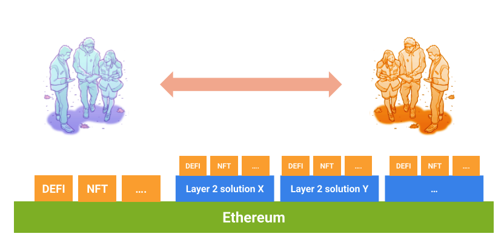
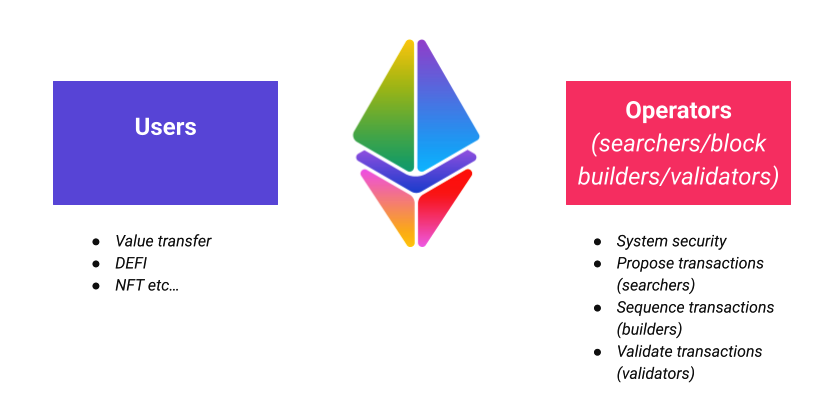
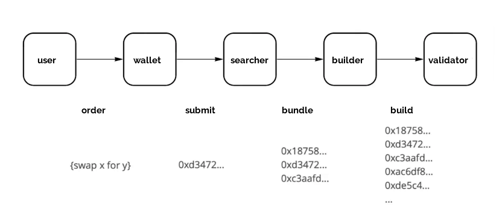
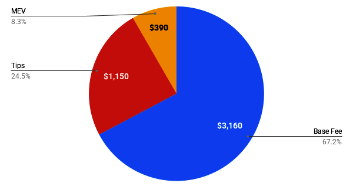
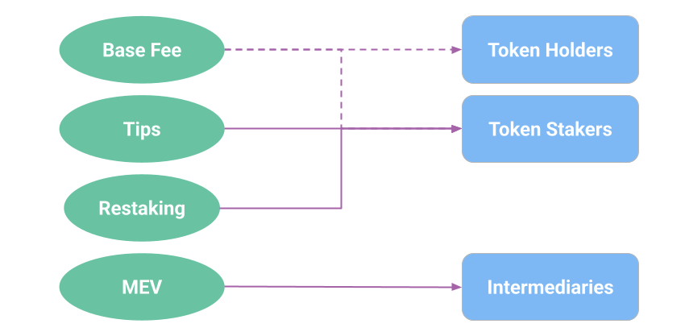
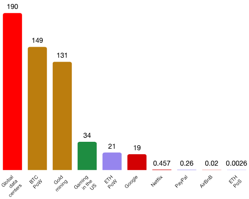
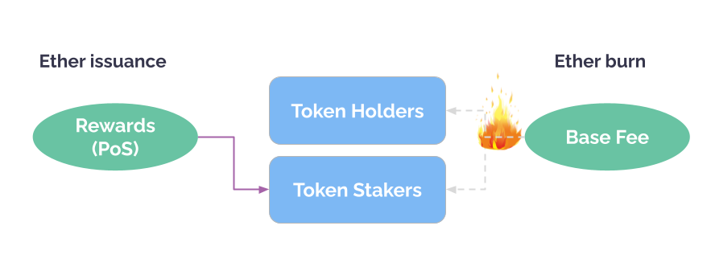
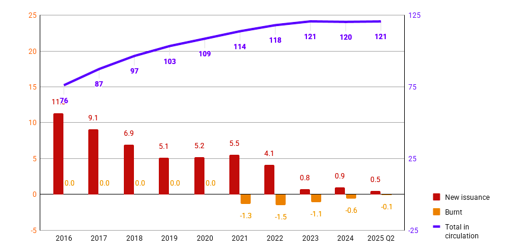
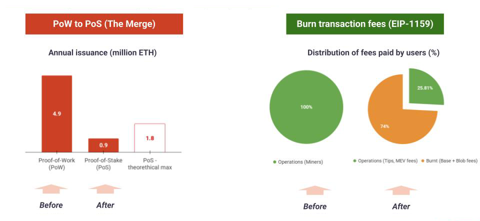
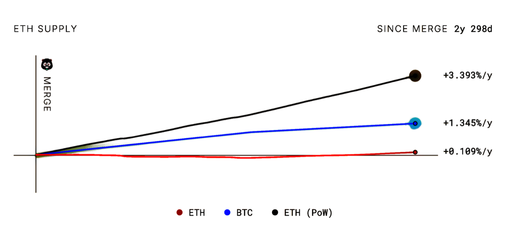

So, how does Ethereum's economy actually work?

First, we have to understand what it is. The easiest mistake is to think of Ethereum as a company. It’s not. A better analogy is to think of it as a sovereign digital nation.

And if we include the Layer 2 blockchains developing on top of it, Ethereum starts to look like **a federation of states**, each with its own local customs but all united under a single security umbrella. Like any nation, this federation has different groups of actors who drive its economy.

<figure><figcaption>Ethereum Federation Ethereum as a federation of users, applications, Layer 2 solutions, and its underlying main chain</figcaption></figure>

## Who Lives in Ethereum’s Digital Nation? {#who-lives-here}

The most important actors in this digital nation are its **users**. These are the individuals and programs transferring assets or using the thousands of applications built on the network. For every action they take—every transaction they send—[they pay a fee](https://ethereum.org/en/developers/docs/gas/)[^1]. These transaction fees are the primary fuel for Ethereum's entire economy.

The applications themselves act like **businesses** renting digital land. They provide everything from financial services (DeFi) and digital art (NFTs) to identity systems and social media. But here’s a key difference from the traditional world: the apps don't pay the rent. The users pay the cost of using Ethereum's infrastructure directly with each transaction[^2].

The second group of actors are the **Layer 2 networks**. Think of these as the individual states within the federation. Each one is a distinct blockchain that manages its own activity but relies on the main Ethereum chain for its security. Just like users, these Layer 2 chains pay fees—their form of "[federal tax](https://www.growthepie.com/fundamentals/rent-paid)"—to the main network for providing this foundational trust.

So, where does all this money go?

The fees go to the people who secure the network and process transactions. For years, this work was done by **miners**, similar to the Bitcoin network. But on September 15, 2022, Ethereum went through [a historic transformation](https://coinmarketcap.com/events/eth-merge/). It replaced miners with **validators**—people who stake their own ETH (Ethereum's native currency) as a security deposit. They now have a direct financial stake in the long-term health and security of the network.

The simplest way to get a handle on the size of Ethereum's economy is to look at the total revenue it generates from fees. It’s the closest thing we have to a [digital nation's GDP.](https://tokenterminal.com/explorer/projects/ethereum/metrics/gdp)

## Where does Ethereum’s revenue come from? {#where-does-ethereums-revenue-come-from}

Ethereum’s core product is [secure, programmable block space](https://ethereum.org/en/developers/docs/intro-to-ethereum/). Think of it as digital land that is guaranteed to be yours, where contracts are enforced by code. All of the network's revenue flows from selling access to this land.

<figure><figcaption>The Market for Block Space Users, DeFi applications, and Layer 2 solutions all compete for Ethereum's block space, paying transaction fees to the validators who operate and secure the network.</figcaption></figure>

### An Auction for Every Ethereum Transaction {#an-auction-for-every-transaction}

Every time a user wants to send money, trade a token, or interact with a financial protocol, they must pay a transaction fee. This fee is their ticket to have their action permanently and securely recorded on the Ethereum ledger. These fees are, by far, Ethereum’s largest source of revenue.

As block space is limited and demand is high, a real-time auction determines who gets to use it and when. When a user submits a transaction, it enters a public waiting room called the mempool.

This waiting room operates like a competitive bidding system. To get their transaction processed, every user pays a **base fee**, which is determined by overall network congestion. But if you're in a hurry, you can't just pay the base fee; you need to get to the front of the line. To do this, you add a **tip** (or priority fee) for the validators who run the network.

Validators, who want to maximize their income, will naturally prioritize transactions with the highest tips. This creates a dynamic where a significant portion of Ethereum's revenue comes from these priority payments, as users compete to have their transactions processed faster than everyone else's.

### Ethereum’s MEV Revenue {#mev-revenue}

The order of transactions in a block is just as important as the transactions themselves. Control the order, and you can unlock a second, far more complex revenue stream. This is where a new class of sophisticated players comes in: **Searchers**, who scan the mempool for profitable opportunities, and **Builders**, who assemble the final blocks submitted to the chain.

<figure><figcaption>The Value Flow of a Transaction <em>Specialized intermediaries now sit between a user's transaction and its inclusion on the chain.</em></figcaption></figure>

Builders decide which transactions make it into a block and in what sequence. Their goal is to build the most profitable block possible. The simplest way is to include transactions with the highest tips, but the real prize lies in exploiting the *order* of transactions. This creates a spectrum of strategies.

On one end, you have benign arbitrage.

Imagine your trade pushes the price of ETH on one exchange to $2001, while it’s $2000 everywhere else. A builder can insert a transaction immediately after yours to sell ETH at $2001, capturing the $1 difference and helping to nudge the price back in line with the broader market.

This kind of arbitrage is useful, helping to keep markets efficient. But this power can also be turned against users.

A builder can see your large buy order, insert their *own* buy order just before yours to drive the price up, and then sell into your trade at a higher price. You, the user, get a worse price because you were "sandwiched" between their predatory trades.

This entire universe of profit—from beneficial arbitrage to parasitic attacks—is [known as](https://www.coindesk.com/learn/what-is-mev-aka-maximal-extractable-value) **Maximal Extractable Value (MEV)**. It remains a major source of revenue on Ethereum, particularly for validators and builders.

Is this system fair? The consensus is a resounding no. The Ethereum community is deeply focused on this problem[^3], and a series of upgrades are already being planned to limit the negative impacts of MEV.

### Exporting Security: The Rise of Restaking {#exporting-security-the-rise-of-restaking}

Beyond the direct fees for block space and the hidden world of MEV, a third economic pillar is emerging: the ability to export Ethereum’s security.

Think of the billions of dollars in ETH staked to secure the network. This creates a massive wall of economic trust. A new concept called **restaking** allows validators to leverage that same capital to simultaneously secure other emerging protocols, like bridges or new data networks. In exchange for taking on this added responsibility and risk, they earn a new stream of revenue.

The pioneer in this field is **EigenLayer** (now called [EigenCloud](https://www.eigencloud.xyz/)), which has built a [marketplace](https://cointelegraph.com/explained/what-is-eigenlayer-ethereums-restaking-protocol-explained) for this very service. It allows new projects to effectively rent Ethereum's powerful security guarantee instead of having to bootstrap their own from scratch.

* * *

These three pillars—transaction fees, MEV, and restaking rewards—give us a complete economic picture. The chart below illustrates the revenue distribution across these streams for the first 11 months of 2024.

<figure><figcaption>Distribution of Ethereum Revenues Calculated based on figures from a chart by Blockworks (in US$ million). (Source: Blockworks - <a href="https://x.com/smyyguy/status/1866145481564307763/photo/2">Dan Smith</a>)</figcaption></figure>

But where does all this value actually flow? As the next diagram shows, the movement of capital in Ethereum's economy is not always a straight line.

<figure><figcaption>How Value Flows on Ethereum Value flows from users to network participants in four distinct ways. Solid lines show direct payments, while dashed lines show indirect value accrual.</figcaption></figure>

Some revenue, like priority fees and certain MEV, flows directly into the pockets of builders and validators. Other forms of value are indirect. For example, the base fee paid on every transaction isn't given to anyone—it's [burned](https://trustwallet.com/blog/blockchain/what-is-eip-1559), permanently removing it from circulation. This doesn't add ETH to a validator's wallet, but by reducing the total supply, it increases the scarcity and potential value of every remaining token, benefiting all long-term holders.

## So, where does Ethereum spend its money? {#so-where-does-ethereum-spend-its-money}

So, what does it cost to run a digital nation like Ethereum?

For years, the answer was a staggering electricity bill. Like Bitcoin, Ethereum's original Proof-of-Work system required a global network of "miners" to burn immense amounts of energy to secure the chain. But on September 15, 2022, Ethereum fundamentally re-architected its economy. By switching to Proof-of-Stake (PoS), it slashed its primary external expense—energy consumption—[by over 99%](https://www.journee-mondiale.com/en/ethereums-99-95-energy-cut-the-merge-thats-reshaping-cryptos-future/).

<figure><figcaption>Energy use of major technologies A comparison of annual energy consumption shows Ethereum's post-Merge efficiency - (terawatt hour/year). (Source: <a href="https://ethereum.org/en/energy-consumption/">Ethereum Foundation</a>)</figcaption></figure>

Today, Ethereum's costs are internal. Instead of paying external energy producers, the network now [pays for its security from within](https://figment.io/insights/ethereum-staking-second-half-of-2025-outlook/). Validators, who pledge their own ETH as collateral, are rewarded with newly issued ETH for their work in securing the system.

This raises a fascinating economic question: are these rewards a true expense?

Some experts say ‘yes’, issuing new currency is the "cost of security" for the network. But a more subtle view argues it isn't an expense in the traditional sense. Rather, it's a dilution of the existing supply—a transfer of value from passive holders to those actively working to protect the network.

Finally, there’s one more cost to consider—a social one that exists on a spectrum. The most harmful forms of MEV, like predatory sandwich attacks, act as a hidden tax paid by everyday users to the sophisticated few. However, not all MEV is bad. Some forms, like arbitrage, are a crucial part of the economy that helps keep market prices consistent. So, MEV is a [complex wealth transfer within the ecosystem](https://www.esma.europa.eu/sites/default/files/2025-07/ESMA50-481369926-29744_Maximal_Extractable_Value_Implications_for_crypto_markets.pdf); part of it is a cost to users, and part of it is a reward for making the market more efficient.

## Meet Ethereum’s currency: ether (ETH) {#meet-ethereums-currency-ether-eth}

Ether (ETH) is the native currency of the Ethereum nation. It’s how the network pays for its security and how users can own a piece of its economy. Holders can capture a share of the value created on the network in two distinct ways: one active, one passive.

The active path is to become a **validator**. By "staking" their ETH, users lock up their capital to help secure the network and process transactions. In return for this work, they earn a yield from three sources:

1. **Issuance:** New ETH created by the protocol as a reward for providing security.
2. **Fees & MEV:** Tips paid by users for priority, along with value captured from transaction ordering (Maximal Extractable Value).
3. **Restaking Rewards:** [Additional yield](https://www.nethermind.io/blog/optimizing-restaking-yields-a-hybrid-quantitative-qualitative-model) earned by using staked ETH to simultaneously secure other networks and protocols.

The passive path relies on a powerful and unique feature of Ethereum’s design: **the fee burn**. The base fee required for every transaction is not paid to anyone; it is permanently [destroyed](https://paxful.com/university/ethereum-burn-explained). This mechanism directly links the economic activity on the network to the scarcity and value of ETH.

This creates a constant push-and-pull on the money supply, a dynamic [battle](https://cryptodamus.io/en/articles/news/eip-1559-eth-burning-why-ethereum-is-still-inflationary-shocking-data-inside) between issuance and burning.

<figure><figcaption>How ETH gets minted and burned New ETH is minted (left) to reward system participants, while a portion of fees is burned (right), removing it from circulation. Direct value transfers (solid lines) are payments, while indirect influence (dashed lines) affects the asset's overall scarcity.</figcaption></figure>

This dynamic has a huge impact. The issuance of new ETH slightly dilutes passive holders, while the fee burn counteracts this by reducing the total supply. When network usage is high *on the mainnet*, the amount of ETH burned can exceed the amount of new issuance, making the entire asset temporarily **deflationary**. However, with [much activity now on Layer 2s](https://osl.com/academy/article/blockchain-scalability-how-layer-2-solutions-are-reducing-costs-and-network), the network more commonly experiences [a very low rate of inflation](https://ycharts.com/indicators/ethereum_supply).

Stakers don't feel this dilution because they receive the new issuance, which maintains their overall share of the network. Passive holders, meanwhile, benefit when high network activity leads to a larger burn, making their holdings more scarce. This isn't just theory—the chart below shows this economic engine at work since the key upgrades in 2021 and 2022.

<figure><figcaption>Ethereum's Money Supply (in millions of ETH) The change in ETH supply over time, showing the impact of the fee burn and the switch to Proof-of-Stake. (Source: <a href="https://blockworks.co/analytics/ethereum/ethereum-staking/ethereum-eth-supply-dynamics/">Blockworks</a>)</figcaption></figure>

Unlike Bitcoin's fixed cap, ETH has a dynamic monetary policy. There is no hard supply limit. Instead, the supply responds directly to the network's economic health. While there's a theoretical maximum inflation rate, real-world data since late 2022 has shown that a busy network often leads to a stable or even shrinking supply of ETH. As of mid 2025, with about [29% of all ETH staked](https://www.coinbase.com/earn/staking/ethereum), the amount burned has frequently kept pace with new issuance, showcasing a monetary system designed to reward usage.

### Why is ETH called "ultra-sound money"? {#why-is-eth-called-ultra-sound-money}

To understand the [provocative phrase](https://www.koinx.com/blog/ultrasound-money-ethereum-deflationary-model) "[ultra-sound money,](https://ultrasound.money/)" you first have to understand Bitcoin's original narrative: **sound money**. Because [its supply is fixed](https://www.kraken.com/learn/how-many-bitcoin-are-there-bitcoin-supply-explained), predictable, and steadily decreasing, Bitcoin earned this title as a direct critique of central banks, which can print national currencies at will.

This established a powerful analogy in the eyes of investors: Bitcoin was **digital gold**. Like physical gold, its utility is limited—it's not used for much beyond securing its own network—but its value comes from its proven scarcity and its role as a hedge against uncertainty. It commands a "monetary premium," a value far beyond its immediate use case.

By contrast, early Ethereum was seen as **digital silver**. It didn't have a fixed, predictable supply, so it couldn't compete with Bitcoin on scarcity. Instead, like silver—an industrial metal—its value was tied to its utility. Ether was useful for powering financial policy applications, and its value was measured by the cash flows it could generate.

For years, the Ethereum community focused on building the world's most powerful decentralized computer, largely neglecting the monetary policy of its native asset. But as the foundations of the network solidified, the focus shifted. Two revolutionary upgrades changed everything.

First, **[EIP-1559](https://eips.ethereum.org/EIPS/eip-1559)** in August 2021 began burning a portion of transaction fees, directly linking network activity to the scarcity of ETH. Then, **[The Merge](https://ethereum.org/en/roadmap/merge/)** in September 2022 switched the network to Proof-of-Stake, eliminating payments to miners and slashing the issuance of new ETH by nearly 90%.

<figure><figcaption>The Two Upgrades That Changed ETH's Supply The one-two punch of The Merge and EIP-1559 fundamentally altered Ethereum's economic engine. (Source: <a href="https://blockworks.co/analytics/ethereum/ethereum-financials/ethereum-network-rev/">Blockworks</a>)</figcaption></figure>

For a remarkable period following these upgrades, ETH's supply growth plunged below Bitcoin's and frequently turned deflationary. This transformation gave birth to a powerful meme that captured the moment: if Bitcoin is sound money, then ETH, with its usage-based scarcity, was positioned as **ultra-sound money**. While later network upgrades to lower fees have made ETH slightly inflationary again, this period revealed a powerful new economic engine at the heart of the protocol.

<figure><figcaption>Post-Merge Supply: ETH vs. BTC After The Merge, ETH's net issuance (red - lowest) often fell below Bitcoin's (blue - in the middle), a stark contrast to the pre-Merge trajectory (black - highest). (Source: <a href="http://ultrasound.money">Ultrasound Money</a>)</figcaption></figure>

This narrative reveals the powerful economic flywheel at the core of Ethereum's design. The theory is that increased demand raises ETH's price and security, attracting more users. This activity is meant to generate more transaction fees, with the burned portion reinforcing scarcity and restarting the cycle. While currently experiencing low inflation, this underlying mechanism shows how the network’s utility is designed to directly strengthen its native asset.

It's a complete economic loop where the network’s usefulness directly strengthens the value of its native asset.

## What the Future Holds for Ethereum {#what-the-future-holds}

Ethereum is no longer just a platform for experimentation; it's maturing into a global, decentralized financial layer. To get there, it’s transforming from the inside out, with a renewed focus on execution and a clear technical roadmap.

First, the [organization's focus is sharpening](https://cryptoapis.io/blog/309-ethereum-foundations-2025-pivot-what-it-means-for-scalability-and-user-experience). The Ethereum Foundation has streamlined its leadership to speed up development, pushing for an intense, renewed focus on the core protocol. The mission is clear: ship faster, be more accountable, and concentrate on scaling the network, expanding data capacity for Layer 2s, and radically improving the user experience.

This new focus is already delivering. The [Pectra upgrade](https://consensys.io/ethereum-pectra-upgrade), which went live in May 2025, is the network's largest to date and represents a massive leap forward on two fronts:

1. **A Better User Experience:** For the average person, Pectra is a game-changer. A new feature ([EIP-7702](https://www.quicknode.com/guides/ethereum-development/smart-contracts/eip-7702-smart-accounts)) gives standard crypto wallets the powers of a smart contract. This means you can finally pay for transactions with tokens other than ETH, bundle multiple actions into a single click, and secure your account with familiar tools like passkeys. It’s a major step toward an experience that feels less like niche crypto and more like the modern web.
2. **A Commitment to Scaling:** For the network, Pectra doubles down on the master plan: [scale through Layer 2s](https://www.theblock.co/post/282236/ethereum-dencun-upgrade-blobs). Building on the foundation laid by the 2024 Dencun upgrade, Pectra doubles the data capacity for 'blobs', making sure that transaction fees on these 'rollup' networks stay low, even as demand skyrockets. It cements the rollup-centric roadmap as the clear path forward for handling millions of users.

With these foundations in place, the next major upgrade, tentatively named "[Fusaka](https://learn.bybit.com/en/crypto/ethereum-fusaka-upgrade)," tackles the final frontier: true, decentralized scalability.

Fusaka will [introduce](https://www.coindesk.com/tech/2025/05/12/ethereums-next-upgrade-fusaka-could-cut-layer-2-and-validator-costs) technologies like PeerDAS and Verkle trees. Stripped of the jargon, their purpose is simple: to make it possible for anyone to help validate the network using consumer-grade hardware. As Ethereum grows, it's crucial that running a node does not become something only large data centers can do. This is the key to preserving decentralization at a global scale.

Each upgrade, from organizational shifts to deep cryptographic changes, is another deliberate step toward building a trust-minimized foundation for the next generation of the internet.

[^1]: Traditionally, users paid the cost of using Ethereum's infrastructure directly with each transaction. However, this is changing. With the rise of 'Account Abstraction,' [applications can now sponsor](https://blog.thirdweb.com/account-abstraction-gas-fees-paymasters-bundlers-cost-optimization/) fees on behalf of their users, creating smoother, 'gasless' experiences more akin to Web 2.0 apps.

[^2]: This analogy clarifies the cost distribution between Ethereum’s users and its applications, underscoring that users directly bear transaction costs.

[^3]: Upgrades like [Pectra](https://blog.1inch.io/ethereums-upcoming-upgrade-2/) and proposals for enshrined Proposer-Builder Separation (ePBS) aim to formalize the block production market and curb the most harmful effects of MEV, though the [challenge is ongoing](https://cointelegraph.com/press-releases/ethereum-s-pectra-upgrade-triggers-mev-surge-zenmev-maximizes-staking-rewards).
