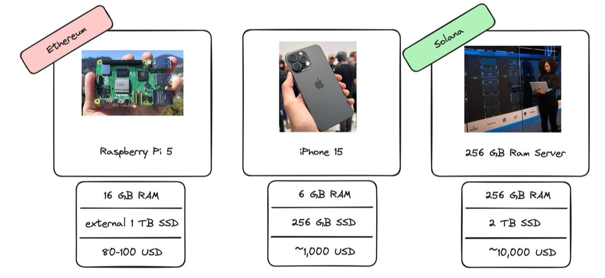
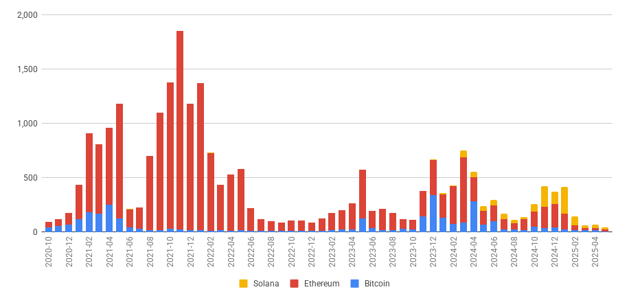

In this section, we’ll look at the recent performance of the three leading blockchain networks and explore what the future might hold.

## What’s Been Happening Lately in Crypto Markets? {#whats-been-happening-lately}

After the boom of 2020–21, crypto markets entered a bear market in 2022, triggered by the dramatic [collapse](https://www.theguardian.com/technology/2024/apr/05/ceo-crypto-crash-fraud-terraform-do-kwan) of the Terra Luna ecosystem, centralized lending platforms, and the FTX exchange. By late 2023, however, signs of recovery emerged, waking markets from their prolonged slumber and kicking off a new, albeit volatile, bull market that continued into 2024 and 2025.

Looking at price movements toward the end of 2023, Ethereum’s coin, ether (ETH), lagged behind both bitcoin (BTC) and Solana’s SOL. This trend continued at times into 2024 and 2025, although market dynamics have been volatile, with periods where Solana also experienced significant corrections.

What explains this trend? Why did bitcoin and SOL surge, while ETH trailed behind?

Crypto markets are still young, and traditional investment metrics like "value creation" are still fuzzy, leaving prices to be easily swayed by powerful stories. So, what narratives did each cryptocurrency offer investors recently?

Bitcoin, the market heavyweight, benefits from simplicity. Its clear narrative as "digital gold," easy for anyone to understand, continues to resonate strongly. Technically complex? Perhaps. But bitcoin’s resilience over its 14-year lifespan—persistently surviving multiple declarations of its death—makes detailed technical understanding less relevant to most.

Beyond its simplicity, bitcoin’s recent surge hinged on three strong expectations:

First, growing skepticism about government monetary policies boosted bitcoin’s appeal as an alternative asset. Investors expect demand to rise if monetary expansion resumes post-COVID.

Second, investors were eagerly awaiting the approval of bitcoin spot ETFs in the US. After a decade of SEC denials, the agency’s court loss to Grayscale in summer 2023 left them no choice. Approval finally [came in January 2024](https://www.sec.gov/newsroom/speeches-statements/gensler-statement-spot-bitcoin-011023). This led to huge, steady inflows, over $14 billion [net](https://cointelegraph.com/news/bitcoin-etf-inflows-top-500-of-2025-average-significant-deviation) by mid-2025, which caused a major [price jump](https://www.investopedia.com/what-to-expect-bitcoin-crypto-markets-second-half-2025-11762236).

Third, [bitcoin’s halving event](https://www.cmegroup.com/articles/2024/bitcoin-halving-2024-this-time-its-different.html) in April 2024 cut miner rewards in half, reducing new supply and easing persistent selling pressure from miners needing to cover expenses[^1]. While long-term miner incentives remain uncertain, recent increases in transaction activity and fees from innovations like Bitcoin Ordinals have partially addressed these concerns. (We’ll discuss these Bitcoin Layer 2 solutions shortly.)

## Solana: The Comeback Kid {#solana-the-comeback-kid}

SOL was 2023’s biggest [surprise](https://www.cryptopolitan.com/solana-emerges-as-top-performer-in-2023/). Even Solana’s most loyal fans didn’t predict its dramatic comeback at the start of the year. A key player during the 2021 bull market, SOL suffered deeply during the bear market, [further impacted](https://www.marketwatch.com/story/sam-bankman-fried-is-going-to-jail-for-25-years-his-victims-are-moving-on-but-it-isnt-always-easy-a6b8acd2) by the collapse of its largest supporter, FTX, and founder Sam Bankman-Fried in late 2022.

At one point, Solana’s very survival was on the line. However, its resilient community rallied strongly, proving the adage "what doesn’t kill you makes you stronger."

Significant technical improvements have greatly reduced past reliability issues (notably, [network outages](https://statusgator.com/blog/solana-outage-history/))[^2], making Solana one of the leaders in the new bullish cycle. Solana’s strength lies primarily in its extremely low transaction fees and rapid processing speeds. This makes it ideal for newcomers learning to trade and experienced speculators alike, creating the vibrant trading environment needed for new token launches.

Airdrops—free token distributions rewarding user engagement—also [play a critical role](https://phantom.com/learn/crypto-101/solana-airdrops). Foundational examples like the [meme coin BONK](https://www.coindesk.com/markets/2023/12/14/sales-of-solana-phone-surge-as-traders-chase-bonk-arbitrage) and the exchange aggregator Jupiter (JUP) significantly boosted the network's growth in late 2023 and early 2024. This trend has continued, with airdrops from protocols like Kamino, Tensor, and Drift remaining a key strategy for attracting users and liquidity to the Solana ecosystem throughout 2024 and 2025.

Whether Solana’s surge is sustainable long-term remains to be seen.

## Ethereum: Caught Between Bitcoin and Solana? {#ethereum-caught-between-bitcoin-and-solana}

Ethereum, the second-largest network, was incredibly popular during the 2020–21 bull run but [lagged behind](https://www.coingecko.com/research/publications/solana-vs-ethereum-2025) BTC and SOL in the recent recovery[^3]. The situation grew so stark that past debates like "Will Ethereum surpass Bitcoin’s total value?" shifted toward questions like "[Will Solana surpass Ethereum?](https://www.nasdaq.com/articles/could-solana-overtake-ethereum-2026)"

But is Ethereum really in trouble? Let’s briefly compare ETH to BTC and SOL:

Ethereum’s narrative struggles compared to BTC’s clear "digital gold" story. Ethereum’s ambitious goal—becoming "a universal computer accessible to all"—is complex, lacking direct appeal to retail investors. Upcoming technical improvements that support this vision don't excite casual investors.

Moreover, Ethereum isn’t as cheap to use as Solana. Ethereum intentionally limits its block space to maintain decentralization, despite strong demand.

<figure><figcaption>Hardware requirements for Ethereum vs. Solana validators. (Source: <a href="https://florindigital.substack.com/p/verifiable-off-chain-compute-enabling">Florin Digital</a>)</figcaption></figure>

Increasing block space could lower transaction costs but would demand more powerful machines, reducing the number of validators and leading to centralization. Centralized systems risk censorship, compromising Ethereum’s fundamental neutrality.

Thus, Ethereum sits awkwardly between Bitcoin’s simple, powerful narrative and Solana’s inexpensive transactions.

Does this mean ether’s future looks bleak?

## Is Ethereum’s Future Really in Jeopardy? {#is-ethereums-future-really-in-jeopardy}

To answer, we need to consider Ethereum’s long-term strategy. Founded in 2013 and launched in 2015, Ethereum has undergone significant strategic changes, slow by crypto standards but fast for an infrastructure network. Its biggest shifts included [abandoning Bitcoin-like energy consumption](https://www.investopedia.com/how-green-is-ethereum-2-0-6666266) (Proof-of-Work) and focusing primarily on infrastructure, shifting user-facing functions to Layer 2 solutions[^4].

This strategic decision emphasized long-term stability over short-term gains, causing temporary growing pains. Currently, Ethereum’s [main priority is providing a secure, neutral foundation for Layer 2 chains](https://www.ccn.com/news/crypto/vitalik-buterin-ethereum-2025-scaling-interoperability/), ensuring users’ funds remain safe across these chains[^5]. Pursuing short-term strategies (like increasing block space) might have reduced costs quickly but would eventually risk centralization.

Users, for now, understandably prioritize cheap fees and quick profits, unconcerned by centralization risks. Yet centralization invites censorship, undermining Ethereum’s goal of a neutral, open network accessible to everyone without discrimination.

That's why Ethereum’s developers focus on lowering costs indirectly through Layer 2 networks. For example, Ethereum’s Dencun upgrade (March 2024) [reduced Layer 2 transaction costs to one-tenth](https://en.cryptonomist.ch/2025/03/13/ethereum-gas-fees-drop-by-95-after-the-dencun-update/), enabling significantly cheaper Layer 2 user transactions.

While Ethereum’s narrative doesn’t excite retail investors—high fees make Ethereum daunting—its secure and stable infrastructure strongly appeals to institutional investors. High fees indicate strong network demand, and the growing adoption of Layer 2 networks further validates its long-term potential. Simply put, Ethereum is becoming a reliable backbone for institutional investors and Layer 2 solutions.

<figure><figcaption>Bitcoin, Ethereum, and Solana monthly transaction fees Monthly transaction fee revenues for the three largest networks (USD millions). (Source: Dune Analytics, @<a href="https://dune.com/queries/3275250/5482283">sankin</a>)</figcaption></figure>

Institutional investors initially gravitated to Bitcoin’s clearer narrative, boosted by ETF approvals. Ethereum ETFs faced SEC resistance but [eventually launched in July 2024](https://www.nasdaq.com/articles/ethereum-etfs-debut-what-you-need-know). Beyond ETFs, Ethereum [offers institutional investors additional appeal](https://www.blockchain-council.org/cryptocurrency/growing-trend-of-institutional-crypto-adoption/) through competitive Layer 2 transaction fees, reliable staking rewards, and innovative features like restaking (generating extra yield from staked ETH).

Comparing the narratives: retail investors prefer networks promising quick rewards (like Solana’s fast transactions and airdrops), while institutions prefer stability, reliability, and steady returns—qualities Ethereum excels at providing.

## Wrapping Up the Big Three {#wrapping-up-the-big-three}

Bitcoin’s position remains uniquely strong, backed by its clear message and proven durability. Its long-term success depends on two factors: growing confidence amid economic uncertainty (a positive) and [ensuring mining remains attractive](https://coingeek.com/miners-in-tight-spot-as-post-halving-takes-dent-on-revenue/) despite halving-induced reward reductions (a lingering concern)[^6].

Solana aims to keep its [momentum](https://www.coininsider.com/cryptocurrency/altcoins/solana/) going with token incentives and smart technical upgrades, especially in DeFi and gaming.

Ethereum’s short-term ETF-driven optimism emerged in mid-2024 following [a surprise regulatory approval](https://www.reuters.com/technology/us-sec-approves-exchange-applications-list-spot-ether-etfs-2024-05-23/). Longer-term success depends on effectively [delivering inexpensive yet secure environments](https://vitalik.eth.limo/general/2025/01/23/l1l2future.html) through Layer 2 solutions and steadily attracting institutional interest.

[^1]: Notably, well-funded US miners (like Marathon and Riot) typically avoid selling mined bitcoins immediately. Riot started selling BTC reserves during the first quarter of 2025.

[^2]: While a major outage occurred in February 2024, the network has demonstrated long stretches of stability since, and ongoing upgrades like the 'Firedancer' validator client aim to make such events a thing of the past.

[^3]: Although by mid-July growing institutional demand seems like having a positive effect on ETH's price.

[^4]: Ethereum and Solana differ here: Ethereum decentralizes blockchain components among various entities, while Solana manages core functions internally.

[^5]: Ethereum aims for "credible neutrality"—treating all participants equally without bias.

[^6]: Critics argue Bitcoin’s expansion into Layer 2 and DeFi strays from its original "digital gold" vision.
