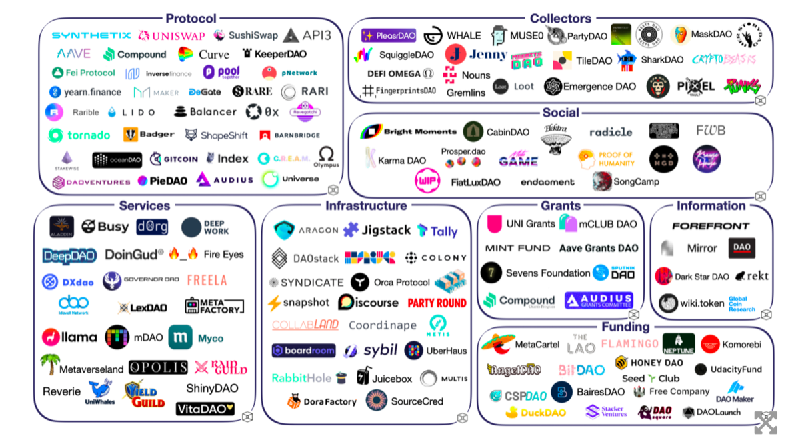

If you want to understand what makes Web3 different, start with the community. It’s the single most significant departure from the startup world we once knew.

The classic playbook for building a company was simple and secretive. A small team of entrepreneurs and their investors would build a product behind closed doors. These two groups—the founders and the venture capitalists—were the only ones with a real stake. If the startup succeeded, the payoff came through an IPO or an acquisition, and the rewards were split between them. It was a private club.

Web3 tears up that playbook.

The closed-door company has been replaced by the open, dynamic ecosystem. The core idea is no longer about building a product *for* a market, but about cultivating an economy *with* a community. The circle of stakeholders has expanded dramatically. It’s not just about the founding team and their investors anymore. Now, the **users** who bring the network to life, the **developers** who build on top of it, and the **miners** or **validators** who secure its infrastructure are all considered vital contributors.

This is why community is everything in Web3. A project’s strength isn’t measured by its headcount but by the vibrancy of its ecosystem. While this creates an incredible engine for growth, it also presents a profound new challenge: how do you coordinate a global, loosely connected group of people toward a common goal? You use a DAO.

## DAOs: The Native Corporation of the Internet {#daos-the-native-corporation-of-the-internet}

### What is a DAO? {#what-is-a-dao}

A **[Decentralized Autonomous Organization](https://www.investopedia.com/tech/what-dao/)** is what it sounds like: a community with a shared mission and a bank account, governed by rules encoded on the blockchain. Think of it less like a traditional company and more like a collective of people from all over the world, working together as peers. The "laws" of this organization—how to vote, how to spend funds, how to reward contributions—are written into transparent, unstoppable smart contracts. It’s an [organization](https://ethereum.org/en/dao/) with no CEO, no boardroom, and no single point of failure.

### A Project’s Journey to Decentralization {#the-journey-to-decentralization}

A project doesn't typically start as a DAO on day one. There's a [natural evolution from a centralized team to a decentralized community](https://a16zcrypto.com/posts/tags/progressive-decentralization/). Why?

In the beginning, a startup needs to move fast. A small, focused core team can make quick decisions, pivot based on feedback, and navigate the chaotic early days with agility. They are the initial spark.

But if the project finds traction and begins to flourish, something magical happens. The circle of contributors naturally expands. External developers start building new tools and features. Users become evangelists, shaping the culture and driving adoption. The project takes on a life of its own, growing beyond the capacity of its initial creators.

This is the point where the need for a new structure becomes critical. The core team needs resources to keep the lights on, and outside talent needs to be compensated for their work. This is when investors might enter the picture, not just to fund a company, but to support an emerging ecosystem.

This is the moment of transition. To truly scale and become a public good, the project must be handed over from the founding team to the community itself. It's a process often called "progressive decentralization," and the DAO is the vehicle for that journey.

### The Contributor's Stake {#the-contributors-stake}

This global, distributed effort isn’t fueled by altruism alone. The thousands of contributors who dedicate their time and talent to a project do so because their incentives are directly aligned with its success. They aren't just working *for* the project; they are working to increase the value of their stake *in* the project.

The mechanism that makes this possible is the **token**. By creating and distributing a native token, a project can reward every contributor—from the earliest investors and developers to the most active community members—with a piece of the network they are helping to build.

### So, What Is a Token Actually Worth? {#so-what-is-a-token-actually-worth}

A token’s value comes from the rights and privileges it grants its holder. It’s a key that unlocks a new kind of ownership.

First and foremost, a token is a voice. In a DAO, tokens grant **[governance rights](https://btcpeers.com/evaluating-governance-token-distribution-and-voting-rights-within-a-dao/)**. Holding a project's token means you get a say in its strategic direction.

Proposals for new features, changes to the protocol, or how to spend the community treasury are put to a vote, and token holders cast their ballots based on the number of tokens they hold[^1]. It’s the digital equivalent of shareholder voting, but for a decentralized network.

Naturally, contributors also expect to share in the economic upside they help create. However, this is where things get nuanced. While tokens have value and can appreciate as the network grows, most projects avoid distributing direct revenue or profits to token holders. Doing so [would risk the token being classified as a "security" under U.S. law](https://www.startsmartcounsel.com/resource-center/understanding-when-tokens-are-not-securities-a-legal-guide-to-utility-tokens), which invites significant legal and regulatory complexity[^2].

Instead, value is delivered in other ways. Token holders are often granted [special privileges](https://coinmarketcap.com/academy/glossary/utility-token), like priority access to new features, discounted fees when using the product, or exclusive opportunities in collaborations with other projects. It's a way to reward the community and deepen their engagement in the ecosystem without crossing regulatory lines.

### The Inevitable Path to Decentralization for Web3 Projects {#the-inevitable-path-to-decentralization}

A project can have a token, a public blockchain, and a passionate user base, but if all the critical decisions are made by a small, centralized team, it has failed to deliver on the core promise of Web3. Decentralization isn’t a technical feature; it’s the diffusion of power.

This isn't just a philosophical stance; it's a principle with massive real-world consequences. A project that remains centrally controlled cannot truly be called decentralized.

This view aligns with influential guidance from key figures at the U.S. Securities and Exchange Commission (SEC). In public statements, the SEC has explored when a digital asset might no longer be considered a security, and the conclusion often hinges on the degree of decentralization.

The critical test is whether the network can thrive without its original creators. As the SEC has noted, for a network to be considered sufficiently decentralized, its value cannot depend on the "essential management or entrepreneurial effort" of a single group.

"But this also points the way to when a digital asset transaction may no longer represent a security offering. If the network on which the token or coin is to function is sufficiently decentralized – where purchasers would no longer reasonably expect a person or group to carry out essential managerial or entrepreneurial efforts – the assets may not represent an investment contract. Moreover, when the efforts of the third party are no longer a key factor for determining the enterprise’s success, material information asymmetries recede. As a network becomes truly decentralized, the ability to identify an issuer or promoter to make the requisite disclosures becomes difficult, and less meaningful."[^3]

This is the heart of the matter. As long as a small team holds all the keys, they have privileged information and control, just like a traditional corporate management team. The goal is to eliminate that information asymmetry.

This is precisely the role a DAO is designed to fill. It serves as the vehicle for a project’s journey away from its founding team and toward genuine decentralization. A thriving DAO is the ultimate proof that a network is no longer a private venture but a public good, governed and sustained by its community.

### The Decentralization Playbook {#the-decentralization-playbook}

How does a Web3 project evolve from a private company into a public good? A common [playbook](https://api.a16zcrypto.com/wp-content/uploads/2022/06/dao-legal-framework-part-1.pdf) has emerged. A project often begins with a core team incorporating into a “Labs” company to raise funds and build the initial technology. When the time comes to decentralize, a critical shift occurs: an independent **Foundation** is created in a neutral, crypto-friendly jurisdiction like the [Cayman Islands](https://cavenwellgroup.com/media/Cayman-Foundations-for-Token-Issuance&Web3.pdf), Switzerland, or the British Virgin Islands (BVI). This separate legal entity, managed by independent directors, handles the token issuance[^4]. This deliberate separation of the for-profit builder from the non-profit steward is the key maneuver that allows a project to shed its centralized origins and become a credibly neutral protocol owned by its community.

## The Many Flavors of DAOs {#the-many-flavors-of-daos}

The world of Decentralized Autonomous Organizations (DAOs) is a fluid and rapidly evolving landscape, making any attempt at a strict classification a challenge. However, you can identify several distinct "flavors" of DAOs, each organized around a specific purpose. This 2021 chart, while from a few years ago, still provides a valuable snapshot of the landscape.

<figure><figcaption>DAO Ecosystem (2021)</figcaption></figure>

*The players that make up the DAO ecosystem. (Source: 'TheBlock, Mapping out the DAO Ecosystem' report)*

Different types of DAOs range from Protocol DAOs like Uniswap and MakerDAO, which act as community stewards for essential Web3 infrastructure, to Collector DAOs that are like group investment funds for acquiring NFTs and other digital artifacts. Social DAOs operate like next-generation private clubs, prioritizing community and shared interests, while Service DAOs act as decentralized talent agencies, connecting skilled professionals with projects in need.

Beyond these, other crucial types make the backbone of the ecosystem. Infrastructure DAOs build the essential "picks and shovels"—the voting, treasury, and operational tools that all other DAOs rely on. Grant DAOs serve as decentralized funding bodies, distributing capital to encourage growth within their specific ecosystems. Information DAOs act as the media and knowledge-management arms of Web3, running community-owned wikis and news outlets to keep everyone informed. Finally, Funding DAOs are challenging the traditional venture capital model by allowing members to pool capital, source deals, and co-invest in promising early-stage projects, democratizing access to startup investing.

## DAOs: Nice in theory not so in reality… {#nice-in-theory-not-so-in-reality}

While in theory, DAOs give online communities the tools to govern themselves, make collective decisions, and share in the value they create together, the reality is a bit different.

The truth is, we're in the messy, early days of DAOs. Many are struggling with fundamental problems, like convincing members to actually show up and vote. Voter apathy isn't just a problem for nation-states; it's a critical bug in decentralized systems too. On top of that, DAOs operate in a legal gray zone, leaving them exposed and uncertain of their standing in the traditional world.

[Despite these growing pains, they represent a radical experiment in human coordination](https://coinlaw.io/decentralized-autonomous-organizations-statistics/). They are a direct challenge to the idea of the top-down, hierarchical firm that has dominated for centuries. What does it look like when a global community, bound by shared goals instead of a shared office, truly takes control? We’re about to find out.

## How Do You Gauge the Health of a Network? {#how-do-you-gauge-the-health-of-a-network}

How can you tell if a community is thriving or just faking it? It’s a crucial question, and while there’s no simple formula, you can learn a lot by knowing where to look and what to look for. Think of it as vetting a project's most valuable, and often least understood, asset.

Your investigation starts at the project's website—the digital front door. From there, you'll find pathways into the community's core gathering places.

The first stop is almost always **Discord.** For the uninitiated, Discord can feel like stepping into a chaotic, sprawling city. It's the Web3 equivalent of the corporate Slack, but messier and more alive. This is the project's town square. Pay attention to the quality of the conversation. Is it full of meaningful questions and support, or just noise and price speculation? How does the core team interact with members? The signal is in the quality of the conversation, not just the raw number of members—a metric that can be easily inflated.

For more thoughtful, long-form discussions, turn to the project's official forums or Reddit sub-channels. These are the community's public archives. Here, you can get a feel for the mood over time and find deeper critiques and more detailed proposals. Comparing the engagement here to that of competitors can offer a rough sense of scale and passion.

A project's X (formerly Twitter) presence also provides clues, revealing how it communicates its vision and engages with the broader Web3 conversation.

But a truly vibrant community is more than just users and speculators; it’s an ecosystem. The most powerful, and often most overlooked, indicator of a network's long-term health is its **developer community**. Are builders actively creating new tools and applications on the protocol? A project that invests in its developers—by providing excellent documentation, tools, and resources—is building a platform, not just a product.

Mature projects make this support official through grant programs, allocating a significant portion of their tokens to fund new development. These grants are designed to kickstart a flywheel of innovation, where outside developers build spin-offs and integrations that make the entire ecosystem more valuable. Ultimately, a project’s success hinges on its ability to convince the smartest builders to bet their time and energy on its future. That’s the most potent social proof there is.

## Conclusion {#conclusion}

In Web3, the community isn't just a part of the strategy; it *is* the strategy. A project with brilliant code but no active community is like a city with no people—an empty shell. The true product isn't just the software, but the living, breathing economy of users, developers, and backers who give it life.

For founders, this means time spent encouraging discussion and incorporating feedback is as vital as time spent writing code. For investors, the calculus has changed. The most telling sign of a project's future success isn't just the elegance of its tech, but the vibrancy of its community. A strong community is the ultimate competitive moat, and the most reliable leading indicator of growth.

[^1]: While one vote per token is the common practice the space is actively experimenting with alternative models to address the shortcomings of this, such as plutocracy (where wealthy token holders have excessive influence) and voter apathy. Alternatives like quadratic voting, conviction voting, and reputation-based or identity-based voting systems are being explored and implemented by various DAOs to create more equitable governance.

[^2]: Token revenue distribution is typically used to avoid being classified as securities under U.S. law. Under current US law, categorizing a token as a stock requires regular reporting to the SEC by issuing teams and compliance with many procedures. Some argue that Web3 tokens should be treated differently from stocks and advocate a new legal framework. The Biden administration (2020–24), particularly SEC Chairman Gary Gensler, maintained that existing securities laws suffice for token management. The Republicans which controlled the House and the Senate in 2025 are in the process of bringing new regulatory framework for digital assets.

[^3]: U.S. SEC guidance emphasizing decentralization in token evaluation. Excerpt from a [2018 speech by William Hinman](https://www.sec.gov/newsroom/speeches-statements/speech-hinman-061418), former Director of Corporate Finance at the SEC: "If the network on which the token or coin functions is sufficiently decentralized—where purchasers no longer reasonably expect a person or group to manage essential efforts—the assets may not represent an investment contract."

[^4]: Common practice of using independent offshore foundations for token management. For additional insights, see this detailed [X post](https://x.com/wassielawyer/status/1850551931393151123).
