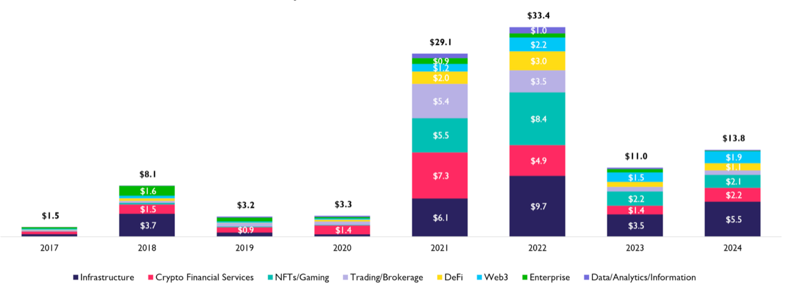

Just as the founders have changed, so have the investors who back them. The old rules of venture capital no longer apply in a world where power is shifting away from the boardroom and into the hands of the community.

### A Weaker Hand at the Table {#a-weaker-hand-at-the-table}

In the Web 2.0 era, the relationship was simple: the founder needed the venture capitalist (VC). The dynamic was a familiar dance. Founders would go door-to-door, pitching their ideas and business plans to VCs. The investor's job was to provide capital and connections to guide the company toward a lucrative exit, like an IPO or acquisition, where they would cash in their shares. In this world, the founder and the investor were the only two players that truly mattered.

In Web3, the table is much more crowded, and the VC's hand is weaker.

Founders are not the only other players at the table. The value created by a project is now shared among a much wider group. You’ve got external developers contributing code, ecosystem partners building on the platform, and, most importantly, the users themselves. All of them have a stake in the project's success and expect a piece of the pie.

With more players claiming a share, the VC's slice inevitably gets smaller. In the old world, investors bought equity through shares or a SAFE (Simple Agreement for Future Equity). In Web3, tokens replace shares, and they are distributed to a broader base of stakeholders. Investors [now often use a SAFT](https://www.coindesk.com/markets/2017/10/02/saft-arrives-simple-investor-agreement-aims-to-remove-ico-complexities) (Simple Agreement for Future Token), a contract that reflects this new reality: they are just one part of a larger community, not the sole kingmaker.

### ...But the Pendulum Swings Back {#but-the-pendulum-swings-back}

The balance of power didn't shift overnight. Before 2020, VCs had an even tougher time. Founders could bypass them entirely by raising funds directly from the public through Initial Coin Offerings (ICOs). But the ICO boom was short-lived. Fueled by hype, countless individual investors poured money into projects that turned out to be hollow, leading to massive losses and a collapse in market trust.

This crash forced a flight to quality. After 2020, the most promising startups shifted their strategy from simply selling tokens to a more thoughtful distribution. To get their projects off the ground, they turned to experienced venture capitalists who could provide more than just capital—they could offer guidance and serious vetting.

Now, the power dynamic between founders and investors ebbs and flows with the market. During the 2020-21 bull market, founders held all the cards. They could send a simple spreadsheet to VCs with a veiled threat: "You have until next week to invest, or you're out." The fear of missing out was so intense that it worked. When the market turned, however, those same founders found their messages went unanswered.

<figure><figcaption>Blockchain Venture Funding 2017-2024 Distribution of annual blockchain investments by area. (Source: TheBlockPro Research,<a href="https://www.theblock.pro/research/2024-blockchain-venture-funding-recap-334524">The Block Pro Research - 2024 Blockchain Venture Funding Recap</a>)</figcaption></figure>

The Block Pro

The trend is clear: the days of completely ignoring investors are over. Venture capital is becoming a core part of the Web3 ecosystem. The big funds are no longer just placing bets; they've become seasoned players in this world. They are more selective, and more importantly, they are building powerful ecosystems by creating synergies between the various projects in their portfolios. They aren't just investors anymore; they are becoming network architects.

## Investors Are Becoming Specialists {#investors-are-becoming-specialists}

As venture capital becomes more embedded in Web3, the firms themselves are evolving. The top VCs are no longer just financiers. They have also dedicated research teams, significantly strengthening their technical expertise. Leveraging this expertise, many firms now specialize in certain Web3 niches.

For instance, a16z, one of the largest investors, invests heavily in zero-knowledge (zk) research and actively backs projects focused on this technology. Paradigm, another major fund, has learned a lot from its experiments with tokenization and game theory, which it uses to help design the tokens for its portfolio companies—though opinions vary on how well this has worked.
