To understand where Web3 is going, you have to follow the developers. They are the architects of this new world, and their movements are the most reliable leading indicator of future growth and value. Where talent flows, innovation follows.

Fortunately, the open-source nature of Web3 gives us a clear view of this migration. The most comprehensive analysis comes from the annual Developer Report by Electric Capital, which [offers a detailed summary](https://www.developerreport.com/developer-report) of the entire landscape.

Here are the key takeaways from the 2024 report:

## 2024 Developer Report Highlights {#b-2024-developer-report-highlights}

The report’s findings paint a clear picture: while surface-level numbers may fluctuate with market cycles, the foundation of the Web3 ecosystem is stronger than ever.

Here’s the story the data tells:

- **A Healthy Shakeout.** Since Ethereum’s launch in 2015, the number of developers has grown an explosive 39% on average each year. While 2024 saw a 7% dip, this isn't a sign of decay. It’s a consolidation. The "tourists" who arrived during the hype cycle have left, while the true builders remain.
- **The Veterans Are Doubling Down.** The number of "seasoned developers"—those who have been building in the space for more than two years—is at an all-time high, growing by 27% in 2024 alone. This dedicated core now ships 70% of all code. They are the ones laying the bedrock for the future.
- **Talent is Decentralizing.** The center of gravity is shifting. In 2024, Asia surpassed North America as the region with the most developers. The US, which accounted for 38% of developers in 2015, now represents just 19%. This is a global movement, no longer confined to Silicon Valley.
- **The Rise of the Multi-Chain Developer.** The days of pledging allegiance to a single network are fading. Nine years ago, fewer than 10% of developers worked on multiple chains. Today, one in three are active across different networks. They are becoming chain-agnostic, choosing the right tool for the job and paving the way for an interoperable future.
- **Scaling is the Name of the Game.** While Ethereum remains the undisputed king of developer mindshare, the real story is the relentless focus on scaling. Solana is seeing the fastest growth among alternative networks. Meanwhile, 42% of Bitcoin developers are focused on scaling solutions, and a remarkable amount of new work in the Ethereum ecosystem is happening on Layer 2 networks. Base now accounts for 42% of new code commits within the Ethereum ecosystem."

## Developer Report Key Takeaways: What to Watch {#key-takeaways-what-to-watch}

### The Signal in the Noise {#the-signal-in-the-noise}

At first glance, the trend line for Web3 developers might seem worrying. While the number of active developers has grown by an average of 39% every year since 2015, the chart shows a recent dip in 2023 and 2024. Are the alarm bells ringing for crypto?

Not if you look closer.

<figure><a href="/assets/books/web3-unlocked/304-1.png">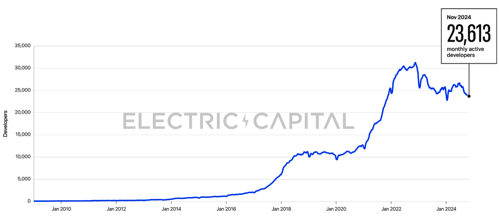</a><figcaption>Developer Development Trend in Web3 Growth of crypto developers over the years. The average annual growth rate is 39%. (Source: Electric <a href="https://www.developerreport.com/developer-report">Capital Developer Report 2024 Page 9)</a></figcaption></figure>

The recent decline is simply the echo of an unsustainable boom. The bull market of 2020 and 2021 was a gold rush. Startups, flush with venture capital, were locked in a frantic race to hire talent and ship products. This frenzy lured a wave of developers from outside Web3, many drawn more by the sky-high salaries than a belief in the mission.

When the market turned in the second half of 2022, driven home by the collapses of Terra, 3AC, and FTX, the flow of easy money stopped dead. The party was over.

Projects had to tighten their belts to survive the crypto winter, leading to a sharp reduction in developer headcount in 2023.

The further 7% decrease in 2024 is best understood as the market finding its stable footing. As the report notes, fluctuations of this size are common and not statistically significant. This isn't a sign of decay; it's the natural consolidation that follows a hype cycle, leaving behind a more resilient and committed base of builders.

### Seasoned Developers Lead the Charge {#seasoned-developers-lead-the-charge}

This is the most important part of the story. While the overall developer count has dipped, the number of truly committed builders is growing. The data shows that the ranks of experienced developers—those with more than two years in the trenches—grew by a remarkable 27% through 2023 and 2024.

<figure><a href="/assets/books/web3-unlocked/304-2.png">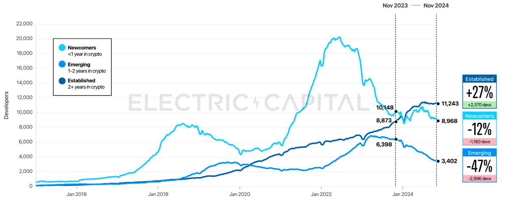</a><figcaption>Monthly Active Developers by Experience Growth in monthly active developers segmented by experience. (Source: <a href="https://www.developerreport.com/developer-report">Electric Capital Developer Report 2024, Page 12</a>)</figcaption></figure>

These aren't fair-weather builders. They are the veterans who have weathered multiple market cycles and remain dedicated to the long-term vision. Their growing numbers signal a powerful consolidation of talent and a maturing ecosystem.

Their impact is even more profound than their numbers suggest. This core group of experienced developers writes 70% of all the code in Web3.

<figure><a href="/assets/books/web3-unlocked/304-3.png">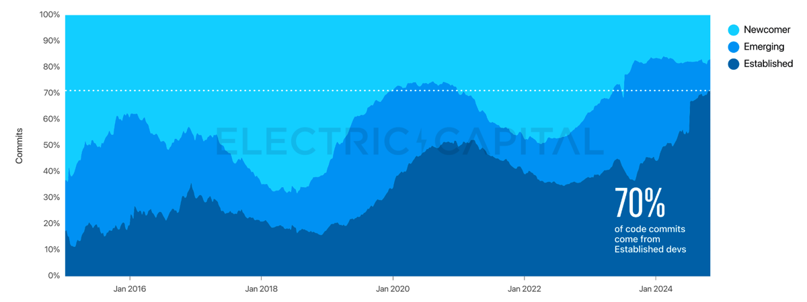</a><figcaption>Developer Contributions by Experience Level Developer contributions segmented by experience. (Source: <a href="https://www.developerreport.com/developer-report">Electric Capital Developer Report 2024, Page 13</a>)</figcaption></figure>

While headlines may focus on fluctuating market caps, the real work is being done by a dedicated and growing cohort of experts who are quietly building the future of the internet. The foundation isn't cracking; it's solidifying.

### Network Popularity Among Developers - Where is the Talent Flowing? {#network-popularity-among-developers-where-is-the-talent-flowing}

Every year, the most revealing part of the report is the breakdown of where developers are choosing to build. In a down market, this data is even more crucial—it shows which ecosystems have real momentum.

<figure><a href="/assets/books/web3-unlocked/304-4.png">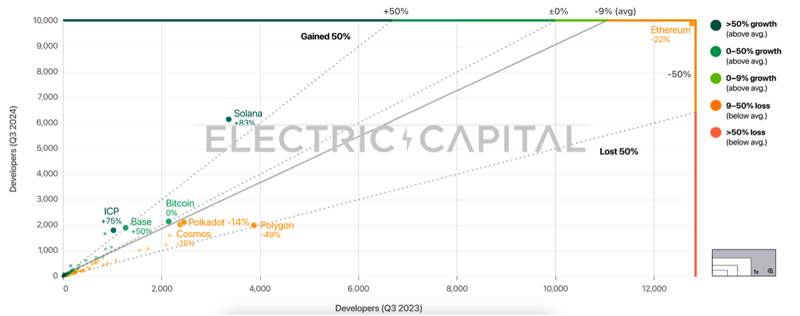</a><figcaption>Top Networks by Developer Count (2023-24) Developer count changes from Q3 2023 to Q3 2024 for networks with 2,000+ developers. (Source: <a href="https://www.developerreport.com/developer-report">Electric Capital Developer Report 2024, Page 104</a>)</figcaption></figure>

The chart above maps the change in developer counts for major networks from late 2023 to late 2024. Any network to the left of the far-left dashed line grew its developer base. Anything to the right shrank.

With the entire industry seeing a 9% contraction, true performance is relative. The networks that beat this average are the ones to watch.

- **The Outliers:** Solana, ICP, and Base are the clear winners, posting stunning growth of 83%, 75%, and 50%, respectively. In a year where talent was scarce, they didn't just retain developers—they aggressively attracted them. Bitcoin also showed resilience, holding its developer count steady.
- **The Incumbents:** In contrast, established players like Polygon (-49%), Ethereum (-22%), Cosmos (-15%), and Polkadot (-14%) all saw their developer numbers shrink by more than the industry average.

Despite the dip, Ethereum still commands the largest army of developers by a massive margin. Its lead is so significant that it's hard to imagine any other network catching up in the near future.

Why does Ethereum have such a powerful gravitational pull? A huge part of the answer lies in its vast, established ecosystem. But the killer feature is the Ethereum Virtual Machine (EVM). The EVM is the software environment where Ethereum applications run, and it has become the *de facto* standard for smart contracts. New blockchains adopt the EVM to make it easy for Ethereum's massive developer base to build on their networks. This creates an incredible network effect, cementing the EVM as the industry's core programming environment.

## Developers Embrace Multi-Network Development {#developers-embrace-multi-network-development}

The dominance of the EVM standard is creating a new type of builder: the chain-agnostic developer. The old model of dedicating oneself to a single network is fading. Today, 36% of all developers are active on multiple blockchains.

<figure><a href="/assets/books/web3-unlocked/304-5.png">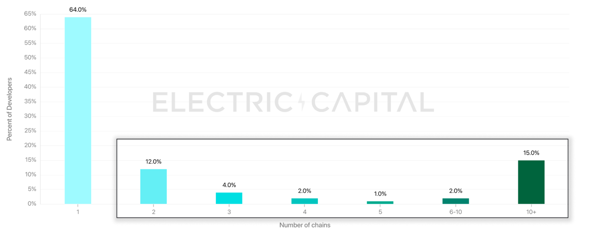</a><figcaption>Number of Networks Supported by Developers How many networks developers typically contribute to. (Source: <a href="https://www.developerreport.com/developer-report">Electric Capital Developer Report 2024, Page 48</a>)</figcaption></figure>

This trend is a direct result of the EVM's success. It provides a common language that allows developers to seamlessly deploy their applications across a wide range of compatible networks. This creates a fluid, interoperable ecosystem where builders can follow opportunities without having to learn a new technical language. Unsurprisingly, among developers who work on multiple smart contract platforms, 74% are building on at least one EVM-compatible chain.

<figure><a href="/assets/books/web3-unlocked/304-6.png">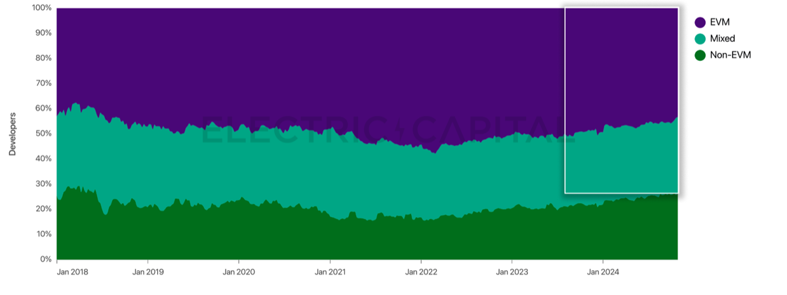</a><figcaption>Multi-Chain Developers: EVM vs. Non-EVM Percentage of developers working across multiple networks by EVM compatibility. (Source: <a href="https://www.developerreport.com/developer-report">Electric Capital Developer Report 2024, Page 57</a>)</figcaption></figure>

## How Do Smaller Networks Stack Up? {#how-do-smaller-networks-stack-up}

Beyond the established giants, a different story is unfolding. A look at the smaller and mid-sized networks reveals where the next wave of explosive growth might come from.

<figure><a href="/assets/books/web3-unlocked/304-7.png">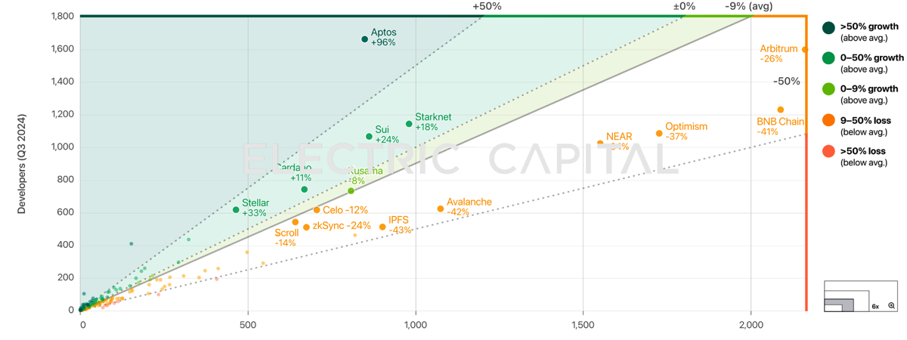</a><figcaption>Developer Growth: Mid-Sized Networks (500–2,000 Developers) Developer growth from Q3 2023 to Q3 2024 for mid-sized networks (500–2,000 developers). (Source: <a href="https://www.developerreport.com/developer-report">Electric Capital Developer Report 2024, Page 106</a>)</figcaption></figure>

While the overall market consolidated, these emerging platforms saw fierce competition for talent. Here’s what stands out:

- The Move programming language is having a moment. Aptos and Sui, two networks built on Move, are shining brightly. Aptos leads all networks with a staggering 95% growth in its developer base, while Sui is close behind with a 24% increase.
- Other notable winners include the payments network Stellar (+33%), the scaling solution Starknet (+18%), and the established smart contract platform Cardano (+11%).

Finally, let's take a closer look at even smaller, nascent ecosystems.

<figure><a href="/assets/books/web3-unlocked/304-8.png">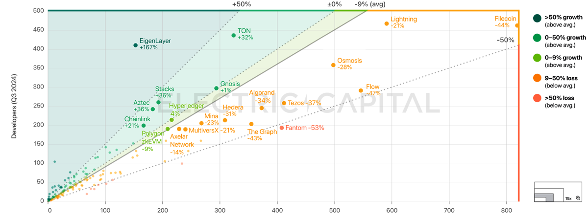</a><figcaption>Developer Growth: Smaller Networks (200–500 Developers) Developer growth from Q3 2023 to Q3 2024 for smaller networks (200–500 developers). (Source: <a href="https://www.developerreport.com/developer-report">Electric Capital Developer Report 2024, Page 107</a>)</figcaption></figure>

## Developer Activity in Decentralized Finance {#developer-activity-in-decentralized-finance}

When it comes to decentralized finance (DeFi), the most valuable and competitive sector in Web3, all roads still lead to Ethereum. More than half of all developers building the future of finance are doing so on the Ethereum network.

<figure><a href="/assets/books/web3-unlocked/304-9.png">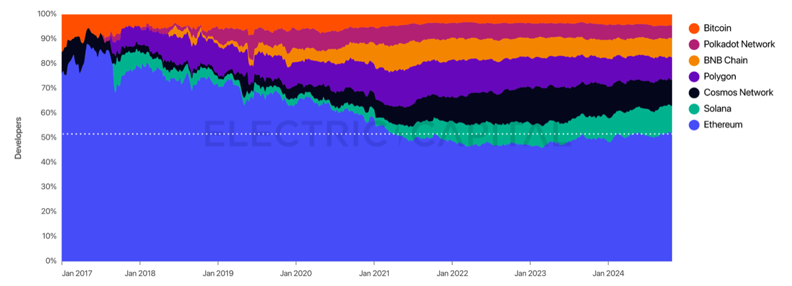</a><figcaption>Developer Distribution in DeFi Networks with the highest concentration of DeFi developers. 53% of developers work on Ethereum and Ethereum L2s. (Source: <a href="https://www.developerreport.com/developer-report">Electric Capital Developer Report 2024, Page 147</a>)</figcaption></figure>

### Web3 is a Global Movement {#web3-is-a-global-movement}

Finally, where are these developers located? While the United States still leads as the single largest country for Web3 talent, that fact masks the most important trend: this is a truly global phenomenon.

Today, a massive 81% of all Web3 developers are located *outside* the US.

<figure><a href="/assets/books/web3-unlocked/304-10.png">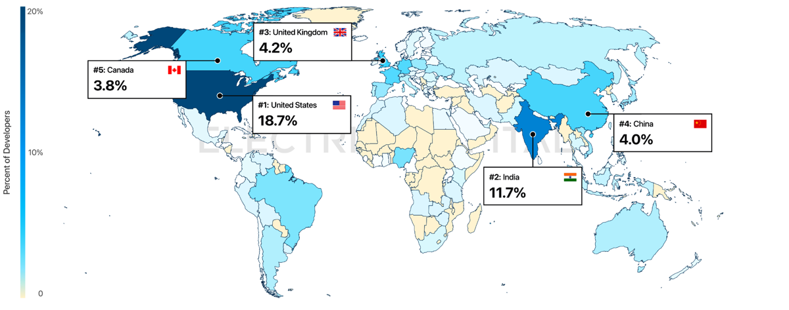</a><figcaption>Global Distribution of Web3 Developers Developer distribution by country. (Source: <a href="https://www.developerreport.com/developer-report">Electric Capital Developer Report 2024, Page 29</a>)</figcaption></figure>

The geographic center of gravity has been shifting for years. A look at the regional trends shows a clear and powerful surge from Asia, with India leading the charge. The US's once-dominant share of the developer landscape has been shrinking as talent and innovation flourish worldwide.

<figure><a href="/assets/books/web3-unlocked/304-11.png">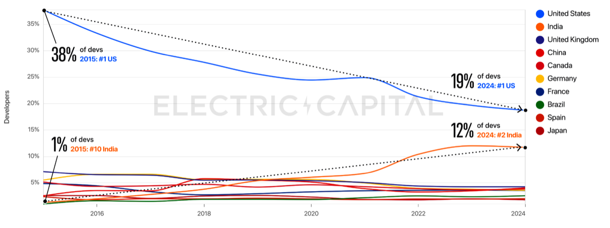</a><figcaption>Top 10 Developer Countries: Changing Shares Over Time Evolution of developer share by region over time. (Source: <a href="https://www.developerreport.com/developer-report">Electric Capital Developer Report 2024, Page 30</a>)</figcaption></figure>

—

Developers are the lifeblood of the crypto ecosystem. Their movements are the most powerful leading indicator of where the future is headed. While the recent crypto winter certainly shook the market, the underlying signals are quite bullish.

The transient builders have moved on, but the core of experienced, dedicated developers is larger and more productive than ever. Talent is no longer concentrated in one country but is spread across the globe, with new hubs of innovation constantly emerging. This isn't a sign of an industry in decline. It's the mark of a maturing, global movement that is quietly building the foundations for the next era of the internet.
