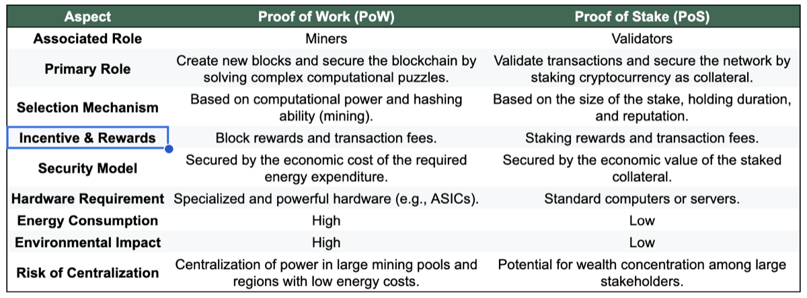

Web3 introduces a new class of participants that simply didn’t exist in Web 2.0: miners and validators. They are the guardians of the network, the decentralized workforce that keeps the entire ecosystem running.

## Why Do Miners and Validators Exist? {#why-do-they-exist}

Web3 projects aren't companies; they're open ecosystems built on blockchain infrastructure. This digital world is like the Wild West—a permissionless frontier where anyone, including malicious actors, can enter and interact with the system.

In the old world, a company would protect itself by building digital walls and investing heavily in centralized security. Web3 networks take a different approach. By running their software on thousands of independent machines, they eliminate the single point of failure that attackers could target.

But decentralization alone isn't enough. How do you ensure the transactions being added to the network are legitimate and can never be changed? The core promise of blockchain is that you don't have to trust anyone. While open-source code allows anyone to audit the system's rules, that only verifies the design. It doesn't guarantee the execution.

You still need to be sure that the machines running the code are doing so correctly. This boils down to two critical functions:

First, you need to ensure the machines keep the system online and processing transactions. Second, you need to guarantee that these machines are acting honestly and independently, faithfully recording history without being manipulated. This is the role of miners and validators.

## How Miners and Validators Secure Networks {#how-miners-and-validators-secure-networks}

The machines that run the infrastructure of a blockchain are called miners on the Bitcoin network[^1] and validators on most others. For over sixteen years, these participants have kept their networks running like clockwork, all thanks to the ingenious incentive mechanism invented by Bitcoin’s founder, Satoshi Nakamoto.

### The Bitcoin Miners {#the-bitcoin-miners}

Bitcoin mining has evolved from a hobbyist activity into a massive, capital-intensive industry. After years of Chinese dominance, the sector’s center of gravity has shifted to the United States, where publicly traded mining giants now reinvest their financing into deploying ever-more powerful equipment[^2].

Miners have two sources of income:

1. **Block Rewards:** Newly created bitcoin they earn for successfully adding a new block of transactions to the chain, which happens roughly every ten minutes.
2. **Transaction Fees:** Fees that users pay to have their transactions included in a block.

Historically, block rewards have made up the vast majority of their revenue. But this model has a built-in challenge: with [around 95% of all bitcoin already mined](https://bitbo.io/how-many-bitcoin/) and the block reward programmed to decrease by half every four years, the network's security budget is shrinking. How will miners be compensated for securing the network in the future?

The answer must come from transaction fees. For the system to remain secure, activity on Bitcoin has to increase dramatically. This is the driving force behind the recent explosion of innovation on the network. Protocols like Ordinals (active since 2023), the BRC-20 token standard, and the new Runes protocol (launched in 2024), along with the development of Layer 2 networks, are all attempts to create new use cases for Bitcoin. The goal is to generate enough transaction activity to secure the network for decades to come (this is covered in more detail in the 'Case Study: Second Level Solutions on Bitcoin' at the end of the second part).

### Ethereum's Validators {#ethereums-validators}

Ethereum originally followed Bitcoin's mining model but later made a crucial switch. Citing the huge energy consumption of mining, [the network transitioned to a different system](https://arstechnica.com/tech-policy/2022/09/ethereum-completes-the-merge-which-ends-mining-and-cuts-energy-use-by-99-95/), replacing miners with validators. This new model, which we discussed in the second chapter, is now the standard for most modern blockchains.

Whether they are called miners or validators, these participants receive a reward for their service: new tokens created by the network itself. This issuance increases the total supply of the token, creating a predictable and transparent form of inflation. This inflation isn't an accident; it's the security budget that pays for the network's defense.

<figure><figcaption>Comparing Miners and Validators</figcaption></figure>

## Do Layer 2 Solutions Require Validators? {#do-layer-2-solutions-require-validators}

Miners and validators are the bedrock of a decentralized network. In mid-2025, one of the most pressing questions for the Web3 space is how Layer 2 networks, particularly those built on Ethereum, will achieve true decentralization and what role their native tokens will play in that journey.

As these Layer 2 networks mature, many have launched their own tokens, initially distributing them to users and ecosystem participants. The primary function of these tokens is governance, allowing holders to vote on the future direction of the network. But is that a strong enough value proposition to sustain a token's value in the long run? The consensus is no, and the race is on to embed these tokens with deeper utility.

The core challenge lies in a Layer 2's relationship with Ethereum. So-called "roll-up" solutions[^3] are designed to inherit their security directly from Ethereum's battle-tested validators. In return for this security blanket, they must pay for services in ETH, the native currency of Ethereum[^4]. This creates a dilemma. Ethereum won't accept a Layer 2's native token as payment, so these networks must constantly balance the need for ETH with the desire to make their own token essential. Some networks navigate this by charging users transaction fees in their own token, then converting them to ETH on the back end to pay Ethereum. It’s a clunky but tolerable workaround in the quest to build value for their token.

A far more significant value proposition lies in decentralizing the "sequencer." Right now, most Layer 2 networks use a centralized party to order transactions before they are sent to Ethereum. This is a critical and highly profitable role, as the sequencer can capture what's known as MEV (Maximal Extractable Value)—revenue generated by arranging transactions in a specific order. Controlling the sequencer is like controlling the front of the line.

To become truly decentralized, networks must give up this central control and distribute the sequencing role to a set of independent actors. How this will be done is still one of the most active areas of research and development. Some projects are actively implementing decentralized sequencing. For example, Scroll has begun rolling out its multi-sequencer protocol, allowing a permissioned set of third-party operators to participate in the network's transaction ordering process.

Meanwhile, a new category of infrastructure known as 'shared sequencers' has emerged. Services like Espresso, Astria, and Radius are building protocols that offer decentralized sequencing as a plug-and-play utility that multiple Layer 2 networks can use, saving each project from having to build its own decentralized set of validators from scratch.

[^1]: Smaller networks like BCH, Dogecoin, and LTC also operate with miners, similar to Bitcoin.

[^2]: After years of Chinese dominance in mining hardware, the industry is seeing a major shift: Bitmain, Canaan, and MicroBT have set up production in the U.S., boosting North America’s share of global hashrate to roughly 30–40%. Still, Chinese firms continue to supply over 90% of mining equipment.

[^3]: To clarify again: Layer 2 networks are any solutions built on top of Layer 1 networks. Roll-up solutions, a subset of Layer 2 solutions, derive security directly from Ethereum. Some Layer 2 solutions transfer data to Ethereum but don't rely on it for security.

[^4]: Deriving security" means these networks send batched transactions to Ethereum, where transactions are verified to ensure accuracy.
