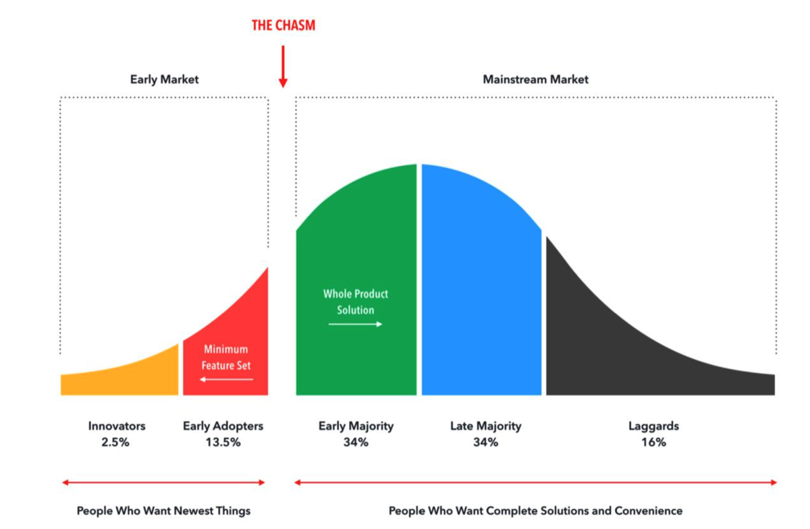
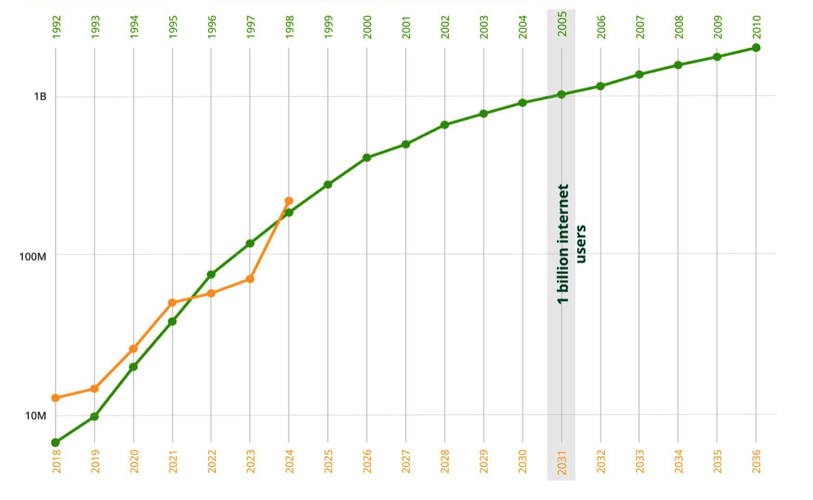
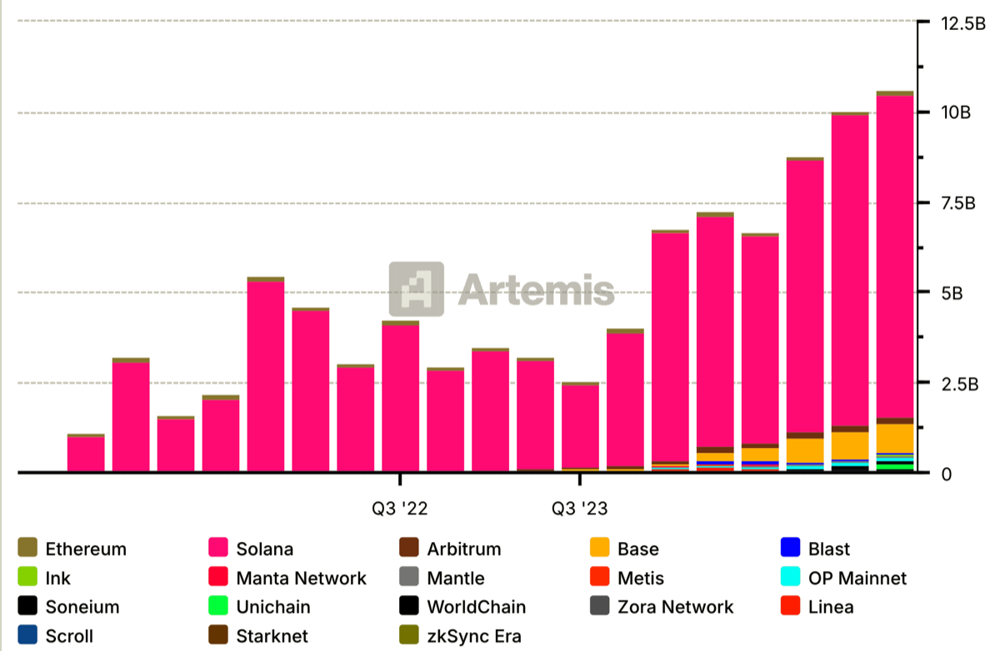

Every player in the Web3 ecosystem—from founders to investors to validators—is working towards a single goal: getting people to actually use this technology. So, have they succeeded? For now, the honest answer is "no." To understand what it will take to get to "yes," we first need to grasp how Web3 fundamentally redefines the concept of a user.

## A New Model for Identity in Web3 {#a-new-model-for-identity}

It’s nearly impossible to know how many individual "people" use Web3, because the system isn't designed to know. Unlike the physical world, where your identity is tied to your person, the digital world allows for a different model. In Web3, users are not anonymous, but pseudonymous. This is a critical distinction, born from a deep-seated philosophical difference about privacy and ownership.

To understand why, let's look at the world of traditional finance. When you use a bank, you transact with your real-world identity. This is essential for the bank's security model, but it comes at a cost to you: privacy. While your financial details are kept hidden from the public, they are fully visible to the bank and, by extension, to government and regulatory bodies. You are trusting the institution to be a responsible steward of your private information. For decades, this has been a workable trade-off.

Web3 starts from a different premise. It operates on a transparent, public ledger where all balances and transactions are visible to everyone. This radical transparency is what eliminates the need for a trusted third party like a bank. The network itself proves that all transactions are legitimate and that all assets are accounted for.

But if everything is out in the open, how do you protect user privacy? If a user's entire net worth were tied to their real name, it would expose them to immense personal risk.

The solution is pseudonymity. Instead of linking transactions to your government-issued identity, Web3 links them to a public address—a string of letters and numbers controlled by your personal wallet[^1]. Your real-world identity is decoupled from your on-chain activity. This model flips the old system on its head: instead of public identity and private transactions, Web3 offers pseudonymous identity and public transactions. You don't have to trust a bank to protect your privacy, because the system is designed so they never have it in the first place.

## Tracking Web3’s Journey to Mainstream Adoption {#tracking-web3s-journey-to-mainstream-adoption}

Web3 is a technology barely a decade old, and it’s following the classic adoption curve of every major technological shift. To understand where we are, it’s helpful to look at Geoffrey Moore’s famous model for technology adoption.

<figure><figcaption>Crossing the Adoption Chasm Geoffrey Moore's famous "Crossing the Chasm" graphic. (Source: <a href="https://en.wikipedia.org/wiki/Crossing_the_Chasm">Wikipedia</a>)</figcaption></figure>

After years of building foundational infrastructure, Web3 is finally beginning to offer products and services that can compete with Web 2.0. It is now attempting to make the tricky leap across the "chasm"—the gap between the visionary early adopters and the pragmatic early majority. The users who have gotten Web3 this far are a unique and specific bunch.

### Who is Currently Using Web3? {#who-is-currently-using-web3}

Until recently, the Web3 world has been populated by two main groups of "early adopters."

First, there are the **Pioneers**. These are the developers, creators, and users who are drawn to the technology for its underlying philosophy of decentralization. They see the potential for a more equitable and open internet and are willing to put up with clunky interfaces and technical hurdles to help build it. Their curiosity and enthusiasm are the engine of innovation, and they are essential for pushing the ecosystem forward.

The second, much larger group, is motivated primarily by **Financial Opportunity**. They see the enormous potential for wealth creation in this new frontier and can be broken down into three distinct sub-groups:

1. **The Long-Term Investors:** This small but influential group invests in projects with a multi-year time horizon, betting on the fundamental value of the technology.
2. **The Traders:** This is the largest and most visible segment. They buy and sell the ecosystem tokens issued by Web3 startups, often speculating on short-term price movements. Since many projects have not yet reached maturity, much of this activity is speculative. A lack of deep financial and technological literacy can make this a particularly high-risk game for many participants.
3. **The Airdrop Hunters:** This group actively uses new protocols and applications with the primary goal of receiving free tokens, known as airdrops, which projects distribute to reward early users. While some dismiss them for generating superficial, "hormonal" growth, they play an undeniably crucial role. By flocking to new applications, they stress-test the infrastructure and uncover critical bugs, effectively acting as a massive, decentralized quality assurance team. We will explore airdrops in more detail in our 'Tokenization' chapter.

### Tracking User Interest in Web3 {#tracking-user-interest-in-web3}

While no single metric can perfectly capture the number of Web3 users, several key indicators paint a clear picture of the network's underlying growth trajectory.

One powerful comparison comes from a16z crypto's 2024 State of Crypto report, which maps the growth of active crypto wallets against the early growth of the internet.

<figure><figcaption>Crypto Wallet Adoption vs. Internet Growth Comparison of the number of internet users and the number of active crypto wallets on a logarithmic scale. The first year is 1992 for internet users and 2018 for crypto addresses. (Source: World Bank, Artemis, and Dune @Daren Matsuoka)</figcaption></figure>

The chart shows that the growth curve for crypto adoption is closely tracking the early days of the internet. It took the internet roughly 13 years to reach one billion users. If this parallel holds, Web3 is on a path to reach one billion monthly active wallets by 2031. While not a perfect apples-to-apples comparison, it's a compelling model for visualizing the technology's potential scale.

Another key metric is the actual usage of the networks. The chart below shows the quarterly transaction volume on smart contract platforms compatible with Ethereum.

<figure><figcaption>Transaction Trends Quarterly transaction counts on blockchains. (Source: <a href="https://app.artemisanalytics.com/chains">Artemis</a>)</figcaption></figure>

The trend line tells a story of resilience and renewed momentum. After explosive growth in 2021, the market stagnation of 2022 and 2023 led to a predictable cooldown in transaction volume. However, beginning in the final quarter of 2023 and through mid-2025, activity has been increasing rapidly, signaling that users are returning and engaging with applications at a growing rate.

## How Does Web3 Reach More Users? {#how-does-web3-reach-more-users}

It's clear that most people are not yet using Web3 applications in their daily lives. The current user base is a mix of pioneers who are fascinated by the technology and a larger group of speculators betting on its future growth. So, what will it take for Web3 to break out of its niche and reach a mainstream audience?

As we'll explore in detail in the final chapter, the answer comes down to solving a few critical problems. Here’s a brief look at the path forward.

### A Radically Better User Experience for Web3 {#a-radically-better-user-experience}

First and foremost, Web3 applications must become radically more user-friendly. For years, developers rightly focused on the deep engineering challenge of building a secure and reliable decentralized infrastructure. That work has paid off, and the foundation is now largely in place.

The industry's focus must now shift from infrastructure to product. It's time to obsess over the user. This means learning from the last two decades of Web 2.0, which, for all its flaws, mastered the art of creating intuitive, seamless, and valuable user experiences. The technology needs to fade into the background so the benefits can shine through.

### The New Generation of Wallets {#the-new-generation-of-wallets}

Perhaps the biggest obstacle to a smooth user experience is the crypto wallet. The core principle of Web3—that you are the sole owner of your assets—is both a revolutionary feature and a terrifying responsibility. In the current model, "be your own bank" also means "be your own security," and a single mistake, like losing a seed phrase, can result in a permanent loss of funds.

Fortunately, a new wave of wallet technology is emerging to solve this problem. Powered by a concept called "account abstraction," these smart wallets are poised to completely change the game. They separate the user's account from the public/private key pair, enabling features that were previously impossible:

- **Social Recovery:** You can appoint trusted friends or institutions to help you recover your account if you lose access, just like resetting a password.
- **Gasless Transactions:** Projects can choose to sponsor transaction fees, so users no longer need to buy a specific token just to interact with an app.
- **Programmable Security:** Users can set spending limits, require multiple approvals for large transactions, and whitelist trusted applications.

In short, these new wallets can make using a Web3 application as simple and safe as using a modern mobile app. If you ask me, their widespread adoption won't just be an improvement—it will usher in a new era, finally making Web3 accessible to everyone.

### Finding Web3’s Product-Market Fit Through Pain {#finding-product-market-fit-through-pain}

Most Web3 applications haven't yet achieved the product-market fit that defines successful Web 2.0 companies. The reason is simple: for most people, the "pain" of using Web 2.0 isn't acute enough to force a change. Adaptation will come slowly, then all at once, as users increasingly suffer the pain of centralized platforms.

We saw a clear example of this recently when Instagram was banned in our country. The platform's decision to remove certain content, followed by the state's move to cut off access entirely, instantly created havoc for users and the thousands of people who earn a living through the application.

This is a problem Web3 is fundamentally designed to solve. When content is stored on a decentralized blockchain, no single company or government can block access on its own. If one application censors you, you can simply use another one to access the same data. They say "time heals all wounds," but in technology, time often reveals them. It's best to let the inherent flaws of centralized systems drive users toward a better alternative.

### Collaboration Between the Old Guard and the New {#collaboration-between-the-old-guard-and-the-new}

The other major catalyst for adoption will be the entry of established institutions. When the Web 2.0 players—especially financial firms—begin offering cryptocurrency services to their existing customers, it will provide a trusted and seamless on-ramp for millions.

* * *

The Web3 world has a long way to go, but the gap with Web 2.0 is closing faster than most people think, driven by a young and relentless generation of entrepreneurs. The coming years won't be defined by hype, but by execution. The teams and communities that finally solve real problems and find true product-market fit are the ones who will shine, and they will build the future of the internet.

[^1]: Blockchain addresses are semi-anonymous strings of letters and numbers. Think of them as email addresses. Accessing both the public address and the private keys requires a set of 12 or 24 words.
