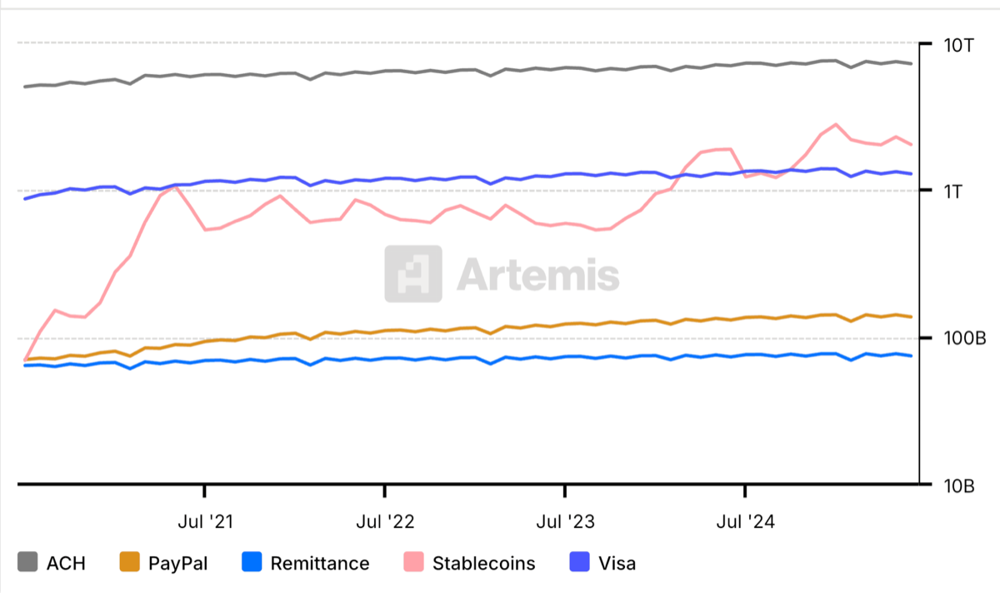
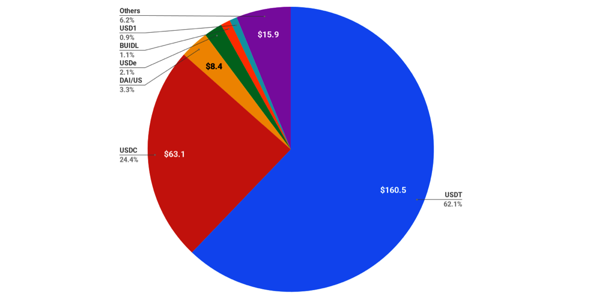
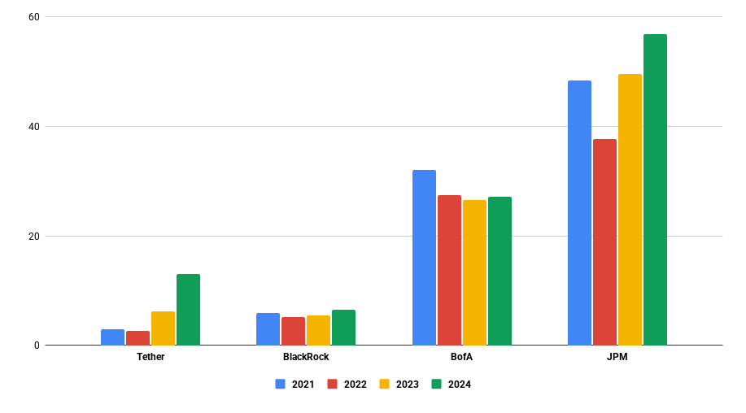

In the relentless search for product-market fit, one Web3 product has succeeded: the stablecoin. It has become the bedrock of the crypto economy. After a brief dip, the total value of stablecoins started climbing again, surpassing its 2022 peak in mid-2024 and continuing to set new all-time highs into 2025.

So what are they? At their core, stablecoins are simple: cryptocurrencies pegged to a fiat currency. In today's market, that almost exclusively means the US dollar. In an ironic twist, the very technology that was once heralded as the end of US dollar hegemony now relies on it for stability.

<figure><figcaption>Stablecoin Volumes vs Other Financial Systems Average last 30D rolling adjusted volume of stablecoin transactions (USD), excluding MEV activity and intra-centralized exchange transactions, against the current average daily volume of other financial systems. Data is aggregated on a weekly basis. Log scale. Originally created by Nic Carter. (Source: <a href="https://app.artemisanalytics.com/stablecoins?settingsTab=ARTEMIS_SHEETS_SETTINGS">Artemis</a>)</figcaption></figure>

Satoshi Nakamoto originally envisioned Bitcoin as a peer-to-peer payment system. While that goal remains elusive, Bitcoin did find an early use case as the primary trading pair on crypto exchanges. If you wanted to buy a new token, you usually had to buy it with BTC. But that era is over.

Volatility is a terrible foundation for a trading economy, and stablecoins—primarily USDT (Tether)—provided the solution. They replaced BTC as the market's default currency, leaving Bitcoin to solidify its narrative purely as a store of value.

### Who Owns the Stablecoin Market? {#who-owns-the-market}

The stablecoin space is dominated by two heavyweights: USDT (Tether) and USDC. Both are centralized, issued by private companies, and (theoretically) fully backed by an equivalent amount of fiat currency held in traditional bank accounts.

While many smaller players exist, the most significant recent entrant is a giant from traditional finance. PayPal, one of the world's largest payment systems, has thrown its hat in the ring with its own stablecoin, PYUSD, now available on both the Ethereum and Solana blockchains. This move signals a powerful convergence between the old financial world and the new. We take a closer look at this in our case study, "Case Study: PayPal's Stablecoin, PYUSD."

<figure><figcaption>Stablecoin Market Shares Market shares of US dollar-pegged stablecoins. (Source: <a href="https://defillama.com/stablecoins">DefiLlama</a>)</figcaption></figure>

## Risks of Centralized Stable Coins {#risks-of-centralized-stable-coins}

### The Risks of Centralized Trust {#the-risks-of-centralized-trust}

This centralized model offers a sense of security—a promise that your digital dollar can always be swapped for a real one. But this promise rests on a fragile foundation: trust. First, you have to trust that the issuer, like Tether or Circle, actually holds one dollar in a bank for every token it mints. This requires faith in their audit reports and transparency.

Second, there's the risk that the banks holding the reserves could fail, a risk that became startlingly real for USDC holders in March 2023 when its peg wavered during a banking crisis.

Most importantly, these stablecoins undermine the core promise of crypto: "full ownership of your assets." You may hold USDT in your wallet, but Tether can freeze those assets remotely with a single command. As centralized companies, Tether and Circle are susceptible to pressure from regulators and governments, and if they are forced to act, there is nothing a user can do.

### What About Decentralized Stablecoin Alternatives? {#what-about-decentralized-alternatives}

This brings us to the decentralized challengers, most notably **DAI** from MakerDAO, which was built to be censorship-resistant.

Unlike its centralized cousins, DAI isn't minted by a company. It’s created by users who lock up collateral—mostly other cryptocurrencies like ETH, but also some real-world assets—to mint DAI against it.

While DAI is more ideologically pure, it has struggled to gain mass adoption. The reason lies in its design. To protect itself from the volatility of its crypto collateral, the system requires massive over-collateralization. For every dollar of DAI that exists, roughly $1.44 worth of other assets [must be locked](https://makerburn.com/#/) away[^1]. This makes DAI incredibly capital-inefficient. For most users, the potential returns don't justify tying up that much capital.

The story took another turn in the summer of 2024 when MakerDAO, the entity behind DAI, began [a major rebrand](https://cryptonewsland.com/makerdao-rebrands-to-sky-new-tokens/) to "Sky" and announced a new stablecoin, USDS. This news triggered a [backlash](https://messari.io/copilot/share/makerdao-s-sky-rebranding-overview-fa2d1fcb-0870-4cec-bedf-9559ff4be8db) from the crypto community because USDS, unlike DAI, includes a feature that allows it to be frozen—the very centralization it was meant to oppose. Sky is making this compromise to get ahead of future regulatory challenges. While the original DAI will continue to exist[^2], the move felt like a retreat from the ecosystem's core principles[^3].

Of course, not all decentralized stablecoins are created equal. In 2021, an algorithmic stablecoin called **UST**, built on the Terra blockchain, gained immense popularity by promising an incredible 20% annual interest rate. Whenever a product offers returns that seem too good to be true, the first question should always be: "Where is the yield coming from?"

In UST's case, the yield was essentially a marketing expense paid by the founders to attract users. As the total value soared past $18 billion, the model became unsustainable. The spectacular collapse of UST is a crucial lesson, which we explore in the "Case Study: UST" at the end of this chapter.

## Central Bank Digital Currencies: The Empire Strikes Back {#central-bank-digital-currencies-the-empire-strikes-back}

The rise of stablecoins did not go unnoticed by the world's central banks. Wary of private, decentralized alternatives to the currencies they control, monetary authorities have been diligently working on their own answer: **Central Bank Digital Currencies (CBDCs)**.

From a central bank's perspective, issuing a CBDC is just the next logical step. Technology now lets them create *programmable money*, a powerful new tool for implementing monetary policy with surgical precision.

Imagine a natural disaster strikes a specific region. A government could instantly airdrop funds directly into the digital wallets of affected citizens. But the power of a CBDC goes further. The government could program that aid to be spent only on essential goods like food and medicine, or on diesel for farmers to save their crops. They could even set an expiration date, automatically reclaiming any funds not used within a specific timeframe.

While this is a massive leap in efficiency for central banks, the implications for citizens are deeply concerning. The complete transparency of a CBDC raises profound privacy issues. Every transaction is recorded, creating a permanent, searchable ledger of a person's financial life. For Web3 proponents, this capability evokes dystopian futures, pointing to China's "social credit" system as a cautionary tale of what is possible when the state has total financial visibility.

In the United States, the traditional leader of the financial world, there is significant resistance to the idea. In a country where personal freedom is a cornerstone of the national identity, convincing the public to adopt a transparent, government-controlled currency is a massive challenge. The Republican party has already declared its firm opposition.

Furthermore, the US may not even feel the need for a CBDC at this stage. The Web3 stablecoin market, worth hundreds of billions of dollars, already runs on the U.S. dollar. The largest issuers, Circle (USDC) and Tether (USDT), have proven to be responsive to government directives. Requests from authorities to "freeze funds in this account" are handled swiftly. With private companies already providing a controllable, dollar-denominated digital currency, the US government can enjoy many of the benefits of a CBDC without bearing the political cost of creating one itself.

Instead of building its own digital dollar, the US is taking a different path: regulating the private stablecoin market. The summer of 2025 saw intense [legislative work to create a formal stablecoin act](https://www.congress.gov/crs-product/IN12522). This new framework doesn't replace issuers like Circle and Tether; it just codifies the rules they must play by, mandating full 1:1 reserves, transparency, and compliance with government oversight.

This strategy allows the US to maintain control and harness the innovation of the private sector. It effectively outsources the digital dollar, extending its global reach through regulated stablecoins without the government having to build or manage a controversial CBDC on its own.

## What Do Stable Coins Offer? The Zero-yield Problem {#what-do-stable-coins-offer-the-zero-yield-problem}

So what do you, the user, get for holding a stablecoin? With centralized coins like USDT or USDC, the answer is simple: nothing[^4]. You are effectively giving an interest-free loan to the issuer.

Tether’s business model is to take the billions of dollars users give it and invest that capital in interest-bearing assets, like U.S. Treasury bills. They pocket the entire yield. It’s an incredibly profitable business. In the first quarter of 2025 alone, Tether, a company with roughly 150 employees, reported a staggering $4.52 billion in net profit—more than triple what BlackRock, the world's largest asset manager, pulled in over the same period.

<figure><figcaption>Net Profits: Tether vs. Major Financial Institutions Net earnings of JPMorgan, Bank of America, BlackRock and Tether for the last four years. The lean, high-margin stablecoin business is a financial powerhouse. (Source: Delphi Digital, Tether, Yahoo Finance)</figcaption></figure>

Decentralized alternatives operate differently. DAI, for instance, allows users to lock their DAI into a smart contract and earn a variable interest rate set by the protocol's governance[^5].

A new player, Ethena, which emerged in 2024, claims it can solve both the centralization problem of USDT and the capital efficiency problem of DAI. We take a closer look at this ambitious project in our case study, "Case Study: Ethena."

## The Stablecoin Paradox {#the-stablecoin-paradox}

Stablecoins offer a crucial safe harbor in the volatile crypto markets. They are the primary on-ramp for new users and the essential lubricant for the entire Web3 economy.

Yet, they represent a deep conflict with the ecosystem's core philosophy. The dominance of centralized, censorable stablecoins—and the emergence of government-issued CBDCs—pulls the industry back toward the very systems it was meant to replace. For Web3 to live up to its original promise, truly decentralized alternatives have to eventually win the market's trust.

For now, stablecoins offer a clear value proposition, especially for users in developing nations looking to shield their savings from unpredictable economic policies. As they get more integrated with other technologies, their use will only grow. The most important of these is Decentralized Finance, the engine of the new economy and our next topic.

[^1]: At the time of writing, Maker ecosystem has $6.91 bn outstanding DAI/USDS and $9.96 collateral. Source: [makerburn.com](http://makerburn.com)

[^2]: The DAI stable coin’s smart contract is non-upgradable—meaning that once deployed to Ethereum, no one can change it. Anyone can freely use it, highlighting blockchain’s immutability.

[^3]: The rebrand drew criticism—only ~10.7% of MKR holders converted despite incentives—and fueled concerns that USDS’s added administrative features could introduce centralized control points.

[^4]: Coinbase, a former Circle partner, [offers interest](https://www.coinbase.com/usdc) to users who lock USDC with them.

[^5]: As of mid-July 2025, this [rate](https://app.spark.fi/) was 2% for DAI and 4.5% for USDS.
