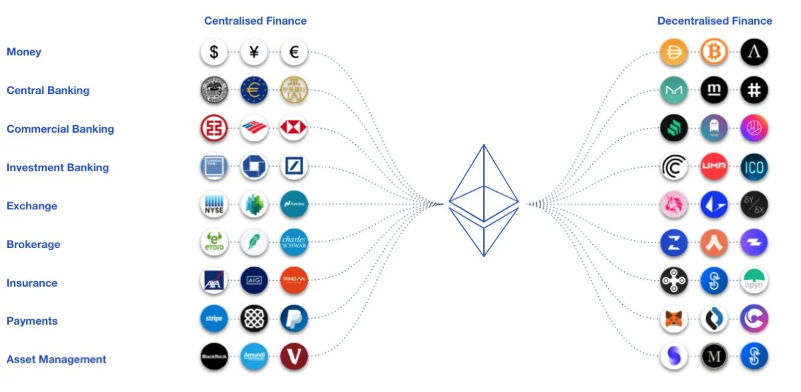
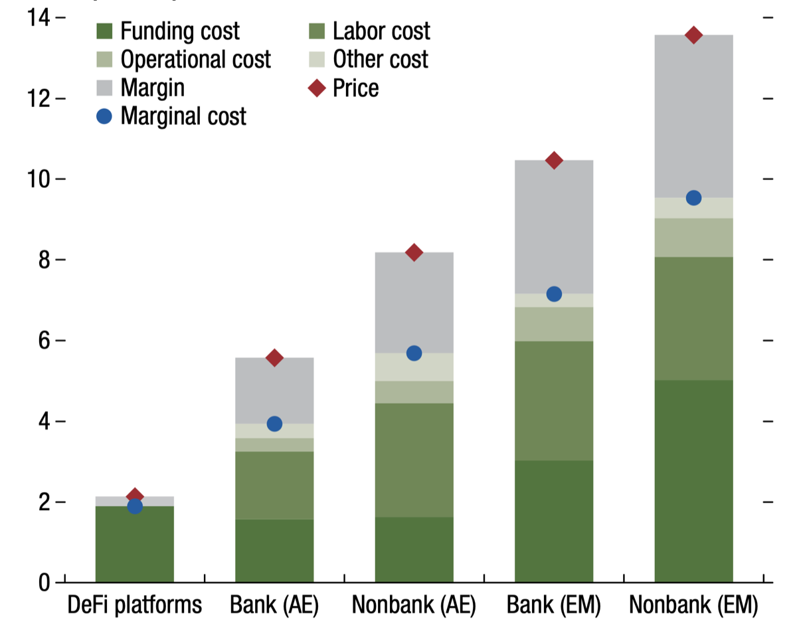
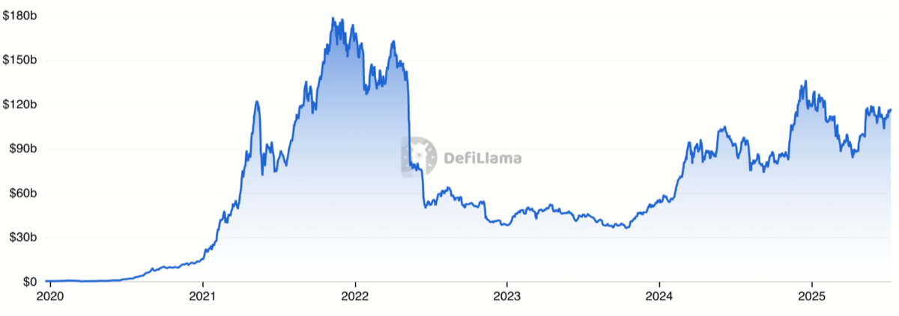

We now arrive at the most developed part of the Web3 world: finance. The ecosystem of applications built here is known as Decentralized Finance, or DeFi.

## An Idea Evolves {#an-idea-evolves}

The story begins with Bitcoin. Launched in 2009, it was a singular creation: a censorship-resistant, peer-to-peer digital currency. But a few years later, a group of developers saw that its underlying technology—the blockchain—could do much more than just money. This insight led them to break away and launch Ethereum in 2015.

Ethereum wasn't just a currency; it was a decentralized computer that anyone in the world could use to build and run applications. It was only natural that the first real killer apps to emerge were financial ones.

## What is DeFi? {#what-is-defi}

Decentralized finance is the rebuilding of the traditional financial system on top of blockchains. It takes all the services you’d expect—lending, borrowing, exchanging, derivatives—and creates them as transparent, open-source protocols.

<figure><figcaption>Traditional Finance vs. Decentralized Finance Decentralized finance aims to provide every service offered by the conventional financial system, but without the traditional gatekeepers. (Source: <a href="https://consensys.io/blog/explain-defi-to-your-dad">Consensys</a>)</figcaption></figure>

The real power of DeFi lies in its architecture. It's an open ecosystem where apps are built to work together seamlessly.

We call this "composability," but it’s easier to think of it as "money legos." Each DeFi service is a building block. As a user, you can pick and choose blocks from different providers and snap them together to create a customized financial strategy. If a better block comes along, you can instantly swap it out. This simple concept creates a huge shift in power from closed institutions to the individual user.

## Why Finance First? {#why-finance-first}

It was no accident that finance became the first major arena for Web3. It happened for two simple reasons: the sector had massive, untapped potential for disruption, and the conditions were perfect for that disruption to occur.

### The High Cost of Trust {#the-high-cost-of-trust}

At its core, blockchain technology is a trust machine. It allows people who don't know each other to interact and exchange value securely in a digital world without a middleman. The one industry whose entire business model is built on acting as that trusted middleman is finance.

The primary product that financial institutions sell is trust. To produce it, they carry a huge operational burden, from maintaining buildings and staff to navigating a maze of regulations. This is expensive, and the cost is inevitably passed on to you, the customer.

Furthermore, these regulations require banks to be exclusive; they can’t serve everyone. As a result, a huge part of the world's population remains unbanked and locked out of the financial system.

This is where DeFi gets fiercely competitive. By generating trust through transparent code instead of expensive institutions, it dramatically lowers the operational burden. It offers financial services that are radically cheaper and, because they're permissionless, open to anyone with an internet connection and a crypto wallet. No paperwork, no gatekeepers.

### A Digital Foundation {#a-digital-foundation}

Of course, potential alone isn't enough. An industry must be ready for a blockchain-based revolution, and the most important precondition is that it must already be digital. Blockchain thrives in the world of bits and bytes; it stumbles when it has to interface with the physical world.

Finance, more than almost any other sector, has been relentlessly digitizing itself since the 1990s. Our relationship with banks has become less physical and more virtual every year. We use cards instead of cash and manage our accounts through mobile apps. Banks have encouraged this shift, closing physical branches because they understand the massive cost advantages of digitalization.

This digital transformation laid the perfect groundwork for Web3. Cryptocurrencies and stablecoins gave us a way to hold and transfer value digitally without permission. DeFi took the next logical step, creating a parallel financial system that allows capital to flow directly from those who have it to those who need it, all in the native language of the internet.

## The Advantages of DeFi {#the-advantages-of-defi}

DeFi’s power comes from a few core principles that give it a fundamental edge over the old system.

### Boosting Efficiency {#boosting-efficiency}

DeFi protocols are essentially just software—smart contracts running on a blockchain. Because they are code, they can be deployed and operated at a fraction of the cost of a traditional financial institution. This isn’t just an incremental improvement; it’s a foundational shift in the cost structure of finance.

Furthermore, DeFi is built on open standards, meaning different applications can connect and work together like money legos. This "composability" ensures that developers don't have to build entire systems from scratch; they can specialize and innovate in one area, knowing their product can plug into the broader ecosystem. The result is fierce competition and rapid innovation, which drives down costs and creates better products for everyone.

A 2022 Global Stability Report from the IMF illustrates this advantage perfectly:

<figure><figcaption>Cost Efficiency: DeFi vs. Traditional Finance A comparison of costs and prices for DeFi platforms versus financial institutions in both developed and developing countries. The data shows DeFi's significant labor and operational cost advantage, especially when compared to banks in developing nations. Intense competition also keeps DeFi's profit margins thin, delivering better prices to the consumer. (Source: IMF Global Financial Stability <a href="https://www.imf.org/en/Publications/GFSR/Issues/2022/04/19/global-financial-stability-report-april-2022">Report, April 2022, Page 80</a>)</figcaption></figure>

### Unprecedented Transparency {#unprecedented-transparency}

In the Web3 world, the teams building apps can be anonymous. This sounds strange until you realize the paradigm has shifted. It no longer matters *who* wrote the code; it only matters that the code *works* as advertised. This is possible because DeFi operates on the principle of "open source"—the underlying smart contract code is public for anyone to inspect, audit, and verify. Once you can see exactly how the machine works, who built it becomes secondary.

This transparency extends to the whole system. Every transaction and every position is recorded on the blockchain for all to see. The 2008 financial crisis was fueled by opaque derivative instruments bundled into a bubble that no one could accurately measure. In DeFi, that kind of systemic murkiness is impossible. The risks are always right there in the open.

### Permissionless Access {#permissionless-access}

Public blockchains are, by their nature, accessible to all. Anyone with a smartphone and an internet connection can download a wallet and get an account on this global financial network. From there, they can connect to any DeFi application and use its services.

But what about websites that block users from certain countries? This is a common question. It’s crucial to understand that a website is just a *frontend*—a window to the app. The DeFi protocol itself—the smart contract—lives on the blockchain forever. While a specific team might restrict their website to comply with local laws, the underlying protocol cannot be turned off. Users can always connect to the smart contract through other websites or directly, making access truly unstoppable.

### True Digital Ownership {#true-digital-ownership}

Perhaps the most profound value Web3 offers is the ability to truly own your digital assets. When you deposit money in a bank, you are legally entrusting it to that institution. You assume you can get it back anytime, but as citizens in countries like Lebanon have discovered during financial crises, that isn't always true. When the bank says no, your money is gone.

In DeFi, you have total control. Your assets are secured in your personal wallet, and only you hold the keys. This is called **self-custody**. You can send your assets to anyone, anywhere, at any time, without asking for permission. This also eliminates **counterparty risk**—the risk that the other side of a trade or loan won’t meet its obligations.

Of course, this power comes with immense responsibility. If you lose the private keys to your wallet, your assets are irrecoverably lost. Fortunately, new wallet technologies are emerging to solve this very problem, making self-custody safer and easier for everyone, a topic we covered in more detail in Chapter 2.

## How Did DeFi Take Off? {#how-did-defi-take-off}

DeFi’s explosive growth was lit during what’s now known as "DeFi Summer" in 2020. The catalyst was a powerful new strategy: protocols began distributing their own governance tokens to users as an incentive.

This tactic, known as "[liquidity mining](https://medium.com/bollinger-investment-group/liquidity-mining-a-user-centric-token-distribution-strategy-1d05c5174641)," created a brilliant growth flywheel. By rewarding users with ownership in the network, protocols attracted the two things they needed most to survive: liquidity from investors and transaction volume from traders. Giving away tokens also had the crucial side effect of decentralizing control, spreading governance across a wide base of users and moving the projects closer to the Web3 ideal.

Of course, this boom had its excesses. A significant amount of the growth was fueled by reckless, high-leverage trading from centralized players like hedge funds and lending desks. When the market turned in 2022, these were the firms that imploded. It’s a critical point: the crisis was not a failure of decentralized protocols, which largely continued to operate as designed, but a failure of the opaque, centralized companies that gambled recklessly within the DeFi arena.

After bottoming out in late 2022/early 2023, DeFi’s TVL and market activity began a gradual recovery through 2023 and into the following two years.

<figure><figcaption>Total Value Locked in DeFi The total value (in billions of USD) locked in Decentralized Finance protocols over the years. This metric, known as TVL, acts as a barometer for user trust and capital commitment to the ecosystem. (Source: <a href="https://defillama.com/">DefiLlama</a>)</figcaption></figure>

While distributing governance tokens was an incredibly effective go-to-market strategy, it was never a sustainable one. There's a finite supply of tokens to give away. The million-dollar question for DeFi now is: what keeps people using these systems when the rewards run out? The answer lies in building real, durable utility that can stand on its own.

## What stands in the way of growth? {#what-stands-in-the-way-of-growth}

For DeFi to achieve sustainable growth, it needs to be adopted more widely. This requires solving two main problems: the fact that it's hard to use and the inherent risks users have to take on.

### Improving the User Experience {#improving-the-user-experience}

Traditional finance is a managed system where institutions hold and secure customer funds. DeFi is the opposite; it's built on users managing their own assets with DeFi protocols.

This space is new, and for the first five years, developers—mostly engineers—focused on the technical challenge of building a solid, working infrastructure. Now that the foundation is built, the next stage is to "polish" these products to make them comfortable for the average person.

The end user doesn't need to know about blockchains, Layer 2s, or private keys. They simply want to access products from their phone. While DeFi isn't there yet, work in this area is accelerating. Solana, known for its fast transaction speeds and developer-friendly environments, has pursued strong user experiences.

We also see progress with products like crypto debit cards. These are making it easier for users to spend their crypto, connect to DeFi apps, and move between fiat and crypto (on-ramp/off-ramp). The next step is integrating daily needs like paying bills[^1].

### Reducing User Risk {#reducing-user-risk}

Full ownership of one's assets is DeFi's greatest power, but it's also a major obstacle. This power comes with great responsibility.

Users are expected to understand the risks of different blockchains and protocols and manage their portfolio accordingly. However, the masses have neither the financial literacy nor the desire to take on this role. We saw this clearly in 2022 with the collapse of UST. It was marketed as a "risk-free" stablecoin, but investors who ignored the underlying risks were wiped out. You can read the full story of the UST crisis in the case study at the end of this chapter.

To reach a wider audience, DeFi needs simpler, more understandable products. It may also need a new layer of intermediaries—not to take custody of your assets, but to use the system's transparency to explain risks and guide users, all while upholding the spirit of decentralization.

## The Path to Adoption {#the-path-to-adoption}

To solve these problems and bring DeFi to the masses, the path forward involves both internal innovation and external collaboration.

### What DeFi Can Build on its Own {#what-defi-can-build-on-its-own}

It’s important to remember that DeFi is still in its early innings. Having built the core infrastructure, the focus is now shifting to the user. We are seeing a rapid improvement in user-facing applications: portfolio dashboards like Zerion and Zapper, user-friendly smart wallets like Clave, Ready (formerly ‘Argent’) and Safe, and aggregators that simplify access to complex products. These tools are crucial for improving the user experience and will continue to accelerate.

Addressing user risk is more complex. Users are rightly intimidated by protocol hacks, founder rug-pulls, and sudden market liquidations. Today's hedging tools are too complicated for most, and decentralized insurance, led by protocols like [Nexus](https://nexusmutual.io/) Mutual, remains [a niche market](https://defillama.com/protocols/Insurance). However, new products are emerging, and the potential for growth is immense. The fact that venture capital continues to flow into Web3, even after the 2022 crisis, signals strong belief in the sector's long-term promise.

### Building Bridges with the Old World {#building-bridges-with-the-old-world}

DeFi doesn't have to solve every problem alone. Strategic partnerships with established players could be a powerful catalyst for growth.

The first candidates are **fintech companies**. These firms have mastered the art of digital user experience in the traditional financial world. By partnering with them, DeFi can power the backend of familiar applications—a model best described as "Fintech in the front, DeFi in the back." This would let users access the power and efficiency of DeFi protocols through the simple interfaces they already know and trust.

The other major candidates are **centralized institutions**, including traditional banks and large crypto exchanges. These players can bring their enormous user bases, established trust, and insurance-like guarantees to DeFi products. While some view this as a betrayal of the "spirit of decentralization," offering users a spectrum of choices from fully decentralized to institutionally-backed will be critical for mainstream adoption.

## Conclusion {#conclusion}

DeFi offers a fundamentally different financial world. After a period of consolidation following its initial explosive growth, it seems to have regained momentum. The next chapter of its story will likely be defined by a powerful combination of native innovation from within the ecosystem and strategic collaboration with the centralized world. The path forward is promising, and it will be fascinating to watch it all unfold.

[^1]: For more, see Delphi Digital's "[The Year Ahead for DeFi 2025](https://members.delphidigital.io/media/delphis-defi-year-ahead-2025)".
