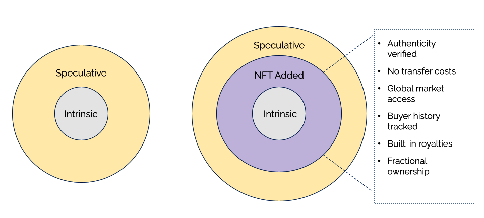
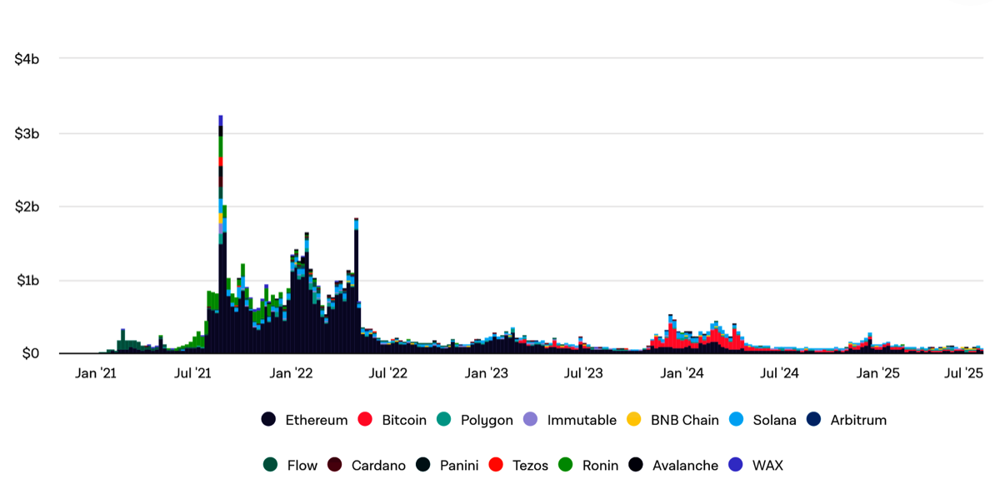

The NFT explosion of the early 2020s was a chaotic, brilliant moment that put digital ownership on the map. While the initial speculative frenzy has cooled, the underlying tech remains one of the most important building blocks for the future of the internet.

## Demystifying NFTs {#demystifying-nfts}

To get NFTs, you first have to understand the core problem of the digital world: everything is a copy. The "right-click, save as" command allows for infinite, perfect reproductions of any file. In a world of 1s and 0s, abundance is the default setting. But real value requires scarcity. If anything can be infinitely copied, how can anyone truly own anything?

This is the problem the Non-Fungible Token solves. "Non-fungible" simply means unique and irreplaceable. A dollar bill is fungible; you can trade it for any other dollar bill. The original, signed Declaration of Independence is non-fungible; it is one of a kind. An NFT is a small piece of code—a token—that acts as a unique digital certificate of authenticity for an asset.

But what does it mean to "own" something that anyone can copy and view?

## Rethinking Digital Ownership {#rethinking-digital-ownership}

Previous attempts to create digital ownership focused on locking things down with encryption or slapping watermarks on them. It was a losing battle. NFTs take the opposite approach: they lean into the fact that digital artwork can be everywhere at once.

Ownership in the Web3 world is no longer about possessing the single, private copy of a file. It is about having an undeniable, public claim to the *original* work.

This is where the blockchain comes in. A blockchain is a global, public, and permanent ledger. Think of it as a digital deed book for the entire world. The creator of a digital work can record its ownership on this ledger. This entry—the NFT—can then be transferred or sold.

The artwork itself can become a public good, free for everyone to look at and enjoy. But the *provenance*—the unbreakable chain of ownership pointing back to the original creator—is now provably scarce and can be verified by anyone. The NFT isn't the art; it's the unforgeable title to the art.

## How NFTs Add Value {#how-nfts-add-value}

An NFT fundamentally changes an asset’s value by enhancing its story, its history, and its utility in the digital world. Think of an asset's price as being driven by its story and social value more than its raw production cost. NFTs supercharge these components.

<figure><figcaption>How an NFT Adds Value to a Work of Art An NFT's impact is primarily on the speculative and narrative layers that determine an asset's true market value. (A subjective evaluation.)</figcaption></figure>

Here’s how NFTs add distinct layers of value:

### Perfect, Instant Provenance {#perfect-instant-provenance}

Authenticating physical art is a costly, expert-driven process. With NFTs, proving an artwork is original is trivial. All you need is the creator’s public address, and the blockchain gives an ironclad, instantaneous, and free confirmation of its origin.

### Frictionless Transfer {#frictionless-transfer}

Moving physical assets across borders is [slow and expensive](https://www.netsuite.com/portal/resource/articles/inventory-management/international-logistics.shtml). NFTs transfer at the speed of the internet, with near-zero friction. This opens up a single global marketplace, letting any asset reach a worldwide audience of buyers instantly.

### Enhanced Liquidity & New Financial Uses {#enhanced-liquidity-new-financial-uses}

Because NFTs can be traded securely and globally in seconds, they are far more liquid than their physical counterparts. This liquidity unlocks new possibilities. We are seeing platforms like **NFTfi.com** and **BendDAO** that allow users to [borrow against their NFTs](https://cointelegraph.com/explained/what-is-nft-lending-and-how-does-it-work), treating them as legitimate collateral for loans.

### A Public, Verifiable History {#a-public-verifiable-history}

An asset's value is deeply tied to its history—the famous collections it has been a part of. NFTs make this history, known as provenance, completely transparent. Anyone can see the full history of owners and sale prices, adding a rich, unforgeable story to the asset itself.

### Automated Creator Royalties {#automated-creator-royalties}

Perhaps the most powerful innovation here is programmability. An artist can [code a royalty](https://pontem.network/posts/nft-royalties-and-how-they-work) percentage directly into their NFT's smart contract[^1]. This makes sure they automatically get a cut of the price every time the work is resold in the future—no lawyers, intermediaries, or collection agencies required. This solves a problem that has frustrated creators for centuries.

### Fractional Ownership {#fractional-ownership}

A physical masterpiece can only have one owner at a time. An NFT, since it’s just a piece of code, can be digitally "[fragmented](https://webisoft.com/articles/fractional-nft/)," letting many people own a share. This makes high-value assets accessible to a much broader audience, dramatically increasing the potential market and liquidity for the work.

### Deeper Community Building {#deeper-community-building}

NFTs are more than just assets; they are digital keys. They can give holders access to exclusive communities, private events, and a direct line to the creator. This turns the static relationship between artist and fan into a dynamic, interactive community, creating ongoing value for everyone.

## The State of the NFT World {#the-state-of-the-nft-world}

The explosion of 2021 was the NFT world’s Big Bang—a chaotic, speculative frenzy that put digital assets on the map. The inevitable cooldown in 2022 was not an end but a reset, clearing the way for a more competitive and diverse ecosystem. The era of a one dominant chain and marketplace is over.

<figure><figcaption>NFT Volumes by Chain Monthly NFT volume across different chains (in billions USD). The market has shifted from Ethereum dominance to a multi-chain landscape. (Source: <a href="https://www.theblock.co/data/nft-non-fungible-tokens/nft-overview">TheBlock</a>)</figcaption></figure>

For years, the market was synonymous with Ethereum. While it’s still a major player, the landscape is now a fierce multi-chain competition. Bitcoin, once thought to be limited to a currency, became a major force in 2023 with the emergence of **Ordinals**, creating an entirely new ecosystem for collectors. Likewise, the **Solana** network, having weathered the 2022 crisis, has roared back to prominence, capturing a massive new audience with its low-cost, high-speed environment for NFTs and memecoins.

This competitive dynamic has also upended the marketplace hierarchy. **OpenSea**, the undisputed leader on Ethereum during the bull run, was outmaneuvered in early 2023 by **Blur**, a new marketplace that aggressively courted professional traders with token incentives and a focus on high-speed trading.

On Solana, a similar story of intense competition unfolded. **Magic Eden**, the network's established leader, was dethroned in trading volume by **Tensor**, a new marketplace that aggressively courted professional traders in 2024. However, in a dramatic reversal in early 2025, Magic Eden successfully recaptured its dominant position, demonstrating the highly volatile and competitive nature of the marketplace ecosystem.

Magic Eden also expanded its empire by strategically supporting Bitcoin Ordinals early, establishing itself as a major force in that new ecosystem. It now [competes fiercely](https://dune.com/domo/ordinals-marketplaces) with other leading Ordinals marketplaces like **OKX and UniSat** for influence on the original blockchain.

## Conclusion {#conclusion}

The NFT market is maturing. The speculative tidal waves are receding, revealing a more durable landscape underneath. What was once a single-lane road is now a multi-lane highway with intense competition driving real innovation. This is no longer a niche experiment; it is the foundation of a serious new asset class.

[^1]: While theoretically true, whether these royalties are honored depends on the marketplace where the asset is sold. Following [intense competition](https://www.theverge.com/2023/8/17/23836440/nft-creator-royalty-fees-are-dead-opensea-optional), many top marketplaces made royalty payments optional, creating a major challenge for creators. While new standards are being developed to give artists more control, it is no longer guaranteed that they automatically receive a share of the price every time the work is resold.
