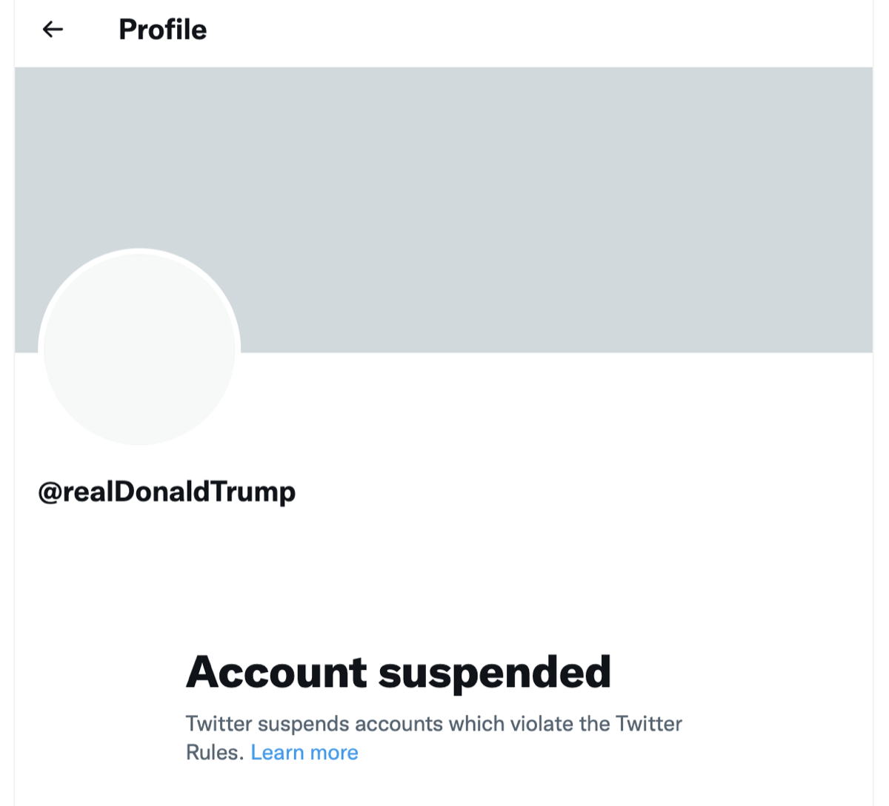

In this section, we'll explore decentralized social media, an emerging alternative to the tech giants that dominate our digital public square.

## The Problems with Social Media {#the-problems-with-social-media}

The platforms we use every day—[Instagram](https://www.instagram.com/), X (formerly Twitter), TikTok, and Facebook—are built on a fundamentally broken model, and the cracks are becoming impossible to ignore. Let's revisit the core issues.

### The Flawed Business Model {#the-flawed-business-model}

The root of the problem is the business model. As publicly traded companies, social media giants are locked in a relentless quest for quarterly growth. Their only way to achieve this is to sell more ads and collect more data. This creates a perverse incentive to degrade the user experience with an ever-increasing ad load and to conduct invasive surveillance on their users. Their systems track not just your clicks, but potentially listen in on your conversations, all to serve you a more targeted ad. You are not the customer; you are the product being sold.

### The Illusion of Control {#the-illusion-of-control}

Your social media feed is not your own. The chronological timeline, where you saw what your friends posted in order, is long gone. It has been replaced by opaque algorithms designed to maximize engagement and serve the platform's agenda, not yours. We have been conditioned to accept this manipulation.

More fundamentally, you don't own your digital life. Your content, your identity, and your network of followers are all held hostage by the platform. If you decide to leave, you can't take your social graph with you. This creates a powerful lock-in effect that traps users in digital prisons.

### The Unchecked Power to Censor and Silence {#the-unchecked-power-to-censor-and-silence}

This centralization of power has dangerous consequences. In the summer of 2024, a conflict between Instagram and Turkish national authorities over content it deemed "inappropriate" led to the [platform being blocked in the country](https://medyascope.tv/2024/08/02/instagram-blocked-in-turkey/), punishing users and creators caught in the middle. Similarly, since **October 2024**, Turkey has blocked **Discord**, citing concerns over illegal content and its refusal to provide user data—and at the time of writing remains inaccessible.

This power is not just wielded by governments. On X, there are constant accusations that the algorithm now favors the political biases of its new owner. It's his platform; he can do what he wants. What's puzzling is watching users flee one centralized system only to embrace another, like Meta's [Threads](https://www.threads.net/?hl=en), which operates centrally[^1]. This was driven home when Mark Zuckerberg admitted to the US Congress that he complied with government requests to suppress certain narratives before the 2020 election.

The ultimate expression of this power is **de-platforming**. Pre-Elon Musk Twitter famously demonstrated this when it permanently banned the sitting US President, Donald Trump, erasing his account and 88 million followers overnight.

<figure><figcaption>De-platforming the President of the USA on Twitter For a long time, this was the screen that greeted anyone trying to access Donald Trump's Twitter account.</figcaption></figure>

This power can also wipe out entire industries. Years ago, Facebook encouraged game developers to build on its platform, attracting millions of users. After observing the revenue and engagement these games generated, Facebook abruptly shut down the platform, destroying countless businesses with a single decision.

## Decentralized Social: The Solution? {#decentralized-social-the-solution}

Decentralized Social (DeSoc) rebuilds social media from the ground up to solve the core problems of the Web2 era. Its promise is simple: you, the user, own and control your content, your identity, and your network.

The key innovation is separating the application you use from your underlying social data. Your profile, posts, and followers are stored on a permissionless, decentralized network—think of it as a public utility for social data.

This means anyone can build an app to access this data. Instead of being locked into a single platform like Instagram or X, you can choose from dozens of clients, each with a different design or feature set. This creates a competitive marketplace for user experience and makes it impossible for any single company to control the narrative or cut off access.

The DeSoc landscape is still new and fragmented, with [many projects](https://github.com/2gatherproject/decentralized-social-apps-guide) competing to become the standard. Let's look at three that stand out.

### Discovering Lens Protocol {#discovering-lens-protocol}

### Lens Protocol {#lens-protocol}

One of the first and most prominent DeSoc infrastructures is the [Lens Protocol](https://www.lens.xyz/), built by [the influential team behind the DeFi lending platform Aave](https://cryptobriefing.com/lens-protocol-permissionless-aave-join-build/).

Lens’s core innovation was to treat your social graph as a collection of ownable assets. Your profile, content, and the relationships you build are all controlled by your crypto wallet, making them portable and programmable. This turns your social presence from something you rent on a platform into a digital asset you truly own.

This ownership unlocks powerful new capabilities. For example, the protocol’s "Open Actions" feature allows any post to become an interactive application. A user can tip a creator, mint a collectible, or vote in a poll directly from their feed, opening up monetization models far beyond simple advertising. To combat spam, Lens Protocol initially gated access, but has since [opened up](https://app.t2.world/article/clt4rnfwt2016491ymccg4d42ar), allowing anyone to create a profile for free.[^2]

This foundational layer supports a competitive ecosystem of applications like [Phaver](https://phaver.com/) and [hey.xyz](https://hey.xyz/), which act as different "windows" onto the same underlying social data. This has led to communities forming around unofficial, community-launched tokens, although the protocol itself has no native token. After launching on Polygon, Lens has since [migrated to its own dedicated Layer 2 network](https://thedefiant.io/news/defi/aave-announces-lens-network-l2-leveraging-zk-stack)—**Lens Chain**—built with ZKsync technology to handle the high transaction volume of social media at a very low cost.

### Getting to Know Farcaster {#getting-to-know-farcaster}

[Farcaster](https://www.farcaster.xyz/) has gained significant traction among Ethereum users, positioning itself as a popular decentralized alternative to X. It uses a hybrid model, securing user identities on-chain while keeping content off-chain for speed. Its [breakout feature, **Frames**](https://globalcoinresearch.com/research/exploring-farcaster-and-frames-the-composable-social-platform), allows developers to embed interactive mini-apps directly into posts, unlocking a new wave of creativity for games, polls, and commerce. Built on the Optimism network, the protocol charges a small annual fee for accounts to deter spam. Its most popular client, originally named Warpcast, now also called **Farcaster**, sharing the name of the protocol itself.

### Exploring Nostr {#exploring-nostr}

For those who prioritize absolute censorship resistance, there is [Nostr](https://nostr.com/). Popular within the Bitcoin community, Nostr is not a company but a simple, open protocol—a set of rules for passing messages through a network of independent nodes. With no founder or leader, it is radically decentralized and funded by community donations. Its raw, robust design makes it a haven for free speech, with clients like [Damus](https://damus.io/) providing a window into the network.

### The Broader Landscape {#the-broader-landscape}

The DeSoc world is far from a two-horse race. The most significant other contender is [Bluesky](https://bsky.app/), founded by former Twitter CEO Jack Dorsey. Built on its own unique foundation, the AT Protocol, it has seen impressive user growth, surpassing [10 million users](https://techcrunch.com/2024/09/16/bluesky-now-has-10-million-users/) by fall 2024. Bluesky represents a different architectural vision for decentralization.

Beyond these, the ecosystem is vast and global. While Western platforms get the most attention, significant projects thrive in other regions, particularly Asia. Older, federated models like [Mastodon](https://mastodon.social/explore) continue to serve a dedicated user base. The space also sees explosive, short-lived experiments like **friend.tech**, which serve as case studies in viral hype and token-driven speculation. This [diverse list](https://github.com/2gatherproject/decentralized-social-apps-guide) of projects is constantly evolving, all competing to build the future of social media.

## The Hurdles for Decentralized Social {#the-hurdles-for-decentralized-social}

Despite its powerful vision, decentralized social media is still far from challenging the giants of Web2. The reasons are clear: the landscape is fragmented, the user experience is still lagging, and the hard problem of content moderation remains unsolved. However, elegant solutions to each of these challenges are beginning to emerge.

### Fragmentation and the Rise of the Aggregator {#fragmentation-and-the-rise-of-the-aggregator}

A social network is only valuable if people are on it—the "network effect." Today, the DeSoc world is fragmented across multiple competing protocols, splitting this vital network effect.

The solution, however, isn't for one protocol to win, but for the applications to unite them. Early pioneers, like the now-defunct Phaver[^3], attempted to solve this by building clients that could access multiple protocols from a single interface. While building a sustainable business in this new space is incredibly difficult, the core idea remains the most promising solution: a user's loyalty will belong to the app that provides the best experience, not the underlying protocol.

### Closing the UX Gap and Innovating Beyond {#closing-the-ux-gap-and-innovating-beyond}

DeSoc apps are still playing catch-up to the polished, multi-billion dollar products of their Web2 rivals. The resource gap is real. Yet, in some ways, they have already leaped ahead.

Features like **Farcaster's Frames** and **Lens's Open Actions** are native Web3 innovations that centralized platforms cannot easily replicate. They turn static posts into interactive applications. Directly within a post, a user can mint an NFT, play a game of chess, tip a creator, or vote in a DAO. This transforms the social feed from a simple wall of content into a dynamic and computational environment.

### A Market for Moderation {#a-market-for-moderation}

The biggest critique of DeSoc is its potential for unchecked, harmful content. Centralized platforms solve this with top-down control, acting as both judge and jury. The decentralized world offers a different, more nuanced solution.

The protocols themselves remain neutral, like public utilities. The responsibility for moderation is pushed up to the application layer. This creates a "market for moderation," where different apps will compete on their content policies. Some will offer raw, unfiltered access. Others will provide heavily curated and family-friendly feeds. Users will be free to choose the client and the level of control that they prefer, escaping the one-size-fits-all censorship of today's giants.

## Conclusion {#conclusion}

For years, creators and now users have felt the pain of the centralized social media model. DeSoc, while still small, holds the blueprint for a better system. The ultimate winner may not be a single protocol, but a vibrant ecosystem of aggregator apps built upon them. Should this vision succeed, the result will be a social web that is more open, more innovative, and fundamentally more aligned with the interests of its users.

[^1]: While Threads launched as a centralized platform, Meta has been actively [integrating](https://engineering.fb.com/2024/03/21/networking-traffic/threads-has-entered-the-fediverse/) it with the Fediverse via the ActivityPub protocol (the same protocol Mastodon uses).

[^2]: It relies on other mechanisms, including its modular architecture, to manage network quality.

[^3]: Even though it gained some traction, Phaver had to close its doors due to insufficient funding.
