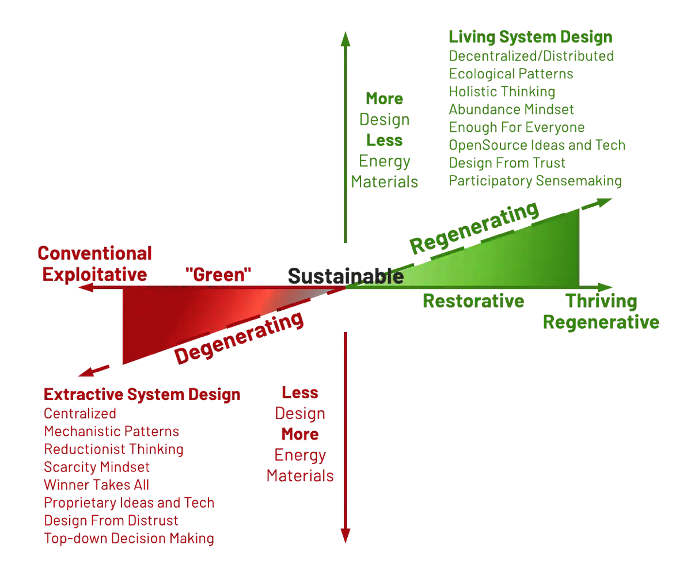

In this section, we turn to Regenerative Finance (ReFi), a branch of Web3 on a mission to prove the ecosystem has a soul.

There's a common misconception about Web3. Because it grew from a Bitcoin philosophy that fiercely champions individualism[^1], many see it as an inherently selfish movement.

But this misses Web3's other superpower: its ability to act as a **social coordination mechanism**. This gives it the tools to align thousands of strangers around the world towards a common goal, all bound by transparent, predetermined rules.

The emerging ReFi movement aims to harness this power for a specific purpose. It represents a powerful counter-narrative to the idea of pure self-interest.

## What is Regenerative Finance? {#what-is-regenerative-finance}

Regenerative Finance (ReFi) is a movement aiming to reshape the financial landscape. Its goal is to restore and improve our natural environment—something we’ve clearly neglected—and boost overall societal well-being[^2].

The system we live in is fundamentally extractive. It is designed to maximize returns for capital owners, treating environmental and social costs as mere "externalities" to be ignored.

ReFi aims to change this definition of profit. It seeks to build a world where the value created flows not only to shareholders, but also to the communities and ecosystems that support us all.

You might think these goals are utopian dreams. You may be right. But for the first time, the decentralized tools of Web3 offer a plausible path to achieving them. Let's look at how blockchain technology can power this movement.

## How Blockchain Helps ReFi {#how-blockchain-helps}

ReFi takes the powerful, battle-tested tools of decentralized finance and points them at real-world problems. It adapts DeFi's core value proposition—user sovereignty over assets and frictionless, borderless value transfer—for a new purpose.

To understand why this is so powerful, we must first look at why current systems fail. The incentive models of our traditional economy are broken. They are slow, opaque, and terrible at mobilizing people on a global scale. Aid for environmental projects or disaster relief is often wasted, captured by intermediaries, or used inefficiently, with little to no accountability for those who cause the problems in the first place.

ReFi uses blockchain to build a better toolkit. It enables anyone, anywhere, to fund socially beneficial services with speed and transparency.

<figure><figcaption>Evolving Ecological Economies The evolution of economies from extractive and degenerative to restorative and regenerative. Adapted from 'The road ahead for ecological design' by Bill Reed (Regenesis) (Source: <a href="https://www.weforum.org/stories/2022/09/regenerative-finance-web3-climate-change/">World Economic Forum</a>)</figcaption></figure>

Here's how it works in practice:

- **Transparent & Auditable Funding:** By using a public blockchain, the flow of capital can be tracked from a donor all the way to the project on the ground. This radical transparency cuts out corruption and makes sure resources are not wasted.
- **Tokenizing Natural Capital:** ReFi allows us to turn positive environmental outcomes into tradable digital assets. A ton of carbon removed from the atmosphere, a restored hectare of rainforest, or a verified reduction in plastic waste can be represented as a token. This creates a direct financial incentive to heal the planet.
- **Decentralized Coordination:** Through structures like DAOs, ReFi allows global communities to pool funds and govern projects directly, bypassing the slow and bureaucratic non-profits and institutions of the old world.

This open-source, transparent, and democratic infrastructure makes it possible to precisely reward positive actions and ensure accountability. It provides the foundation to create global resource pools, design products for local communities, and accelerate environmental movements on a scale never before possible[^3].

## Where ReFi Can Make a Difference {#where-refi-can-make-a-difference}

While ReFi's potential is vast, it is already making a tangible impact in a few key areas.

### Building Markets for Environmental Assets {#building-markets-for-environmental-assets}

Perhaps the most mature area of ReFi is creating liquid, transparent markets for environmental assets. Projects like [Toucan Protocol](https://blog.toucan.earth/) were early pioneers in tokenizing carbon credits, bringing them onto the blockchain[^4]. Others, like [Credit Nature](https://creditnature.com/), focus on new assets like biodiversity credits, creating financial incentives for landowners to engage in reforestation and conservation.

### Financing Sustainable Agriculture {#financing-sustainable-agriculture}

ReFi projects are also creating new models to support sustainable farming. A powerful example is [EthicHub](https://www.ethichub.com/en), a platform that connects investors directly with unbanked coffee farmers in South America. It uses DeFi's lending rails to provide affordable capital, bypassing local lenders who charge insane interest rates. It also helps farmers access new revenue streams (such as biodiversity programs) by [connecting them](https://www.hoganlovells.com/en/publications/where-finance-digital-sustainability-and-impact-meet-what-is-regenerative-finance-refi) to global markets[^5].

### Empowering Local Communities {#empowering-local-communities}

At its core, ReFi is about using Web3 tools for grassroots development. This includes a wide range of initiatives, from [funding micro-entrepreneurs](https://www.goldfinch.finance/)[^6] to bringing [financial services to the unbanked](https://www.ethichub.com/en) and helping communities build their own renewable energy projects.

## Challenges Facing ReFi {#challenges-facing-refi}

For all its promise, why don't we hear more about the ReFi movement?

First, this is a long-term game. The positive impacts of regenerative projects are measured in years or decades, not days or weeks. The ReFi space today feels much like DeFi did between 2017 and 2020: a small community of builders laying the groundwork, long before the mainstream hype arrived.

Second, the core idea—that token incentives can create sustainable, regenerative economies—is still a powerful but unproven hypothesis. Finding the right economic models that align profit with purpose without creating unintended consequences will require years of testing and refinement.

## Conclusion {#conclusion}

ReFi is the conscience of Web3. It extends the ecosystem's value proposition from empowering the individual to healing society and the planet. In a world often dominated by short-term speculation and hype cycles, it takes courage to build for the long term.

While it may seem small today, ReFi's focus on solving tangible, real-world problems could be the key to Web3's mainstream legitimacy and adoption. It is a critical movement that aims to prove that this technology can be used not just to create wealth, but to create well-being.

[^1]: The early Bitcoin philosophy strongly emphasizes individual freedom. It’s worth noting that one of the most influential segments of the Bitcoin community leans toward individualism and libertarianism—an ideology with strong roots in the U.S.

[^2]: [Definition](https://www.engage.hoganlovells.com/knowledgeservices/news/where-finance-digital-sustainability-and-impact-meet-what-is-regenerative-finance-refi) adapted from “Where finance, digital, sustainability and impact meet: What is Regenerative Finance (ReFi)?” by Hogan Lovells.

[^3]: These definitions are from Toucan’s blog post, “[What is ReFi?](https://blog.toucan.earth/what-is-refi-regenerative-finance/)”

[^4]: However, this first model faced significant challenges in 2022 when major carbon registries restricted this activity, forcing the on-chain carbon market to evolve. Today, Toucan and other projects are developing new infrastructure for creating more robust and transparent 'digital native' environmental assets

[^5]: After years of successfully providing affordable loans to unbanked coffee farmers, the platform faced a major crisis in 2022-2023 when a sharp drop in coffee prices led to widespread defaults. However, the project demonstrated significant resilience. By 2025, EthicHub had entered a recovery phase, securing a $1 million investment [from Bybit](https://igrownews.com/bybit-latest-news/) and expanding its [partnership with Heifer International](https://www.ethichub.com/en/blog/heifer-international-ethichub-ecosystem) to rebuild its lending pools.

[^6]: Through protocols like [Goldfinch](https://www.goldfinch.finance/) which uses crypto to originate loans for businesses in emerging markets
