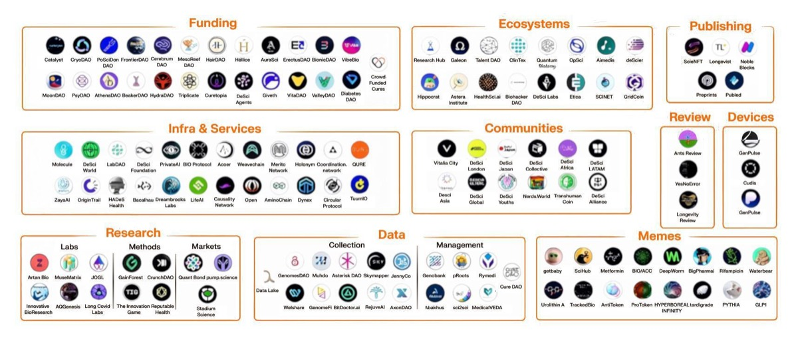

For years, the most successful use case for Web3 has been finance. The tools built for DeFi, particularly the Decentralized Autonomous Organization (DAO), proved to be incredibly powerful for coordinating capital and communities. Now, that same battle-tested model is being aimed at a new target: the world of science.

After a wave of non-financial blockchain projects failed between 2015 and 2019, a more mature movement has emerged. Decentralized Science, or DeSci, is applying the lessons learned from DeFi to rebuild the scientific process from the ground up.

## Exploring Decentralized Science (DeSci) {#exploring-decentralized-science-desci}

Classically, science is a methodical search for truth. In practice, it has become a centralized system, monopolized by a handful of powerful universities, government grant agencies, and for-profit academic publishers. This structure often stifles innovation, slows down funding, and locks critical knowledge behind expensive paywalls.

DeSci aims to dismantle this old model by building a new scientific ecosystem based on four key principles[^1]:

1. **Decentralization:** DeSci moves science away from siloed institutions and onto open networks. The goal is to reduce the power of bureaucratic gatekeepers and make funding and decision-making more democratic.
2. **Transparency:** The movement puts transparency first. It aims to make the entire research process—from data collection to peer review—more open and auditable, increasing the reliability and reproducibility of scientific work.
3. **Permissionless Collaboration:** Using distributed networks, DeSci breaks down the institutional and geographical walls that separate researchers. It fosters a global environment where diverse perspectives can connect and collaborate without friction.
4. **New Incentive Systems:** DeSci introduces powerful new economic models. Through DAOs and tokens, it can directly reward researchers for their contributions and use novel mechanisms like IP-NFTs to give scientists and funders true ownership of the intellectual property they create.

## The DeSci Landscape {#the-desci-landscape}

The DeSci movement has sparked a Cambrian explosion of new projects. By early 2025, the number of organizations building in the space had [surged to over 250](https://desci.world/projects), creating a vibrant and diverse ecosystem.

<figure><figcaption>The Decentralized Science Ecosystem The DeSci ecosystem map as of Dec 2024. (Source: <a href="https://x.com/MessariCrypto/status/1875220342157013062">Messari</a>)</figcaption></figure>

While a detailed list of these initiatives is available, the players can be grouped into a few key functional areas that are working to rebuild the scientific process[^2]:

- **New Funding Models:** At the heart of DeSci are new ways to fund research. This is led by **DAOs**—decentralized autonomous organizations—that allow communities to pool capital and collectively vote on which projects to support. They focus on everything from longevity research to rare diseases, bypassing traditional grant agencies.
- **Open Publishing & Collaboration:** This category aims to dismantle the paywalls of traditional academic journals. These projects are building open, transparent platforms for publishing research, conducting peer reviews, and enabling scientists to collaborate across borders without friction.
- **Data and IP Infrastructure:** This is the foundational layer for a new scientific economy. It includes decentralized protocols for storing and sharing large datasets immutably. Crucially, it also includes platforms that use **IP-NFTs** (Intellectual Property NFTs) to turn patents and research data into ownable, tradable, and fundable digital assets.

## Conclusion {#conclusion}

Decentralized Science is tackling one of the most important and challenging use cases for Web3. Initiatives that bridge the digital and physical worlds, like DeSci, face thorny problems and long timelines.

Nevertheless, the mission to build a more open, efficient, and equitable system for scientific discovery is critical for the long-term adoption and legitimacy of Web3. While its success is not guaranteed, its potential impact is immense, making it one of the most vital areas of innovation to watch.

[^1]: Definitions of decentralized science are sourced from Jagjit Singh’s article published on [Cointelegraph](https://cointelegraph.com/explained/decentralized-science-desci).

[^2]: Definitions of the groups below come from the [DeSci Wiki](https://docs.google.com/document/d/1aQC6zn-eXflSmpts0XGE7CawbUEHwnL6o-OFXO52PTc/edit#heading=h.arcrgw3lu7wt), the most comprehensive resource in this space.
