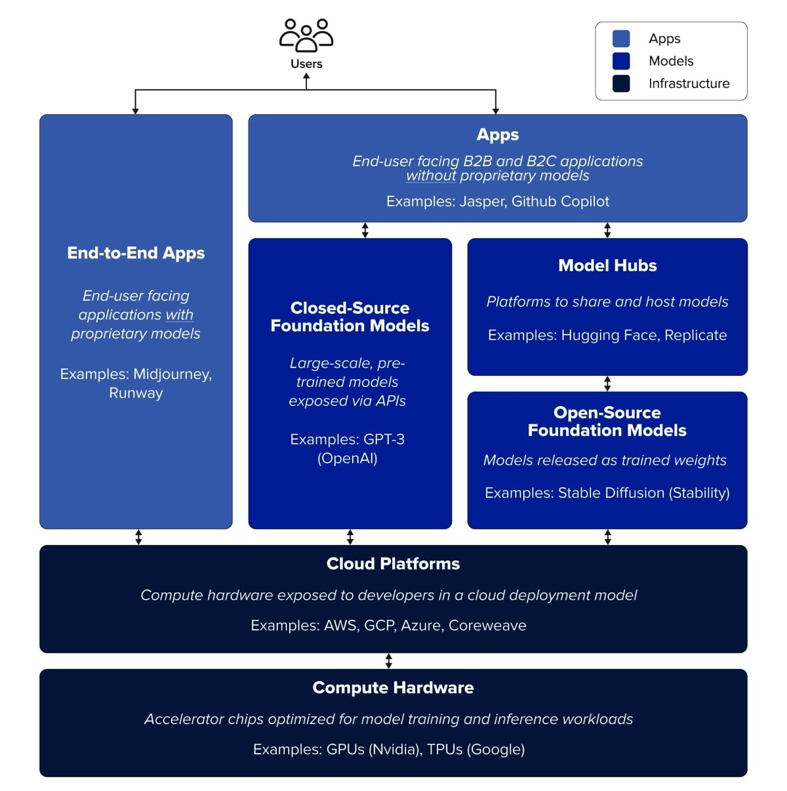
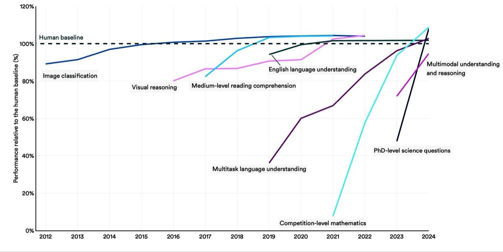
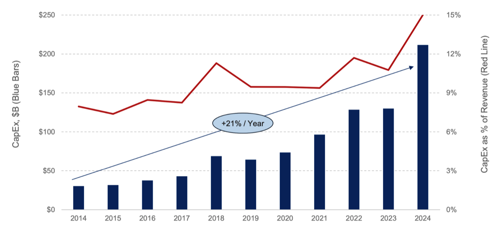
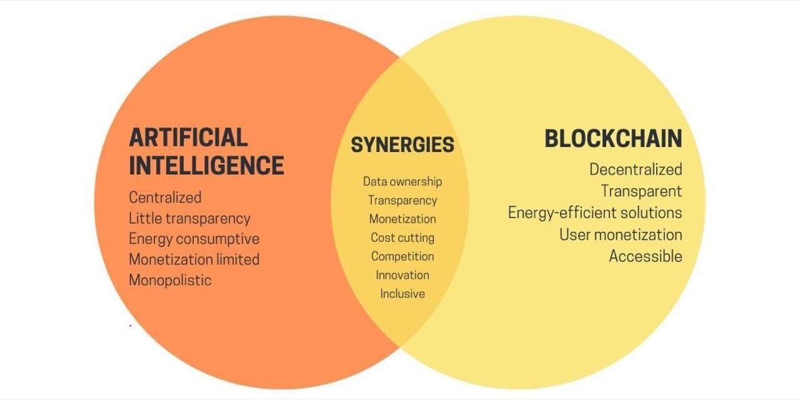
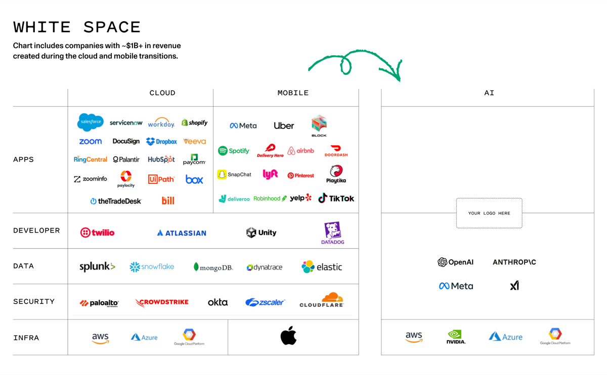

## Artificial Intelligence and Web3 {#artificial-intelligence-and-web3}

Two of the most powerful forces in technology are on a collision course: AI and Web3. Understanding their relationship is key to understanding the future.

Artificial intelligence is nothing new. Its roots [trace](https://coderspace.io/blog/yapay-zekanin-tarihi-dunden-bugune-yapay-zeka/) back to the 1950s, and the quest for 'general artificial intelligence'[^1] has been a quiet pursuit for over two decades. For years, progress was slow, simmering in the background. Then, recent explosions in hardware capability threw fuel on the fire, bringing us to today's incredible pace of development.

So, how does it all work?

## What is AI? {#what-is-ai}

Pinning down a single definition for artificial intelligence is tricky because it serves so many functions. At its core, you might think of general AI as a hyper-aware mimic, a parrot with a near-perfect memory. It absorbs the vast universe of information we’ve created and reflects it back to us. But this is no simple mimicry. What’s magical about this parrot is that it doesn’t just imitate our words; it imitates our patterns of thought, our tones of voice, and ultimately, evolves into something more advanced than the original it’s copying.

AI's lifeblood is data, and its primary source is the internet. Every piece of text, every image, and every sound file on the open web is ingested. This public library is then enriched with information from private databases. Once collected, this raw data is cleaned and structured, making it readable for a machine.

From there, the machine begins to analyze, looking for patterns. It infers the relationships between words—how they’re used, in what order, and in what context. Through a process called 'tokenization', every word and its components become individual units. The critical step is weighting these units based on how often they appear and how they relate to other units. This complex web of relationships creates a model with trillions of parameters. ChatGPT, for example, operates on a staggering 1.8 trillion parameters[^2].

Finally, when you ask it a question, the AI predicts and constructs an answer[^3], presenting it so naturally it feels like a conversation[^4].

Here’s where it gets interesting. Once a machine learns *how* to learn, it can begin to teach itself. Every interaction, every piece of user feedback, becomes a lesson. You might remember when ChatGPT first launched; users would point out a flawed answer, and the AI would take that into account and update itself. That wasn't just a simple fix. It was the AI using our feedback to refine its own understanding. This process has become so effective that today, even the experts who build these systems are sometimes stunned by the emergent, unexpected ways AI arrives at its conclusions.

But what *is* this intelligence? Is it a physical box humming in a server farm, or a ghost in the network? To understand, we need to pull back the curtain and see what’s running the show.

## Inside AI’s Technology Stack {#inside-ais-technology-stack}

Artificial intelligence isn't some single, monolithic thing. It’s a stack of technologies, layered on top of each other, much like the DeFi "money legos" we've explored. Each layer builds on the one below it, creating the foundation for the tools we now use every day.

<figure><figcaption>The Generative AI Technology Stack The stack that powers generative AI, from silicon to application. (Source: <a href="https://a16z.com/who-owns-the-generative-ai-platform/">a16z.ai</a>)</figcaption></figure>

At the very bottom of the stack is the **infrastructure layer**. To perform trillions of calculations and deliver results instantly, AI has an insatiable hunger for computational power. This is the world of hardware—the processors (chips) and cloud platforms that do the heavy lifting. It's why chip giants like Nvidia have seen their valuations soar[^5] and why Amazon's AWS and Microsoft's Azure have become profit engines for their parent companies. This layer provides the raw power.

On top of this foundation sits the **model layer**. This is where the "brain" of the operation lives. Here you’ll find the large models like ChatGPT that have captured the world's attention. But not all models are created equal. They exist on a spectrum from closed to open.

- **Closed models**, like the initial versions of ChatGPT, are proprietary. Both their training data and their internal weightings are kept secret, like the recipe for Coca-Cola.
- **Semi-open models**, like Meta's Llama, take a different approach. While the training data is closed, the model's internal weightings are made public. This is a crucial distinction. It means anyone can take the model and fine-tune it by adjusting these weights—for example, one could theoretically remove the censorship filters common in other systems.
- **Fully open-source models**, like some versions of Mistral,[^6] open everything. Both the data and the weights are available for anyone to see, use, and modify.

Finally, at the very top, is the **application layer**. This is the part of the stack you see and touch. These are the end-user products built on top of the powerful models below, turning their abstract intelligence into something tangible and useful[^7].

## The Dazzling Pace of AI {#the-dazzling-pace-of-ai}

Artificial intelligence is developing at a breathtaking pace. While many of us see it through the narrow lens of a personal assistant like ChatGPT, its true impact is quietly reshaping the global economy.

Imagine a new kind of workforce. It doesn't eat or sleep; it only consumes energy. It works 24/7. Today, it has the skills of a sharp university student. Tomorrow, it will have the capabilities of a PhD candidate[^8]. This isn't science fiction; it's the reality of AI's integration into the business world.

<figure><figcaption>AI vs. Human Performance This chart tracks AI performance against a human baseline (the 100% line). AI has already surpassed human ability in almost all areas except multimodal understanding and reasoning. (Source: <a href="https://hai.stanford.edu/ai-index/2025-ai-index-report">Stanford University - AI Index Report</a>)</figcaption></figure>

This leap in performance translates directly into economic value. The World Economic Forum [projects](https://www.weforum.org/stories/2024/05/these-5-countries-are-leading-the-global-ai-race-heres-how-theyre-doing-it/) that AI will add between $1.2 trillion and $3.8 trillion to the global economy *annually* over the next decade[^9].

Now, combine this cognitive revolution with rapidly advancing robotics. The implications are staggering, poised to fundamentally alter everything from the cost of services to the very nature of your work[^10].

## The AI Arms Race {#the-ai-arms-race}

The tech giants aren't just dabbling in artificial intelligence; they are in an all-out arms race, investing everything they have to claim the future.

Consider the 'four horsemen' of the tech world: Microsoft, Amazon, Google, and Meta. Over the last three years, they have poured a stunning [$465 billion into AI](https://members.delphidigital.io/reports/the-tower-the-square#the-tower---the-square-b517).

They did not stop there. In 2025 alone, their collective capital expenditures, driven almost entirely by AI, are projected to approach $200 billion. By the way, the spending spree is far from over. These companies, along with Apple, are sitting on a war chest of another $550 billion in cash, ready to be deployed. This isn't a temporary trend; it's a seismic shift in capital allocation, and the investment appetite will only continue to grow.

<figure><figcaption>Big Six Tech Giants Capital Expenditure Spending The combined capex spending and % of total revenue for six major tech companies (Apple, Nvidia, Microsoft, Alphabet / Google, Amazon, &amp; Meta Platforms) (Source: <a href="https://www.bondcap.com/report/pdf/Trends_Artificial_Intelligence.pdf">Bond Capital</a>)</figcaption></figure>

This tidal wave of investment has a clear beneficiary. Propelled by the insatiable demand for its processors, chipmaker Nvidia has skyrocketed to become one of the most valuable companies in the world.

When you consider that the biggest owners of the data—AI's most critical input—are these same tech giants, a familiar and troubling question arises. Are we destined to repeat the problems of Web 2.0, where a handful of companies held monopolies over our digital lives?

This is the central challenge of our time. Will AI simply reinforce the centralized power of the incumbents, or can decentralized solutions like Web3 offer an alternative path?

## The Intersection of Web3 and AI {#the-intersection-of-web3-and-ai}

In a world dominated by AI giants, can the decentralized startups of the Web3 world even survive? Forget challenging the titans head-on; is there any space for them to exist at all?

To answer that, we first have to understand if their underlying technologies can even work together.

### Are Blockchain and AI Compatible? {#are-blockchain-and-ai-compatible}

At a technical level, blockchain and artificial intelligence are fundamentally incompatible. Their core designs are in direct opposition.

Blockchain demands mathematical certainty; every transaction must be absolute and verifiable. AI, however, thrives on probabilistic guesswork, constantly calculating the *likelihood* of an answer being correct[^11].

Furthermore, their resource needs are diametrically opposed. Blockchain is intentionally slow and redundant, distributing its workload across thousands of machines to achieve decentralization. AI is a centralized beast, a computational brute that devours as much processing power and energy as it can get. The more resources it consumes, the more powerful it becomes.

While these technologies seem like oil and water, their very differences can create powerful synergies where they intersect.

### Where Opposites Attract: Blockchain and AI {#where-opposites-attract}

The unique properties of blockchain can complement AI precisely where AI is weakest. Their conflicting natures can create a new kind of harmony.

<figure><figcaption>Synergies at the Intersection of AI and Blockchain "Polarity creates synergy." (Source: De University of <a href="https://blog.ueth.org/p/when-giants-collide-exploring-the">Ethereum</a>)</figcaption></figure>

### How Can Web3 Influence AI? {#how-can-web3-influence-ai}

Given the immense investment required to build AI, a completely decentralized, end-to-end model cannot realistically compete with what the tech giants are building. Frankly, it doesn’t need to.

The goal isn’t to build a parallel universe but to strategically inject the spirit of Web3 into the existing AI stack. By carving out a niche in specific layers and leveraging the core strengths that set it apart from Web 2.0, Web3 can offer a powerful alternative. So what are those strengths?

### The Web3 Advantage (compared to Web 2.0) {#the-web3-advantage-compared-to-web-2-0}

Web3 offers a fundamentally different vision for the internet, built on a set of principles that directly challenge the old guard:

It is a world built on **openness**, where transparency is the default. It is **permissionless**, available to everyone and resistant to the de-platforming risks of centralized control. Its components are designed for **interoperability**, allowing different parts to work together seamlessly. It is built to be **censorship-resistant**, with **immutable data** that provides a verifiable source of truth.

Most importantly, it is an ecosystem where **users get a share of the value they help create.**

## Where Web3 is Making a Difference in AI {#where-web3-is-making-a-difference-in-ai}

The core features of Web3 aren't just theoretical ideals; they are potent, practical tools for solving some of the biggest problems emerging in the age of AI. As a recent [a16z report](https://a16zcrypto.com/posts/article/state-of-crypto-report-2024/) highlights, Web3 startups are already carving out niches by applying these principles.

**Fighting For Authenticity:** In 2023 alone, AI models [generated](https://journal.everypixel.com/ai-image-statistics) over 15 billion photos[^12]. That's more than humanity produced in the entire 150-year history of photography. In a world flooded with synthetic content, blockchain provides a vital anchor to reality, allowing us to cryptographically verify a piece of content's origin and prove its authenticity.

**Democratizing Power:** The raw computational power required to train cutting-edge AI models [has quadrupled every year](https://epochai.org/blog/training-compute-of-frontier-ai-models-grows-by-4-5x-per-year) for the last decade. This creates a massive barrier to entry, concentrating power in the hands of a few. Web3 offers an alternative by creating decentralized marketplaces where anyone can access or contribute computational power, breaking the stranglehold of the giants.

**Building Transparency:** Over the last five years, public trust in AI companies in the US [has plummeted from 50% to 35%](https://www.edelman.com/trust/2024/trust-barometer)[^13]. Blockchain directly counters this erosion of trust. By building services that are open, auditable, and owned by their users, it provides a transparent alternative to the "black box" approach of corporate AI.

**Enabling Ownership:** Leading AI models have been trained on trillions of data points[^14], nearly all of which were provided by users for free. Blockchain flips this exploitative model on its head. It creates a system where data providers can be treated as true owners, earning royalties and sharing in the immense value their information creates.

These are not just abstract possibilities. A new wave of decentralized startups is already building on these principles, chipping away at the centralized AI stack. Let's look at who they are and what they're building.

### The Data Layer: From Collection to Validation {#the-data-layer-from-collection-to-validation}

AI’s hunger for high-quality, verified data is insatiable. The open internet is a good start, but it's full of low-quality information and has its limits. Web3 provides the tools to create better data pipelines by properly incentivizing people to share and verify information without compromising their identity.

A whole ecosystem of solutions is emerging here:

- **Data Marketplaces** are being built to connect data providers with data consumers. Protocols like [Ocean Protocol](https://oceanprotocol.com/)[^15], Masa, and [Sahara](https://saharalabs.ai/) AI are creating new, transparent economies for information.
- **DataDAOs** and other networks are focused on sourcing valuable private datasets directly from users, creating community-owned information pools. (Case Studies: Vana, NVG8)
- Other platforms specialize in sourcing public data or creating new synthetic datasets on demand, effectively 'sweeping' the web for valuable information. (Case Studies: [Dria](https://dria.co/), [Mizu](https://mizu.global/), Grass, [Synesis One](https://www.synesis.one/), [First Batch](https://www.firstbatch.xyz/))
- Once sourced, data needs a home. Decentralized **data storage** solutions ensure that datasets can be stored immutably and accessed reliably for the long term. (Case Studies: [Filecoin](https://filecoin.io/), [Arweave](https://www.arweave.org/), Ceramic, Tableland)
- Before an AI can use data, it must be processed. **Data management and validation** platforms prepare information so AI models can digest it and cryptographically verify its source. (Case Studies: [Space and Time](https://spaceandtime.io/), [The Graph](https://thegraph.com/), [Subsquid](https://www.sqd.dev/), [Sahara](https://saharalabs.ai/), [Covalent](https://www.covalenthq.com/), Hyperline)
- Finally, **data labeling** protocols use human intelligence to fine-tune AI models, creating a feedback loop that results in higher-quality data and smarter systems. (Case Studies: [Sapien](https://www.sapien.io/), Kiva AI, Fraction.AI)

### The Processing Power Layer: Decentralizing Compute {#the-processing-power-layer-decentralizing-compute}

To analyze massive datasets and generate human-like responses, AI requires immense processing (GPU) power. Tackling the hardware layer is the ultimate challenge for Web3 startups, as tech giants have a massive head start.

While these decentralized solutions are still nascent, they represent a fundamentally different approach to providing the raw horsepower AI needs.

- Some platforms provide **general purpose processing power**, offering decentralized alternatives to cloud services for a wide range of hardware needs. (Case Studies: [Akash Network](https://akash.network/), [Aethir](https://www.aethir.com/))
- Others focus on **narrow-domain processing**, providing compute for specific AI tasks like model training or GPU tokenization rather than trying to compete across the board. (Case Studies: [io.net](http://io.net), [Gensyn](https://www.gensyn.ai/), [Prime Intellect](https://www.primeintellect.ai/), [Hyperbolic](https://hyperbolic.xyz/), [Hyperspace](https://hyperspace.xyz/))
- Perhaps the most radical approach is bringing processing power **directly to the end-user**. The mega-models we use today run in massive, centralized data centers. A new generation of smaller, more efficient models promises to run on your phone or personal computer. This is a game-changer for privacy. When the model runs on your device, your personal data never has to leave it. These solutions provide both the models and the processing capacity needed for a truly personal and private AI. (Case Studies: [PIN AI](https://www.pinai.io/), Exo, [Crynux.ai](http://crynux.ai), [Edge Matrix](https://edgematrix.pro/))

### Building the Foundation for AI Agents {#building-the-foundation-for-ai-agents}

The next frontier for AI is the 'agent'—autonomous applications that can act on our behalf. But before these agents can flourish, they need a solid foundation to stand on. This infrastructure layer is developing now, creating the rails upon which future user-facing applications will run.

This foundation is being built with a mix of open-source and decentralized components:

- It starts with **interchangeable large language models**. When models like Meta's Llama3 or those from Mistral release their internal 'weights' as open source, they hand immense power to builders. Anyone can take these models and fine-tune them, giving agents the power to be shaped for specific needs—or to have "features" like censorship mechanisms removed entirely.
- Another crucial layer provides **privacy**. As AI models are trained and used, platforms like Bagel Network, [Arcium](https://www.arcium.com/), and [ZAMA](https://www.zama.ai/) are creating the cryptographic mechanisms needed to protect confidential user information.
- To combat AI "hallucinations" and build trust, a new category of tools focuses on the **verification of AI outputs**. Modulus Labs, [Giza](https://www.gizatech.xyz/), Ritual, and [OpenGradient](https://opengradient.ai/) are building platforms that produce cryptographic proofs to verify that an AI's inference is accurate and untampered with.
- Finally, **networks that coordinate infrastructure** act as the conductors for this decentralized orchestra. Platforms like [Bittensor](https://bittensor.com/), [Near](https://www.google.com/search?q=https://near.org/blog/near-ai-vision), Allora, and Sentient are emerging to bring together all the necessary resources—processing power, datasets, and models—into a coherent, functioning whole.

### The Final Frontier: User Applications {#the-final-frontier-user-applications}

While the infrastructure heats up, the application layer remains surprisingly cool. As we've seen, open-source or decentralized AI applications for end-users are still incredibly rare. In fact, not a single major AI application startup (with over $1 billion in sales) has emerged yet. The field is wide open.

<figure><figcaption>The Application Layer is Still Virgin Territory Cloud, mobile, and AI startups that have crossed the $1 billion revenue mark. While tech giants dominate infrastructure, the application layer is waiting for its breakout star. (Source: Sequoia Capital - Generative <a href="https://www.sequoiacap.com/article/generative-ais-act-o1/">AI's Act o1</a>)</figcaption></figure>

Today, most of us interact with AI through centralized, closed applications like ChatGPT. This creates enormous "platform risk" for anyone building on top of them. We've seen this movie before. Remember when Facebook changed its algorithm, wiping out the audiences of countless businesses that had built their content on the platform? All that investment vanished overnight. It's highly likely that platforms like OpenAI will eventually operate like the App Store, taking a significant cut from any plugin that becomes successful on their turf.

This is where the Web3 world offers a fundamentally different path. A new wave of applications is emerging that leverages the unique properties of decentralization to address user needs for privacy and ownership. For example, end-user applications like [venice.ai](http://venice.ai) use verifiable AI inference and are built on a promise to never store user data. In the gaming world, projects like Parallel's [Colony](https://parallel.life/colony/signup) allow users to connect their own wallets and forge their own paths alongside AI agents.

So far, we've explored how Web3's principles can reshape the world of AI. But this is a two-way street. Now, let's flip the coin and see how AI is set to revolutionize the Web3 world itself.

## How AI Can Reshape Web3 {#how-ai-can-reshape-web3}

Artificial intelligence is a tidal wave transforming every corner of the software world, and Web3 is no exception. Its most profound impact will be fixing Web3’s biggest weakness: its notoriously difficult user experience.

For all its unique advantages, Web3 remains clunky and intimidating for the average person. We can criticize the centralized giants of Web 2.0, but they mastered one thing: creating intuitive, user-friendly applications. This is where AI enters the picture. AI-powered "agents" are the missing link that may bridge this gap, translating complex on-chain actions into simple, seamless experiences[^16].

This revolution is happening on two fronts. The first is the creation of these user-facing agents. The second is the development of the underlying AI-powered infrastructure that allows these agents to operate effectively on-chain[^17]. Let's explore the emerging initiatives in both of these areas.

### Artificial Intelligence Agent Applications {#artificial-intelligence-agent-applications}

This is where AI will deliver its most transformative impact on Web3: creating intelligent applications, or "agents," that finally make it easy for people to navigate the complexities of the on-chain world.

Let's be honest: Web3's philosophy of giving power and responsibility to the user is revolutionary, but most people lack the technical skill to use the applications. Nor should they need to. The world of decentralized finance, for example, is filled with powerful and interesting applications spread across different networks. To use them, you currently need to act as your own IT administrator, manually bridging assets from one network to another. An average user doesn't need to know—or care—what network they're on. They just want it to work.

This is the problem AI agents will solve. They will act as a natural language interface for the blockchain. An agent will understand a command like, "Buy me $100 worth of this token at the best possible price, every day for the next month." More than that, it will work for you 24/7 to execute that command under the best possible conditions.

Is this fully possible today? Not quite. Agent applications are still in their infancy, and the underlying AI infrastructure needs more time to mature and support decentralized systems. But the foundation is being laid, and the direction is clear.

Here’s a look at the key areas where AI agents are already beginning to reshape the Web3 experience:

**Simplifying the User Experience:** The most immediate impact is creating **AI interfaces** that let you interact with the blockchain using natural language. Instead of complex transactions, you can simply tell an agent what you want to do. (e.g., [Venice.ai](https://venice.ai/chat))

**Powering Decentralized Finance (DeFi):**

- **Automated Trading:** Agents are being built to execute complex on-chain trading strategies automatically, turning simple commands into sophisticated actions. (e.g., [Taoshi](https://www.taoshi.io/), [Intent.Trade](https://intent.trade/), [Robonet](https://robonet.finance/))
- **Smarter Lending:** New models are using zero-knowledge proofs and AI to assess a user's digital reputation, allowing them to borrow with less collateral without exposing their private data.
- **Automated Risk Management:** In the volatile world of DeFi, platforms are using machine learning and AI agents to monitor market conditions and instantly adjust risk parameters, protecting protocols and users. (e.g., [Chaos Labs](https://chaoslabs.xyz/), [Gauntlet](https://www.gauntlet.xyz/), [Minerva](https://www.gominerva.com/))[^18]

**Strengthening the Ecosystem:**

- **Smarter Governance:** In DAOs[^19], where members vote on key decisions, AI agents can help automate the on-chain actions that result from those votes. (e.g.,  [Botto](https://www.botto.com/))
- **Better Developer Tools:** AI is being used to create a new generation of **development and security tools**, improving the developer experience and hardening the security of the entire ecosystem. (e.g., [ChainGPT](https://www.chaingpt.org/), [Guardrail](https://www.guardrail.ai/))
- **Proof of Personhood:** To combat bots, applications are using AI and cryptographic proofs to verify that a user is a unique human, a critical primitive for a fair digital society. (e.g., [Worldcoin](https://worldcoin.org/))

**Creating New Entertainment and Social Experiences:**

- **Next-Generation Gaming:** Game developers are using AI to create smarter, more dynamic non-player characters (NPCs) and core game mechanics, leading to more immersive worlds. (e.g., [Parallel](https://parallel.life/colony/signup) Colony, [PlayAI](https://playai.network/))
- **Enhanced Social Media:** AI agents are being integrated into social apps to enhance the on-chain user experience. (e.g., [KaiKai](https://kaikai.ai/), [NFPrompt](https://nfprompt.io/))

## The Infrastructure Powering the Agents {#the-infrastructure-powering-the-agents}

For AI agents to function as a user's trusted on-chain concierge, they need a constant supply of high-quality, verifiable data and a suite of powerful tools to act on it. An entire decentralized infrastructure is being built to provide this support system.

**Making Sense of the Data:** The first step is understanding what's happening on-chain. **Data analysis and tracking tools** act as the eyes and ears of this world, querying, analyzing, and visualizing blockchain data to provide actionable insights. (e.g., Nansen, Dune, Arkham, Messari)

**Verification and Scaling:** Blockchains need help in two key areas: increasing their transaction capacity and verifying the "probable" information coming from AI models. Decentralized **co-processors** are emerging to tackle both problems, acting as a trust layer that helps blockchains scale and validate AI-driven information[^20]. (e.g., [Superprotocol](https://superprotocol.com/), [Phala](https://phala.network/ai))

**Bridging to the Real World:** To be truly useful, agents need access to off-chain information like prices, news, or weather data. **Oracles** act as the essential bridge, securely feeding real-world data to on-chain smart contracts. (e.g., [Chainlink](https://chain.link/), Ora, OpenLayer)

**Building and Training the Models:** A new wave of platforms is focused on the AI models themselves:

- **On-chain model creators** are building foundational language models specifically designed for use in the Web3 ecosystem. (e.g., [Pond](https://cryptopond.xyz/), RPS, [Nous](https://nousresearch.com/))
- **Data training and 'fine-tuning' mechanisms** create on-chain feedback loops. These platforms use token incentives to encourage users to help train and correct AI models, creating a verifiable and community-driven way to improve them over time. (e.g., Gensyn, [Prime Intellect](https://www.primeintellect.ai/), [Pluralis](https://pluralis.ai/), [Macrocosmos](https://www.macrocosmos.ai/), Neuromesh, [Flock.io](https://flock.io/))

**Bringing It All Together:** Finally, **agent networks** act as the master conductors for this orchestra. They bring together all the different infrastructure resources—data, compute, models—and provide developers with the tools to easily build, deploy, and even monetize the agent applications that users will ultimately interact with. (e.g., [Morpheus](https://mor.org/), Theoriq, [Grass](https://www.getgrass.io), Olas, Wayfinder, [Mira](https://mira.network/), Payman, Skyfire)

**What’s Next for AI and Web3?**

An age of abundant intelligence is upon us. AI is poised to fundamentally reorder our economy, first by transforming the work of "white-collar" professionals who trade on knowledge, and later, with the rise of robotics, by reshaping the physical labor of "blue-collar" workers.

This incredible promise is shadowed by a familiar risk. The same tech giants who defined the centralized world of Web 2.0 are investing hundreds of billions to own the infrastructure of this new era. It begs the question: are we destined to simply repeat the past, trading one set of monopolies for another?

Perhaps not. This time, the Web3 world is more prepared. It has learned from the past. Instead of trying to build monolithic, end-to-end competitors, a new strategy has emerged. A swarm of smaller, interoperable initiatives is working in harmony, embodying the idea of strength through decentralization.

Let's be realistic. The core infrastructure of AI—the raw energy, the advanced chips, the massive data centers—requires immense capital. The dominance of the tech giants in this layer is likely to continue for some time. Web3 startups won't win with a frontal assault; they will win by "nibbling" away at the edges of this massive pie.

The most promising beachhead for these decentralized solutions is the layer closest to the user. They can win by becoming the indispensable bridge between people and the complex AI infrastructure. The applications that succeed will be those that empower the user—finding the fastest, cheapest, or most private way to accomplish a goal.

The race is on, and the pace of development is staggering. It's difficult to predict whether decentralized initiatives will one day stand as equals alongside the tech giants in the world of AI. What is far more certain is that AI will be the catalyst that Web3 has been waiting for. By solving the user experience problem that has held it back, AI will finally make the promise of a user-owned internet a tangible reality for everyone. We will all watch—and participate—with excitement.

**Further Reading:** For deeper exploration, check these invaluable resources:

- Delphi Digital’s Decentralized AI Reports:
    - [I - The Tower & The Square](https://members.delphidigital.io/reports/the-tower-the-square#the-tower---the-square-b517)
    - [II - Means of Production](https://members.delphidigital.io/reports/seizing-the-means-of-production-deai-part-ii#the-means-of-production-ca3c)
    - [III - Composable Compute](https://members.delphidigital.io/reports/deai-iii-composable-compute)
    - [IV - The Agentic Economy](https://members.delphidigital.io/reports/deai-iv-the-agentic-economy#vox-populi--war-of-the-rails-4435)
- [Situational Awareness](https://situational-awareness.ai/) by [Leopold Aschenbrenner](https://x.com/leopoldasch)
- Coinbase Ventures - [Demystifying the Crypto x AI Stack](https://paragraph.xyz/@cbventures/demystifying-the-crypto-x-ai-stack)
- [topology.vc AI Map](https://www.topology.vc/deai-map): Comprehensive overview of AI startups.

[^1]: Artificial intelligence began with narrow applications—for example, IBM’s Deep Blue, which focused on chess. General-purpose AI (AGI) has progressed more slowly but gained serious momentum in recent years.

[^2]: While OpenAI has never confirmed this figure, it illustrates the immense complexity involved as the industry's focus shifts from raw parameter count to overall model efficiency and capability.

[^3]: Artificial intelligence mimics how we associate and make sense of people, patterns, and events.

[^4]: AI can generate a wide range of outputs—from writing text to analyzing images and gathering data. For simplicity, we’ve used ChatGPT’s Q&A approach as our example here.

[^5]: In fact Nvidia has seen its valuation skyrocket, becoming the world's most valuable company in 2025 with a market capitalization exceeding $3.5 trillion.

[^6]: "Mistral 7B" and "Mixtral 8x7B," models are truly open source.

[^7]: Some AI models, like Midjourney, are accessible directly without a separate app layered on top.

[^8]: I tried to keep this article free of flashy headlines, but here’s one too good to skip: Bryan [Caplan](https://x.com/bryan_caplan), an economics professor at George Mason University, bet [Matthew Barnett](https://x.com/MatthewJBar) in January 2023 that “ChatGPT won’t score an A on any of my exams before 2029.” Three months later, GPT-4 [aced the test](https://x.com/finmoorhouse/status/1638221410328797186), and Caplan lost the bet.

[^9]: Some research claims that AI could push per capita GDP growth—historically around 2% annually—to as high as 30% per year thanks to explosive productivity gains. [Read more here](https://www.openphilanthropy.org/research/could-advanced-ai-drive-explosive-economic-growth/).

[^10]: One more glimpse of the future: [this short story](https://press.asimov.com/articles/tinker) by an OpenAI engineer imagines how AI might someday design its own chips to break through the computational bottleneck.

[^11]: Blockchain systems produce definitive, unchangeable results. AI, like humans, works probabilistically. That’s why when you correct it, it says “Sorry!”—and adjusts. (It can also apply logic through neural networks, but we’ll skip that tangent for now.)

[^12]: With growth continuing exponentially, the annual figure for 2024 was estimated to be significantly higher, demonstrating the flood of synthetic content blockchain aims to authenticate.

[^13]: The erosion of trust in the technology sector is a significant headwind. The 2025 Edelman Trust Barometer, for example, revealed that while technology remains the most trusted industry, a majority of people globally feel innovation is being poorly managed. Blockchain counters this by building services that are open, auditable, and owned by their users, providing a transparent alternative to the 'black box' approach of corporate AI.

[^14]: "Tokens" in the AI context are units of data, like words or pixels.

[^15]: In 2024, [Ocean Protocol,](https://oceanprotocol.com/) [Fetch.ai,](http://fetch.ai) and [SingularityNET](https://singularitynet.io/) merged to form the [Artificial Superintelligence Alliance](https://www.superintelligence.io/) (ASI).

[^16]: Some projects are experimenting with translating on‑chain actions into natural-language workflows, though mass adoption is still pending

[^17]: These projects don’t necessarily need to be decentralized or open source—many of them aren’t.

[^18]: The space is also dynamic; another leader, Gauntlet, famously parted ways with its largest client, Aave, in early 2024 to pursue its own protocol, highlighting the evolving business models in this sector.

[^19]: DAO stands for “Decentralized Autonomous Organization.”

[^20]: Projects like Phala lead the way in TEE deployment; related research on zero-knowledge ML (zkML) and optimized ML (opML) is ongoing in both academic and industry settings.
