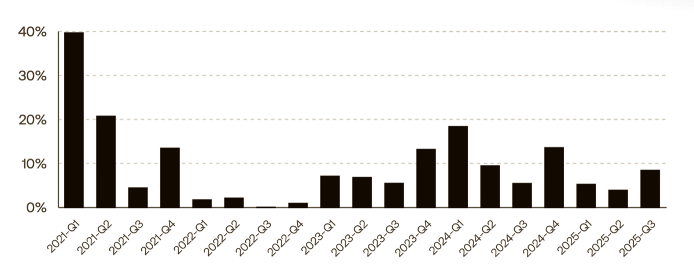
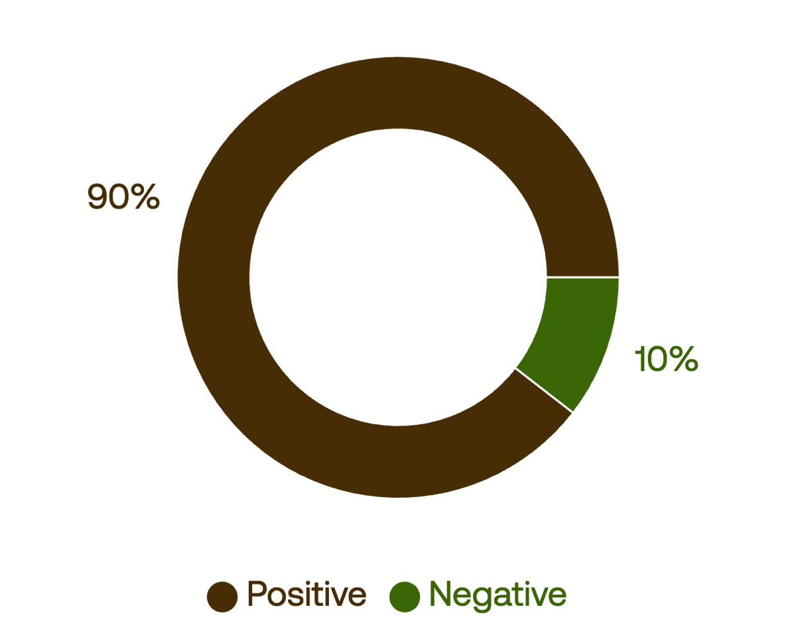
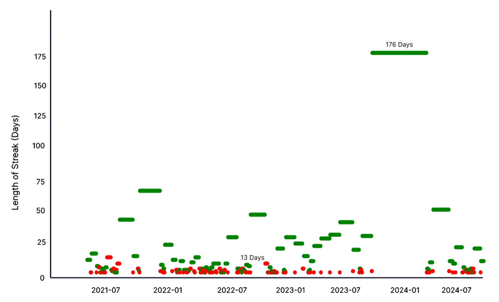

In the world of stablecoins, two ideals have often seemed at odds: decentralization and capital efficiency. A new project, Ethena, has stormed onto the scene, claiming to have cracked the code for achieving both. But Ethena doesn't call its creation, USDe, a stablecoin. It calls it a "synthetic dollar." What does that mean, and why does it matter?

## Meet Ethena: Decentralized Synthetic Dollar {#meet-ethena-decentralized-synthetic-dollar}

At its core, Ethena gives you the power to create your own dollar-pegged currency. By depositing collateral—be it ETH, BTC, SOL, or liquid staking tokens like stETH—you can mint an equivalent amount of USDe. It’s a synthetic dollar, born on the blockchain and designed to maintain a 1:1 value with its real-world counterpart.

Once you have USDe, you can use it across the decentralized finance (DeFi) landscape, just as you would with any other stablecoin. So far, so familiar. But what happens when the ground beneath it shifts?

### What if USDe’s Collateral Prices Drop? {#what-if-collateral-prices-drop}

This brings us to the critical question that has always haunted collateralized stablecoins: "DAI requires over-collateralization precisely to avoid a crisis if the value of the collateral plummets. Ethena, on the other hand, operates on a 'dollar-for-dollar' basis. What happens if the assets backing it take a nosedive?"

Herein lies Ethena's clever twist. For every dollar of cryptocurrency you deposit, Ethena takes out an equivalent short position on a centralized exchange. This is a classic hedging strategy from traditional finance, repurposed for the crypto world.

So, what does this actually do? Imagine the price of ETH, held by Ethena as collateral, drops from $3,000 to $2,900. Normally, this would create a $100 hole in the backing of USDe. But thanks to the short position, Ethena earns $100 from that same price drop, perfectly offsetting the loss. The result? The total value of the collateral remains a steady $3,000. This elegant solution not only protects the peg but also dramatically reduces the amount of collateral required to mint new USDe.

### More Than Just a Stablecoin: Meet sUSDe {#more-than-just-a-stablecoin-meet-susde}

But Ethena's design offers more than just stability. It also provides a way for you to put your USDe to work. While you can use your USDe in the open market, you also have the option to lock it back into the Ethena system. In exchange, you receive a new token: sUSDe. By holding sUSDe, you become a direct beneficiary of the revenue streams generated by the collateral you and others have provided.

### How Ethena Makes Money {#how-ethena-makes-money}

So, where does this revenue come from? Ethena has two primary income sources.

First, the protocol stakes the ETH and other assets it holds as collateral. With liquid staking tokens like stETH, it automatically earns staking rewards, which currently [hover around 2.77% annually](https://lido.fi/ethereum), though this rate fluctuates.

The second, and more dynamic, source of income comes from the short positions it opens for hedging. In the crypto futures markets, known as perpetuals, traders are constantly betting on the future direction of prices. Some go long, expecting prices to rise, while others go short, anticipating a fall. To keep these two sides in balance, the market uses a mechanism called the "funding rate."

In a bull market, where most traders are long, they pay a fee to the short-sellers to keep their positions open. Since crypto markets have historically trended upwards, these funding rates are often positive. As a short-seller, Ethena collects these fees and distributes them to those who have locked their USDe in the system. While this rate is constantly changing and can occasionally turn negative—a risk we'll explore later—it has proven to be a significant source of yield.

<figure><figcaption>Return on average short position in futures markets Average quarterly rates of return on ETH perpetuals markets (annualized). (Source: <a href="https://app.ethena.fi/dashboards/market-data">Ethena Labs</a>)</figcaption></figure>

To put this in perspective, the yield for sUSDe in the last quarter of 2024 [fluctuated between 15-20%](https://app.ethena.fi/dashboards/yields), averaging [at 18%](https://docs.ethena.fi/how-usde-works)[^1]. This powerful combination of stability and yield is what makes Ethena one of the most talked-about projects in DeFi today.

## Ethena: Stablecoin Meets Internet Bond {#ethena-stablecoin-meets-internet-bond}

This unique architecture has a twofold outcome. First, it gives the world USDe: a truly (almost[^2]) decentralized [synthetic dollar](https://nftevening.com/ethena-deep-dive-understand-usde-and-ena-token/) built for the internet economy. Second, it offers sUSDe: an 'Internet Bond' that provides a globally accessible, dollar-denominated savings instrument[^3]. One is money; the other is a vehicle for making that money productive.

## The Price of Innovation: Understanding Ethena's Risks {#the-price-of-innovation-understanding-ethenas-risks}

No great reward comes without risk, and Ethena's design is a masterclass in managing a complex set of trade-offs. The team has been commendably transparent about the challenges, laying them out for all to see. Let's walk through them.

### What if Ethena’s Yield Engine Goes into Reverse? {#what-if-the-yield-engine-goes-into-reverse}

Ethena’s stability hinges on its short positions in the perpetual futures markets[^4]. In these markets, traders who bet on prices rising (going "long") typically pay a fee to those betting on prices falling (going "short"). Since crypto markets have historically been biased toward optimism, Ethena, being permanently short, usually collects a steady stream of these "funding costs." This is the engine of its yield.

But what happens when sentiment flips? In a bear market, fear can take over. Shorts can become the majority, forcing them to pay the longs. For Ethena, this means the yield engine goes into reverse, and the protocol starts bleeding money.

How serious is this threat? Looking at the last three years of data, funding rates have been negative about 20% of the time. While Ethena profited the other 80% of the time, the risk of a prolonged downturn is real. What happens if the losses from funding costs start eating into the collateral backing USDe?

<figure><figcaption>Days of Gains vs. Losses in ETH Futures Markets Over the last three years, short positions on ETH perpetuals have been profitable roughly 90% of the time. (Source: <a href="https://app.ethena.fi/dashboards/market-data">Ethena Labs</a>)</figcaption></figure>

This is where the **Reserve Fund** comes in. Ethena sets aside a portion of its earnings to create an insurance buffer. This fund is designed to cover losses during periods of negative funding, protecting the collateral. While historical data shows that the longest consecutive losing streak for shorts was only 13 days, the future is always uncertain.

<figure><figcaption>Consecutive Days of Positive or Negative Funding Costs Distribution of consecutive days funding (+/-) streaks longer than 5 days. Green bars show streaks of positive funding (yield); red bars show negative streaks. The longest losing streak was 13 days. (Source: <a href="https://docs.ethena.fi/solution-overview/risks/funding-risk">Ethena Labs</a>)</figcaption></figure>

Independent auditors like Chaos Labs (and CryptoQuant later) have modeled these scenarios, recommending a specific reserve amount needed to weather potential storms[^5]. As of now, Ethena has around 1% of outstanding USDe as funding reserve[^6].

If the Reserve Fund were ever depleted, the value of USDe could fall below a dollar. This wouldn't be a sudden, UST-style death spiral. Instead, it would be a slow bleed. Arbitrageurs would sell USDe on open markets like [Curve](https://curve.fi/#/ethereum/pools?search=usde), and approved institutions could then redeem the discounted USDe directly from Ethena for $1 worth of collateral, gradually draining the system. It’s a measured process, not a catastrophic collapse, giving users time to exit their positions with minimal losses.

### Ethena’s Centralization Dilemma {#the-centralization-dilemma}

To get the deep liquidity it needs for its hedges, Ethena must use centralized exchanges—a pragmatic but risky choice. What happens if an exchange like Binance or Bybit goes bust?

Ethena mitigates this counterparty risk in several ways:

1. **No Single Point of Failure:** It spreads its positions across multiple major exchanges, including Deribit, Binance, Bybit, Bitget, and OKX.
2. **Off-Exchange Custody:** This is the crucial part. Ethena uses institutional-grade custodians like [Copper](https://copper.co/en/products/digital-asset-custody), [Ceffu](https://www.ceffu.com/), and [Cobo](https://www.cobo.com/). Client assets are held in a "bankruptcy-remote" legal structure, meaning that if an exchange fails, Ethena’s collateral is legally separate and cannot be seized to pay the exchange's debts.
3. **Frequent Settlement:** Profits from trades are swept from the exchanges back to secure custody every 8 to 24 hours, minimizing the funds at risk at any given moment.
4. **Radical Transparency:** Ethena provides real-time dashboards showing all [collateral balances](https://app.ethena.fi/dashboards/solvency) and [hedging positions](https://app.ethena.fi/dashboards/hedging/BTC), along with monthly [attestations](https://app.ethena.fi/dashboards/transparency) from third-party auditors.

### Other Ethena Risks: Code, Oracles, and Regulators {#code-oracles-and-regulators}

Beyond market and counterparty risks, a few other factors are in play:

- **Smart Contract Risk:** Ethena is new technology. Like any complex protocol, there's always a risk of a bug or exploit in the code that has yet to be discovered.
- **Oracle Risk:** The protocol [relies on external data feeds](https://docs.ethena.fi/solution-design/use-of-oracles) from [Pyth Network](https://www.pyth.network/) and [Redstone](https://redstone.finance/) to get accurate pricing information. If these oracles are compromised, it could threaten the system's operations. Using multiple providers helps reduce this risk.
- **Regulatory Risk:** The global regulatory landscape for crypto is a minefield. Ethena restricts access for users in numerous jurisdictions, including the United States, United Kingdom, and Canada, to comply with global regulations.

### Is Ethena Worth the Risk? {#is-it-worth-the-risk}

Yes, the list of risks is long. But risk is never absent; it's just different. Holding centralized stablecoins like USDT or USDC means you are trusting a company and the traditional banks they partner with. You are exposed to censorship and classic counterparty risk.

Ethena replaces that with a different set of transparent, auditable, and market-based risks. The choice is yours: Do you prefer the familiar, opaque risks of the old financial world, or the volatile but transparent risks at the frontier of DeFi? Ethena bets that for many, a calculated, on-chain risk is better than a risk you can't see at all.

## Where Does Ethena Go From Here? {#where-does-ethena-go-from-here}

Ethena’s ascent has been nothing short of explosive. In the short time since its launch, it has attracted over **$5.3 billion** in assets, a testament to the market's hunger for a capital-efficient, decentralized dollar. But with great growth comes a great question: what are the limits?

A system like Ethena can’t grow infinitely. Its size is fundamentally capped by the depth of the markets it relies on for hedging. To maintain its peg, every dollar of collateral must be matched by a dollar in a short position. This means Ethena’s potential size is a fraction of the total open interest in the ETH and BTC derivatives markets.

The team estimates their ceiling is roughly 30% of the total open positions available. While this imposes a hard limit at any given moment, the ceiling itself is constantly rising. The [crypto derivatives market is not static](https://iongroup.com/blog/markets/crypto-derivatives-a-comprehensive-guide/); it grows with the underlying assets. According to an [analysis](https://chaoslabs.xyz/resources/chaos_Labs_ethena_perpetual_assessment_risk_report.pdf) by Chaos Labs, a 1% increase in ETH's market capitalization tends to expand the futures market by 1.2% to 1.45%. In other words, as the crypto ecosystem expands, so does Ethena's runway.

## The ENA Token: Valuing the Protocol {#the-ena-token-valuing-the-protocol}

Much of the initial excitement around Ethena was fueled by its governance token, **ENA**. While it grants holders a say in the protocol's future, its real value may come from a potential share in Ethena's revenue.

So, just how profitable is this system? We can sketch out a simple model.

The protocol generates revenue from the yield on USDe that *isn't* staked as sUSDe. As of today, with roughly **$5.3 billion** in total USDe supply and about [60% of that locked as](https://dune.com/entropy_advisors/ethena-protocol-metrics) sUSDe, the protocol is earning yield on the remaining **$2.1 billion**.

Assuming an annualized yield of **10%** from its hedging activities, Ethena's potential annual revenue clocks in at over **$210 million**. A figure like that would instantly place Ethena among the most profitable products in DeFi history[^7].

Of course, such high returns rarely last forever. [Ethena’s incredible yield](https://www.binance.com/en/square/post/24719862524642) is a direct result of a market inefficiency—an imbalance between long-biased retail traders and the few players willing to take the other side. As Ethena proves the model's success, you can bet that institutional capital will flood in to capture the same spread. Inevitably, this competition will compress the funding rates, and the 'alpha' will shrink. The challenge for Ethena will be to innovate faster than the market can catch up.

## Conclusion: The Great DeFi Experiment {#conclusion-the-great-defi-experiment}

Ethena is more than just another protocol; it’s a high-stakes experiment attempting to deliver two of crypto’s holy grails: a truly decentralized, scalable synthetic dollar (USDe) and a native, permissionless savings vehicle for the internet (the sUSDe "Internet Bond").

Its complex architecture is both its genius and its vulnerability. The risks—from negative funding rates to exchange counterparty failure—are not just footnotes; they are core to the model. The protocol’s future hinges on a fundamental question: can its sophisticated defenses and transparent risk management outlast the inherent chaos of open markets? The measures are in place, but they have yet to be tested by a true black swan event.

At the same time, Ethena faces the paradox of success. The incredible yields it offers are a product of market inefficiency. As the protocol proves its model and competitors flood in to capture the same arbitrage, those returns will inevitably compress.

The journey ahead is uncertain. We will see if the team can navigate the immense risks while adapting to a maturing market. What is certain is that Ethena represents a bold leap forward, pushing the boundaries of what a decentralized financial system can look like. Whether it succeeds or fails, its story will be a defining chapter in the evolution of money.

[^1]: As of mid-2025, the yield has stabilized to a more typical, yet still significant, rate of around 12-13%.

[^2]: Caveat: USDe is backed through centralized exchanges and custodial services.

[^3]: Subject to regional regulations

[^4]: Perpetuals are a type of futures contract—like traditional futures, but with no expiration date.

[^5]: Initial Chaos Labs finding was $33 million for the first $1bn USDe. Source: Chaos Labs ‘[Ethena Perpetual Assessment Risk Report](https://chaoslabs.xyz/resources/chaos_Labs_ethena_perpetual_assessment_risk_report.pdf)’ p. 43 dated Nov 9, 2023. CryptoQuant remodeled a different dynamic approach and concluded that “To safely manage the extraordinary event of large negative funding rates at larger market capitalizations of $4 billion, $5 billion, $7.5 billion or $10 billion, the reserve fund would need to increase to about $40 million, $50 million, $80 million and $100 million, respectively”. Source: ‘[Ethena: USDe’s Tail Risks Analysis and Key Metrics to Monitor](https://bucket.cryptoquant.com/applied-research/6639fff4f919457d1576444d/Ethena%2520-%2520USDes%2520Tail%2520Risks%2520Analysis%2520and%2520Key%2520Metrics%2520to%2520Monitor.pdf) ‘ p.7 dated April 16, 2024

[^6]: Ethena has [$61 million in funding reserve and $5.3 billion outstanding USDe](https://dune.com/entropy_advisors/ethena-protocol-metrics) as of mid-2025 which corresponds to 1.15%

[^7]: These figures are for mid-July. During the first half of 2025 the staked USDe figures ranged between 42% and 71% and sUSDe earning yields were between 4.89% and 10.03%. Source: [Dune Analytics](https://dune.com/entropy_advisors/ethena-protocol-metrics) - entrophy\_advisors
