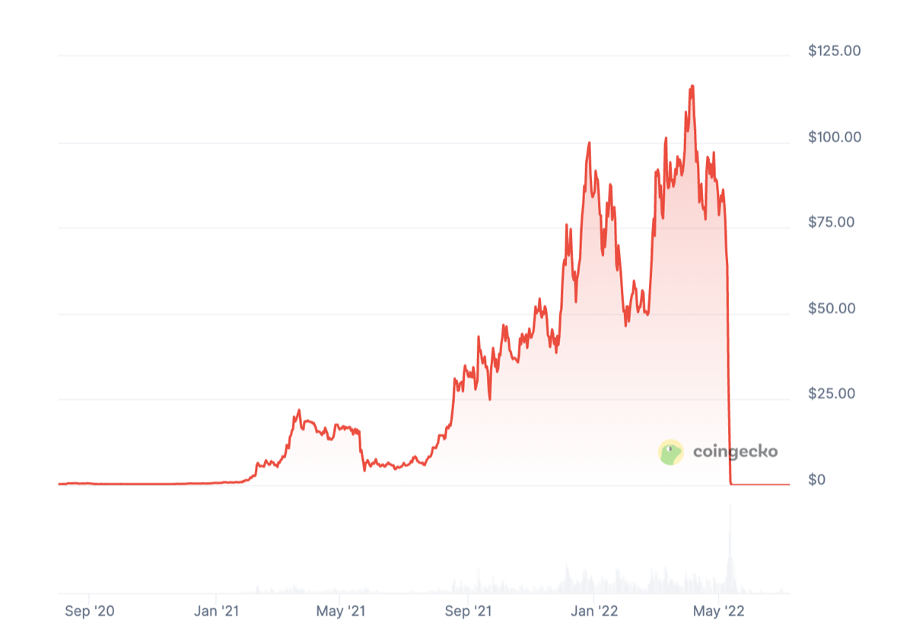
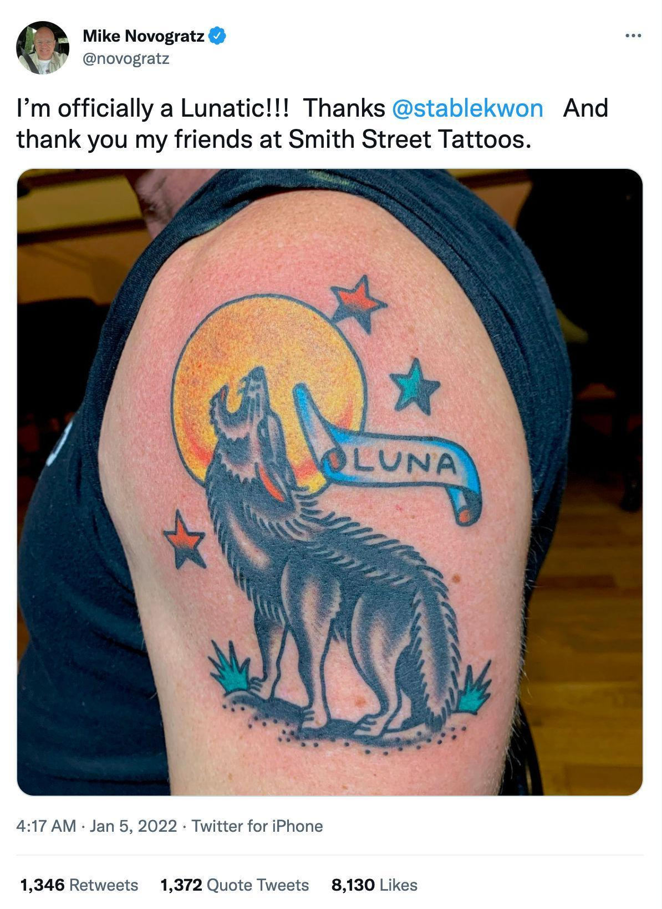

This section dives into the story of Terra’s algorithmic stablecoin UST, which faced a major crisis in May 2022.

UST, which was issued by the Terra, a payments-focused blockchain, lost its peg to the US dollar due to a coordinated market attack. Let’s quickly recap what stablecoins are before examining what went wrong with UST.

## What Is UST, and How Does It Work? {#what-is-ust-and-how-does-it-work}

UST is an algorithmic stablecoin. Unlike stablecoins backed by cash (like USDC) or over-collateralized crypto (like DAI), UST was backed solely by Terra’s native cryptocurrency, LUNA.

Here’s how it works: If you want UST, you send LUNA. If you send $100 worth of LUNA, the system mints 100 UST and burns the LUNA you provided. Want your money back? Send 100 UST to the system, it burns that UST, and you receive freshly minted LUNA worth $100.

### Why Did the Market Need UST? {#why-did-the-market-need-ust}

Given the many stablecoins already available, why introduce UST? Terra is a payments-focused blockchain that needed a flexible and liquid stablecoin tailored specifically to its ecosystem. Using USDC or USDT would require Terra to pay external issuers, whereas with UST, Terra can mint tokens directly against LUNA whenever needed.

But why would users adopt UST? The theory was simple: If you believed in Terra’s future growth and wanted to use its ecosystem apps, you would acquire and hold UST. Yet initially, the Terra ecosystem didn’t have many applications, creating a classic chicken-and-egg dilemma.

Terra solved this by employing a tried-and-tested DeFi incentive: attractive yields. Through Anchor Protocol, Terra offered an incredible 20% interest rate on deposited UST—highly appealing, especially when US dollar yields were near zero in 2021.

The strategy worked spectacularly. From launch until May 2022 (around 18 months), the market supply of UST soared to $18 billion.

Notably, UST had already survived a scare in May 2021, temporarily losing its peg to $0.96, though it quickly recovered, reassuring investors.

### What Happened Next to UST? {#what-happened-next}

UST’s rapid growth benefited LUNA immensely. To get high yields on Anchor, investors swapped LUNA for UST, driving demand and reducing LUNA’s supply through burning. Consequently, LUNA’s price surged from just $1 to an [all-time high](https://www.coingecko.com/en/coins/terra-luna-classic) of $119 by early April 2022.

However, this positive cycle had a critical vulnerability. If investors ever lost confidence and swapped their UST back for LUNA en masse, increased LUNA issuance could crash its price, triggering a vicious downward spiral.

To prevent such a scenario, Terra’s founders adopted a traditional central banking strategy: building a reserve. Just as central banks hold gold or foreign currencies, Terra chose Bitcoin (BTC), the “digital gold,” [announcing](https://www.securities.io/news-of-terras-10bn-btc-reserve-spurs-bitcoin-rally-heres-what-more-it-means/) plans to build a $10 billion BTC reserve. Eventually, they accumulated [roughly $3 billion worth of BTC](https://www.elliptic.co/blog/what-happened-to-the-3.5-billion-terra-reserve-elliptic-follows-the-bitcoins).

Unfortunately, this precaution wasn’t enough. [Between May 7-9](https://www.coindesk.com/learn/the-fall-of-terra-a-timeline-of-the-meteoric-rise-and-crash-of-ust-and-luna), following the US Federal Reserve’s announcements and broader crypto market declines, heavy selling pressure hit UST, causing it to lose its dollar peg irreversibly. LUNA went down from its highs to below $1 in a matter of hours.

<figure><figcaption>LUNA price</figcaption></figure>

Terra ecosystem’s native coin LUNA price chart *(USD). (Source: CoinGecko)*

## Trust Is Everything for Stablecoins {#trust-is-everything}

Stablecoins are foundational to decentralized finance (DeFi), making user trust essential. Investors expect stablecoins to reliably preserve value amid other investment risks.

USDC earns trust by proving each token is backed by actual dollars. USDT lacks perfect transparency but benefits from being the de facto standard on centralized exchanges. DAI is over-collateralized, though crypto-backed reserves pose their own risks, especially in market downturns.

Algorithmic stablecoins like UST are different, experimental, and inherently risky. Past algorithmic projects like Basis failed, while others, like Ampleforth, remain niche despite hovering near $1.

Long-term success for algorithmic stablecoins requires broad acceptance in payments and app integrations. Terra was aware of this, establishing [partnerships with Avalanche](https://www.chaincatcher.com/en/article/2072831) and Evmos. But offering high interest alone doesn’t guarantee genuine utility if users only deposit funds for yield without actual spending.

In the short term, however, success hinged entirely on trust in LUNA. High yields fueled rapid but unsustainable growth. Paying 20% annually on $18 billion ($3.6 billion per year) required constant issuance of new LUNA.

Terra’s opaque defense measures during attacks included [allocating](https://x.com/lfg_org/status/1526126703046582272) $1.5 billion to OTC traders. These actions, taken without clear transparency, undermined trust. This secrecy and lack of on-chain verification fueled rumors and fear, exacerbating the crisis.

## Lessons Learned from the Crisis {#lessons-learned-from-the-crisis}

While it won't recover losses, the crisis offers important lessons that can make crypto stronger. Let’s review some key takeaways:

### DeFi Is Young: Theory vs. Reality {#defi-is-young-theory-vs-reality}

DeFi’s risks aren’t exaggerated. Even the most carefully planned theoretical models can fail under real-world stress.

Delphi Digital, a leading DeFi analyst firm, later [openly reflected](https://members.delphidigital.io/reports/learnings-from-last-week/) on their Terra misjudgment. Initially, Anchor’s 20% yield seemed reasonable compared to typical 100%-plus DeFi yields. But as yields fell across DeFi in 2022, Anchor’s fixed rate drew unsustainable inflows, eventually collapsing under market pressures despite BTC reserves.

### Decentralization Is Essential {#decentralization-is-essential}

Decentralization must be the guiding principle for blockchain projects. While some centralization may be acceptable early on, genuine decentralization demands transparency in decision-making and full on-chain traceability. Terra’s centralized approach and opaque emergency actions undermined these principles severely.

### Understanding Relative Risks Matters {#understanding-relative-risks-matters}

In traditional finance, investors balance risky and “safe” assets. Similarly, crypto investors thought UST was safe because of its supposed peg to USD. Unfortunately, the reality proved different—highlighting the importance of accurately understanding and evaluating relative risks.

### Fanaticism Has Limits {#fanaticism-has-limits}

Every project initially needs enthusiastic supporters who help sustain momentum despite early imperfections. However, unchecked fanaticism can become toxic. Terra’s community, including founder Do Kwon, notoriously dismissed criticisms as “[stupid](https://twitter.com/stablekwon/status/1464897977793728514?s=20&t=jbrCdOsCTMywLNKXSYk-vA).” Ignoring constructive criticism ultimately prevented necessary improvements and risk mitigation.

Even seasoned investors, like Galaxy Digital’s Mike Novogratz—who infamously tattooed LUNA on his arm—fell prey to overconfidence. Post-collapse, Novogratz acknowledged his mistake, emphasizing humility as essential for investors.

<figure markdown="1">

<figcaption markdown="span">“I’m officially a Lunatic![^1]” – Mike Novogratz ([source](https://twitter.com/novogratz/status/1478535972560195585?ref_src=twsrc%255Etfw); later deleted).</figcaption>
</figure>

### Transparency: A DeFi Must-Have {#transparency-a-defi-must-have}

Transparency is crucial for DeFi because no formal regulatory oversight exists. Users must trust platforms based purely on openly available information, including open-source code, on-chain transactions, and publicly determined strategies.

Terra’s BTC reserves were not transparent. It took Terra 10 days after the crisis began to publicly reveal their BTC sales, severely damaging trust.

### A Painful but Necessary Lesson {#a-painful-but-necessary-lesson}

Despite widespread commentary claiming this crisis damaged DeFi irreparably, I disagree. The UST crisis undoubtedly delayed mainstream adoption—especially alongside the collapses of 3AC and FTX. However, it clearly demonstrated the importance of adhering strictly to Web3 principles.

Had the collapse occurred later, losses could have been even greater, given other unstable projects emerging at the time. Viewed optimistically, perhaps we narrowly avoided an even bigger disaster.

## Conclusion {#conclusion}

The UST/LUNA collapse, crypto’s largest crisis to date, had lasting repercussions. However, I believe the Web3 community emerged stronger by clearly recognizing the dangers of centralized, opaque, and leveraged structures. Crypto’s post-crisis path emphasizes transparency, openness to criticism, and more cautious growth. Future crises are inevitable, but hopefully, small investors will increasingly weather them safely. Time will tell.

[^1]: Lunatic refers humorously to LUNA fans.
