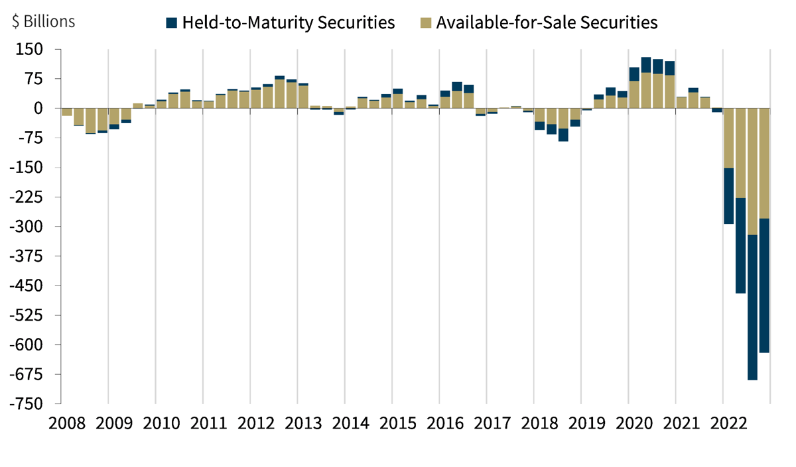

The spring of 2023 sent a [tremor](https://www.imf.org/en/Publications/global-financial-stability-notes/Issues/2024/03/04/The-US-Banking-Sector-since-the-March-2023-Turmoil-Navigating-the-Aftermath-544809) through the U.S. financial system. For a moment, it felt like we were staring into the abyss of another 2008-style meltdown as three banks imploded in rapid succession. While a massive government rescue package[^1] managed to calm the immediate panic, the episode left a lingering question: Just how stable is the ground beneath our feet? To understand what might be coming, we need to dissect what went wrong.

## The Setup: A Flood of Cash, Then a Sudden Stop {#the-setup-a-flood-of-cash-then-a-sudden-stop}

To understand the banking crisis, we first have to understand the tidal wave of cash the Federal Reserve unleashed on the economy. In 2020 and 2021, [to fight the pandemic-induced recession](https://www.cbpp.org/research/economy/tracking-the-recovery-from-the-pandemic-recession), the Fed effectively turned on the money printer. This deluge of capital caused bank deposits to surge by over $4 trillion in 2020–21, reaching record‑high levels.

For banks, this was a strange problem to have. They were swimming in cash but had nowhere to lend it. Their solution? Pour that money into the safest asset they could find: U.S. Treasury bonds. With interest rates at historic lows, they loaded up on long-term bonds (5-10 years) to chase whatever meager yield they could find.

This strategy created a hidden time bomb: a massive *maturity gap*. Banks' liabilities—[their customer deposits](https://gocardless.com/en-us/guides/posts/what-is-a-customer-deposit/)—are short-term. Anyone can demand their cash back at a moment's notice. But their assets—those long-term bonds—were locked up for years. Sure, you can sell a bond on the secondary market, but that comes at a cost, especially if everyone is selling at once. And that's exactly where the problem began.

## The Squeeze: How Everything Unraveled {#the-squeeze-how-everything-unraveled}

The trigger was the Fed's dramatic reversal. In 2022, facing down the worst inflation in 40 years, it slammed on the brakes, [hiking interest rates](https://www.pbs.org/newshour/economy/analysis-what-the-feds-largest-interest-rate-hike-in-decades-means-for-you) at a pace not seen in decades. This single move created a two-pronged crisis for the banks.

First, as interest rates climbed, the market value of those low-yield bonds the banks were holding plummeted. A simple rule of finance is that when new bonds pay higher interest, older bonds with lower interest become [less valuable](https://www.pimco.com/ca/en/resources/education/bonds-102-understanding-how-interest-rates-affect-bond-performance). This created a massive, unspoken problem.

A clever accounting rule[^2] allowed banks to value these bonds at their original purchase price—not their dismal new market price—as long as they were 'held to maturity.' This accounting trick papered over the cracks, hiding a [staggering **$620 billion**](https://www.businesstimes.com.sg/international/us-banks-have-us620-billion-unrealised-losses-their-books) in unrealized losses across the U.S. banking system.

**Bonds held by banks - book vs market value**

<figure><figcaption><em>The growing chasm between the book value and market value of bonds held by banks. (Source: FDIC)</em></figcaption></figure>

Second, customers started getting smarter with their money. Why keep cash in a bank account earning a paltry 0.1% when money market funds were suddenly offering close to 5%? A [quiet exodus of deposits began](https://www.elibrary.imf.org/view/journals/065/2024/001/article-A001-en.xml) as people moved their money to chase higher yields. This forced banks that were losing liquidity to do the one thing they couldn't afford to do: sell their underwater bonds and turn those paper losses into catastrophic real ones.

## The Tipping Point: Concentration and Contagion {#the-tipping-point-concentration-and-contagion}

This is where the unique risks of the three failed banks came into play. Their downfall wasn't just about bad bond strategy; it was about who they served. This was a crisis of **sectoral concentration**.

[The first domino, Silvergate Bank](https://www.ledgerinsights.com/silvergate-bank-wind-down-crypto/), was the "crypto bank." [The third, Signature Bank](https://time.com/6263742/signature-bank-crypto/), was also known for being crypto-friendly. And [the big one, Silicon Valley Bank](https://en.wikipedia.org/wiki/Silicon_Valley_Bank) (SVB), was the undisputed banker to the tech and venture capital world[^3].

These sectors were ground zero for the boom-and-bust cycle. They were flush with cash during the easy-money era of 2020-21, and they parked it all in these three banks. But when the Fed tightened the screws and venture capital funding dried up, these startups began burning through their deposits just to stay alive.

The customers of these banks weren't your average depositors. They were hyper-connected, tech-savvy founders and investors, all in the same group chats. When whispers of trouble started, the reaction was instantaneous. This was the digital-age volatility the Fed fears most.

Silvergate's demise was a slow burn. Its deep ties to the collapsed FTX exchange put it under a microscope[^4]. Scrutiny from crypto-skeptical senators [in a public letter](https://www.warren.senate.gov/newsroom/press-releases/senators-warren-marshall-kennedy-release-new-information-renew-push-for-answers-from-silvergate-bank-over-role-in-ftx-collapse/) sealed its fate, and it went into voluntary liquidation. Crucially, its assets were enough to cover all deposits without a taxpayer-funded bailout[^5].

But Silvergate's failure sparked a new question in the market: "Who's next?" All eyes turned to SVB, the bank with the highest ratio of bonds and the fewest insured deposits. The answer came with stunning speed. Venture capital firms blasted warnings to their portfolio companies: "Get your money out of SVB. Now." What followed was a bank run executed over Slack and Twitter, an exodus of billions in just 48 hours[^6]. By Friday, March 10, 2023, [regulators had seized the bank](https://www.fdic.gov/news/speeches/2023/spmar2923.html).

The panic was palpable. Over the weekend, U.S. authorities stepped in with overwhelming force. In a [sweeping announcement](https://www.federalreserve.gov/newsevents/pressreleases/monetary20230312b.htm), they guaranteed *all* deposits at the failed banks—well beyond the standard $250,000 FDIC limit—and launched a new program to allow banks to borrow against their devalued bonds at face value.

Tucked into that announcement, however, was a curious detail: the closure of Signature Bank. This move struck many as odd. Signature wasn't as exposed to bond losses as SVB or as concentrated in crypto as Silvergate[^7]. In crypto circles, the shutdown was seen not as a rescue, but as a message—a sign of the administration’s growing hostility towards the digital asset industry[^8].

## Key Takeaways and Future Implications {#key-takeaways-and-future-implications}

Let's get one thing straight: 2023 wasn't a repeat of 2008[^9]. This crisis wasn't about bad loans. It was a spectacular failure of basic risk management. Banks made a massive, unhedged bet that low interest rates were here to stay. They were wrong.

### A Reckoning for Banks, A Scare for Depositors {#a-reckoning-for-banks-a-scare-for-depositors}

The blame lies squarely with the bank executives who made that reckless bet. They lost their jobs, and their investors were wiped out. The Biden administration made it clear there would be no bailouts for those at the top.

While depositors were ultimately made whole, the chaos of that weekend was a brutal wake-up call. Tech founders with payroll locked in SVB aged years in a matter of days[^10]. The event triggered a predictable flight to safety, with customers pulling money from smaller banks and consolidating it in the "too big to fail" giants, a trend reflected in plunging small bank stocks[^11].

### The Fed's Dilemma {#the-feds-dilemma}

The Federal Reserve knew its aggressive rate hikes would eventually break something; it just didn't expect the banking system to crack first. The Fed was caught in a dilemma: keep fighting inflation or protect financial stability?

The government’s decision to guarantee all deposits stopped the panic but introduced "moral hazard"—the long-term risk that banks will gamble again, knowing they'll be bailed out. For now, putting out the fire took priority over the inflation fight[^12].

### Innovation vs. Regulation {#innovation-vs-regulation}

The SVB collapse proved that bank runs are now digital flash mobs, executed in hours via smartphone. This is the new reality of "social media risk," where a firm's reputation can be dismantled overnight.

Amid this chaos, the shutdown of Signature Bank felt less like a rescue and more like a message aimed at the crypto industry. It revealed a deep friction between slow-moving regulators and the relentless pace of innovation. You cannot regulate a 24/7 digital world with a 9-to-5 analog mindset.

This battle between innovation and regulation will define the next decade. While the US system is often slow to adapt, don't bet against its ability to eventually create the frameworks that allow it to lead.

[^1]: Including full coverage of uninsured deposits and a new Fed lending facility

[^2]: Under US GAAP, (the accounting principles) that was put into effect in 1993, banks can classify securities into one of three categories. Held-to-Maturity (HTM), Available-for-Sale (AFS) and Trading Securities. Under first category, HTM securities are recorded at amortized cost, not at fair market value. Any unrealized losses or gains due to market value changes are not reflected on the income statement or in shareholder equity.

[^3]: Crypto is still new, so most big banks stay away from startups in the space. But crypto companies have unique needs. For example, they operate 24/7, so they can’t rely on traditional banking hours. That’s why Silvergate launched SEN, a 24/7 money transfer network just for its clients. It created a powerful network effect: if your whole industry is using SEN, joining it means breaking free from one of traditional finance’s biggest barriers. The same goes for SVB. Many US banks won’t open accounts unless the company’s authorized signers have US Social Security Numbers (SSNs). But many founders, especially those incorporating in Delaware, live abroad. SVB became the go-to bank for tech startups because it didn’t require SSNs to open an account.

[^4]: “If it had been a bank for farmers, this wouldn’t have spiraled out of control so fast” is sounding more valid by the day.

[^5]: Silvergate voluntarily liquidated in March 2023, its liquidation plan repaid all deposits, without taxpayer funding, and in September 2024 the holding company filed for bankruptcy to repay creditors from remaining assets

[^6]: On Thursday, March 9, 2023 alone, SVB saw $42 billion in withdrawals—about 25% of its total $175 billion in deposits! (Source: DFPI.) Shockingly, Moody’s still rated the bank “A” just the week before.

[^7]: Bank officials said the deposit run that began Friday didn’t stop until Sunday. Since the bank operated a 24/7 payment system, outflows continued right through the weekend.

[^8]: The FDIC's official review later concluded that the bank's failure was caused by poor management and a devastating, contagion-fueled bank run, rather than a targeted regulatory strike on crypto.

[^9]: While some outlets mentioned crypto client exposure, Treasury Secretary Yellen and official reports emphasized that the bank’s problem stemmed from unrealized losses on long-dated bond holdings.

[^10]: It’s estimated that around half of US startups banked with SVB. (Source: [Delphi Digital)](https://twitter.com/delphi_digital/status/1634956829058019331)

[^11]: If a bank gets in trouble, deposits are protected—but its share price isn’t. That’s why investors who fear trouble rush to dump their bank stocks.

[^12]: Some believe quantitative easing leads to inflation. Others argue it boosts asset prices and pushes money into alternative (and riskier) assets instead.
