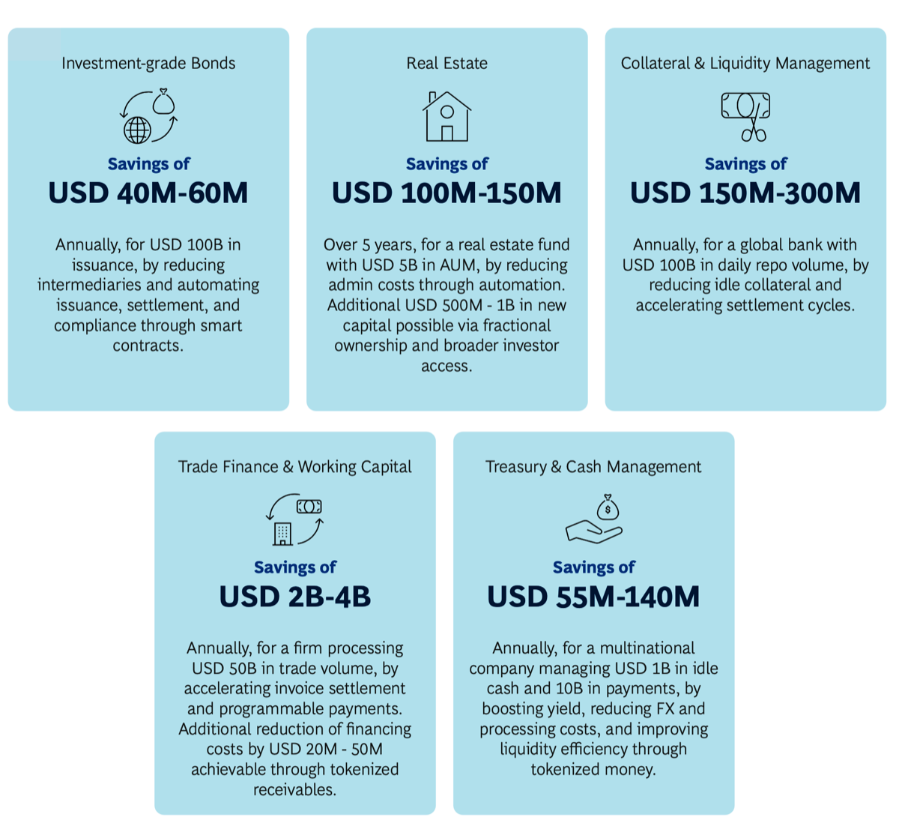
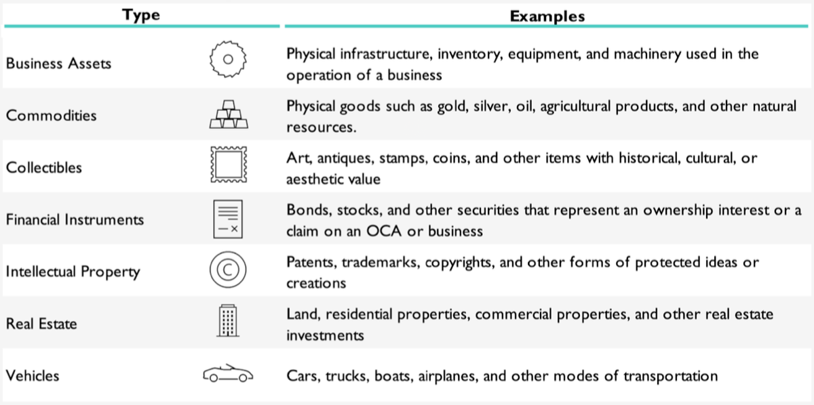
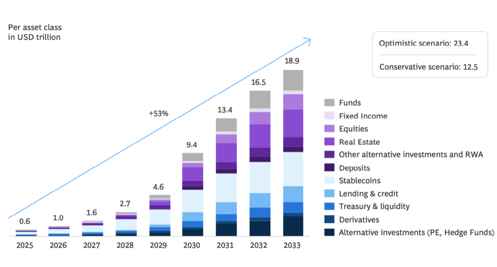

To understand the Web3 economy, you first need to understand its core building block: the token.

## What are tokens? {#what-are-tokens}

A token is a digital representation of ownership. It can represent a piece of a company, a vote in a network, or a title to a physical object like a house.

To grasp why this is a breakthrough, we have to look at a fundamental problem of the digital world. Physical assets exist in one place at one time. Digital assets—bits and bytes—are different. Their greatest strength is that they can move instantly, unbound by geography. Their greatest weakness? They can be copied just as easily.

### The 'Copy-Paste' Problem {#the-copy-paste-problem}

Think about it. You can right-click a JPEG and duplicate it endlessly. Each copy is identical to the original. When anything can be infinitely replicated for free, it becomes impossible for it to hold value. So how did we solve this?

### The Centralized Solution {#the-centralized-solution}

For a long time, the answer was trust. Someone had to promise us that the digital numbers in our bank accounts were scarce and couldn't be copied. That "someone" was a bank. We, as a society, trusted these large institutions to manage the ledger.

This system worked well enough to power the digital economy for decades. We now live in a world of credit cards and wire transfers, where money is mostly an abstraction. Some Scandinavian countries have become almost entirely [cashless societies](https://all-things-nordic.com/2024/11/27/nordic-countries-lead-europe-toward-cashless-societies/)[^1]. But this entire system rests on a foundation of centralized intermediaries.

### The Decentralized Breakthrough {#the-decentralized-breakthrough}

This is where blockchain changes the game. It solves the copy-paste problem without needing a bank.

A blockchain is a shared public ledger. When a digital asset is recorded on it, its scarcity is guaranteed and verified by the entire network. Anyone can see it. No single entity can change it. Through the power of mathematics and cryptography, a network of computers can achieve the same social consensus on trust that took banks centuries to build. It creates true, native digital scarcity.

### From Concept to Code {#from-concept-to-code}

So, a token is a scarce digital asset secured by a blockchain, free from the control of any single institution.

Technically, a token is just a small piece of code—a smart contract—that represents digital ownership. But the true magic lies in a single property: this code is *programmable*. Programmability gives these digital assets [superpowers](https://www.lcx.com/the-transformative-role-of-smart-contracts-in-asset-tokenization/), which we will explore next. But first, let's look at the [different kinds of tokens](https://axiomq.com/blog/token-definition-how-they-work-and-why-they-matter/) that exist.

## Token Standards {#token-standards}

For tokens to work together across thousands of different applications, they need a common language. Token standards are blueprints that ensure every token speaks the same language, allowing them to be universally understood, traded, and used. Think of them as the shipping containers of the digital world—a simple, brilliant idea that unlocked global commerce.

### Fungible Tokens {#fungible-tokens}

The first tokens, like Bitcoin, were designed to be *fungible*, a core feature of money. Why does this matter?

Fungibility means that each unit is identical and interchangeable. A dollar is a dollar, no matter its serial number. This property is the bedrock of commerce. You trust that the dollar you accept for selling a coffee can be used to buy bread, and its value will be the same. History is filled with cautionary tales of kings who debased their currency by mixing gold with cheaper metals. This destroyed interchangeability, shattered trust, and led entire kingdoms into crisis.

The first tokens in the crypto world learned this lesson. Both Bitcoin and Ethereum's native coin, ETH, are fungible. But Ethereum also allows others to build on top of its network. For these new tokens to act like money and circulate freely within the vast Ethereum ecosystem, they must follow a shared blueprint. This standard for creating fungible, money-like tokens is called [ERC-20](https://ethereum.org/en/developers/docs/standards/tokens/erc-20/).

### Non-Fungible Tokens {#non-fungible-tokens}

As the blockchain world evolved, new ideas emerged that didn't fit the mold of money. How do you represent unique assets like a piece of digital art, a collectible, or a property deed? The fungible ERC-20 standard was the wrong tool for the job. By their very nature, these assets needed to be one-of-a-kind.

In 2018, the Ethereum community introduced a new standard to solve this: [ERC-721](https://eips.ethereum.org/EIPS/eip-721). This was the birth of the Non-Fungible Token, or NFT.

An NFT is a smart contract that points to a specific asset and gives it a *unique ID*. If you have a collection of 10,000 digital trading cards, each one is assigned a number from 1 to 10,000. While they all belong to the same collection, the unique ID makes each one distinct and individually ownable.

### Hybrid Tokens {#hybrid-tokens}

The software world moves fast, and new needs quickly lead to new inventions. Historically, a major challenge on Ethereum's main network was cost. Deploying and managing a unique smart contract for every different item type in a complex application, like a video game, was incredibly inefficient and expensive due to Layer 1 transaction fees.

This challenge led to the creation of the [ERC-1155 standard](https://ethereum.org/en/developers/docs/standards/tokens/erc-1155/). It’s a hybrid, multi-token model designed for maximum efficiency. Think of it as a master contract that can act like a vending machine, dispensing both fungible stacks of items (like potions) and unique, individual collectibles (like a legendary sword) from a single interface. While many modern applications now solve the cost issue by building on cheaper Layer 2 networks, the ERC-1155 standard remains a powerful tool that combines the mass-production of ERC-20 with the uniqueness of ERC-721 in a highly efficient architecture.

### Tokens vs. Coins: What's the Difference? {#tokens-vs-coins-whats-the-difference}

You’ll often hear the words ‘token’ and ‘coin’ used interchangeably, but there's a simple distinction worth knowing.

Think of it like this: a **coin** is the native currency of a specific Layer 1 blockchain. It’s the asset that powers the network itself. Bitcoin (BTC) is the coin of the Bitcoin blockchain. Ether (ETH) is the coin of the Ethereum blockchain. AVAX is the coin of the Avalanche network. These coins are essential; they are used to pay for transaction fees, often called "gas," which is the fuel that makes the network run.

A **token**, on the other hand, is [an asset](https://www.investopedia.com/terms/c/crypto-token.asp) built *on top* of an existing blockchain. Thousands of different tokens, from stablecoins to NFTs, are built on platforms like Ethereum using [standards](https://www.myetherwallet.com/blog/the-different-types-of-ethereum-tokens/) like ERC-20 or ERC-721. They rely on Ethereum’s infrastructure to exist and are secured by its network.

So, every coin is a type of token, representing ownership of its native network. But not every token’s a coin, because most tokens are applications running on a network, not the network itself.

## Why Tokenization Matters {#why-tokenization-matters}

What makes tokenizing an asset so powerful? Consultants can list [endless benefits](https://www.mckinsey.com/industries/financial-services/our-insights/from-ripples-to-waves-the-transformational-power-of-tokenizing-assets), but they all stem from one core feature: **programmability.**

### The Superpower: Programmability {#the-superpower-programmability}

Simply digitizing something creates a pale imitation of the real thing. The digital dollars in your bank account today aren't functionally different from the paper cash you rarely carry. It's just a number on a screen.

But when you tokenize an asset, you’re not just creating a digital record; you're embedding it with logic. You’re turning it into a small piece of software—a smart contract—that can execute rules automatically. This transforms it into something entirely new.

### CBDC’s: Programmable Money {#cbdcs-programmable-money}

Consider the idea of a Central Bank Digital Currency (CBDC). When a nation's currency is tokenized, it becomes programmable. This allows for incredibly precise and efficient policy.

Imagine a flood devastates a farming region. The government could instantly send aid—in the form of a CBDC—to the accounts of affected farmers. But it could also program that money to be usable only for essential recovery purchases, like tools and fuel. The aid goes exactly where it's needed, for the purpose it was intended, with no leakage.

### A Double-Edged Sword {#a-double-edged-sword}

This level of control is already being used in the crypto world, particularly with stablecoins. Tether, the largest stablecoin provider, is known to quickly comply with requests from authorities to remotely freeze USDT in user accounts.

It’s a stark reminder that programmability is a tool, and its impact depends on who wields it. It prompts a critical question: If your assets can be frozen by a central party, do you truly own them? Suddenly, the promise of decentralization becomes much more nuanced.

The benefits of programmability, however, are vast. They cascade across the financial, real, and crypto economies, unlocking new efficiencies and markets.

### Unlocking New Markets and Efficiencies {#unlocking-new-markets-and-efficiencies}

Programmability is the key that unlocks a cascade of other advantages.

Assets that live on a blockchain operate on a global, 24/7 financial infrastructure. This leads to [faster settlements and radically reduced operational costs](https://www.mckinsey.com/featured-insights/mckinsey-explainers/what-is-tokenization).

<figure><figcaption>Efficiency potential enabled by tokenization Example of the advantages of tokenization in various areas (Source: <a href="https://ripple.com/lp/bcg-tokenization-report/">BCG/Ripple</a>)</figcaption></figure>

Perhaps [the most profound benefit](https://www.weforum.org/publications/asset-tokenization-in-financial-markets-the-next-generation-of-value-exchange/) is the creation of **liquidity**. By programming an asset to be divisible into tiny fractions, you make it accessible to a vastly wider audience. A $10 million commercial building is an illiquid asset, available only to a few wealthy investors. A tokenized building, however, can be sold in $100 increments, opening it up to a global market of millions.

Finally, because these tokens are built on shared standards, they are **composable**—they can be plugged into other applications like LEGO bricks. An owner can use their tokenized asset as collateral for a loan in one application, lend it out for a yield in another, and trade it on a market, all without intermediaries. Capital becomes fluid, efficient, and far more productive.

## Which Assets Can Be Tokenized? {#which-assets-can-be-tokenized}

Theoretically, any asset in the world can be tokenized. The real question isn’t *what* can be tokenized, but *how* easily.

The primary challenge is bridging the physical and digital worlds. The more an asset already exists as pure information, the easier it’s to bring on-chain. This is why the first wave of tokenization is crashing into the financial markets. Assets like bonds, stocks, and debt are already mostly digital entries in a ledger. Turning them into programmable tokens is a natural next step, and giants like [BlackRock are already making moves](https://www.youtube.com/watch?v=CS9CJw3sX3k), as we'll explore in detail later.

After financial instruments, expect to see the tokenization of other digital-native assets, like [intellectual property rights](https://medium.com/@syedhasnaatabbas/tokenizing-intellectual-property-a-legal-perspective-in-finance-86f480e52be7). From there, the wave will move to [commodities](https://medium.com/@coolwavecapital/digital-alchemy-reshaping-commodities-through-refinery-tokenization-e1189323cbfc) like gold, silver, and oil—physical assets, but ones that are highly standardized.

The final, most complex frontier will be unique physical assets: real estate, art collections, and commercial equipment.

The challenge here isn't their illiquidity—that's precisely the problem tokenization solves. Rather, it's their lack of standardization.

Each house, painting, or machine is unique, making the legal and technical process of tokenizing them more complex than for a barrel of oil or a share of stock.

<figure><figcaption>Tokenization examples Types of assets that can be tokenized and case studies. (Source: TheBlock - <a href="https://www.theblock.co/post/241500/tokenization-of-off-chain-assets-presented-by-avalanche-and-ava-labs">Tokenization of Off-Chain Assets- Presented by Avalanche and Ava Labs)</a></figcaption></figure>

## Understanding the Token Market Size {#understanding-the-token-market-size}

So, how big is this opportunity? According to Boston Consulting Group (BCG), this isn't a niche market. They forecast that the [value of tokenized assets](https://www.ledgerinsights.com/bcg-addx-estimate-asset-tokenization-to-reach-16-trillion-by-2030/) will swell to nearly **$19 trillion by 2033**.

<figure><figcaption>Forecast token market (2030) The development of the token market until 2033 according to the renowned consulting firm BCG (Source: <a href="https://www.ledgerinsights.com/bcg-ripple-predict-tokenization-to-reach-18-9-trillion-by-2033/">BCG</a>)</figcaption></figure>

As the forecast reveals, the lion's share of this growth—roughly three-quarters of the total—is set to come from tokenizing traditional financial assets. The remaining quarter will likely emerge from tokenizing real-world infrastructure, from sprawling vehicle fleets to individual patents, turning the world's illiquid value into a dynamic, programmable, and globally accessible market.

## How to Tokenize an Asset? {#how-to-tokenize-an-asset}

Bringing a physical asset onto the blockchain isn’t magic; it’s a deliberate process that bridges the worlds of law, finance, and technology. The journey can be broken down into five essential steps.

### 1. Asset Selection & Strategy {#b-1-asset-selection-strategy}

First, you identify the asset to be tokenized. This could be anything from a portfolio of corporate bonds to a single piece of real estate. A crucial decision at this stage, particularly for assets aimed at U.S. investors, is its [legal classification](https://www.debutinfotech.com/what-is-tokenization). Will the token be treated as a security or a commodity? The answer dictates the entire regulatory path forward.

### 2. The Off-Chain Bridge: Law & Value {#b-2-the-off-chain-bridge-law-value}

This is often the most complex step because it’s where the messy reality of the physical world meets the clean logic of the blockchain. You must legally prove indisputable ownership of the asset and establish its fair market value. This is a crucial trust-building phase that, for now, inevitably involves third parties. Lawyers are needed to structure the legal framework, and auditors are required to verify the valuation. Getting this right is non-negotiable.

### 3. Encoding the Rules {#b-3-encoding-the-rules}

With the legal and financial groundwork laid, the next step is to create the token itself. This may require the least physical effort, but it demands the most technical experience. Here, you define the token's DNA. Its features, functions, and the "superpowers" it possesses are all encoded into a smart contract. This code dictates the total supply of tokens and embeds [all the rules and restrictions](https://www.solulab.com/on-chain-vs-off-chain-asset-tokenization/) that will govern the asset on-chain.

### 4. The Birth of the Token - Token Generation Event aka TGE {#b-4-the-birth-of-the-token-token-generation-event-aka-tge}

Once the smart contract is finalized, it's deployed to the blockchain. This is the moment of creation, known as the [Token Generation Event](https://academy.geniusyield.co/articles/what-is-a-token-generation-event-tge-genius-academy) (TGE). The act of "[minting](https://corporatefinanceinstitute.com/resources/cryptocurrency/minting-crypto/)" brings the tokens into existence, creating a permanent, public record of the digital asset. The token is now live.

### 5. Custody & Continuous Tracking {#b-5-custody-continuous-tracking}

The final step is an ongoing one: ensuring the digital token remains permanently linked to its physical counterpart. This requires a robust system of governance. The physical asset, whether it's a gold bar or a building, must be secured by a specialized trustee. Simultaneously, the digital tokens must be managed by [custody service providers](https://www.bitgo.com/resources/blog/essential-guide-to-picking-digital-asset-custody-providers/) who safeguard access. This dual-custody system ensures the integrity of the tokenization, maintaining the essential bond between the on-chain representation and its real-world value.

## The Hurdles to a Tokenized World {#the-hurdles-to-a-tokenized-world}

While the vision of a tokenized future is compelling, its arrival has been uneven. Native cryptocurrencies have exploded in value and use, but the tokenization of real-world assets has, until recently, moved at a slow pace, but is now beginning to accelerate. The one shining exception has been stablecoins, which have successfully demonstrated how to build a robust bridge between traditional finance and the on-chain world.

So, what’s holding everything else back? The challenges aren't trivial; they are a complex mix of legal uncertainty, technical limitations, and deep-seated image problems.

### The Core Conflict: Regulation vs. a Global Ledger {#the-core-conflict-regulation-vs-a-global-ledger}

The biggest [obstacle](https://en.cryptonomist.ch/2025/04/12/real-world-assets-rwa-and-regulation-the-challenges-of-adoption-according-to-the-leaders-of-the-paris-blockchain-week/) is the philosophical clash between blockchain’s nature and the reality of regulation. Blockchains are global, open, and designed to be permissionless. Governments, by necessity, create local rules designed to protect investors, enforcing procedures like Know-Your-Customer (KYC).

This creates a fundamental tension. While on-chain KYC solutions exist, they are far from standardized. We still lack a universal, trusted digital identity layer for the blockchain world, forcing every project to reinvent the wheel.

More importantly, a token’s power ends where the blockchain does. A smart contract can transfer ownership of a tokenized house instantly, but it can’t evict a tenant or resolve a property line dispute in the physical world. This **off-chain enforcement gap** is the Achilles' heel for real-world asset tokenization. Until our legal systems can reliably interpret and enforce on-chain events, the trust required for widespread adoption will remain elusive.

### The Data Problem: Oracles and Trust {#the-data-problem-oracles-and-trust}

There are also significant technical hurdles in securely connecting a token to its real-world value. For liquid, standardized assets like gold or oil, information providers known as oracles can reliably feed real-time prices onto the blockchain.

But what about illiquid assets? There is no public price feed for a unique office building or a private art collection. Determining their value requires appraisers and auditors, reintroducing a layer of human trust and intermediation that blockchain is supposed to eliminate. Users are often forced to simply trust the data provided by the centralized party holding the asset.

### Crypto's Baggage: An Image Problem {#cryptos-baggage-an-image-problem}

Finally, tokenization is burdened by its association with the wilder side of "crypto." The industry's reputation pushes away a huge segment of potential users and investors who remain skeptical.

This has led to a fork in the road. On one path, you have institutions like JPMorgan building permissioned, "walled garden" systems accessible only to pre-vetted clients. This approach solves for compliance but sacrifices the open, permissionless ethos of Web3. It’s unclear if these closed ecosystems can achieve the scale and network effects of their open counterparts.

On the other path, many of the first projects to embrace open tokenization have been relatively risky ventures that couldn't secure financing from traditional markets. This creates a "lemons problem," where the projects most visible to the public are often the least sound, souring the perception of the entire field.

## Conclusion {#conclusion}

Tokenization is poised to reshape our financial world, but its future hinges on resolving a single, fundamental conflict.

The core dilemma is this: to satisfy today's regulations, projects are pushed toward private, permissioned blockchains. Yet, we have seen this movie before. The private "intranet" blockchains of the late 2010s failed to gain traction precisely because they abandoned the very principle that makes this technology revolutionary: open, permissionless access. Walled gardens, by definition, cannot tap into the global, liquid markets that public chains promise.

This leaves the industry at a crossroads, navigating the tension between compliance and composability. Still, the potential is undeniable. The regulatory clarity that has now been established in key markets like the European Union, and which continues to emerge elsewhere, will only accelerate development. The search is on for the holy grail: a new generation of tokens and on-chain identity solutions that can provide the guarantees governments require, without sacrificing the open spirit that will unlock a trillion-dollar market. The projects that solve this puzzle will define the next decade.

[^1]: Sweden conducts only about [10%](https://www.theguardian.com/technology/2025/mar/16/sweden-cash-digital-payments-electronic-banking-security) of transactions in cash as of 2025.
