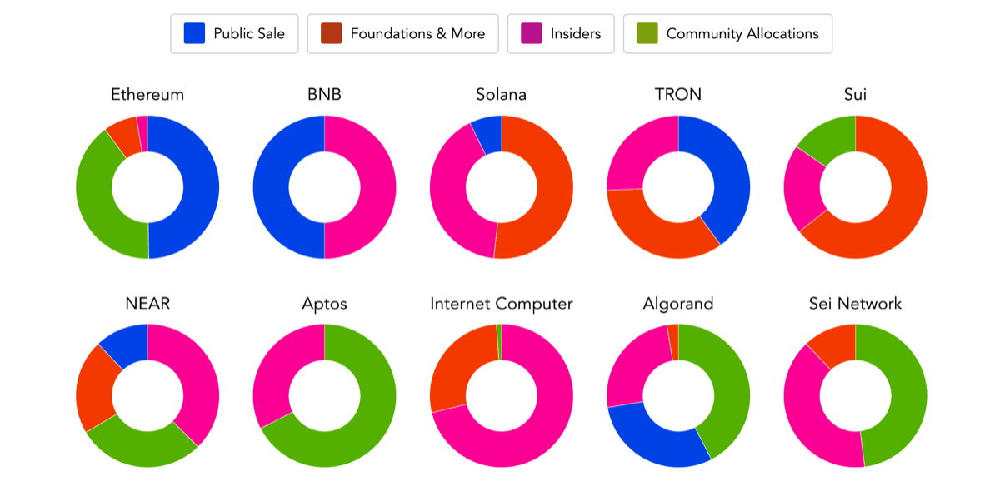

Tokenomics is easily one of the most debated topics in the crypto world. So what’s all the fuss about?

## The Economics of Tokens {#the-economics-of-tokens}

The term itself is a mashup of "token" and "economics," which hints at its core idea: [building an entire economy on top of tokens](https://www.quillaudits.com/blog/blockchain/what-is-tokenomics).

Think of tokens as the native currency of any given ecosystem. They are the assets people use to exchange value within that digital world. The entire lifecycle of these assets—how they're created, distributed, used to incentivize people, and eventually removed from circulation—forms a unique economic system.

Tokenomics is the art and science of designing that system. It’s what ensures an ecosystem can grow and sustain itself over the long run.

## A Quick Trip to the Traditional World {#a-quick-trip-to-the-traditional-world}

To understand what makes tokenomics so different, let’s first look at how value is shared in the world we already know. For a traditional company, the math is relatively simple.

A company generates value and distributes it to everyone who helped create it. Employees get salaries and bonuses. Suppliers get paid for materials. Banks get interest on loans, and the government gets its taxes. Whatever profit is left over is either reinvested back into the company or paid out to shareholders. The company share is the fundamental unit for distributing this profit.

You issue a set number of shares, and you divide them among the owners[^1]. The first owners are usually the founders and the early investors who backed them. The main drama here often revolves around negotiating the different rights assigned to various shareholder groups, especially in the early funding rounds.

In Web3, tokens take the place of stocks. But that’s where the similarities end.

Instead of a company, you have an ecosystem. This shift introduces a much wider array of stakeholders, all with a claim on the value the ecosystem creates. And how that value gets distributed is a completely different game. Let's dig in.

## Who Gets a Piece of the Pie? Token Distribution {#who-gets-a-piece-of-the-pie-token-distribution}

Distributing tokens is a far more intricate dance than issuing stock, because you're no longer just dealing with founders and their investors. You’re dealing with an entire ecosystem.

Beyond the core team and its financial backers, you have the miners or validators who secure the network. You have a community of external developers building on and battle-testing your software. And most importantly, you have the users themselves, the lifeblood of the system's growth.

This gets to the heart of Web3's promise: the value created by an ecosystem should be shared fairly among all who helped build it. When you design a token economy, you’re not just creating a currency; you’re designing a system to reward every single one of these participants for their contribution.

## The Blueprint for a Token Economy {#the-blueprint-for-a-token-economy}

Designing a token economy requires a blueprint. You need a plan that balances four critical elements: how tokens are created, how they are distributed, how they are used to keep everyone motivated, and finally, how they are removed from circulation.

But weaving through all of these is the crucial element of timing. Deciding who gets which tokens, and when, can make or break the entire system.

Before we dive into those four pillars, let's trace the journey of a project *before* a single token is even minted.

### The Pre-Token Era {#the-pre-token-era}

Every project starts with a small, dedicated team. They work relentlessly to build a product or service they believe in, publishing their progress and vision in the project's public documentation.

Soon, others join the mission. If the project's code is open-source on GitHub, volunteer developers might spot vulnerabilities or suggest improvements. Believers in the project's vision start contributing directly or building new tools that integrate with it.

Of course, passion doesn't pay the bills. The founding team and even the contributing developers eventually need funding to survive. In the early days of Web3, before 2020, projects often turned to the public to raise money.

This method was modeled after the traditional stock market's Initial Public Offering (IPO), but with a crypto twist: the Initial Coin Offering, or ICO. For a while, especially during the 2017-18 boom, it was the go-to fundraising strategy. Then, it all came crashing down.

Why? Two reasons.

First, the retail investors who bought into ICOs were impatient. They wanted quick returns. But these projects were often little more than a vision on paper, needing significant time and effort to come to life. This created a fundamental mismatch in expectations.

Second, drawing up a grand vision is easy. Executing it is hard. When people saw the fortunes being raised, thousands of projects flooded the market with big promises and hollow plans. The well was poisoned. ICOs dried up because trust evaporated.

Post‑2020, many projects adopted early token giveaways—airdrops—to reward contributors. Meanwhile, traditional crowd sales waned and projects increasingly relied on crypto‑focused venture capital—even as VC funding shifted toward later‑stage, utility‑driven ventures.

### Minting the Token {#minting-the-token}

A project minting its token is more than a milestone; it's the moment it sets sail for decentralization. I use the term "setting sail" intentionally. The journey to a truly decentralized future is treacherous, and many promising projects have sunk after their Token Generation Event (TGE) because they couldn't navigate the storms.

While every project has its own unique approach to this moment, a few common questions always surface.

### How Many Tokens Will Ever Exist? {#how-many-tokens-will-ever-exist}

Most Web3 projects commit to a fixed total supply of tokens. This is a radical departure from the stock market, where a company can simply convene a meeting and decide to double the number of shares, diluting every existing owner. A fixed supply is a powerful statement. It’s a promise of scarcity and a sign of a project’s long-term conviction.

Can that number ever change? Technically, yes. The token holders themselves—the ultimate decision-makers in a decentralized network—could vote to mint more. However, everyone understands this would likely harm the token's value, making it a rare and contentious event. It's worth noting that foundational infrastructure projects like Ethereum are an exception; they often launch without a predetermined cap on their total supply.

### How Are the Tokens Divided? {#how-are-the-tokens-divided}

Once the total supply is set, the critical work of allocation begins. Who gets what?

While there's no single formula, a common pattern has emerged, heavily influenced by community expectations. The founding team and advisors now typically receive around **15-20%** of the total supply. Investors who funded the early stages get a slice in the **15-25%** range.

Critically, the majority of the tokens—often **60% or more**—is reserved for the ecosystem itself. A large portion is set aside as a treasury, often controlled by a DAO or a foundation, to fund future development and award grants. Finally, a slice of the pie, typically ranging from **7% to 20%**, is allocated to early users and supporters through airdrops to bootstrap the network.

<figure><figcaption>Token Distribution of Layer 1 Networks The token allocations of Layer 1 networks can vary greatly from one another. (Source: <a href="https://messari.io/token-unlocks/allocation-analysis?utm_source=twitter&amp;utm_medium=organic_social&amp;utm_campaign=token_unlocks&amp;destination=token_unlocks">Messari</a>)</figcaption></figure>

The strategy behind airdrops has evolved significantly. Given how much interest this topic generates, it's worth a closer look.

## Everyone's Favorite Topic: Airdrops {#everyones-favorite-topic-airdrops}

The word "airdrop" sounds like magic—money appearing out of thin air. It’s a strategy that nearly every project now uses to capture the community's attention. But what started as a simple giveaway evolved into a complex and fascinating game, especially after the decentralized finance boom in 2020.

### The First Wave {#the-first-wave}

While projects had long used tokens to incentivize people, 2020 was the year airdrops became a phenomenon. The first [big splash](https://www.comp.xyz/t/should-compound-retroactively-airdrop-tokens-to-early-users/595) came from [Compound](https://compound.finance/), a lending platform that rewarded users with COMP tokens just for using the protocol.

Then came the drop that changed everything: Uniswap.

As the largest decentralized exchange, Uniswap was facing a serious threat from a rival, Sushiswap, which was luring away its liquidity with generous token rewards. To counter, Uniswap launched its own token, but with a revolutionary twist. It didn't just reward current users; it retroactively [airdropped](https://gov.uniswap.org/t/learn-requirements-how-to-claim-your-400-uni/1025) 400 UNI tokens to *every single wallet* that had ever made a trade on the platform.

This represented ~$1,200–$1,600 at launch, but those holding UNI saw values reach up to ~$16,000 within six months.

The community was stunned. The move did more than just reward Uniswap's loyalists; it ignited a gold rush. Users began flocking to promising new applications that hadn't yet launched a token, hoping to qualify for the next big retroactive airdrop. A new behavior was born: "airdrop farming."

### The Game Evolves {#the-game-evolves}

After Uniswap, a flood of projects followed suit with their own airdrops. But soon, the system began to creak under its own weight. Since creating a new wallet is trivial, a single person could create hundreds of accounts, perform one transaction with each, and wait for the reward. The game was becoming too easy to beat.

In response, projects got smarter.

The Arbitrum airdrop marked a major turning point. Instead of just rewarding a single action, the Arbitrum team [designed a sophisticated system](https://docs.arbitrum.foundation/airdrop-eligibility-distribution) to identify and reward genuine, active users. They looked at several key behaviors:

- **Early Adopters:** Were you there from the beginning?
- **Sustained Activity:** Did you use the platform across different months?
- **Deep Engagement:** Did you interact with multiple smart contracts?
- **Significant Volume:** Did you transact a meaningful amount of value?
- **Commitment:** Did you bridge significant assets over from Ethereum?

By rewarding users across these different metrics, Arbitrum created a [blueprint](https://www.cenit.finance/blog/the-arbitrum-airdrop-lessons-in-user-acquisition-and-retention) for how to distinguish real community members from opportunistic farmers. It was no longer about just showing up; it was about contributing real, sustained value.

### What Purpose Do Airdrops Serve? {#what-purpose-do-airdrops-serve}

On the surface, airdrops are a tool for rewarding early and active users, which is fantastic for building a positive community image. But their utility runs much [deeper](https://trakx.io/resources/insights/what-are-crypto-airdrops-guide/).

For projects, especially those based in the US, airdrops have become a clever shield against the SEC’s argument that "your token is a security." How? It’s all about how value is established. When a founding team takes money from venture capitalists, they promise to deliver tokens in the future. At the moment of the TGE, investors know *how many* tokens they'll get, but not what they're worth. Unlike a traditional IPO where shares are sold at a set price, a token's value is unknown until it hits the open market on exchanges like Uniswap.

Because investors’ tokens are locked up for a period, they can't influence that initial price. By airdropping a portion of the supply to the public for free, projects can argue that there was no initial "investment of money" from the community with an expectation of profit—a key prong of the SEC's test for what constitutes a security. They aren't selling anything; they're giving it away to build a network. This makes the regulatory argument far more nuanced.

### The Rise of the Airdrop Farmer {#the-rise-of-the-airdrop-farmer}

As we've seen, this beautiful idea of rewarding the community had an unintended consequence. Once people realized the potential windfall, a new class of user emerged: the airdrop farmer.

This wasn't just a few people; it was an organized effort. Farmers would create thousands of wallets and use bots to perform basic interactions across dozens of new projects, hoping to catch the next big airdrop. This swamped projects with fake users and meaningless transaction volume, making it difficult to see if they were achieving real product-market fit. It created a shadow economy where the goal wasn't to use a product, but to extract value from its token launch. This is precisely why sophisticated scoring systems, like the one pioneered by Arbitrum, became not just a good idea, but a necessity for survival.

### Why Projects Adopt Scoring Systems {#why-projects-adopt-scoring-systems}

You would think projects would fight the wave of airdrop farmers and their fake transaction volumes. Instead, many leaned into it. They not only embraced the inflated metrics but began actively encouraging them with a new weapon: the point system.

Suddenly, users were rewarded with "points" for every conceivable action: making a trade, holding funds in the app, or even just mentioning the project on social media.

This "points game" is, by its nature, an opaque—and often exploitative—system. A user might rack up thousands of points and feel like they're earning a significant stake, only to be crushed when they discover the project has issued billions of points in total. Your slice of the pie is meaningless if you have no idea how big the pie is. For the project, it makes no difference if they give you ten points or ten thousand; the number of tokens in the final reward pool is already fixed.

So why do it? Why create this elaborate illusion?

First, even fake usage generates real commission fees. But the real reasons are deeper.

In the high-stakes world of venture capital, teams need to show investors that their metrics are going "up and to the right." Surging user activity, even if juiced by point-seekers, helps a team hit its targets and strengthens its hand when asking for more funding before the token launches.

This inflated sense of scale also becomes leverage. When a protocol with high "active user" counts wants to partner with another project, it can negotiate a much better deal. It's a show of strength.

Most importantly, the points system gives projects ultimate flexibility. Unlike a hard promise of tokens, points are an IOU with no fixed value. The project can change the rules, tweak the incentives, and control the timeline however it sees fit, all while keeping the community engaged and churning transactions. It’s the art of the non-committal commitment.

### The Hamster Wheel of Seasons {#the-hamster-wheel-of-seasons}

As the points game dragged on, user fatigue inevitably set in. To keep the machine running, projects introduced a new tactic: "seasons."

They would close one chapter and launch "Season Two," often with bigger point multipliers to attract a fresh wave of users. This created a strange tension. The earliest, most loyal supporters saw their initial efforts dwarfed by the inflated rewards offered to newcomers. Yet, they couldn't afford to leave, trapped by the hope that their history would eventually pay off. They were stuck on the hamster wheel, forced to keep running just to protect their spot.

The final allocation also became a major point of contention. A project can do everything right and then fumble the ball at the one-yard line. If the final airdrop is too small, it insults the community's effort. If the allocation seems unfair, it can break trust instantly.

This is exactly what happened to [Starknet](https://www.starknet.io/). Widely considered one of the most brilliant Layer 2 solutions on Ethereum, its reputation was shattered by its airdrop. The community perceived the distribution as heavily favoring developers and insiders, leaving genuine users with scraps. The backlash was swift and brutal. Users who felt cheated dumped their tokens and abandoned the platform in a mass exodus. In the months immediately following the airdrop, projects building on Starknet struggled to attract anyone, a stark reminder that community goodwill is priceless.

### Value Outlasts Hype {#value-outlasts-hype}

Ultimately, this entire cycle of airdrops, points, and seasons reveals a simple truth: you can’t trick people into long-term loyalty. The users you attract with these schemes are mercenaries, not community members. They will leave the moment a better offer appears.

A project’s real challenge has nothing to do with token incentives. It’s about creating lasting value. When deciding whether to engage with a project, the question to ask is the same one investors have asked for a century:

"What real-world problem is this actually solving?"

## Token Unlocks: When Owners Can Sell? {#token-unlocks-when-owners-can-sell}

A crucial piece of any token's design is the schedule that dictates who can sell their tokens and when. This single element can create enormous tension in the market.

As a rule, tokens distributed to the community via airdrop are liquid immediately. You can sell them the moment they hit your wallet. For insiders—the founding team and early investors—it's a different story. Their tokens are almost always locked for a significant period.

Over the years, these lock-up periods have gotten longer and longer. The market learned the hard way that projects with short lock-ups often suffered from intense selling pressure. An upcoming unlock for insiders hangs over a project like the Sword of Damocles, often suppressing the token's price as traders anticipate a flood of new supply.

The timing of these unlocks is just as critical as their existence. Sudden, massive unlocks, often called "cliff unlocks," can have a brutal impact on price. Arbitrum, despite its many successes, provides a stark example. After its initial airdrop of 1.1 billion tokens, it scheduled another unlock of a similar size for its team and investors in March 2024.

The result? Even though Arbitrum is one of the most used and asset-rich projects on Ethereum, its token, $ARB, struggled. In the months before and after this massive unlock, its performance lagged significantly behind comparable projects like Optimism. The market's fear of the impending supply dump became a self-fulfilling prophecy.

## The Regulatory Maze {#the-regulatory-maze}

So, what are these tokens in the eyes of the law?

This is one of the most complex and unsettled questions in Web3. The legal status of a token shifts dramatically from one country to another, creating a confusing maze for projects and users alike.

Amid this uncertainty, Switzerland became an early pioneer, offering one of the first and most influential [frameworks](https://brill.com/edcollchap-oa/book/9789004514850/BP000031.xml?language=en) for classifying tokens. The Swiss approach is [elegantly simple](https://www.lexr.com/en-ch/blog/crypto-token-types-switzerland/): ignore the marketing hype and focus on the token's economic purpose. It sorts tokens into [three main categories](https://www.lexr.com/en-ch/blog/crypto-token-types-switzerland/).

**1. Payment Tokens** Think of these as digital cash. Their primary use is to buy goods and services or to transfer value. Familiar cryptocurrencies like Bitcoin (BTC) fit this description. The defining feature is that the issuer isn't promising you a return on an investment; they are providing a tool for commerce.

**2. Utility Tokens** These tokens act as a digital key or a pass, granting you [access to a specific application or service](https://www.moonpay.com/learn/cryptocurrency/what-are-utility-tokens). In a way, many payment tokens also have a utility function. For example, you need ETH ([the utility token](https://www.cmegroup.com/education/courses/introduction-to-ether/defining-ether-and-ethereum.html)) to pay for transactions and interact with applications on the Ethereum blockchain. It's the native currency required to make the network function.

**3. Asset Tokens** This is the most straightforward category. Asset tokens are [digital wrappers](https://www.mckinsey.com/featured-insights/mckinsey-explainers/what-is-tokenization) for real-world assets. They are direct representations of ownership, whether that's a share in a company, a bond, or even a piece of physical property. When you hear about bringing traditional financial products onto the blockchain, people are talking about [asset tokens](https://www.chainalysis.com/blog/asset-tokenization-explained/).

## The Battleground: America {#the-battleground-america}

While Switzerland offered a blueprint for sensible regulation, America is where the real fight is—a chaotic, high-stakes battle for the internet’s future. To understand the landscape today, you have to understand how we got here.

When Bitcoin first appeared in 2009, Washington D.C. barely noticed. It’s easy to see why. For a global superpower, a tiny, speculative digital token was hardly a blip on the radar.

By the 2020s, that had changed. A consensus was forming in D.C.: crypto was here to stay, and it needed rules. But just as that conversation began, the industry was shattered by the collapse of FTX. Its founder, Sam Bankman-Fried, had been a prolific political donor, [pouring over $40 million into campaigns](https://en.wikipedia.org/wiki/Sam_Bankman-Fried), including President Biden’s.

When FTX [imploded](https://law.rutgers.edu/news/significance-and-consequences-ftx-crypto-collapse) in November 2022, revealing a multi-billion dollar fraud, the political climate turned toxic overnight. The scandal empowered the hardliners, especially SEC Chairman Gary Gensler. He relentlessly pushed a new narrative: crypto doesn’t need new laws, it just needs to submit to the old ones.

Gensler’s position is that nearly every crypto asset—with a lone, begrudging exception for Bitcoin—is a security. He has famously evaded questions on Ethereum's status, while telling every other project to "[come in and register](https://www.sec.gov/newsroom/speeches-statements/gensler-sec-speaks-090822)." This wasn't an invitation to collaborate; it was a demand to bend the knee.

But the political pendulum, as it always does, swung back. The election of a new Trump administration signaled a dramatic reversal. After campaigning on a promise to foster a friendly environment for crypto, the new president began a systematic overhaul.

The administration’s appointments sent a clear message. David Sacks was named the new ‘[czar of AI and crypto](https://www.politico.com/live-updates/2024/12/05/congress/a-crypto-czar-00192955).’ The cabinet was stacked with crypto advocates, like Treasury Secretary Scott Bessent and [Commerce Secretary Howard Lutnick](https://thecensusproject.org/2025/02/19/new-commerce-secretary-lutnick-confirmed-by-u-s-senate/#:~:text=New%2520Commerce%2520Secretary%2520Lutnick%2520Confirmed%2520by%2520U.S.%2520Senate%2520). Soon after, key regulatory posts were filled by industry allies, including [Paul Atkins at the SEC](https://www.whitecase.com/insight-alert/sec-enforcement-20-chairman-atkins-has-arrived#:~:text=Atkins%2520Has%2520Arrived) and Brian Quintenz at the CFTC[^2]. The message from the White House was unmistakable: America is open for business.

Congress followed suit, with crypto supporters taking the chairmanships of key committees in both the House and Senate.

The impact was immediate. The SEC reversed course, dropping its high-profile lawsuits against Coinbase and Ripple. The legislative logjam finally broke. In July 2025, President Trump [signed](https://www.whitehouse.gov/fact-sheets/2025/07/fact-sheet-president-donald-j-trump-signs-genius-act-into-law/#:~:text=Act%2520into%2520Law-,The%2520White%2520House,%253A%2520Today%252C%2520President%2520Donald%2520J.) the [GENIUS Act](https://www.congress.gov/bill/119th-congress/senate-bill/1582) into law, bringing much-needed clarity to stablecoins. A broader bill to regulate crypto markets passed the House and moved on to the Senate.

In the space of a year, the American regulatory climate transformed from crypto's greatest headwind into a powerful tailwind.

## Europe Takes the Lead {#europe-takes-the-lead}

In a surprising turn of events, "Old World" Europe—often seen as a laggard in tech—has pulled ahead of the US on crypto regulation. While America is stuck debating 80-year-old legal tests, the EU [passed](https://micapapers.com/guide/timeline/) a comprehensive framework in 2023 called MiCA, the Markets in Crypto-Assets Regulation.

MiCA’s goal is to create a single, clear set of rules for the entire EU, designed to protect investors and ensure market stability. The [regulation](https://www.esma.europa.eu/esmas-activities/digital-finance-and-innovation/markets-crypto-assets-regulation-mica) establishes a unified licensing regime for crypto service providers and imposes rules to prevent market manipulation, with a particular focus on bringing stability to the world of stablecoins.

What makes MiCA particularly interesting is what it chooses *not* to cover. In a pragmatic move, the framework explicitly excludes protocols that are "fully decentralized[^3]." Regulators acknowledged the obvious: you can't force a leaderless, global software protocol to register with a national authority. This carves out a space for decentralized finance (DeFi) to innovate.

NFTs also get a special mention and are exempt on a case-by-case basis, hinging on the concept of "singularity." A unique digital artwork, for example, falls outside MiCA's scope. However, if you were to fractionalize that artwork into a thousand interchangeable pieces, those fractions would be treated as financial instruments and fall under the regulation.

MiCA provides a general framework that will apply across all EU member states, creating a unified market. A [transition period](https://technologyquotient.freshfields.com/post/102jake/grandfathering-under-mica-how-member-states-approach-the-transitional-regime) is in place to allow existing companies to adapt, but the deadline is not uniform. While a 'grandfathering' clause extends to July 1, 2026, individual EU member states can set an earlier deadline, and many are expected to do so.

[^1]: Later, you can increase the total number of shares through a capital raise if needed.

[^2]: At the time of writing Senate still yet to [approve](https://cointelegraph.com/news/brian-quintenz-donald-trump-cftc-pick-market-structure) Brian Quintenz as CFTC chair.

[^3]: The precise definition of this term remains a subject of ongoing discussion and clarification by regulators
