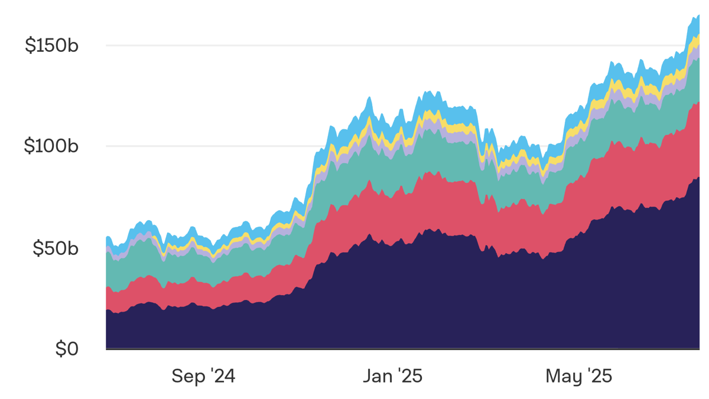

The crypto world’s relationship with Wall Street is entering its final act. It brings to mind the old quote, often attributed to Gandhi: ‘First they ignore you, then they laugh at you, then they fight you, then you win’[^1].

Nothing captures this arc better than BlackRock—the world's largest asset manager—placing a $100 million tokenized fund on the Ethereum network in March 2024. To understand why this is a landmark event, we have to look at how BlackRock’s perspective on crypto completely transformed.

## A Titan’s Change of Heart {#a-titans-change-of-heart}

BlackRock is not just another firm; it's a [$12.5 trillion behemoth](https://s24.q4cdn.com/856567660/files/doc_financials/2025/Q2/BLK-2Q25-Earnings-Release.pdf). In the world of finance, it's often said, "There is BlackRock, and then there is everyone else."

Like the rest of Wall Street, BlackRock kept its distance from crypto for years. In a 2017 interview, its legendary CEO, [Larry Fink](https://trustwallet.com/blog/cryptocurrency/who-is-larry-fink-black-rock), [dismissed](https://www.cnbc.com/2017/10/13/blackrock-ceo-larry-fink-calls-bitcoin-an-index-of-money-laundering.html) Bitcoin as an "index of money laundering." But the ground began to shift. As institutional interest grew, especially during the 2020 pandemic, BlackRock’s stance softened. In August 2022, the fund [announced](https://www.coindesk.com/business/2022/08/04/blackrock-to-offer-crypto-for-institutional-investors-through-coinbase-prime/) a partnership with Coinbase to give its clients a gateway to crypto.

The real bombshell [dropped](https://www.investopedia.com/blackrock-files-for-a-spot-bitcoin-etf-7547609) in June 2023: BlackRock had filed for a spot Bitcoin ETF. An ETF is essentially a stock that tracks the price of an asset like gold or oil, allowing people to invest without holding the asset itself. A Bitcoin ETF was the holy grail for two reasons: it would cement Bitcoin as a legitimate investment vehicle and open the floodgates for mainstream capital.

This was the moment the tide turned. For a decade, the SEC had rejected every Bitcoin ETF application that crossed its desk. But Larry Fink is a man who can get the SEC Chairman on the phone, and BlackRock has a near-perfect 99.8% approval rate on its ETF applications. The filing wasn’t just a request; it was a signal. Wall Street had finally arrived[^2].

Fink’s pivot didn't stop there. In October 2023, he [called](https://www.coindesk.com/business/2023/10/17/blackrock-ceo-larry-fink-seeing-client-demand-for-crypto-around-the-world/) the rising price of Bitcoin a "flight to quality." A few months later, he [described](https://www.nasdaq.com/articles/blackrock-ceo-larry-fink-says-bitcoin-is-an-asset-class-that-protects-you) Bitcoin “as an ‘international instrument’ capable of mitigating localized economic fears”.

When the [Bitcoin ETFs were approved](https://401kspecialistmag.com/sec-approves-11-spot-bitcoin-etfs-opening-floodgates/) in January 2024, BlackRock’s market sense was proven right. Their fund exploded out of the gate, amassing over $85 billion in assets and [rocketing to first place among all Bitcoin ETF issuers.](https://blockworks.co/bitcoin-etf)

<figure><figcaption>Bitcoin ETF Asset Inflows Cumulative inflows into US-based spot Bitcoin ETFs (USD billion). (Source: <a href="https://www.theblock.co/data/crypto-markets/bitcoin-etf">TheBlock</a>)</figcaption></figure>

## Understanding BlackRock’s Tokenized Fund {#understanding-blackrocks-tokenized-fund}

BlackRock's latest move was to create a $100 million money market fund built on a simple, powerful idea: [bring safe, yield-bearing US Treasury assets onto the blockchain](https://securitize.io/learn/press/blackrock-launches-first-tokenized-fund-buidl-on-the-ethereum-network). Shares in the fund are represented by a dollar-pegged token, and in a clever nod to the crypto ethos, BlackRock named it BUIDL[^3].

Here’s how it works: [the fund invests in low-risk assets](https://zerocap.com/insights/snippets/what-is-buidl-blackrock/) like cash and T-bills. Each month, the income earned is paid out directly to investors' wallets in the form of new tokens[^4].

So, why does this matter? Large crypto institutions and companies often hold millions in digital cash, sitting idle in stablecoins like USDC and earning zero return. To earn a yield, they had to move that capital back into the traditional financial system—a slow, cumbersome process.

BUIDL changes the game. It allows institutions to keep their capital on-chain, earning a yield, and ready to be transferred to other qualified clients 24/7. This makes their assets vastly more efficient. It’s a liquid, on-chain savings account that also happens to be a building block for a new financial system. In the future, these BUIDL tokens could become collateral for loans or the foundation for new derivative products.

Of course, BlackRock didn't do it alone. It assembled a dream team of crypto-native and traditional finance players. While BlackRock manages the investments, the Bank of New York Mellon holds the real-world assets. Securitize[^5] handles the tokenization and client management, while a roster of crypto custody specialists—[Anchorage](https://www.anchorage.com/), [BitGo](https://www.bitgo.com/), and [Coinbase](https://www.coinbase.com/prime/custody)—secure client funds. [Fireblocks](https://www.fireblocks.com/) protects the fund's own on-chain assets.

The demand was immediate. Launched at $100 million, the fund [swelled](https://etherscan.io/token/0x7712c34205737192402172409a8f7ccef8aa2aec) to $521 million in just the first six months, proving that Wall Street's biggest player had built something the on-chain world desperately wanted.

## How Does BUIDL Differ from ETFs? {#how-does-buidl-differ-from-etfs}

At first glance, the BUIDL fund might look like another version of the Bitcoin ETF. Both bridge the worlds of crypto and traditional finance, but they travel in opposite directions.

### The ETF Pulls Crypto into the Old World {#the-etf-pulls-crypto-into-the-old-world}

A Bitcoin ETF is a tool for traditional investors. It pulls a crypto asset *into* the legacy financial system. Someone can buy exposure to Bitcoin through their existing brokerage account, just like a stock, without ever needing a crypto wallet or an exchange account. It brings the asset to them, on their terms.

### BUIDL Pushes the Old World On-Chain {#buidl-pushes-the-old-world-on-chain}

The BUIDL fund does the exact opposite: it pushes a traditional asset *onto* the blockchain. It's a tool built for crypto-native institutions, allowing them to use a yield-bearing, real-world asset directly within the crypto ecosystem.

This addresses a common critique of Bitcoin ETFs—that they "tame" crypto, forcing the unruly child to play by the old system's rules. BUIDL, in contrast, is a structure built *on* the blockchain, designed to pull more capital and activity into the new world.

### BlackRock’s Real Strategy: Tokenizing Everything {#the-real-strategy-tokenizing-everything}

This isn't just BlackRock chasing a trend. BUIDL is the first move in a much larger, long-term strategy. In nearly every interview, Larry Fink emphasizes the massive potential of tokenizing real-world assets. While we might think of tokenizing houses or art, the lowest-hanging fruit is classic financial funds, which are already digital.

With BUIDL, BlackRock is stepping through that door. And the room on the other side is vast. The consulting firm BCG [predicts the market for tokenized assets will reach $16 trillion by 2030](https://www.ledgerinsights.com/bcg-addx-estimate-asset-tokenization-to-reach-16-trillion-by-2030/).

### Why an Open Blockchain Matters {#why-an-open-blockchain-matters}

Crucially, BlackRock built this fund on Ethereum, a public blockchain. This is a deliberate and meaningful choice, breaking from the "private blockchain" experiments favored by other Wall Street giants.

Carlos Domingo, the founder of BlackRock's partner Securitize, puts it best. He argues that private blockchains—like those used by JPMorgan—are limited by closed ecosystems, whereas public networks allow broader innovation and open access. A private blockchain is a sandbox where only a few privileged institutions get to play. If you issue a token representing a dollar, the only way for the broader world of innovators and startups to build new products with it is if that token lives on a public chain.

According to Domingo, BlackRock was visionary. They understood that the future of tokenized assets is on open networks, and they didn't need convincing. Ethereum was the natural choice as the largest and most battle-tested smart contract platform. Still, Domingo suggests the future will likely involve multiple interoperable public chains.

## Conclusion {#conclusion}

If the Bitcoin ETF was Wall Street dipping its toes in the water, the BUIDL fund is the dive in. This isn't one of JPMorgan's sterile initiatives on a private, permissioned chain—a project that only *pretends* to embrace the new paradigm. This is a real, yield-bearing financial asset from the world's largest manager, set loose in the wild of an open blockchain. The game has changed.

[^1]: Kit Miller, director of the Gandhi Institute, confirms the well-known English phrase "First they ignore you, then they laugh at you, then they fight you, then you win," is not actually Gandhi’s. The original quote was made in 1918 by Nicholas Klein, a US union leader, during a demonstration: "[First they ignore you](https://apnews.com/article/archive-fact-checking-2315880316), Then they ridicule you. And then they attack you and want to burn you. And then they build monuments to you

[^2]: The company also [announced](https://www.coindesk.com/policy/2023/11/16/blackrock-files-application-for-spot-ether-etf/) its Ethereum ETF application on November 16, 2023. Indeed, BlackRock's iShares [Ethereum ETF](https://www.blackrock.com/us/individual/products/337614/ishares-ethereum-trust-etf) was among the first Ethereum ETFs [to start trading](https://www.theglobaltreasurer.com/2024/07/23/ethereum-etfs-get-the-green-light-a-new-era-for-crypto-investment/) on July 23, 2024.

[^3]: A quick story from crypto history about "BUIDL": During Bitcoin's volatile early days in 2013, its price surged from $15 to $1,000 and then collapsed from $716 to $38 overnight. At that chaotic time, a (probably not sober) Bitcoin Forum member famously posted, "I AM HODLING." It was a typo for "holding," meaning "I'm holding my Bitcoin no matter what." Initially mocked, the phrase quickly became a beloved motto among long-term investors. Similarly, "BUIDL" is a playful misspelling of "build," meaning "building something lasting."

[^4]: You can view the blockchain record of this initial USD 100 million transaction after the fund's inception, as well as its current size of USD 408 million.

[^5]: Wanting to minimize crypto risks, BlackRock invested in Securitize, became a strategic partner, and appointed one of its executives to the company's board of directors.
