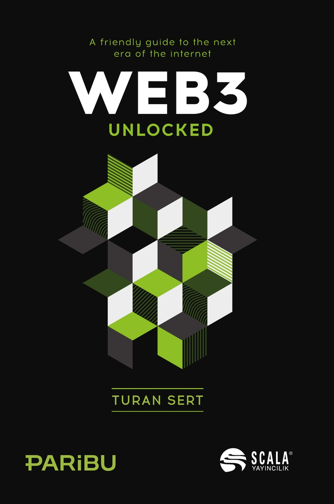
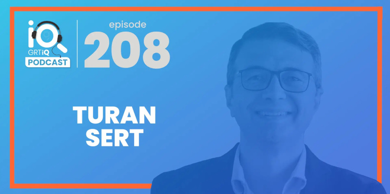

I'm Turan Sert, an author and researcher on frontier technologies – blockchain, decentralized finance (DeFi), Web3 and artificial intelligence – and how they are reshaping finance and the internet. Since 2017 my main focus has been the blockchain-based decentralized technologies now called Web3, and increasingly where they meet AI.

I have written four books in a question-and-answer format: *Sorularla Blockchain* (2019), *Sorularla DeFi – Merkeziyetsiz Finans* (2022), *Sorularla Web3* (2025) and *[Web3 Unlocked](/Web3_Unlocked/)* (2026), the English translation of *Sorularla Web3*. All four can be read free on this site; see [the books page](/Kitaplar/).

I started my career in finance and technology with audit at Arthur Andersen and investment banking at Garanti Bank, then spent three years in management consulting at Booz Allen's New York office before returning to Türkiye in 2005. I have held executive and board roles at several FİBA Group companies and served as Chief Business Officer of Özyeğin University (2014–2016). In the Web3 space, I previously served on Paribu's advisory board and wrote for CoinDesk Türkiye and CoinDesk. I also taught the Decentralized Finance course in Bahçeşehir University's Financial Technologies master's programme. Today I sit on the advisory board of BlockchainIST Center and hold advisory and board roles at other organisations. I studied Business Administration at Boğaziçi University (BA, 1995) and earned my MBA at Harvard Business School (2001).

Explore a comprehensive collection of my articles and talks across various platforms, all available in one place. The majority of my writings are in Turkish, primarily due to the limited availability of comprehensive resources in this language.

Feel free to connect with me on [LinkedIn](https://www.linkedin.com/in/turansert/) or follow me on [Twitter](https://twitter.com/turansert) to stay updated on my work.

My fourth book, *[Web3 Unlocked](/Web3_Unlocked/)*, is the English translation of *Sorularla Web3*. It offers a friendly guide to the next era of the internet, making the world of Web3 accessible to English-speaking readers. You can read the whole book online, free, [here](/Web3_Unlocked/read/).

If you are curious about my story, here is the GRTIQ podcast episode about me and *Sorularla Web3* (recorded in February 2025)👇

  

<iframe title="Listen to Turan Sert on Spotify" style="border-radius:12px" src="https://open.spotify.com/embed/episode/5QbmflKjKmrIKIIgpwPLdF?utm_source=generator" width="100%" height="352" frameBorder="0" allowfullscreen="" allow="autoplay; clipboard-write; encrypted-media; fullscreen; picture-in-picture" loading="lazy"></iframe>
    
Spotify

  

  

<iframe loading="lazy" title="Listen to Turan Sert on Apple Podcasts" allow="autoplay *; encrypted-media *; fullscreen *; clipboard-write" frameborder="0" height="175" style="width:100%;max-width:660px;overflow:hidden;border-radius:10px;" sandbox="allow-forms allow-popups allow-same-origin allow-scripts allow-storage-access-by-user-activation allow-top-navigation-by-user-activation" src="https://embed.podcasts.apple.com/us/podcast/turan-sert/id1559587482?i=1000692350521"></iframe>
    
Apple Podcast

  

&nbsp;

---

&nbsp;

Seasoned Business Leader  |  Finance, Technology & Education  |  Blockchain Enthusiast

With over two decades of board-level experience across the US and Europe, I specialize in:
- Driving business growth and shareholder value
- Implementing effective strategies and building sustainable teams
- Delivering stellar sales, service, and operational results
- Fostering innovative organizational cultures

Key strengths:
- Performance optimization
- Data-driven decision making
- Operational excellence
- Profitability enhancement

Passionate about emerging technologies, particularly blockchain and its transformative business potential.
Areas of expertise:
- Digital Transformation
- Business Development
- Strategic Planning
- Organizational Design
- Governance
- Culture & Change Management
- Operational Efficiency
- Blockchain-Based Systems
