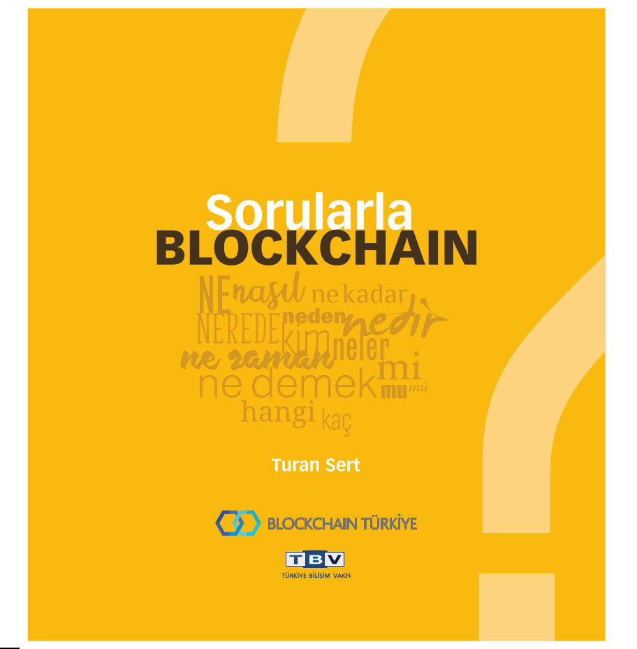
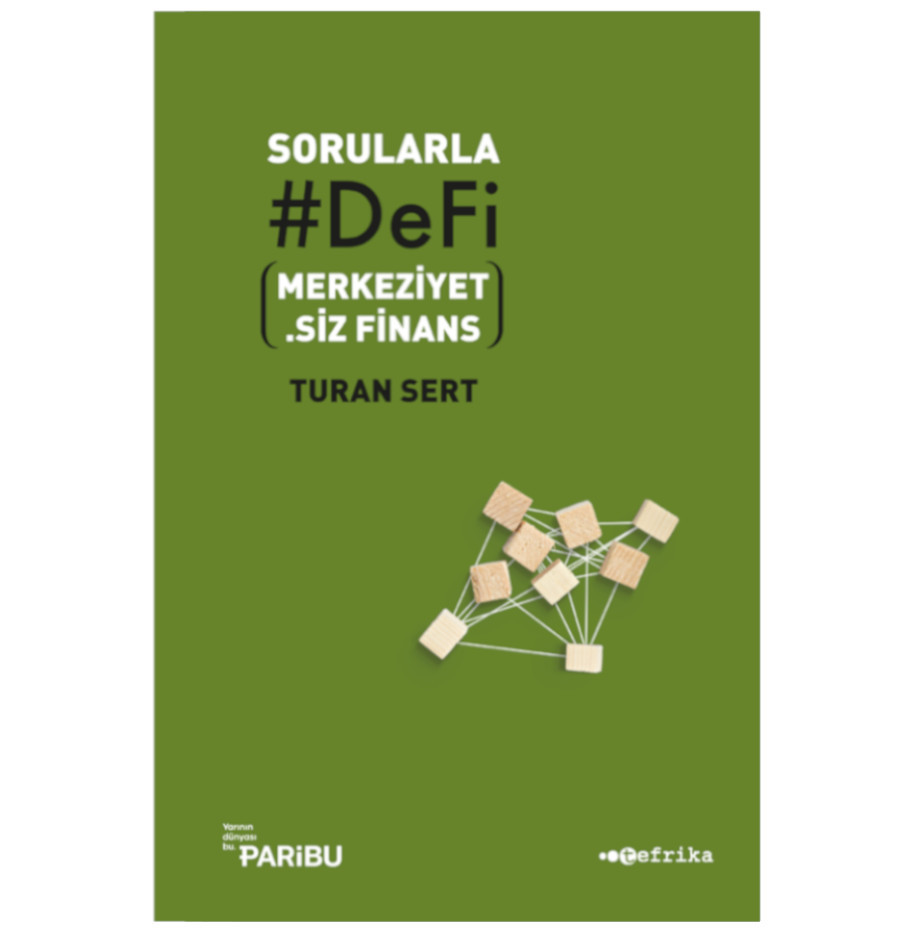
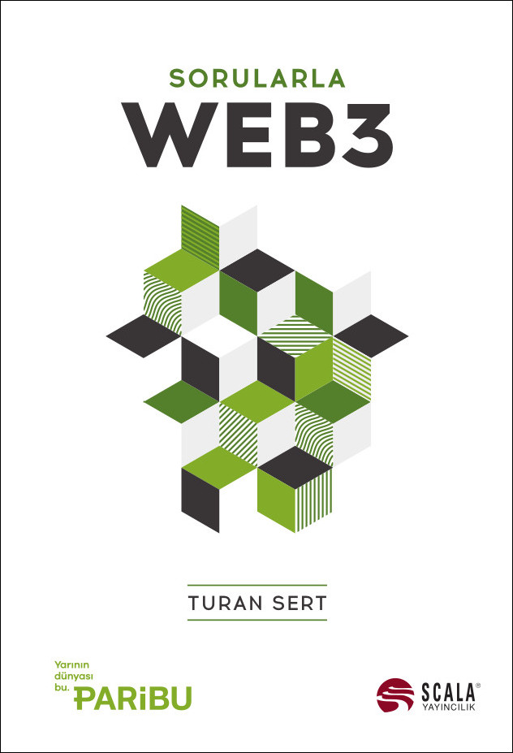
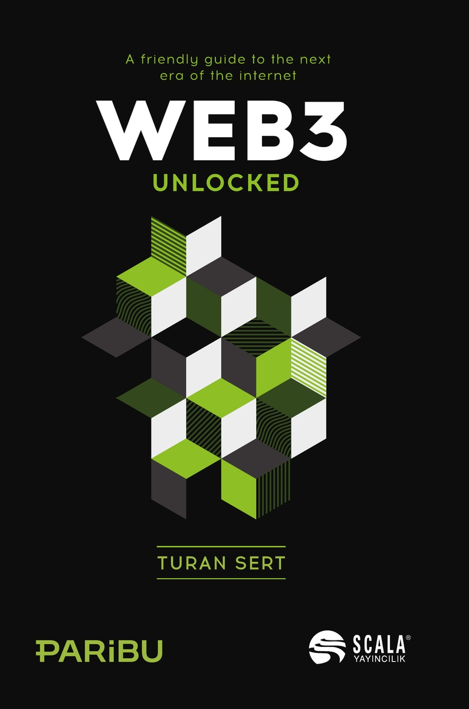

**In English:** *Web3 Unlocked* is the English edition of *Sorularla Web3* — a friendly guide to the next era of the internet. [Read it free online, chapter by chapter](/Web3_Unlocked/), or [download the PDF](/assets/books/Web3_Unlocked.pdf).
{: lang="en" .en-note}

Ekosisteme katkı sağlamak amacıyla yayınlanan, biri İngilizce çeviri olmak üzere dört kitabım bulunmakta. 

Bunlardan ilki Blockchain Türkiye aracılığıyla 2019 yılında yayınlanan "[Sorularla Blockchain](/Sorularla_Blockchain/)". Kitabın tamamını [bölüm bölüm çevrimiçi ve ücretsiz okuyabilirsiniz](/Sorularla_Blockchain/); PDF sürümü [burada](/Sorularla_Blockchain/oku/).  

İkinci kitap ise 2022 yılının başında yayınlanan "[Sorularla DeFi - Merkeziyetsiz Finans](/Sorularla_DeFi/)". Kitabın tamamını [bölüm bölüm çevrimiçi ve ücretsiz okuyabilirsiniz](/Sorularla_DeFi/); PDF sürümü [burada](/Sorularla_DeFi/oku/). 

Üçüncü kitap ise 2025 Şubat ayında yayınlanan "[Sorularla Web3](https://www.scalakitapci.com/sorularla-web3)". Kitap [Scala Yayıncılık websitesinde](https://www.scalakitapci.com/sorularla-web3) sizlerle buluşuyor. Kitabın tamamını [bölüm bölüm çevrimiçi ve ücretsiz okuyabilirsiniz](/Sorularla_Web3/); PDF sürümü [burada](/Sorularla_Web3/oku/). 

Dördüncü kitabım "[Web3 Unlocked](/Web3_Unlocked/)" (2026), üçüncü kitabım "Sorularla Web3"ün İngilizce çevirisi. Web3 dünyasını İngilizce okumak isteyenler için hazırlanan kitabı [bölüm bölüm çevrimiçi ve ücretsiz okuyabilirsiniz](/Web3_Unlocked/); PDF sürümü [burada](/Web3_Unlocked/read/).

&nbsp;

<table>
<tr>
<td style="width:25%">

</td>
<td style="width:25%">
</td>
<td style="width:25%">
</td>
<td style="width:25%">
</td>
</tr>
<tr>
<td style="width:25%; vertical-align:top">

Sorularla Blockchain (2019)  <a href="/Sorularla_Blockchain/">Çevrimiçi okuyun</a> (<a href="/Sorularla_Blockchain/oku/">PDF</a>).
 
</td>
<td style="width:25%; vertical-align:top">

Sorularla DeFi - Merkeziyetsiz Finans (2022) <a href="/Sorularla_DeFi/">Çevrimiçi okuyun</a> (<a href="/Sorularla_DeFi/oku/">PDF</a>).

</td>
<td style="width:25%; vertical-align:top">

Sorularla Web3 (2025)  <a href="https://www.scalakitapci.com/sorularla-web3">Buradan sipariş verebilirsiniz</a>
 
Ya da <a href="/Sorularla_Web3/">çevrimiçi okuyun</a> (<a href="/Sorularla_Web3/oku/">PDF</a>).

</td>
<td style="width:25%; vertical-align:top">

Web3 Unlocked (2026)

Sorularla Web3’ün İngilizce çevirisi.

<a href="/Web3_Unlocked/">Çevrimiçi okuyun</a> (<a href="/Web3_Unlocked/read/">PDF</a>).

</td>
</tr> 
  
</table>

---

&nbsp;
